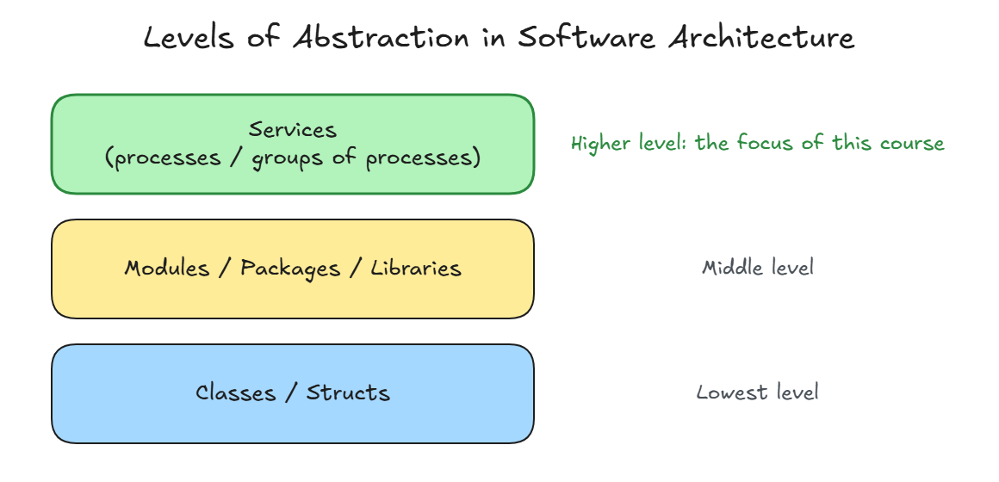
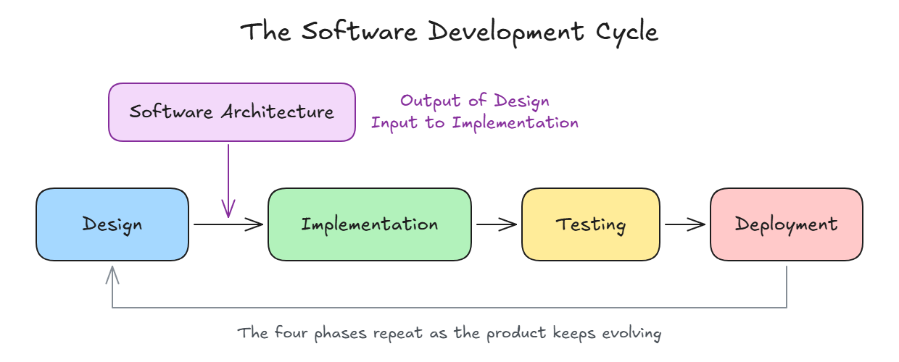

# Introduction

## Introduction to Software Architecture

**In this lecture:**

1. Why software architecture is important (the motivation)
2. The definition of software architecture used in this course
3. An explanation of that definition, piece by piece
4. Where software architecture fits in the software development cycle

---

### Why Software Architecture Matters

To build a good understanding, the lecture starts with examples from outside the software world.

**Everything we build has a structure.** This is true whether we know about the structure or not, and whether we planned it ahead of time or it simply formed as we went along.

**The more we invest in building a product, the harder it becomes to change its structure later.**

**The structure of a system describes two things:**

1. The intent of the product (what it is meant to do)
2. The qualities of the product (how well it does it)

| Building | What it is good for | What it is bad for |
| ---------------- | ------------------------------ | --------------------------------------------------------------------------------------------- |
| Theater | Shows and performances | Living or working. People would be very uncomfortable and would have a terrible experience. |
| Residential home | People living there | Hosting big shows or performances. This would not work very well. |

Each building's structure makes it perfect for its own purpose and poor for the other one.

### The Same Ideas in Software

The same principles apply to software. There is an almost infinite number of ways to organize our code and still get the functionality the system needs. However, different ways of organizing the code give the system different properties.

**Software architecture affects:**

1. How well the product performs and scales (handles growth)
2. How easy it is to add new features and grow the engineering team
3. How well the product responds to failures or security attacks

As with physical buildings, if we organize our software in a poor way, the cost of a redesign is significant in both time and money. This is especially true for a large-scale system.

**Real-world example:** Adding a new room to a house is much harder after the house is built than while it is still a drawing.

---

### The Definition

People have argued for many years about the best way to define software architecture, and there are many definitions. This course uses this one:

> **"The software architecture of a system is a high-level description of the system's structure, its different components, and how those components communicate with each other to fulfill the system's requirements and constraints."**

The definition has three parts.

### Part 1: A High-Level Description of the System's Structure

A high-level description is an **abstraction**. This means it shows us the important components that help us think about the system, and it hides the implementation details (how each thing is actually built).

So the technologies and programming languages we use to build the system are **not** part of the software architecture. They are part of the implementation.

This is an important point, because many engineers wrongly assume that software architecture is just about picking the right technologies or frameworks. That is far from the truth. In fact, we want to delay making these choices until the very end of the design.

**Real-world example:** A house plan shows the rooms and how they connect. It does not choose the paint brand or the type of tiles. Those choices come later.

### Part 2: The Components and How They Communicate

The components in a software architecture are **black box elements**. This means each component is defined by its behavior and its APIs (what it does and how others talk to it), not by what is inside it.

A component may itself be a complex system, described by its own software architecture diagrams. So this definition can be recursive when needed: a system is made of components, and one of those components can be a system made of its own components.

**Real-world example:** A driver uses a car's engine through the pedal, without needing to know what is inside it. That is a black box. The engine is also a complex system with its own parts and its own drawings.

### Part 3: Fulfilling the Requirements and Constraints

The software architecture should describe how all the components come together so that:

1. **Requirements:** the system does what it must do.
2. **Constraints:** the system does not do what it should not do.

**Real-world example:** A bank's requirement is to let customers send money. Its constraint is to not let anyone else take money from their account.

---

### Levels of Abstraction

We can talk about software architecture at many different levels of abstraction:

| Level | What the components are | What we talk about |
| ------ | ---------------------------- | ------------------------------------------------------------------------------------------ |
| Lowest | Classes or structs (depending on the programming language) | How objects inside a program are organized and how they communicate |
| Middle | Modules, packages or libraries | How they interact with each other |
| Higher | Services | Separate services that run as individual processes or groups of processes, potentially on different computers |

**This course focuses on the services level**, because it is about large-scale systems.

This distributed, multi-service approach allows us to build systems that can:

1. Handle large amounts of requests
2. Process and store very large amounts of data
3. Serve thousands, hundreds of thousands or even millions of users every day

**Examples of such systems:**

1. Ride-sharing
2. Video-on-demand
3. Social media
4. Online video games
5. Investing services and banks

---

### Why the Stakes Are High

**If we get the architecture right:** when building a product at this scale, it can mean going from a small start-up to a multi-billion dollar company, and making a positive impact on millions of people around the world.

**If we do a poor job at the design phase:**

1. We can waste months of engineering time.
2. We can build a system that does not meet our requirements and that nobody wants to use.
3. Restructuring a system that was not architected correctly is very hard and expensive.

---

### Where Software Architecture Fits: The Software Development Cycle

Software development can roughly be described in four phases:

1. **Design**
2. **Implementation**
3. **Testing**
4. **Deployment**

Software products generally keep evolving over a long time, so these four phases can repeat many times. The first round is arguably the most critical. Later rounds make small, step-by-step changes to the existing system.

**Software architecture is the output of the design phase and the input to the implementation phase.**

**Real-world example:** An architect finishes the building plan (output of design), and the builders use that plan to construct the building (input to implementation).

This course focuses on the design phase, arguably the most important step. The design phase is essentially the process of defining the software architecture of the system. An entire team, or even multiple teams of engineers, then implement that architecture, sometimes over multiple weeks or months.

---

### The Biggest Challenge

There are many challenges in defining a good software architecture. The one software engineers struggle with most is this: an algorithm or a formula can be proven to be both correct and optimal (the best possible), but **we cannot prove this for a software architecture**.

**Real-world example:** We can prove that 2 + 2 = 4, but nobody can prove that a house plan is the best one possible. We can only follow good building practices.

**What we can do to guarantee success** is follow these, which the course teaches:

1. A methodical design process
2. Industry-proven architectural patterns
3. Best practices

---

### Summary

1. Every software system has an architecture, which is basically its structure, and that structure is absolutely critical for its success.
2. Software architecture is a high-level description of the system's structure, its different components, and how those components communicate with each other to fulfill the system's requirements and constraints.
3. In the software development cycle, software architecture is the output of the design phase and the input to the implementation.

**Key idea:** Software architecture is the high-level structure of a system, and it must be designed well because it is very hard and expensive to change later.

---

## Short Note

- **Structure:** everything we build has one, and it gets harder to change as we invest more.
  - It shows the product's intent and qualities (a theater suits shows, a home suits living).
- **Architecture affects:**
  - Performance and scale
  - Adding features and growing the team
  - Handling failures and security attacks
- **Definition:** a high-level description of the system's structure, its components, and how they communicate to fulfill the requirements and constraints.
- **Not part of architecture:** technologies and programming languages. Choose them at the very end of the design.
- **Components:** black boxes defined by their behavior and APIs, and each can be a complex system itself.
- **Requirements vs constraints:** what the system must do, and what it must not do.
- **Levels of abstraction:**
  - Classes or structs
  - Modules, packages or libraries
  - Services, running as separate processes (the focus of this course)
- **Why it matters:** good design can build a multi-billion dollar company, while poor design wastes months and is expensive to fix.
- **Development cycle:** design → implementation → testing → deployment, repeated.
  - Architecture is the output of design and the input to implementation.
- **Biggest challenge:** an architecture cannot be proven correct or optimal, so we rely on:
  - A methodical design process
  - Architectural patterns
  - Best practices
