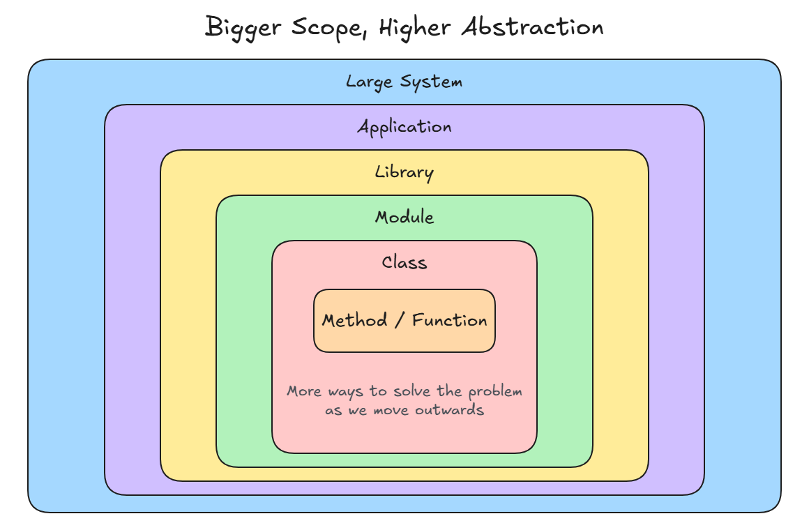
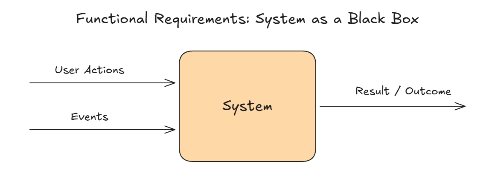
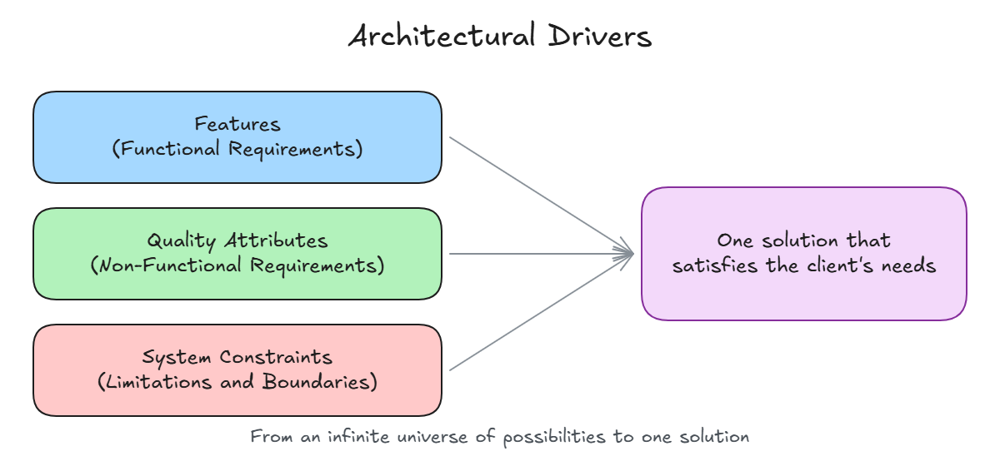

# Introduction to System Design and Architectural Drivers

**In this lecture:**

1. Why system requirements matter (the motivation)
2. How to classify requirements into types

Gathering, classifying and analyzing requirements is the first step in designing a large-scale system.

---

### What Are System Requirements?

System requirements is a formal term for figuring out and narrowing down exactly what we need to build for our client.

As software engineers, we are already used to getting informal requirements for our tasks. However, the requirements for a large-scale system are different from the requirements for implementing a method, an algorithm or a class. There are two main differences:

1. Big scope and a high level of abstraction
2. A high level of ambiguity (the request is unclear and can be understood in many ways)

**Real-world example:** "Fix this door handle" is a clear, small task. "Build us a hospital" is huge and leaves many questions open.

---

### Difference 1: Big Scope and High Level of Abstraction

When we implement a method or an algorithm in an existing code base, we typically know what the input and output look like. We are also somewhat limited in the programming languages we can use.

As we move up to a class, a module, a library or an application, the number of possible ways to solve the problem grows bigger and bigger, because we have more degrees of freedom (more choices we are free to make). The scope also becomes so big that it is hard to even picture the implementation.

So when we are asked to design an entire system, we may feel so overwhelmed that we do not even know where to begin.

**Lecture examples:** Imagine being asked to design one of these, scaled to serve millions of users per day:

1. A file storage system
2. A video streaming solution
3. A ride-sharing service

---

### Difference 2: High Level of Ambiguity

There are two reasons for this ambiguity.

**Reason 1: The person giving the requirements is often not an engineer.** Sometimes they are not even very technical. A client or product manager may ask for something very high-level. It is our responsibility to turn that request into precise, technical requirements. Those technical requirements are the foundation for building our software architecture.

**Reason 2: Getting the specific requirements is already part of the solution.** This may seem odd at first, but the client does not always know exactly what they need. The only thing they know for sure is the problem they need to solve.

**Real-world example:** A patient tells the doctor about the pain, not the medicine they need. The doctor asks questions to find out the rest.

### Example: Hitchhiking Service

**The high-level requirement from the client:** Allow people to join drivers who are already driving on a particular route and are willing to take passengers on their way for a fee.

That may be all we get from the client. It is up to us to ask clarifying questions:

1. Is it a real-time service, or must riders contact drivers in advance?
2. Is it a mobile experience, a desktop experience, or both?
3. Is payment made through our system, or do riders pay drivers directly?

In some cases, the client may not know the answers until we actually ask.

This is why most system design interviews test our ability to clarify and ask these questions ahead of time. Asking them and gathering the requirements is already part of the solution, and it greatly narrows down what we need to design and build.

---

### Why Getting Requirements Right Matters

**The question:** Can't we just build something, see if it satisfies the client, and fix it if it doesn't? After all, software seems to have no big cost of materials, unlike mechanical engineering or constructing a building.

**The answer:** That works for small projects, such as a method or a few classes, where we can easily rewrite the code many times until we get it right. Large-scale systems are big projects that cannot be changed easily overnight, because:

1. They need many engineers, sometimes multiple teams.
2. They can take months to build, so the cost of engineering time is very significant.
3. They often require buying hardware, and sometimes software licenses, upfront.
4. They typically involve contracts with time commitments and financial obligations.
5. Not delivering on time may cause irreversible damage to the company's reputation and brand image.

So getting the requirements right upfront is absolutely critical.

**Real-world example:** Changing a sentence in a letter takes a minute. Moving a bridge to a different place after it is built costs a fortune.

---

### The Three Types of Requirements

Requirements fall into three types, and each type affects our architecture and design in a completely different way:

1. **Features of the system:** also known as functional requirements
2. **Quality attributes:** also known as non-functional requirements
3. **System constraints:** the limitations and boundaries of the system

### Type 1: Features (Functional Requirements)

These describe the system's behavior, meaning what the system must do. They are easily tied to the objective of the system.

They are called functional requirements because they describe the system as a black box function:

1. **Input:** the user's actions or external events
2. **Output:** the result or outcome of the operation the system takes

**Important:** Functional requirements dictate the functionality of the system, but they do **not** determine its architecture. Generally, any architecture can achieve any feature, which is what makes the job of a software architect so difficult.

**Examples from the hitchhiking service:**

| Requirement | Input | Output |
| ---- | ---- | ---- |
| When a rider logs into our mobile app, the system must display a map with nearby drivers within a 5-mile radius. | The user's login action | A view of a map with nearby drivers |
| When the ride is complete, the system will charge the rider's credit card and transfer that money to the driver, minus some service fees. | The completion of the ride (an event) | The transfer of the money |

### Type 2: Quality Attributes (Non-Functional Requirements)

These are properties the system must **have**, as opposed to what the system must **do**. Examples include:

1. Scalability
2. Availability
3. Reliability
4. Security
5. Performance

This list can go on and can change depending on the system.

**Important:** Unlike functional requirements, quality attributes **do** dictate the software architecture of the system. Another way to say this is that the software architecture defines the system's quality attributes, and different architectures give us different quality attributes.

**Real-world example:** "The car must drive" is a feature. "The car must be safe and fast" are qualities, and they change how the car has to be built.

### Type 3: System Constraints

These are the limitations and boundaries of the system. Examples include:

1. **Time constraints:** strict deadlines
2. **Financial constraints:** a limited budget
3. **Staffing constraints:** a small number of engineers available to work on the project

Such constraints may force us to make trade-offs and sacrifices in our design. They can shift us towards architectural decisions we would not make without those constraints.

**Real-world example:** With a small budget and only one month, you may build a small simple house instead of the house you would really like.

---

### Architectural Drivers

The three types of requirements are also called **architectural drivers**, because they drive our architectural decisions from an infinite universe of possibilities towards one solution that satisfies our client's needs.

---

**Key idea:** Clarify the requirements upfront, because the features, quality attributes and constraints are what guide us to the right architecture.

---

## Short Note

- **System requirements:** figuring out exactly what to build for the client, which is the first step of the design.
- **How they differ from small tasks:**
  - Big scope: many ways to solve the problem, and it is hard to picture the implementation.
  - High ambiguity: the person asking is often not technical, and clients only know the problem they need solved.
- **Clarifying questions are part of the solution,** and interviews test them. For the hitchhiking service:
  - Real-time or booked in advance?
  - Mobile, desktop or both?
  - Payment through us or directly to the driver?
- **Why we can't just build and fix large systems:**
  - Many engineers and months of work
  - Hardware and software costs
  - Contracts with time and money commitments
  - Risk to reputation and brand
- **The three architectural drivers,** which lead us from infinite possibilities to one solution:
  - **Features (functional):** what the system must do, as a black box with inputs and outputs. They do not decide the architecture.
  - **Quality attributes (non-functional):** what the system must have, such as scalability, availability, reliability, security and performance. They do decide the architecture.
  - **Constraints:** limits such as deadlines, budget and number of engineers, which may force trade-offs.
