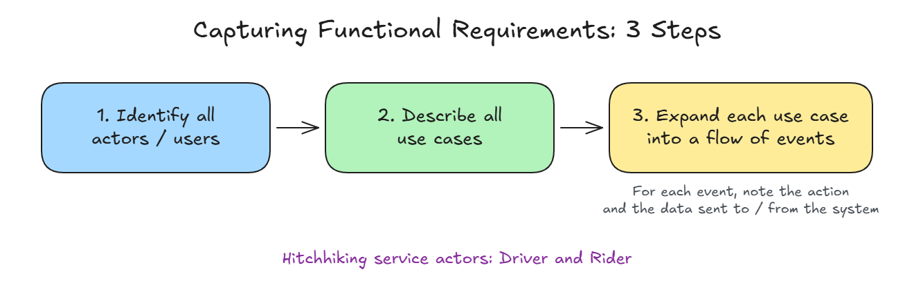
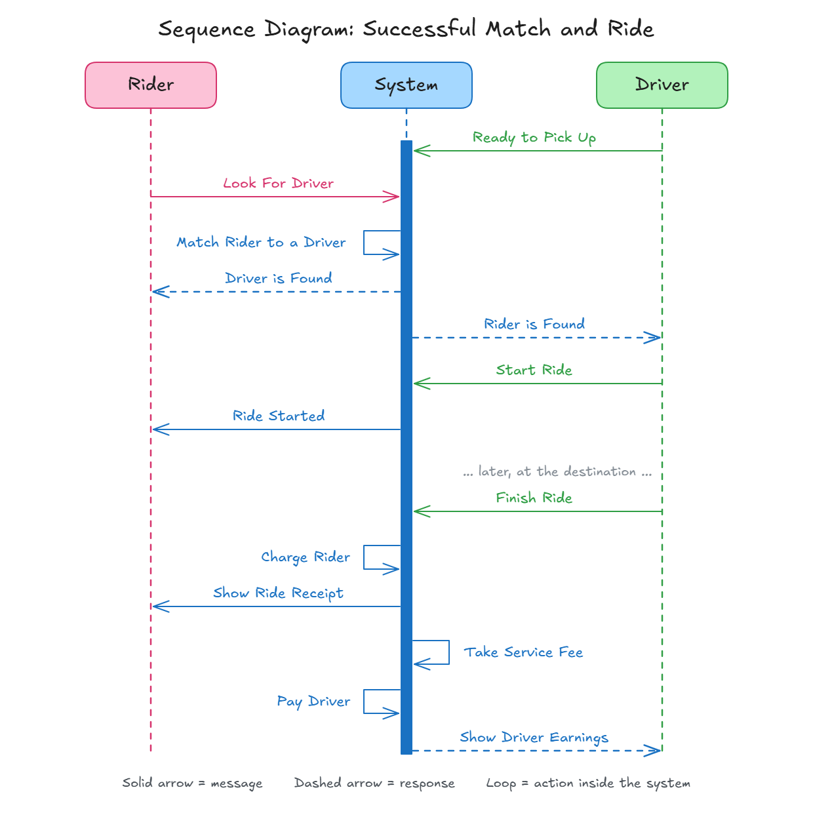

# Feature Requirements - Step by Step Process

**In this lecture:**

1. A formal, step-by-step method to capture all the functional requirements (features) of a system
2. How to visualize those requirements with a sequence diagram

---

### Why We Need a Method

In the previous lecture, we learned that we must gather all the requirements before we start designing the system architecture. We also learned that this is hard, because of two challenges:

1. The large scope
2. The ambiguity (the request is unclear and can be understood in many ways)

**The naive way:** ask the client to describe everything they need the system to do, and hope they do not forget any detail. For complex systems with many features and multiple actors, this is not a good approach.

**The better way:** a more powerful and methodical way to gather requirements is to use **use cases** and **user flows**.

1. **Use case:** a particular situation or scenario in which our system is used to achieve a user's goal.
2. **User flow:** a more detailed, step-by-step or graphical representation of each use case.

**Real-world example:** "Withdraw cash at an ATM" is a use case. Its user flow is the steps: insert the card, enter the PIN, choose the amount, and take the cash.

---

### The 3 Steps to Capture Functional Requirements

1. **Identify all the actors (users) of the system.** If we miss an actor, we will likely miss all of their use cases too.
2. **Describe all the possible use cases.** These are all the scenarios in which an actor can use our system.
3. **Expand each use case into a flow of events.** These are the interactions between the actor and the system. For each event, we capture the action and take note of the data that flows to and from the system.

---

### Example: Hitchhiking Service

As a reminder, this service allows people to join drivers who are already driving on a particular route and are willing to take passengers on their way for a fee.

**Step 1: Actors.** There are only two:

1. The driver, who is willing to take passengers
2. The rider

**Step 2: Use cases.** Some of the use cases where a driver or a rider interacts with the system:

1. A new rider registers with the system for the first time.
2. A new driver registers with the service.
3. An existing rider logs in to start a ride.
4. A driver logs in and is willing to pick up a rider.
5. A successful match between a rider and a driver, which starts and completes a ride.
6. An unsuccessful match, where a rider could not find a driver willing to pick them up.

These are not all the use cases, but they show the idea.

**Step 3: Expand a use case.** The lecture expands the most interesting one, the successful match between a rider and a driver. It uses a sequence diagram to show the flow.

---

### Sequence Diagrams

There are many ways to show the flow of actions in a user flow. This course uses a **sequence diagram**.

A sequence diagram is a type of diagram that shows the interactions between actors and objects. It is part of the **Unified Modeling Language (UML)**, a standard way to visualize system design.

**Things to know about UML:**

1. In practice, UML diagrams are used mostly for software design (the code level).
2. There is no real standard for drawing software architecture at a high level.
3. The industry does not strictly follow UML as a language.
4. Sequence diagrams are still used often, to show the interactions between any entities in the system, not just objects.

**How to read a sequence diagram:**

1. **Time** goes from top to bottom.
2. **Each entity** (actor or system) is a vertical line.
3. **A call or message** is a solid arrow from one entity to another.
4. **A response** is a broken (dashed) line, going back from the destination entity to the caller.
5. **An arrow that loops back** to the same entity (seen in the lecture's diagram) is an action the system does by itself, such as "Charge Rider".

**Real-world example:** In a restaurant, you give your order to the waiter (a call), and later the waiter brings your food back to you (a response). Read from top to bottom, these steps form a sequence diagram.

---

### Walkthrough: Successful Match and Ride

**Starting the ride:**

1. A driver, already logged in, tells the system they are on a particular route and ready to pick up a rider.
2. A rider, also already logged in, sends their origin and destination, and says they are looking for a driver.
3. The system tries to match the rider to an existing driver. If it finds a match, it notifies both the rider and the driver.
4. The driver goes to the rider's location, picks them up and starts the ride.
5. The system notifies the rider that the ride has begun, as a confirmation.

**Finishing the ride:**

6. The driver arrives at the destination, finishes the ride, and a message is sent to the system.
7. The system charges the rider from their bank account and sends the receipt to the rider.
8. The system keeps a portion of the charge as a service fee and credits the driver's account with the rest.
9. The system notifies the driver about the new credit in their account.

**Note:** The diagram does not show the data sent in each message, but we take note of that data for the future.

---

### Side Benefit: Finding the System's API

Capturing all these interactions in a user flow gives us a great side benefit. We can easily use it to identify the future **API** of our system (the set of calls that others can make to it):

1. **Each interaction** between an actor and the system is an API call.
2. **The data** flowing between the actor and the system becomes the arguments of that API call.

The course covers designing APIs in a later lecture.

---

**Key idea:** Find all the actors, list their use cases, and expand each use case into a flow of events with a sequence diagram. Each event later becomes an API call.

---

## Short Note

- **Naive way:** just ask the client for everything. It fails for complex systems with many features and actors.
- **Better way:** use cases (scenarios where the system helps a user reach a goal) and user flows (their step-by-step details).
- **The 3 steps:**
  - Identify all actors.
  - Describe all use cases.
  - Expand each use case into a flow of events, noting the action and the data for each.
- **Hitchhiking service:**
  - Actors: driver and rider.
  - Use cases: registration, login, successful match, unsuccessful match, and more.
- **Sequence diagram (part of UML):**
  - Time goes top to bottom, and each entity is a vertical line.
  - Calls are solid arrows, and responses are dashed lines back to the caller.
  - UML isn't strictly followed in the industry, but sequence diagrams are widely used.
- **Successful ride flow:** driver ready → rider requests → match and notify both → start ride → finish ride → charge rider and send receipt → credit driver minus fee → notify driver.
- **Bonus:** each interaction becomes an API call, and its data becomes the call's arguments.

---

## Q & A

**Question 1:** We are tasked to design a social media system like Facebook. In this system, different users can post media (text, images, videos) on their wall. Their friends can like or respond to those posts as they see them. We will make money from the platform by allowing external advertisers to place ads, which we show on users' social media walls.

Following the three-step process to gather all the functional requirements, who are the (external) actors in this system?

1. Our platform, and the social media wall
2. Social media users, and advertisers
3. Advertisers, posts, and likes

**Answer:** 2. Social media users, and advertisers.

Actors are the people or outside parties who use the system. Our platform is the system itself, and the wall, posts and likes are things inside the system, not actors.

**Question 2:** While designing an online store, we created this user flow using a sequence diagram. It has three entities: the client (user), the online store (system), and the delivery driver.

1. Delivery driver → store: Register Delivery Driver
2. Client → store: Look For Shoes
3. Store (by itself): Match Query to Existing Products
4. Store → client (dashed response): Return Results
5. Client → store: Buy Product
6. Store (by itself): Charge Client $
7. Store → client (dashed response): Confirm Purchase
8. Store → delivery driver (dashed response): Schedule Delivery of Product

What use case does this user flow represent?

1. A merchant adding products to our online store
2. A driver making a delivery to a user
3. A user purchasing a product in our store

**Answer:** 3. A user purchasing a product in our store.

The flow starts with the user searching and buying, and ends with the purchase confirmed. The driver only gets a delivery scheduled, so the main goal belongs to the user who buys.
