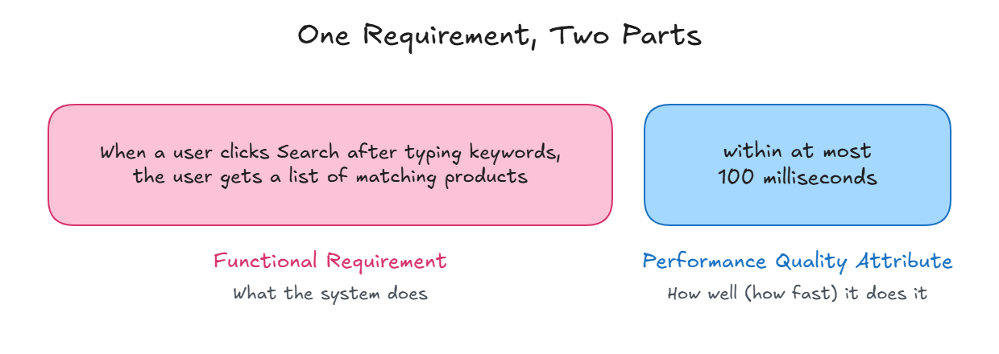
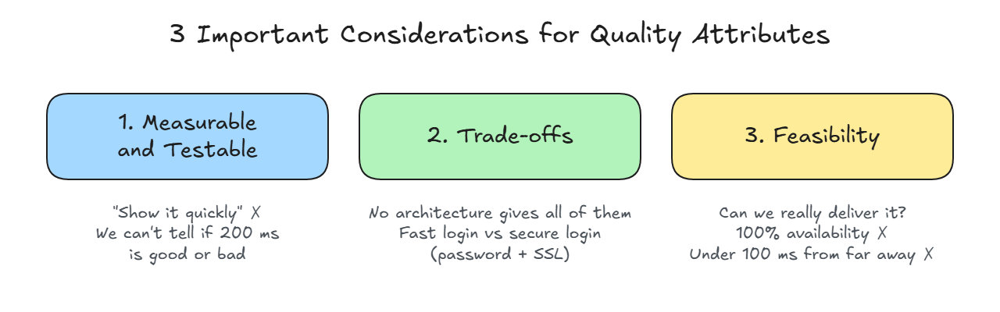

# System Quality Attributes Requirements

**In this lecture:**

1. Why quality attributes matter (the motivation)
2. The formal definition of a quality attribute
3. Three important things to consider when defining quality attributes

Quality attributes are also called non-functional requirements. This type of requirement has a direct effect on the software architecture.

---

### Why Quality Attributes Matter

Studies have shown that systems are often redesigned and restructured. Usually this is **not** because they are missing features, and not because of new feature requirements. It is because the existing system, as it stands:

1. Is not fast enough
2. Cannot scale well enough to the growing number of users or amount of data
3. Has a structure that makes development, maintenance or security very hard

In most cases, after such a major redesign, the system gives the same, or almost the same, functionality as before.

So it is extremely important to design the system with the right quality attributes from the start, to avoid these major redesigns.

**Real-world example:** A small shop gets so busy that customers wait in long queues. The owner rebuilds the shop bigger, but it still sells exactly the same things.

---

### The Definition

Quality attributes are non-functional requirements that describe:

1. The qualities of the system's functional requirements, or
2. The overall properties of the whole system

In other words, quality attributes do not say **what** the system does. They give a **quality measure** of **how well** the system performs on a **particular dimension** (one area, such as speed or availability).

Quality attributes have a direct connection to the architecture of the system.

---

### Examples: Online Store

**Example 1: Search (performance).** Users can look for products using search keywords.

> "When a user clicks on the search button after typing in particular search keywords, the user will be provided with a list of products that closely match the search keywords within at most 100 milliseconds."

1. **The functional requirement** is the action the system takes when the user clicks the search button.
2. **The quality attribute** is in the **performance** dimension. It describes how fast that action must happen.

**Example 2: Availability.** This one is not tied to a particular feature. It applies to the whole system.

> "The online store must be available to user requests at least 99.9% of the time."

This quality attribute is in the **availability** dimension.

**Example 3: Deployability.** Quality attributes must satisfy the quality requirements of **all the stakeholders** (everyone who has an interest in the system), not only the clients.

> "Our development team can deploy a new version of the online store at least twice a week."

This also applies to the whole system. It describes how the system performs in the **deployability** dimension (how easily new versions can be released).

---

### 3 Important Considerations

### Consideration 1: Quality Attributes Must Be Measurable and Testable

If we cannot objectively measure and consistently test that the system meets a quality attribute, we cannot know whether the system performs well or poorly on it.

**Lecture example:** The requirement is: "When a user clicks the buy button, the purchase confirmation must be displayed **quickly**." We design the system to show the confirmation within 200 milliseconds. Because we could not measure what "quickly" really meant, we cannot know if 200 milliseconds is good or bad.

**Real-world example:** "Deliver the pizza fast" cannot be checked. "Deliver the pizza within 30 minutes" can.

### Consideration 2: We Must Make Trade-offs

No single architecture can give us all the quality attributes. If one did, everyone would use it for every system, and the job of a software architect would not exist.

This is impossible because some quality attributes contradict each other. Some combinations are very hard to achieve, or even impossible.

So our job as software architects is to:

1. Make the right trade-offs, choosing some quality attributes over others
2. Design the system to give the highest chance of success, based on the business requirements

**Lecture example: the login page.** There are two conflicting requirements:

1. **Fast:** a user should log in very quickly, preferably in under one second.
2. **Secure:** the user's account must be protected. So the user has to type a password, and we must protect the password with something like **SSL** (a technology that stops a third party from intercepting the password).

Typing a username and password, and sending the network request with SSL, both make login slower. This goes directly against the first requirement.

**Real-world example:** A car cannot be both the fastest and the cheapest to run. The maker has to choose what matters more.

### Consideration 3: Feasibility

Feasibility means the requirement is actually possible to deliver. It is our job, as the designers, to make sure the system we design and build can really deliver what the client asks for.

Clients are often not technical, so they may ask for something that is technically impossible or far too expensive to build. We must point this out early in the process.

**Examples of unfeasible requirements from the lecture:**

1. **Unrealistically low latency** (latency means delay). Say the network delay between a client in South America and our closest data center in US East is 100 to 150 milliseconds. Then we cannot promise page loads under 100 milliseconds. We cannot even promise something close to that, because loading a page over HTTP needs several round trips, and may need to load several assets (files such as images).
2. **100% availability.** This means the system can never fail, and we could never take it down for maintenance or upgrades.
3. **Full protection against hackers.**
4. **Streaming high-resolution movies** in areas where the bandwidth (internet speed) does not allow it.
5. **Increasing storage capacity at an unreasonable rate.**

Before approving a requirement, we may even need to consult people with domain expertise, to make sure we can actually deliver what we promise.

---

**Key idea:** A quality attribute measures how well the system does something. It must be measurable, balanced against other qualities, and actually possible to deliver.

---

## Short Note

- **Why they matter:** most redesigns happen because the system is too slow, can't scale, or is hard to develop, maintain or secure, not because features are missing.
  - The redesigned system usually does the same things as before, so get the qualities right from the start.
- **Definition:** a quality measure of how well the system performs on a particular dimension. It is not about what the system does, and it directly shapes the architecture.
- **Online store examples:**
  - Search results within 100 ms → **performance**
  - Available 99.9% of the time → **availability**
  - Deploy at least twice a week → **deployability**, which serves the dev team, since quality attributes serve all stakeholders
- **3 considerations:**
  - **Measurable and testable:** "quickly" can't be judged, so we can't tell if 200 ms is good or bad.
  - **Trade-offs:** no architecture gives every quality, so pick what matters most (fast login vs secure login with a password and SSL).
  - **Feasibility:** call out impossible asks early, such as under 100 ms from South America to US East, 100% availability, full hacker protection, HD streaming on low bandwidth, or unreasonable storage growth.

---

## Q & A

**Question 1:** We have the following requirement:

> "When a user is performing a search on our system, we need to return as many results as fast as possible."

What is the correct statement about that requirement?

1. This is a perfectly valid quality attribute requirement.
2. This is not a good quality attribute requirement because it is not measurable.
3. This is not a good quality attribute requirement because it is not feasible.
4. This is a perfectly valid functional requirement.

**Answer:** 2. It is not measurable.

"As many as possible" and "as fast as possible" give no numbers, so we can never test whether the system meets them. A good version would be something like "return results within 100 ms".

**Question 2:** We have the following requirement:

> "We want to offer unlimited raw, uncompressed video storage for a $1.99 annual subscription fee."

What is the correct statement about that requirement?

1. This is a perfectly valid quality attribute requirement.
2. This is not a good quality attribute requirement because it is not measurable.
3. This is not a good quality attribute requirement because it is not feasible.
4. This is a perfectly valid functional requirement.

**Answer:** 3. It is not feasible.

Unlimited storage of huge, uncompressed video files would cost far more than $1.99 a year, so we could never deliver it. This is the kind of request we must point out early.
