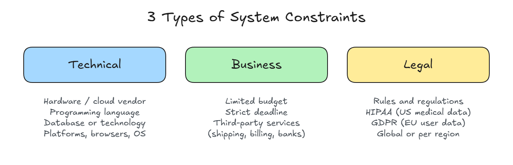
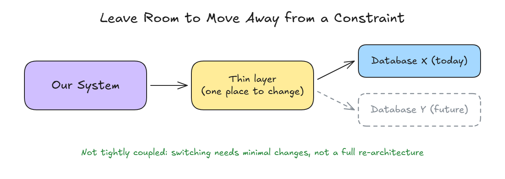

# System Constraints in Software Architecture

**In this lecture:**

1. What system constraints are (the third architectural driver)
2. The types of constraints, grouped by where they come from, and how they affect the architecture
3. Two considerations to keep in mind when dealing with constraints

---

### What Is a System Constraint?

Once we define the functional requirements (what the system must do), we usually have a lot of freedom in how we structure the system. While defining the final architecture we make many decisions, because there are usually many ways to achieve the required features and quality attributes. With quality attributes especially, we are allowed, and usually expected, to make trade-offs.

**A system constraint is a decision that was already fully or partially made for us, which reduces our degrees of freedom (the choices we are free to make).**

This is not always a bad thing. Instead of seeing a constraint as a choice that was taken away from us, we can see it as a decision that was made for us, which sometimes makes our job easier.

That is why people sometimes call system constraints the **pillars of our software architecture**:

1. They give us a solid starting point.
2. They are usually non-negotiable, so we design the rest of the system around them.

**Real-world example:** If the land for a house is already chosen, the architect no longer has to pick a location, and can design the house around that land.

---

### The 3 Types of Constraints

### Type 1: Technical Constraints

As software engineers, we deal with technical constraints every day. Examples:

1. Being locked to a particular hardware or cloud vendor, because of an existing contract or for security reasons
2. Having to use a particular programming language, because of frameworks we built in-house, or because it is hard to hire engineers for other languages
3. Having to use a particular database or technology
4. Having to support certain platforms, browsers or operating systems, because of licenses, support costs, or because our clients asked for it

At first, technical constraints may seem to belong to the implementation, not the architecture. But in practice, they often affect the decisions we make in the design phase and put restrictions on the architecture.

**Lecture examples:**

1. **Running on-premise.** Suppose the company decides to run all services in its own data centers, for security or financial reasons. Then cloud architectures and patterns such as auto-scaling or function as a service may be unavailable or very hard to achieve, because we would have to build a lot of complex infrastructure ourselves.
2. **Older browsers or low-end devices.** If we must support older browsers or low-end mobile devices that do not support certain communication protocols, or cannot handle as much data, we have to change our architecture a lot. We support those platforms and their APIs, while giving a different, more high-end experience to newer browsers and higher-end devices.

### Type 2: Business Constraints

As engineers, we want to make the right technical choices, but we cannot always judge how those choices fit the goals of the business. So the business team often gives us constraints that force us to make sacrifices in both the architecture and the implementation.

**Limited budget or strict deadline.** With these, we make very different choices than we would with unlimited money or time. Some architectural patterns suit small startups that must get to market fast with a small team. Other patterns fit bigger organizations with many engineering teams and a much larger budget. The course covers these patterns later.

**Using third-party services.** The business may decide to specialize in one area and get the rest from partners:

1. **Online store:** we focus on the shopping experience of our clients, and use third-party providers for shipping and billing.
2. **Investment platform:** we usually need to integrate with banks, broker services, and security and fraud detection services.

All these third-party providers have their own APIs and architectural patterns, which we must work with when designing our system.

### Type 3: Legal Constraints

These come from rules and regulations. They can be global, or specific to one geographical region. Examples:

1. **HIPAA (United States):** applies to systems that handle medical information or patient records. It restricts who can access patient data, and what security we must put in place to store this sensitive information.
2. **GDPR (European Union):** limits what data online services can collect and store about their users, and what they can share with third parties. It also limits how long some data can be kept.

So depending on the countries where we offer our services, and the industry they belong to, different regulations may affect our architecture.

---

### Consideration 1: Don't Take Any Constraint Lightly

We must tell the difference between:

1. **Real constraints:** ones we can do nothing about
2. **Self-imposed constraints:** ones we can negotiate, and maybe even remove

**Lecture examples:**

1. **External rules and regulations:** there may be little room to negotiate.
2. **Budget and time from the business:** maybe we can postpone some deadlines or stretch the budget.
3. **Being locked to a hardware, cloud vendor or set of technologies:** this project may be the perfect chance to explore other options that could benefit the business in the long run.

Once we agree to a set of constraints, it is very hard to back away. If we later find out they were not real constraints, our whole architecture may no longer make sense.

**Real-world example:** "The building must be fireproof" is the law, so we cannot change it. "Finish in 3 months" may be just a wish, so it is worth asking.

### Consideration 2: Leave Room to Move Away from Constraints

When we do accept a constraint, we must leave enough room in the architecture to move away from it in the future.

For example, if we must use a particular database, or integrate with a particular third-party service, our system must **not be tightly coupled** (too strongly tied) to that technology or those specific APIs. Then if we can use a different technology or service later, we only need minimal changes, instead of re-architecting the whole system from scratch.

The course will show specific tools and general techniques for this in the topic of **architectural building blocks**. These help us decouple (separate) parts of the system so they can be replaced or updated independently, without refactoring the whole system.

**Real-world example:** A lamp with a plug can move to any socket. A lamp wired straight into the wall needs an electrician to move it.

---

**Key idea:** Constraints are decisions already made for us. Check that they are real, design around them, and never tie the system so tightly to them that we cannot change later.

---

## Short Note

- **System constraint:** a decision already fully or partially made for us, which reduces our freedom.
  - It is not always bad: constraints are the **pillars** of the architecture, giving a solid, usually non-negotiable starting point to design around.
- **3 types:**
  - **Technical:** a locked hardware or cloud vendor, language, database, or supported platforms and browsers. They do shape the architecture, for example on-premise means no easy auto-scaling, and old browsers need a different design.
  - **Business:** budget, deadlines and third-party services (shipping, billing, banks, fraud detection). Startups and big organizations suit different patterns.
  - **Legal:** regulations, global or per region, such as HIPAA (US medical data) and GDPR (EU user data and how long it is kept).
- **2 considerations:**
  - **Don't take constraints lightly:** separate real ones (laws) from self-imposed ones (budget, deadlines, vendor lock), which can be negotiated.
  - **Avoid tight coupling:** if a constraint goes away, we should only need minimal changes, not a rebuild.

---

## Q & A

**Answer options for every question:**

1. Technical constraint
2. Business constraint
3. Legal constraint

**Question 1:** While building our multiplayer online game, we want to build our own proprietary game engine, to give better performance optimized for our use case. However, because of the strict deadline to release the game by the end of the year, we decided to use an existing solution called Unreal Engine. What type of constraint made us change our original decision?

**Answer:** 2. Business constraint.

A strict deadline comes from the business, not from technology or the law. Time and budget limits are business constraints.

**Question 2:** While designing our multiplayer online game, we decided to use the Cassandra database to store information about our users. However, we couldn't find any engineers in our team who know how to work with Cassandra. We later found out that all the teams in our company use MongoDB, so we decided to use MongoDB instead. What type of constraint made us choose MongoDB?

**Answer:** 1. Technical constraint.

Having to use a particular database or technology, because of the skills and tools already in the company, is a technical constraint. It is like the lecture's example of using a language because hiring for other ones is hard.

**Question 3:** While designing a social media platform for sharing short videos with friends, we came up with the most optimal design. However, before finalizing it, we found out that COPPA (the Children's Online Privacy Protection Act), a law that protects the privacy of children under 13, requires significant changes to our design. What type of constraint required us to change our architecture?

**Answer:** 3. Legal constraint.

COPPA is a law, so it is a legal constraint, just like HIPAA and GDPR in the lecture. It is also a real constraint that we cannot negotiate.
