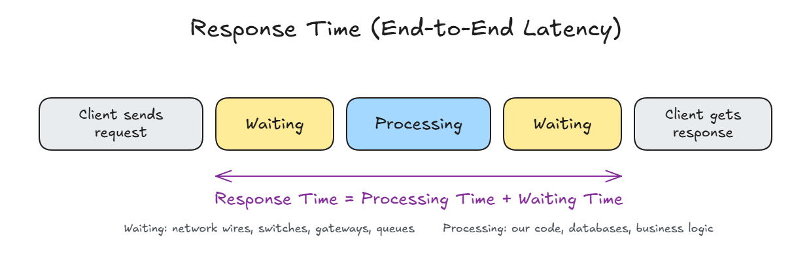
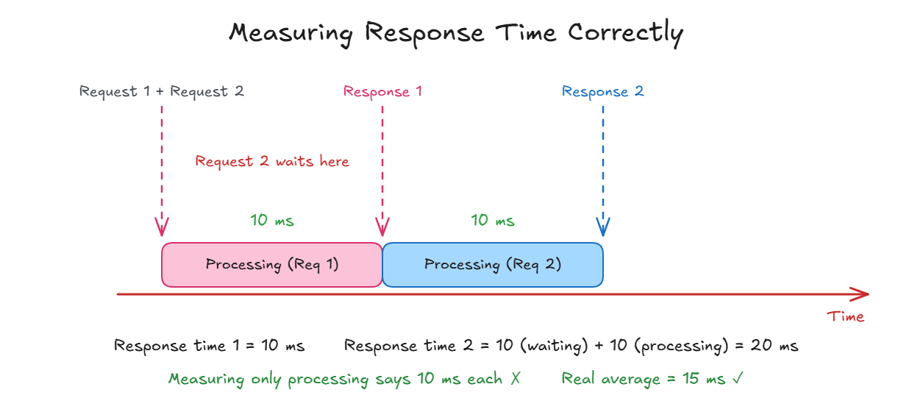
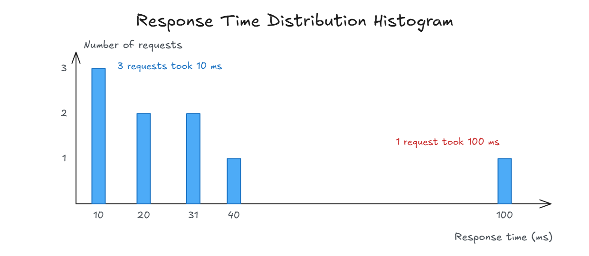
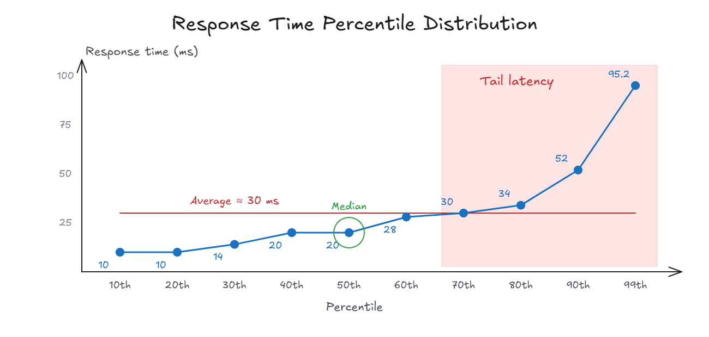
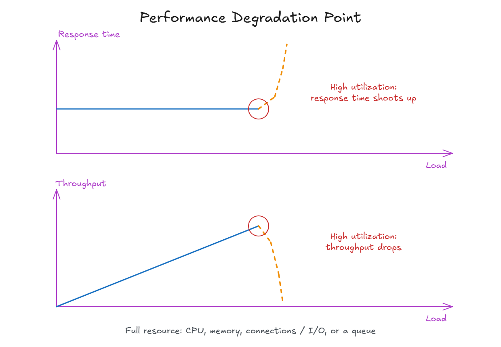
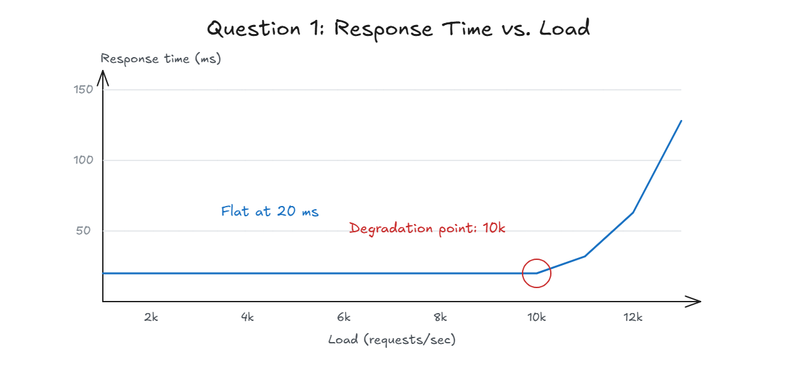
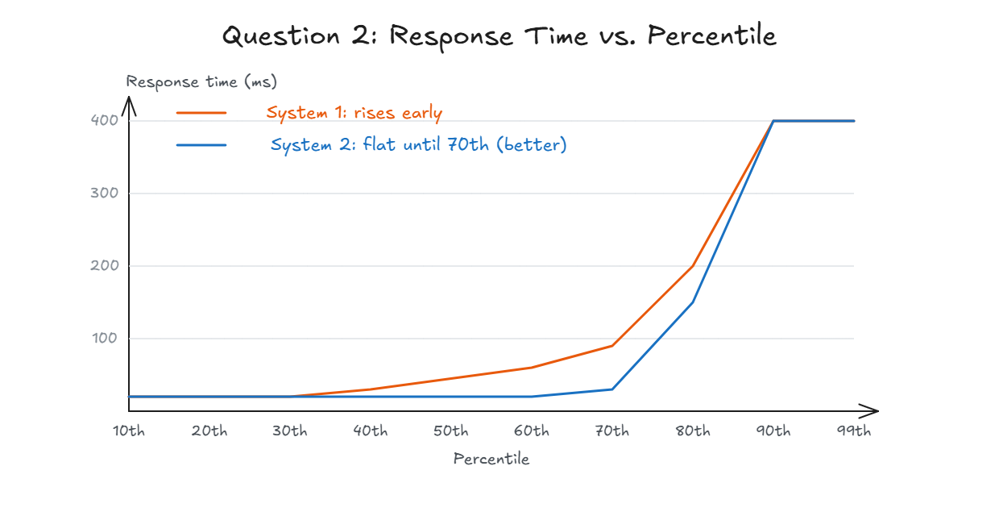

# Performance

**In this lecture:**

1. The first important quality attribute: performance
2. Two types of performance metrics: response time and throughput
3. Three important considerations when setting goals for, measuring and analyzing performance

The list of possible quality attributes is very long, but not all of them are equally important for every system. This section focuses on the small group of quality attributes that are the most important in **any** large-scale system, whatever it is used for. Performance is the first one.

---

### Metric 1: Response Time

When we talk about the performance of a system, we often think of **speed** first. When a system responds quickly to our actions, we feel it has high performance.

**Response time is the time between a client sending a request and receiving a response.**

Response time has two parts:

1. **Processing time:** the time our system actively works on the request and sends the response. This is the time spent in our code, our databases or other parts of the system, applying business logic and building the response.
2. **Waiting time:** the time the request or response spends inactive in our system. Usually it is in transit, in network wires, switches and gateways, or waiting in network or software queues to be handled or sent to its destination. This part is less obvious and often forgotten.

**A note on the word "latency":** latency simply means delay, so the word is used in different ways:

1. Some textbooks use latency to mean the waiting time.
2. Others use response time and latency to mean the same thing.

To avoid confusion, response time is often called **end-to-end latency**.

**When it matters most:** response time is an important metric when we design a system or subsystem that is in the **critical path of a user interaction** (something the user is waiting on directly). Users have very little patience for long response times, and quickly get frustrated when they get no immediate feedback.

**Real-world example:** When you tap "Pay" in an app, you wait for the confirmation. Every extra second feels long.

---

### Metric 2: Throughput

Many engineers wrongly think response time is the only, or the most important, performance metric. Some even think response time **is** the definition of performance. It is not, and for some systems it is less important than throughput.

**Lecture example:** A distributed logging system collects and analyzes a constant stream of logs from hundreds or thousands of servers. Here the most important metric is how much data the system can take in and analyze in a given time. The more data it handles per unit of time, the higher its performance.

**Throughput can be defined in two ways:**

1. **The amount of work** the system does per unit of time, measured in tasks completed per second
2. **The amount of data** the system processes per unit of time, measured in bits, bytes or megabytes per second

**Real-world example:** A highway's performance is not how fast one car drives. It is how many cars pass through each hour.

---

### Consideration 1: Measure the Response Time Correctly

A common mistake is to measure only the **processing time** (the time spent in our code) and treat it as the response time. Then users may have very long response times while our performance graphs show that everything is normal.

**Lecture example:** Two requests arrive at almost the same time, and the system can process only one request at a time.

1. The first request is processed for 10 ms and its response is sent.
2. Meanwhile, the second request waits in the network or software queues.
3. Only then is the second request processed, for another 10 ms.

| What we measure | Request 1 | Request 2 | Average |
| ---------------------------------- | --------- | --------- | ------- |
| Processing time only (wrong) | 10 ms | 10 ms | 10 ms |
| Response time, as the user sees it | 10 ms | 20 ms | 15 ms |

This does not only happen when the system can process one request at a time. It happens any time the system is somewhat overloaded with other requests.

---

### Consideration 2: Response Time Distribution

Say we run our application on hundreds of servers, and every minute we collect the response times from each server. Each response time belongs to a different request from a different user.

Ideally, all the response times would be the same, so every client gets exactly the same experience. In practice, we always get a **distribution** (a spread of different values). Some are very good, and some are surprisingly bad.

So which number should we set goals for and measure: the average, the median, or the maximum? First we need to learn how to organize and analyze the samples.

### Step 1: Histogram

Sort the response time samples and group them into a **histogram**, which shows how often each response time happened. This gives a better picture of the distribution.

**Lecture example:** in the lecture's histogram, 3 requests had a response time of 10 ms, and only 1 request had a response time of 40 ms.

### Step 2: Percentile Distribution

From the histogram, we can easily make a percentile distribution chart or table.

**The x-th percentile is the value below which x% of the values are found.**

**Lecture examples:**

1. **20th percentile = 10 ms:** 20% of requests had a response time under 10 ms.
2. **50th percentile = 20 ms:** 50% of requests were under 20 ms. The 50th percentile is also called the **median**.
3. **90th percentile = 52 ms:** 90% of requests took at most 52 ms.

| Percentile | 10th | 20th | 30th | 40th | 50th | 60th | 70th | 80th | 90th | 99th |
| ------------------ | ---- | ---- | ---- | ---- | ---- | ---- | ---- | ---- | ---- | ---- |
| Response time (ms) | 10 | 10 | 14 | 20 | 20 | 28 | 30 | 34 | 52 | 95.2 |

With enough samples, the chart in the lecture shows that about **20% of users** get an excessively long response time (from about the 80th percentile up, it climbs from 34 ms to 95.2 ms). Only the percentile distribution shows this. Both the median (20 ms) and the average (about 30 ms) completely hide what happens to those 20% of users.

### Tail Latency

**Tail latency is the small percentage of response times that take the longest, compared with the rest of the values.**

We want the tail latency to be as short as possible.

### Setting Goals with Percentiles

When we define response time goals, we must use **percentiles and tail latency, not averages**. After launch, we measure and check the response times by analyzing the percentile distribution, and compare them to the goals we set beforehand.

**Lecture examples of goals:**

1. **95th percentile under 30 ms:** the system may go over 30 ms for only 5% of requests.
2. **99th percentile under 30 ms (more aggressive):** this still leaves some room to go over 30 ms because of unexpected, short-lived system jitter (small random delays).

**Real-world example:** If 9 friends wait 1 minute for food and 1 friend waits 1 hour, the average looks fine, but that one friend had a terrible experience.

---

### Consideration 3: The Degradation Point

This applies to both response time and throughput. We need to find the **performance degradation point**, and see how fast, or how steeply, performance gets worse after it.

**The degradation point is the point on the performance graph where performance starts to get significantly worse as the load increases.**

As the load grows:

1. **Response time** stays flat, until the degradation point, and then it shoots up.
2. **Throughput** rises steadily, until the degradation point, and then it drops.

If performance gets worse very quickly, it usually means one or more resources are **fully used**:

1. **CPU:** the CPU usage of one or more servers is close to 100%.
2. **Memory:** one of our processes uses a lot of memory.
3. **Connections:** there are too many connections, so the operating system or the network cannot handle that much I/O (input and output).
4. **Queues:** one of our software queues is full and cannot keep up with the number of incoming messages.

This leads into the next quality attribute, scalability, in the next lecture.

---

**Key idea:** Measure performance with response time (including waiting time) and throughput, set goals using percentiles instead of averages, and find the load where performance starts to break down.

---

## Short Note

- **Performance metrics:**
  - **Response time (end-to-end latency):** time from sending a request to getting the response, made of processing time plus waiting time (network and queues).
  - **Throughput:** work done (tasks per second) or data processed (bytes per second) per unit of time. It matters most for systems like log processing.
- **Latency** just means delay, and different sources use it differently.
- Response time matters most in the **critical path** of a user interaction, because users have little patience.
- **3 considerations:**
  - **Measure correctly:** include waiting time. With one-at-a-time processing, users see 10 ms and 20 ms (15 ms average), not 10 ms each.
  - **Use percentiles, not averages:** histogram → percentile chart. The median and average hide the slow **tail latency**, so set goals such as "95th or 99th percentile under 30 ms".
  - **Find the degradation point:** a steep slowdown under load usually means a full resource, such as CPU, memory, connections and I/O, or a queue.

---

## Q & A

**Question 1:** We measured the response time of our system as a function of load (in thousands of requests per second) and got this graph:

| Load (requests/sec) | 2k to 10k | 11k | 12k | 13k |
| ------------------- | --------- | ----- | ----- | ------ |
| Response time | 20 ms (flat) | ~32 ms | ~63 ms | ~128 ms |

What is the degradation point of our system?

1. 2k requests/sec
2. 10k requests/sec
3. 12k requests/sec
4. 100 ms

**Answer:** 2. 10k requests/sec.

The response time stays flat at 20 ms up to 10k requests/sec, and then starts rising steeply. The degradation point is measured in load (requests/sec), not in milliseconds.

**Question 2:** We have the response time distributions of 2 systems (approximate values read from the graphs, in ms):

| Percentile | 10th | 20th | 30th | 40th | 50th | 60th | 70th | 80th | 90th | 99th |
| ---------- | ---- | ---- | ---- | ---- | ---- | ---- | ---- | ---- | ---- | ---- |
| System 1 | 20 | 20 | 20 | 30 | 45 | 60 | 90 | 200 | 400 | 400 |
| System 2 | 20 | 20 | 20 | 20 | 20 | 20 | 30 | 150 | 400 | 400 |

Which system has a shorter (better) tail latency?

1. System 1
2. System 2
3. Both systems have the same tail latency

**Answer:** 2. System 2.

Tail latency is the small percentage of response times that are much longer than the rest. In System 2, response times stay low until the 70th percentile, so only a small share of requests is slow. In System 1, they start climbing much earlier, so many more requests are slow.

**Question 3:** We are designing a Video Transcoding and Compression as a Service system. It receives raw video files from clients (video streaming companies), transcodes them into different video formats for different devices, and compresses those files. What is the most important performance metric for our system?

1. Response time
2. Throughput
3. Latency
4. Scalability

**Answer:** 2. Throughput.

Our clients are businesses, not end users waiting on a screen. We receive many files and must keep up with the load, so the number of tasks we finish per unit of time matters most, just like the lecture's logging system example.
