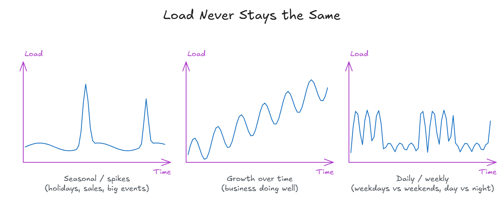
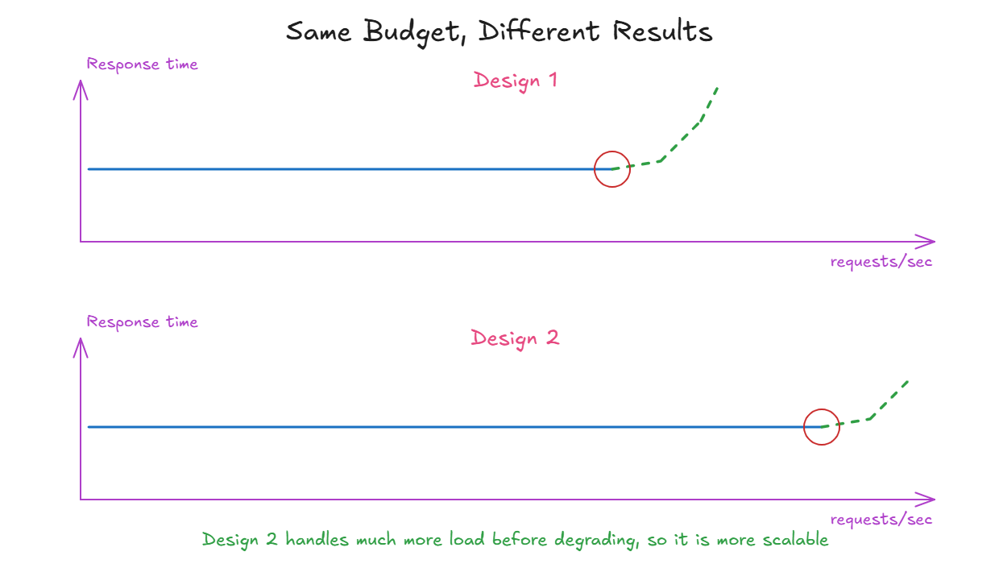
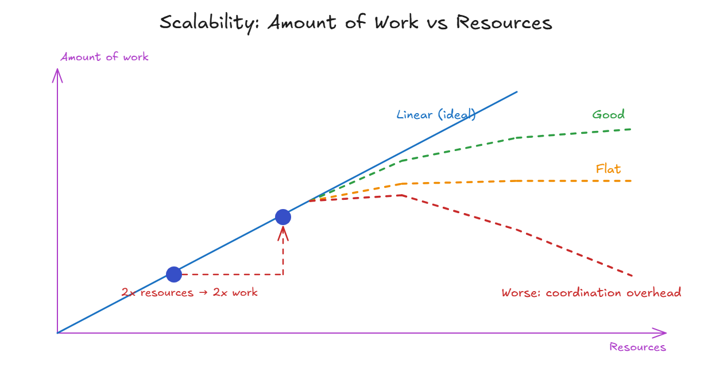
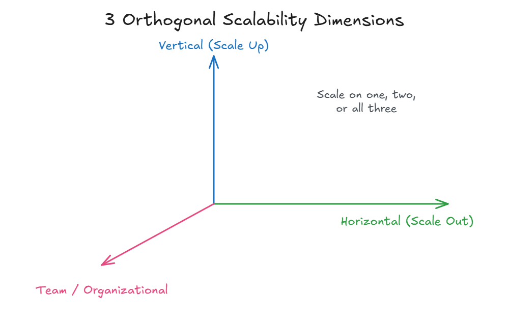
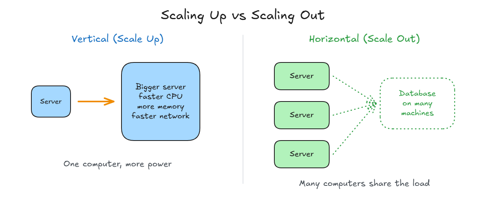
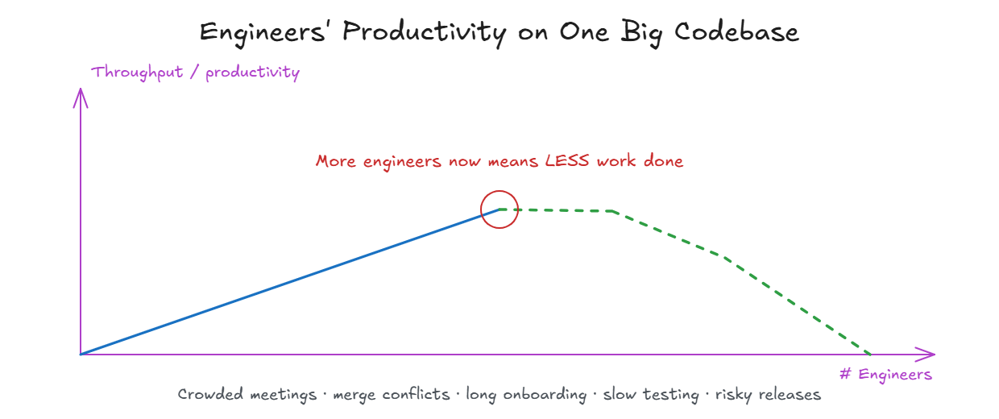
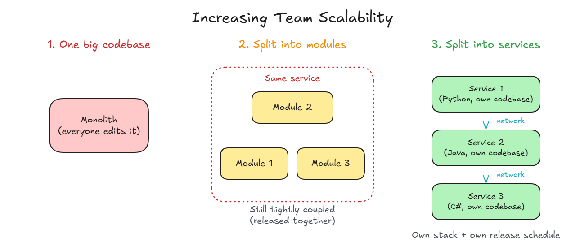
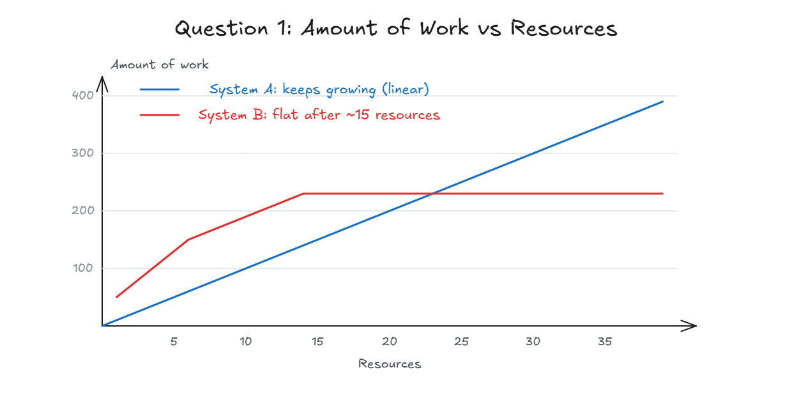

# Scalability

**In this lecture:**

1. Why scalability matters (the motivation)
2. The formal definition of scalability
3. The three scalability dimensions: vertical, horizontal, and team (organizational)

---

### Why Scalability Matters

The load (traffic) on a system never stays the same. It follows different patterns:

1. **Seasonal:** a retail website gets a lot of traffic during holidays or sales, and less in between.
2. **Sudden spikes:** for a search engine, a spike can be a global event, when many users suddenly open their browsers to search for news about it.
3. **Daily and weekly:** a news website, or a tool people use at work, gets different load on weekdays and weekends, and during the day and the night.
4. **Long-term growth:** if the business is doing well, more users use the system over time, so the traffic and load grow.

### Comparing Two Designs

In the Performance lecture, we learned about the **degradation point**: the point where the system can no longer handle more load with the same performance.

**Lecture example:** Two teams have two designs of the same system. Each team gets the **same budget**, in time and money, to upgrade its system to take more load. After the upgrades:

1. **Design 1** starts to degrade at a fairly low number of requests per second.
2. **Design 2** handles a much higher load before it starts to degrade.

So, informally, **Design 2 is much more scalable**: for the same effort and cost, it got much better results.

**Real-world example:** Two restaurants each get the same money to expand. One adds 10 seats, the other adds 50 seats, so the second one scales better.

---

### The Definition

> **Scalability is the measure of a system's ability to handle a growing amount of work, in an easy and cost-effective way, by adding resources to the system.**

If we plot the amount of work the system can do against the resources we give it:

1. **Linear scalability (the ideal):** if we double the resources, we get double the work, or we can take double the load before the system degrades. In practice this is very hard to achieve.
2. **Less than linear:** adding resources still helps, but each addition helps less.
3. **Flat:** after some point, adding resources gives almost no extra work.
4. **Worse (the least wanted):** adding resources actually makes performance worse, because of the overhead of managing and coordinating all those resources.

---

### The 3 Scalability Dimensions

We can scale a system on three **orthogonal** dimensions (independent of each other):

1. **Vertical scalability:** also called scaling up
2. **Horizontal scalability:** also called scaling out
3. **Team or organizational scalability**

Because they are orthogonal, we can scale on one dimension, two, or all three.

---

### Dimension 1: Vertical Scalability (Scaling Up)

**Lecture example:** A service runs on a single computer and takes traffic from many users. As the number of users grows, at some point the system cannot take more load and reaches its degradation point. To fix this, we can:

1. Move the service to a faster, newer machine, with a faster CPU, more memory, and maybe a network card that handles higher bandwidth
2. Move the database to stronger hardware with more storage

**Vertical scalability means adding more resources, or upgrading the existing resources, on a single computer**, so the system can handle more traffic or load.

### Dimension 2: Horizontal Scalability (Scaling Out)

Instead of upgrading the existing hardware, we **add more units of the resources we already have**. For example:

1. Run the service on **multiple computers** instead of one. The load is spread across a group of machines, so each machine stays far from its degradation point.
2. Run the database on **multiple machines** instead of one. This takes the performance pressure off any single computer.

**Horizontal scalability means adding more resources in the form of new instances running on different machines**, so the system can handle more traffic or load.

**Real-world example:** Vertical is replacing your car with a bigger truck. Horizontal is adding more cars to your delivery fleet.

---

### Vertical vs Horizontal Scalability

| | Vertical (Scale Up) | Horizontal (Scale Out) |
| --- | --- | --- |
| **Code changes** | ✅ Almost any application benefits with no code changes. For example, if the problem is high CPU usage, a faster CPU fixes it. | ❌ Not every application can easily run as many instances on different computers, so we may need big code changes. But once they are done, adding or removing resources needs no more changes. |
| **Moving and cost** | ✅ Migration is simple: move to a stronger machine when traffic is high, and to a weaker one when it is low, to save money. This is especially easy when renting hardware from a cloud provider. | ✅ We can easily add more machines as needed, and remove them just as easily when the load goes down. |
| **Limit** | ❌ There is a limit to how much we can upgrade hardware. At internet scale, we reach it very fast, and there is nowhere to go beyond it. | ✅ There is virtually no limit. |
| **Availability and fault tolerance** | ❌ It locks us into a centralized system (everything in one place), which **cannot** give high availability and fault tolerance. This is probably the bigger issue. | ✅ If designed correctly, it gives high availability and fault tolerance out of the box. |
| **Complexity** | ✅ Simple | ❌ The biggest disadvantage: more complexity and coordination overhead when running a group of instances. The course covers these challenges and their solutions later. |

High availability and fault tolerance are two extremely important quality attributes, covered in the next lectures.

---

### Dimension 3: Team (Organizational) Scalability

Look at the definition of scalability again, but from a **developer's** point of view instead of a client's:

1. **The work** is adding new features, testing, fixing bugs, deploying releases, and so on.
2. **The resources** we can add to do more of this work are **more engineers**.

### Engineers' Productivity on One Big Codebase

Say a group of engineers works on one big **monolithic** codebase (all the code in one single project). If we plot productivity against the number of engineers:

1. At first, the more engineers we add, the more work gets done.
2. After some point, the more engineers we add, the **less** work we get done.

**Why productivity drops:**

1. **Meetings** become more frequent and more crowded, so they are much less productive.
2. **Code merge conflicts** become unavoidable, because many developers work on many features at the same time. This adds a lot of overhead, and everyone starts stepping on each other's toes.
3. **New developers** have much more to learn before they become productive, because the codebase keeps growing.
4. **Testing** becomes very hard and slow. There is no isolation, so any small change can break something, and we have to test everything after every change.
5. **Releases** become very risky, because each one includes many changes from many engineers. Many companies respond by releasing less often, which makes it even worse, because each release then contains even more changes.

So the software architecture affects not only the system's performance, but also our ability to grow the team and increase the **engineering velocity** (how fast the team delivers work).

**Real-world example:** One kitchen with 20 cooks gets crowded and slow. Splitting them into separate kitchens, each with its own job, works better.

### How to Increase Team Scalability

1. **Split into modules or libraries.** Separate groups of developers can work on each module independently and interfere with each other much less. But all the pieces are still part of the **same service**, so they are still tightly coupled (strongly tied), especially when releasing new versions to production.
2. **Split into separate services.** Each service has its own codebase, its own stack (its own languages and tools, such as Python, Java or C#) and its own release schedule. The services talk to each other over the network through loosely coupled protocols. This gives much better engineering productivity and helps scale the organization.

Breaking a monolithic codebase into multiple services does not come for free. The course covers this in detail in the topic of architectural patterns.

---

**Key idea:** Scalability is how easily and cheaply a system handles more work when we add resources. We can scale up (a stronger machine), scale out (more machines), and scale the team (more engineers working on separate services).

---

## Short Note

- **Load always changes:** seasonal (holidays, sales), sudden spikes (global events), daily and weekly (weekdays vs weekends, day vs night), and long-term growth.
- **Same budget, better result = more scalable:** Design 2 degrades at a much higher load than Design 1.
- **Definition:** the ability to handle a growing amount of work, easily and cost-effectively, by **adding resources**.
  - Linear (2x resources → 2x work) is the ideal, but very hard to get. The worst case is when more resources make things worse, because of coordination overhead.
- **3 orthogonal dimensions** (use one, two or all three):
  - **Vertical (scale up):** a stronger single computer (CPU, memory, network, storage).
    - ✅ No code changes and easy migration. ❌ A hard upper limit, and a centralized system with no high availability or fault tolerance.
  - **Horizontal (scale out):** more instances on different machines.
    - ✅ Virtually no limit, easy to add or remove machines, and high availability and fault tolerance if designed well. ❌ May need code changes once, plus complexity and coordination overhead.
  - **Team (organizational):** the work is features, tests, bugs and releases, and the resource is engineers.
    - On one big codebase, productivity drops after a point: crowded meetings, merge conflicts, slow onboarding, slow testing and risky releases.
    - Fix: modules or libraries (still tightly coupled) → separate services (own codebase, stack and release schedule, talking over the network).

---

## Q & A

**Question 1:** This graph shows the amount of work two systems can do as a function of their resources:

Which system is more scalable?

1. System A
2. System B
3. Both systems are equally scalable

**Answer:** 1. System A.

System B does more work at first, but after about 15 resources it goes flat, so adding resources no longer helps. System A keeps growing in a straight line (linear scalability), so it is the more scalable one, even though it starts lower.

**Question 2:** We currently run our system as 2 instances on 2 separate computers. To take more requests from users, we deploy our 2 application instances on a new type of machine that runs twice as fast and has 3 times more memory. What type of scalability did we use?

1. Vertical scalability
2. Horizontal scalability
3. Organizational scalability

**Answer:** 1. Vertical scalability.

We did not add more instances. We kept the same 2 instances and moved them to stronger machines (faster CPU, more memory), which is scaling up.

**Question 3:** Our entire system runs as a single service. Its codebase became very large and complex, so we broke it into 2 separate services that we deploy as 2 separate groups of application instances. What scalability principle did we apply?

1. Vertical scalability
2. Horizontal scalability
3. Organizational scalability

**Answer:** 3. Organizational scalability.

Splitting one big codebase into separate services lets separate teams work and release independently, which is how the lecture says we scale the team.

**Question 4:** We are designing a Video on Demand system whose number of active users is expected to **double every 3 months**. What is the best scalability principle to keep up with the incoming traffic and give all users good performance?

1. Vertical scalability
2. Horizontal scalability
3. Vertical and horizontal scalability are equally good in the long run

**Answer:** 2. Horizontal scalability.

Traffic that doubles every 3 months grows very fast. Vertical scaling hits a hardware limit quickly, but horizontal scaling has virtually no limit, because we can keep adding machines.
