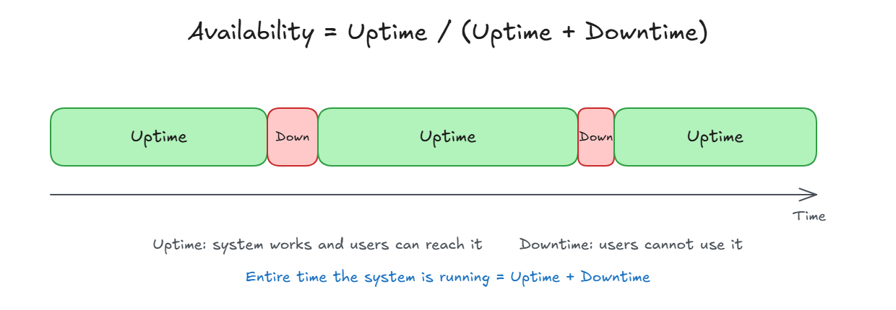
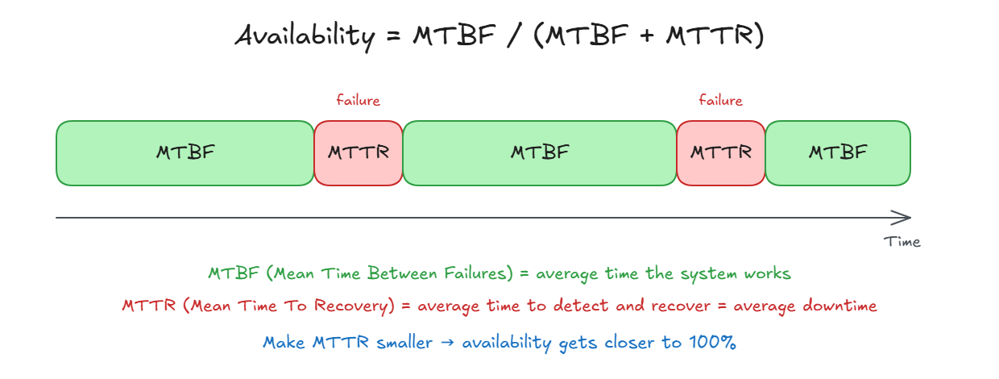

# Availability - Introduction & Measurement

**In this lecture:**

1. Why high availability is important
2. How to define and measure availability
3. What counts as **high** availability

---

### Why Availability Matters

Availability is one of the most important quality attributes, because it arguably has the **greatest impact on both our users and our business**.

### Impact on Users

1. **Online store:** a user types our URL and the page doesn't load. Or it loads, but at checkout they get an error instead of a confirmation.
2. **Email provider:** everyone loses access to their email for a few hours, or even a whole day.
3. **Services for other companies:** if we serve other companies instead of end users, the impact of a long outage is **compounded** (multiplied), because every one of those companies is affected too.
   - **Famous example:** the **AWS S3 (Simple Storage Service) outage in February 2017**. Hundreds of companies and more than 100,000 websites used that service, so the outage almost took down the entire internet.
4. **Mission-critical systems:** downtime is not always just an inconvenience. For software such as air traffic control at an airport, or managing patient health care in a hospital, a long crash can put people's lives on the line.

### Impact on the Business

When our system goes down, there are two consequences:

1. **Loss of money:** if users cannot use the system, our ability to make money drops to zero.
2. **Loss of customers:** if users lose access too long or too often, they will go to our competitors.

**Real-world example:** If a supermarket's doors are locked, it makes no sales that day, and if it happens often, people start shopping elsewhere.

---

### The Definition

> **Availability is the fraction of time, or the probability, that our service is operationally functional and accessible to the user.**

1. **Uptime:** the time the system is operationally functional and accessible to the user
2. **Downtime:** the time the system is unavailable to the user

### Formula 1: Uptime and Downtime

Availability is usually measured as a **percentage**: the uptime divided by the entire time the system is running (uptime plus downtime).

> **Availability = Uptime / (Uptime + Downtime)**

**Side note:** uptime and availability are sometimes used to mean the same thing. If an agreement describes uptime as a **percentage**, and not as an absolute amount of time, it is really talking about availability.

### Formula 2: MTBF and MTTR

Another way to define, and estimate, availability uses two statistical metrics:

1. **MTBF (Mean Time Between Failures):** the average time the system is operational.
   - It is very useful when dealing with many pieces of hardware, such as computers, routers and hard drives, where each component has its own operational shelf life (how long it usually works before it fails).
   - For an existing service, such as a cloud provider or a third-party API, we usually don't need to calculate it, because they tell us their uptime and availability upfront.
2. **MTTR (Mean Time To Recovery):** the average time it takes to **detect and recover** from a failure. It is basically the **average downtime**, because until we fully recover, the system is not operational.

> **Availability = MTBF / (MTBF + MTTR)**

This formula is conceptually very similar to Formula 1. Because it is statistical and talks about probabilities, it is **more useful for estimating** availability than for actually measuring it.

### What Formula 2 Teaches Us

If we could reduce the time to detect and recover from a failure (MTTR) all the way to **zero**, we would get **100% availability**, no matter how often failures happen.

In practice, MTTR cannot be zero. But this shows that **detectability and fast recovery** help us achieve high availability. This is a clue to one way of achieving it.

**Real-world example:** A shop with a backup generator that turns on in seconds hardly loses any business during power cuts, even if the power fails often.

---

### How Much Availability Should We Aim For?

**100% availability** is what users want, but it is extremely hard to achieve, and it leaves **no time** for planned or emergency maintenance and upgrades.

To get a feel for the numbers, look at how much downtime each percentage allows:

| Availability | Daily downtime | Weekly downtime | Monthly downtime | Annual downtime |
| ------------ | -------------- | --------------- | ---------------- | --------------- |
| 90% | 2 h 24 m | 16 h 48 m | 3 d | 36 d 12 h |
| 95% | 1 h 12 m | 8 h 24 m | 1 d 12 h | 18 d 6 h |
| 99% | 14 m 24 s | 1 h 40 m 48 s | 7 h 18 m | 3 d 15 h 36 m |
| 99.9% | 1 m 26 s | 10 m 5 s | 43 m 12 s | 8 h 45 m 36 s |

1. **90%** may seem high, but users could be unable to use the system for more than **2 hours every day**, or more than **36 days a year** (over a month). This is clearly **not** high availability.
2. **95%** is better, but about **1 day of downtime every month**, or **1 hour every day**, is still not good enough for most use cases.

### What Counts as High Availability

There is no strict definition. But the **industry standard set by cloud vendors** is generally between **99% and 100%**, typically **99.9% or higher**.

At 99.9%, the service may be unavailable for **less than 1.5 minutes per day**, which users would hardly notice. It still leaves about **8 hours a year** for emergency maintenance if needed.

### "Nines"

To make it easier to talk about, availability percentages are often named by how many nines they have:

1. **99.9%** = three nines
2. **99.99%** = four nines
3. And so on

---

**Key idea:** Availability is the percentage of time the system works and users can reach it. High availability means three nines (99.9%) or more, and fast detection and recovery is one key way to get there.

---

## Short Note

- **Why it matters:** arguably the biggest impact on users and the business.
  - Users: failed checkouts, lost email, and outages that cascade to other companies (the AWS S3 outage in Feb 2017 almost took down the internet). In mission-critical systems such as air traffic control or hospitals, lives are at risk.
  - Business: **lost money** (revenue drops to zero) and **lost customers** (they go to competitors).
- **Definition:** the fraction of time, or the probability, that the system is operationally functional and accessible to users.
- **Formula 1 (for measuring):** Availability = Uptime / (Uptime + Downtime). Uptime given as a percentage = availability.
- **Formula 2 (for estimating):** Availability = MTBF / (MTBF + MTTR).
  - **MTBF:** the average time between failures, useful for hardware with a shelf life.
  - **MTTR:** the average time to detect and recover, which is the average downtime.
  - If MTTR → 0, then availability → 100%, so **fast detection and recovery** boosts availability.
- **How much:** 100% leaves no time for maintenance. 90% means 36+ days down a year, and 95% means about 1 day a month. Neither is high.
- **High availability:** 99.9% or higher (the cloud vendor standard). That is under 1.5 min a day, with about 8.75 h a year left for emergencies.
- **Nines:** 99.9% = three nines, 99.99% = four nines.

---

## Q & A

**Question 1:** In the last month (30 days), we had 2 outages in our system. The first outage lasted 18 hours, and the second lasted 6 hours. What was our system's availability last month?

1. 3.34%
2. 96.67%
3. 3.35%
4. 94.7%

**Answer:** 2. 96.67%.

1. **Downtime** = 18 h + 6 h = 24 h = **1 day**
2. **Uptime** = 30 days − 1 day = **29 days**
3. **Availability** = Uptime / (Uptime + Downtime) = 29 / 30 = **96.67%**

**Question 2:** Our clients ask us to design a system with "6 nines" of availability. How much availability do we need to provide?

1. 99.999999%
2. 99.9999%
3. 0.999999%
4. 96%

**Answer:** 2. 99.9999%.

Count the nines: 99.9999% has six 9s (two before the dot and four after). Option 1, 99.999999%, has eight nines.

**Question 3:** What is a potential risk of a prolonged outage of our mission-critical system?

1. Loss of revenue
2. Loss of customers
3. Loss of life
4. All of the above

**Answer:** 4. All of the above.

The lecture names loss of money and loss of customers as the business risks. For mission-critical systems, such as air traffic control or hospital software, a long outage can also put people's lives on the line.
