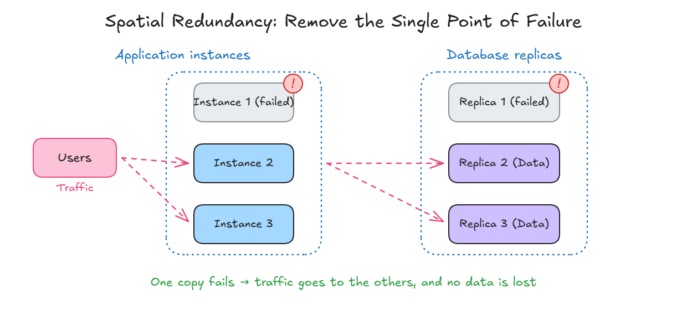
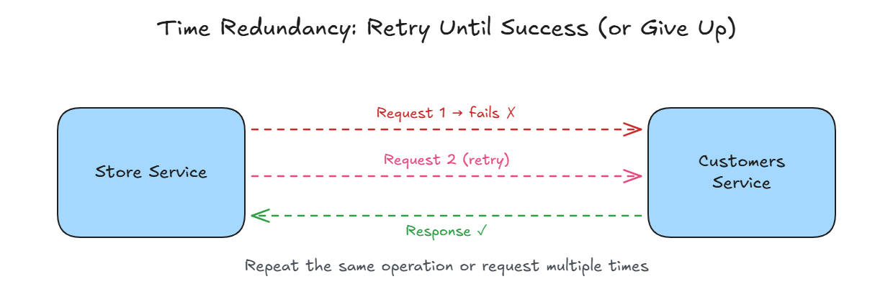
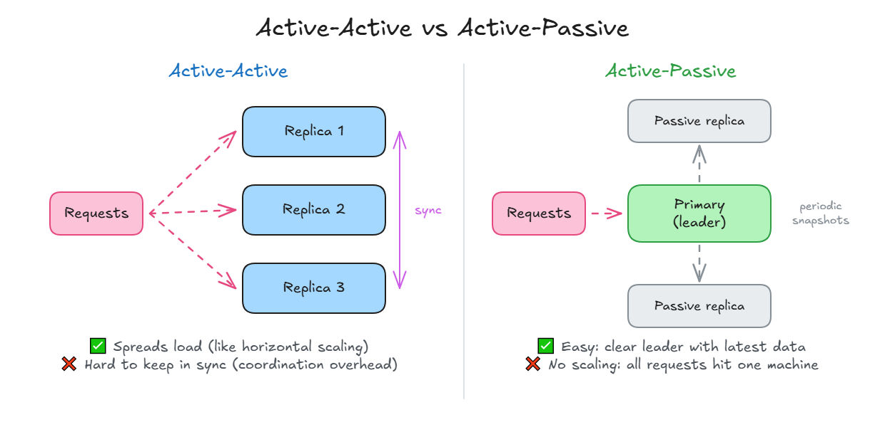
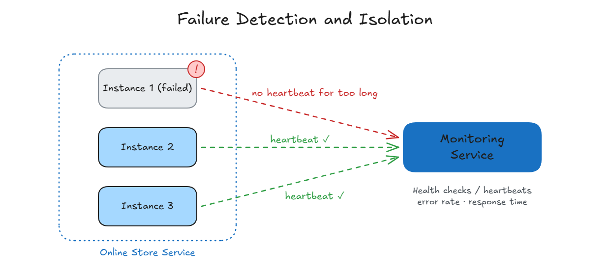
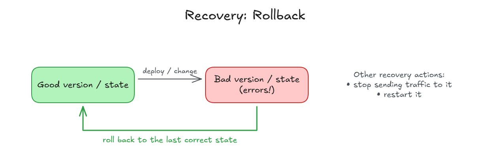

# Fault Tolerance & High Availability

**In this lecture:**

1. What stops us from getting high availability out of the box (the sources of failures)
2. Fault tolerance: the way to achieve high availability
3. The three tactics of fault tolerance: failure prevention, failure detection and isolation, and recovery

---

### The 3 Sources of Failures

1. **Human error:** the first and most common source.
   - Pushing a faulty config (configuration settings) to production
   - Running the wrong command or the wrong script
   - Deploying a new version of the software that hasn't been thoroughly tested
2. **Software errors:**
   - Exceptionally long garbage collections (pauses while the program cleans up unused memory)
   - Crashes, such as out-of-memory exceptions, null pointer exceptions and segmentation faults
3. **Hardware failures:**
   - Servers, routers or storage devices breaking down because they reached the end of their shelf life
   - Power outages caused by natural disasters
   - Network failures caused by infrastructure issues or general congestion (too much traffic)

We can improve our code reviews, testing and release processes, and keep maintaining our hardware, but failures will **inevitably** still happen.

---

### Fault Tolerance

So the best way to achieve high availability is through **fault tolerance**.

> **Fault tolerance enables our system to remain operational and available to users despite failures in one or more of its components.**

When failures happen, a fault-tolerant system may keep working at the **same** level of performance, or at a **reduced** level, but it prevents the system from becoming **entirely** unavailable.

Fault tolerance is built on three major tactics:

1. **Failure prevention**
2. **Failure detection and isolation**
3. **Recovery**

**Real-world example:** A plane with two engines can keep flying if one engine fails. It may fly slower, but it does not fall.

---

### Tactic 1: Failure Prevention

The first thing we can do is **eliminate every single point of failure**: one part that, if it breaks, takes the whole system down. Examples:

1. One server where we run our application
2. All our data stored in one database instance on a single computer

The best way to eliminate a single point of failure is **replication and redundancy** (keeping extra copies).

### Spatial Redundancy

Spatial redundancy means running copies in **different places**, on different computers:

1. **Application:** instead of one instance on one server, run multiple instances on multiple servers. If one server goes down for any reason, we can send all the network traffic to the other servers.
2. **Database:** instead of storing all the data on one computer, run multiple **replicas** (copies) of the database, holding the same data, on multiple computers. Losing any one replica does not lose any data.

### Time Redundancy

For computations, besides spatial redundancy, we also have **time redundancy**: repeating the same operation or request multiple times until we either succeed or give up.

### Two Replication Strategies

Both strategies are used a lot in the industry, in different systems.

**1. Active-active architecture:** requests go to **all** the replicas, which forces them all to stay in sync with each other. If one replica goes down, the others can take all the requests immediately.

**2. Active-passive architecture:** one **primary** instance or replica takes all the requests. The other **passive** replicas follow the primary by taking periodic snapshots of its state.

| | Active-Active | Active-Passive |
| --- | --- | --- |
| **Advantage** | Spreads the load across all replicas, the same as horizontal scalability, so it takes more traffic and gives better performance | Much easier to build: there is a clear leader with the most up-to-date data, and the other replicas just follow it |
| **Disadvantage** | All replicas take requests, so keeping them in sync is not trivial, and needs extra coordination and overhead | No ability to scale, because all requests still go to one machine |

**Real-world example:** Active-active is several cashiers all serving customers at once. Active-passive is one cashier working while a trainee watches and is ready to take over.

---

### Tactic 2: Failure Detection and Isolation

If one application instance crashes because of a software or hardware problem, we must be able to:

1. **Detect** that the instance is faulty
2. **Isolate** it from the rest of the group, for example by stopping requests from going to that server

To detect failures, we usually need a **separate system** that acts as a **monitoring service**. It can check the health of our instances in two ways:

1. **Health checks:** the monitoring service sends periodic health check messages to each instance.
2. **Heartbeats:** each healthy instance sends periodic messages, called heartbeats, to the monitoring service.

Either way, if the monitoring service does not hear from a server for a **predefined amount of time**, it assumes that server is no longer available.

### False Positives vs False Negatives

| | What happens | Is it okay? |
| --- | --- | --- |
| **False positive** | A healthy host is marked as faulty, for example because of a network issue or a temporary long garbage collection | ✅ Okay. We don't need a perfect monitoring service. |
| **False negative** | A server crashed, but the monitoring service did **not** detect it | ❌ Not okay. Our monitoring must not have false negatives. |

### Smarter Monitoring

Besides simple pings and heartbeats, the monitoring system can watch for certain conditions:

1. **Error rate:** it collects the number of exceptions or errors each host gets per minute. If one host's error rate becomes exceptionally high, it treats that host as failed.
2. **Response time:** it collects how long each host takes to respond to requests. If one host becomes exceptionally slow, it decides something must be wrong with that server.

**Real-world example:** A lifeguard who doesn't see a swimmer's hand wave for a while goes to check on them, even if the swimmer turns out to be fine.

---

### Tactic 3: Recovery from Failure

Remember the second availability formula:

> **Availability = MTBF / (MTBF + MTTR)**

If we can detect and recover from **each** failure faster than the user can notice, MTTR gets close to 0, so availability gets close to **100%**, no matter how often the system fails.

Once we detect and isolate the faulty instance or server, we can:

1. **Stop sending traffic** or any workload to that host. This is the obvious action.
2. **Restart it**, assuming the problem may go away after the restart.
3. **Roll back:** go back to a version that was still considered stable and correct.

### Rollbacks

1. **Databases:** rollbacks are very common here. If we reach a state that breaks some condition, or the integrity of the data, we roll back to the last state in the past that was correct.
2. **Software releases:** if we roll out a new software version to all servers and detect that the servers with the new version get many errors, we can automatically roll back to the previous version. This keeps the system from becoming entirely unavailable.

**Real-world example:** If a phone update makes your apps crash, going back to the old version that worked is a rollback.

---

**Key idea:** Failures will always happen, so we achieve high availability through fault tolerance: prevent failures with redundancy, detect and isolate failed parts quickly, and recover fast.

---

## Short Note

- **3 sources of failures:**
  - **Human error** (the most common): a bad config, the wrong command or script, untested deployments.
  - **Software:** long garbage collections and crashes (out of memory, null pointer, segmentation fault).
  - **Hardware:** devices reaching the end of their shelf life, power outages, network failures or congestion.
- **Failures are inevitable**, so high availability comes from **fault tolerance**: the system stays available despite failed components, maybe with reduced performance, but never entirely down.
- **Tactic 1: failure prevention.** Remove single points of failure with redundancy and replication.
  - **Spatial:** many app instances and many database replicas on different computers.
  - **Time:** retry the same request until it succeeds or we give up.
  - **Active-active:** all replicas take requests, so load is spread, but syncing is hard.
  - **Active-passive:** one primary takes everything and passives copy snapshots, which is easy but doesn't scale.
- **Tactic 2: detection and isolation.** A separate monitoring service uses health checks or heartbeats, and a host that is silent too long counts as failed.
  - False positives are okay. False negatives are **not**.
  - It can also watch error rates and response times.
- **Tactic 3: recovery.** Fast recovery makes MTTR → 0, so availability → 100%.
  - Actions: stop traffic to the host, restart it, or **roll back** (to the last correct database state, or the previous software version).
