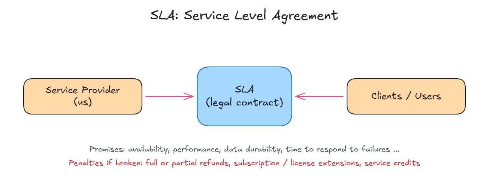
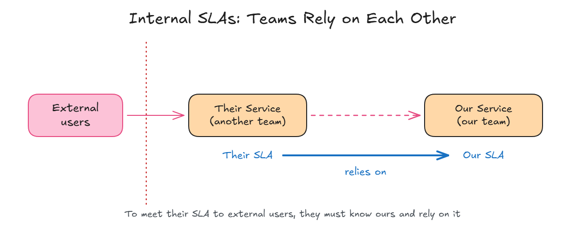
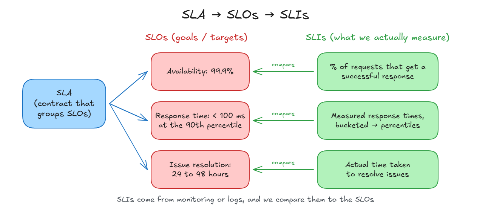

# SLA, SLO, SLI

**In this lecture:**

Three very important terms that bring together the promises we make to our users about our quality attributes:

1. **SLA:** Service Level Agreement
2. **SLO:** Service Level Objective
3. **SLI:** Service Level Indicator

---

### SLA: Service Level Agreement

> **An SLA is an agreement between us (the service provider) and our clients or users.**

It is essentially a **legal contract** that represents the promises we make to our users about the quality of service, such as:

1. Availability
2. Performance
3. Data durability (keeping the data safe and not losing it)
4. The time it takes us to respond to system failures, and so on

It also explicitly states the **penalties** and financial consequences for us if we fail to deliver those promises and breach (break) the contract. Penalties can include:

1. Full or partial refunds
2. Subscription or license extensions
3. Service credits

**Real-world example:** A pizza place promises "delivered in 30 minutes or it's free". The promise is the SLA, and the free pizza is the penalty.

### Who Gets an SLA?

1. **External paying users:** SLAs almost always exist for them.
2. **Free external users:** sometimes. For example, if we give users a 3-day free trial and our system has major issues during it, it makes sense to compensate them with a longer trial or credits for the future. However, most companies that provide **entirely free** services avoid making strict public promises and do not publish an SLA.
3. **Internal users within our company:** occasionally. Internal SLAs are unlikely to include penalties.

### Why Internal SLAs Make Sense

Internal customers may be **other teams** that provide services to external customers. To meet **their** SLA, they need to know **ours** and rely on us to meet it.

---

### SLO: Service Level Objective

> **SLOs are the individual goals we set for our system.** Each SLO is a target value, or a target range of values, that our service must meet.

**Lecture examples:**

1. **Availability SLO:** three nines (99.9%)
2. **Response time SLO:** less than 100 ms at the 90th percentile
3. **Issue resolution time SLO:** between 24 and 48 hours

All the quality attribute requirements we gathered at the start of the design process end up in one or more SLOs, along with any other goals we want our system to hit and to hold ourselves accountable for.

### How SLOs and the SLA Connect

1. If the system **has an SLA**, each SLO is an individual agreement within that SLA about one specific metric. The SLA **groups all the SLOs** into a single legal document.
2. Even a system **without an SLA must still have SLOs**. Without them, internal or external users do not know what to expect when they rely on our system.

---

### SLI: Service Level Indicator

> **An SLI is a quantitative measure (a real number) of how well we comply with an SLO.**

In other words, SLIs are the **actual numbers** we measure with a monitoring system, or calculate from our logs. We then compare them to the goals we set in our SLOs.

**Lecture examples:**

1. **Availability:** measure the percentage of user requests that get a successful response, and compare it with the 99.9% availability SLO.
2. **Response time:** collect the response time of each request, bucket them into time windows, and calculate the average or the percentile distribution. Then compare it with the SLO of 100 ms at the 90th percentile.

### Why Quality Attributes Must Be Measurable

Now we understand why quality attributes had to be **testable and measurable**:

1. SLOs are the target values for our most important quality attributes.
2. If a quality attribute is not measurable, we can't find an SLI to check that we meet its SLO.
3. If we can't measure and prove that we meet our SLOs, we can't definitely say we meet our SLA, which is a **legal contract**.

**Real-world example:** On a diet, the goal weight is the SLO, the number on the scale each morning is the SLI, and a deal with your coach would be the SLA.

---

### Who Defines What

1. **SLAs** are written by the **business and legal teams**.
2. **SLOs and SLIs** are where **software engineers and architects** have a lot more control.

### 4 Considerations When Defining SLOs

**1. Start from what users care about.** Don't take every SLI we can measure and create an objective for it. First think about the metrics users care about **most**, define SLOs around them, and **then** find the right SLIs to track those SLOs.

**2. Promise fewer SLOs.** The fewer SLOs we promise, the better for us. With too many, it is hard to give them all equal priority. With just a few, it is much easier to focus our whole software architecture on meeting them.

**3. Set realistic goals, with a budget for error.** Just because we **can** provide five nines of availability does not mean we should commit to it. We should commit to a much **lower** availability than we can actually provide. This:

1. Saves costs
2. Leaves room for unexpected issues

This matters most when SLOs are part of an **external** SLA. Some companies define:

1. **Looser external SLOs**, for example 99.9% availability promised to clients
2. **More aggressive internal SLOs**, for example 99.99% availability as the internal goal

This way, we aim for better quality internally, commit to much less with our clients, and avoid financial penalties if we miss the high internal bar.

**4. Have a recovery plan.** Decide **ahead of time** what to do when the SLIs show we are not meeting our SLOs, for example when the system goes down for a long time, performance degrades, or we suddenly get many reports of issues or bugs. The plan should include:

1. Automatic alerts to engineers or DevOps
2. Automatic failovers, restarts, rollbacks or auto-scaling policies
3. Predefined handbooks on what to do in certain situations, so the person on call does not have to improvise during an emergency

---

**Key idea:** The SLA is the legal contract, the SLOs are the goals inside it, and the SLIs are the real measurements that prove whether we meet those goals.

---

## Short Note

- **SLA (Service Level Agreement):** a legal contract between the provider and users, with promises (availability, performance, durability, failure response time) and **penalties** (refunds, extensions, credits).
  - Almost always for paying users, sometimes for free users (such as a broken free trial → extend it), and occasionally internal (usually no penalties).
  - Fully free services usually publish no SLA.
  - Internal SLAs matter because other teams rely on ours to meet their own.
- **SLO (Service Level Objective):** an individual target value or range, such as 99.9% availability, < 100 ms at the 90th percentile, or issue resolution in 24 to 48 h.
  - The SLA groups the SLOs. Every system needs SLOs, even without an SLA.
- **SLI (Service Level Indicator):** the actual measured number (from monitoring or logs) that we compare to the SLO, such as the % of successful requests, or the percentiles of response times.
- **Measurable quality attributes** → SLIs exist → we can prove the SLOs → we can prove the SLA.
- **Business and legal teams** write SLAs, while **engineers and architects** shape SLOs and SLIs.
- **4 considerations for SLOs:**
  - Start from what users care about most, then pick the SLIs.
  - Promise **fewer** SLOs.
  - Commit **lower** than we can deliver (error budget), for example 99.9% external vs 99.99% internal.
  - Have a **recovery plan**: alerts, failovers, restarts, rollbacks, auto-scaling, and handbooks.
