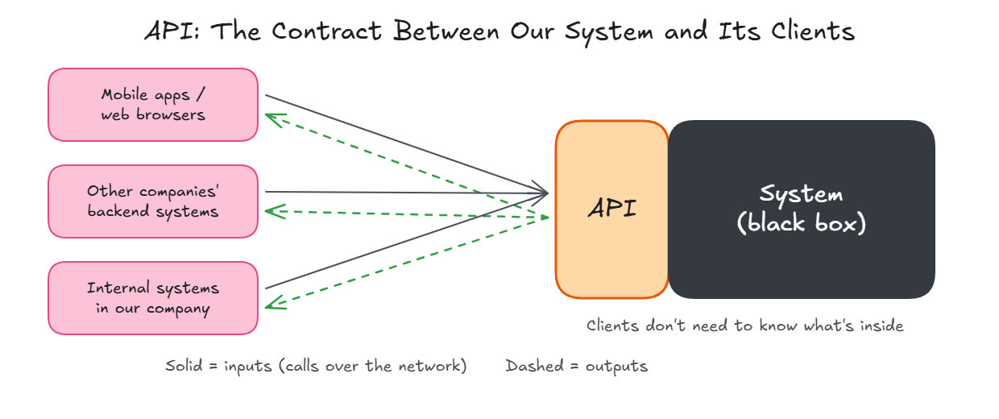
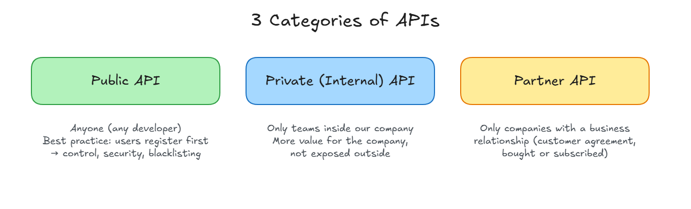
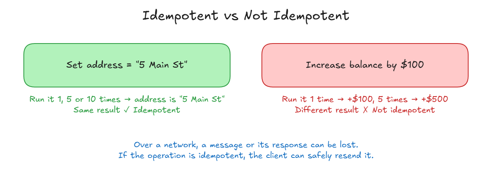
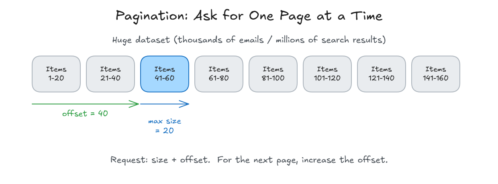
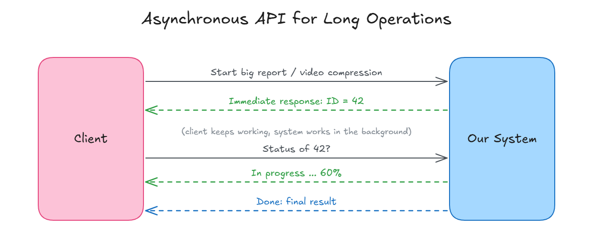

# Introduction to API Design

**In this lecture:**

1. What an API is, and why we need it
2. The three categories of APIs
3. Best practices and patterns for designing a good API

---

### What Is an API?

After we capture all the functional requirements, we can think of our system as a **black box** with a behavior and a well-defined **interface**.

That interface is a **contract** between:

1. Us, the engineers who build the system
2. The client applications that use our system

Because other **applications** call this interface, we call it an **Application Programming Interface (API)**.

We are building a large-scale system, not a class or a library, so this API is called by other applications **remotely, through the network**.

### Who Calls Our API?

1. **Front-end clients:** mobile applications or web browsers
2. **Other companies' backend systems**
3. **Internal systems** in our own organization

Also, once we finish the internal design and decide on the different components, **each component will have its own API**, called by other applications inside our system.

**Real-world example:** A restaurant menu is an API. You order from the menu without knowing how the kitchen works inside.

---

### The 3 Categories of APIs

**1. Public APIs:** exposed to the general public, so any developer can use them from their application.

- **Best practice:** require users to **register** before they can send requests. This gives us better control over who uses our system and how, better security, and the ability to **blacklist** users who don't follow our rules.

**2. Private (internal) APIs:** exposed only **inside our company**. Other teams or parts of the organization can use our system and get more value for the company, without exposing the system outside the organization.

**3. Partner APIs:** very similar to public APIs, but exposed only to companies or users that have a **business relationship** with us, in the form of a customer agreement after buying our product or subscribing to our service.

---

### Benefits of a Well-Defined API

1. **Main benefit:** clients can immediately and easily improve their business with our system, **without knowing anything** about its internal design or implementation.
2. **Clients don't have to wait:** once we define the API and share it, clients can start building their integration with us before we finish implementing the system.
3. **Easier internal design:** the API defines the endpoints, meaning the different routes users can take to use our system, so it becomes much easier to design and architect the system's internal structure.

---

### Best Practices for a Good API

### 1. Complete Encapsulation

Hide the internal design and implementation completely, and abstract it away from the developers who use the API.

1. If a client needs to know how the API is implemented internally, or too much about our business logic, the whole purpose of the API is defeated.
2. The API must be fully **decoupled** from our internal design, so we can change that design at any time without breaking our contract with existing clients.

### 2. Easy to Use

The API must be easy to use, easy to understand, and **impossible to misuse**, by accident or on purpose. Things that help:

1. **Only one way** to get certain data or perform a task, not many
2. **Descriptive names** for actions and resources
3. Exposing **only** the information and actions users need, nothing more
4. Keeping things **consistent** across the whole API

### 3. Idempotent Operations

> **An idempotent operation has no additional effect on the result if it is performed more than once.**

**Lecture examples:**

1. **Updating a user's address to a new address:** idempotent. The result is the same whether we do it 1, 5 or 10 times.
2. **Increasing a user's balance by $100:** **not** idempotent. The result changes with the number of times we do it.

**Why we prefer idempotent operations:** our API is used over the network. When a client sends a message:

1. The message may be lost, or
2. The response may be lost, or
3. A critical component in our system may go down, so the message was never received.

The client has **no idea** which of these happened. If the operation is idempotent, the client can simply **resend** the same message without risking bad consequences.

**Real-world example:** Pressing a lift button many times still calls the lift once, which is idempotent. Pressing "pay" twice in a shop might charge you twice, which is not.

### 4. Pagination

Pagination is important when a response contains a **very large** payload or dataset. Without it, most client applications can't handle such big responses, or the user experience is poor.

**Lecture examples:**

1. Opening your email and seeing **all** the thousands of emails you ever received on one page, instead of the last 10 or 20
2. Searching in an online store or search engine and getting **all** the thousands, or millions, of matching items

Even if the app or browser didn't crash, which is highly unlikely, it would take an unreasonable time to show all those results.

**How pagination works:** the client asks for only a **small segment** of the response by giving:

1. The **maximum size** of each response
2. An **offset** within the overall dataset (where to start)

For the next segment, the client simply **increases the offset**.

### 5. Asynchronous API for Long Operations

Some operations take a long time and only produce **one big result at the end**, with nothing meaningful to give before they finish, so pagination doesn't help. **Lecture examples:**

1. Running a big report that needs to talk to many databases
2. Big data analysis that scans many records or log files to aggregate them
3. Compressing large video files

If the client has to wait, it cannot make any progress. The solution is an **asynchronous API**:

1. The client gets a response **immediately**, without waiting for the final result.
2. The response usually includes an **identifier** (ID).
3. The client uses that ID to track the progress and status of the operation, and eventually get the final result.

**Real-world example:** At a dry cleaner you get a ticket number right away, and you come back later with the ticket to collect your clothes.

### 6. API Versioning

Explicitly **version** the API, and let clients know which version they are using.

1. The best API lets us change the internal design and implementation without changing the API.
2. In practice, we can't always predict the future, so at some point we may have to make **non-backward-compatible** changes (changes that break old clients).
3. With explicit versions, we can run **two versions at the same time**, and gradually **deprecate** (retire) the older one, while communicating properly with the clients still using it.

---

### Standard API Types

In theory, we can define our API in any way we want, as long as we follow these best practices. But over time, a few types of APIs became **standard in the industry**. The next lectures cover them.

---

**Key idea:** An API is the contract that lets other applications use our system without knowing its insides. A good API is encapsulated, easy to use, idempotent, paginated, asynchronous for long jobs, and versioned.

---

## Short Note

- **API (Application Programming Interface):** the contract between our system (as a black box) and client applications, called **remotely over the network**.
  - Callers: mobile apps and browsers, other companies' backends, and internal systems. Each internal component also gets its own API.
- **3 categories:**
  - **Public:** anyone can use it. Make users register first (control, security, blacklisting).
  - **Private (internal):** only teams inside our company.
  - **Partner:** only companies with a business relationship (agreement or subscription).
- **Benefits:** clients use us without knowing our insides, they can start integrating before we finish, and the API makes our internal design easier (it defines the endpoints).
- **Best practices:**
  - **Encapsulation:** hide the internals, and stay decoupled so the internals can change without breaking clients.
  - **Easy to use:** one way to do each thing, descriptive names, only what's needed, consistent, impossible to misuse.
  - **Idempotent:** repeating gives the same result (set an address ✓, add $100 ✗), so clients can safely resend after network problems.
  - **Pagination:** a max size plus an offset for huge results (emails, search results).
  - **Asynchronous API:** for long jobs (reports, big data, video compression), return an ID immediately and let the client check the status and result later.
  - **Versioning:** run old and new versions together, and deprecate the old one gradually.

---

## Q & A

**Question 1:** Which one of these operations is **NOT** idempotent?

1. Deleting a record with a particular ID from the database
2. Resetting the user's balance to 0
3. Taking the absolute value of a number
4. Removing the last record from a queue

**Answer:** 4. Removing the last record from a queue.

Each time we run it, a **different** record is removed, so the result keeps changing. The other three give the same result no matter how many times we repeat them: the record with that ID is already gone, the balance stays 0, and the absolute value stays the same.

**Question 2:** When an API offers pagination, what 2 pieces of information does the user of the API need to send to the server in the request?

1. The client's font size, and the offset in the dataset
2. The size of the client's memory, and the client's display resolution
3. The number of items in each response, and the offset in the entire dataset

**Answer:** 3. The number of items in each response, and the offset in the entire dataset.

This matches the lecture: the client sends the **maximum size** of each response and the **offset** (where to start). For the next page, it increases the offset.

**Question 3:** What problem may we run into if we do **not** explicitly version our external API?

1. We won't be able to change the implementation of the API
2. We won't be able to add features to the API
3. If we need to change our API in a non-backward-compatible way, we won't be able to make the change without breaking existing clients

**Answer:** 3.

With versions, we can run the old and new APIs side by side and retire the old one gradually. Without versions, any breaking change hits every existing client at once.
