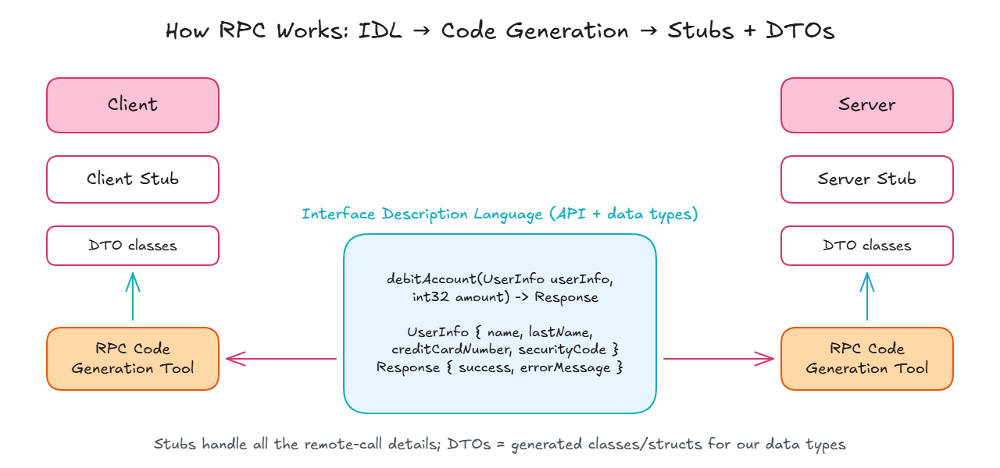
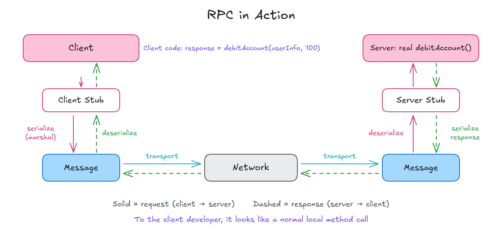
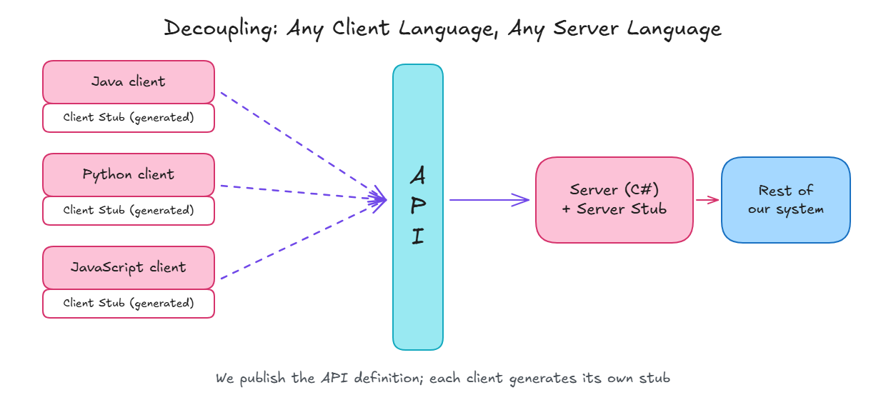
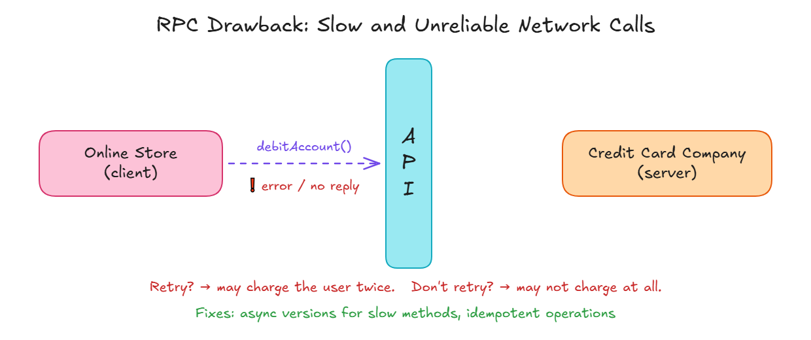

# RPC - Remote Procedure Calls

**In this lecture:**

1. What RPC is, and how it works
2. Its benefits and drawbacks
3. When to choose RPC over other API styles

---

### What Is RPC?

> **A Remote Procedure Call (RPC) is the ability of a client application to execute a subroutine (a method) on a remote server.**

What makes this type of API unique: calling the remote method **looks and feels like calling a normal local method**, in terms of the code the developer writes.

1. **Local transparency:** this feature is called local transparency. To the client developer, a method running locally and a method running remotely look almost exactly the same.
2. **Multiple programming languages:** most RPC frameworks, but not all, support many programming languages, so applications written in different languages can talk to each other through RPC.

**Real-world example:** Ordering by phone from a shop feels like asking someone next to you, even though the person who does the work is far away.

---

### How RPC Works

### Step 1: Define the API in an Interface Description Language (IDL)

The API, and the data types used in its methods, are declared in a special **Interface Description Language (IDL)**. Each RPC framework has its own IDL.

The IDL is a **schema definition** (a formal description) of the communication between the remote client and our server.

**Lecture example:**

```
debitAccount(UserInfo userInfo, int32 amount) -> Response

UserInfo {
    String name, lastName;
    String creditCardNumber;
    int32 securityCode;
    ...
}

Response {
    bool success;
    String errorMessage;
}
```

### Step 2: Generate the Stubs and DTOs

Once we have the IDL definition, a special compiler, or **code generation tool** that is part of the RPC framework, generates two separate implementations of the API method:

1. **Server stub:** the generated implementation on the server side
2. **Client stub:** the generated implementation on the client side

The stubs take care of **all the details** of making the remote call.

Also, all the custom object types we declare in the IDL (such as `UserInfo` and `Response`) are compiled into classes or structs, depending on the programming language. These generated types are called **Data Transfer Objects (DTOs)**.



### Step 3: What Happens at Run Time

**The request:**

1. The client application calls the RPC method with some parameters, for example `debitAccount(userInfo, 100)`.
2. The **client stub** encodes the data. This is called **serialization** or **marshalling** (turning objects into a format that can be sent).
3. The client stub opens a connection to the remote server and sends the data to the server stub.
4. The **server stub** for that method is listening for client messages. When a message arrives, it **deserializes** (unmarshals) the data.
5. The **real implementation** of the method runs on the server.

**The response:**

6. The server passes the result back to the server stub, which **serializes** it and sends it to the client.
7. The client stub receives the encoded response, **deserializes** it, and returns it to the caller, as if it were the return value of a normal local method.



RPC has been around for **decades**. Only the frameworks, their implementation details and their efficiency change over time.

---

### Our Job as API Developers

1. Pick an appropriate RPC framework.
2. Define the API and its data types in the framework's IDL.
3. **Publish** that description.

From this point, the client using our system and the server that is part of our system are **completely decoupled**:

1. When we finish designing and implementing our system, we generate the **server stub**.
2. When a new client wants to call our API, they use the framework's publicly available tools to generate their own **client stub** from the API definition we published.
3. If the framework supports many programming languages, we are not limited in our choice of language for the server, and each client can pick their favorite language to talk to our system.



---

### Benefits of RPC

1. **Convenience for client developers:** once they generate their stub, they talk to our system by calling methods on objects, which look and feel exactly like normal local methods.
2. **Full abstraction of the network:** all the details of how the connection is made and how data travels between client and server are hidden from the developers.
3. **Familiar error handling:** any communication failure simply becomes an error or an exception, depending on the language, just like with any normal method.

---

### Drawbacks of RPC

Unlike local methods that run on the client, remote methods are much **slower** and much **less reliable**.

### Drawback 1: Slowness

The client never knows how long a remote method call will take. In the code, it looks like a local method, which is usually fast, so it can cause **surprising performance bottlenecks**.

**Fix:** as API designers, we must help client developers avoid blocking their code on methods we know are slow on our end. We do this by providing **asynchronous versions** of those slow methods, a best practice from the previous lecture.

### Drawback 2: Unreliability

The client runs remotely, maybe on a computer that belongs to a different company, and talks to our server over the network. If we're not careful, we can create very confusing situations for client developers.

**Lecture example:** We are a **credit card company**, and the client runs an **online store** that calls our `debitAccount()` method. If the call fails or throws an exception, the client has a dilemma:

1. **Retry:** they risk charging the user **twice**.
2. **Don't retry:** they risk not charging the user **at all**.

The client has no real way to know whether:

1. Our server received the message, and only the acknowledgement got lost in the network, or
2. Our server crashed and never received the message.



**Fix:** we can't fully solve unreliability, but we can reduce the problem by making our operations **idempotent** when possible, another best practice from the previous lecture.

**Real-world example:** If you send money through a banking app and the screen freezes, you don't know whether to press "Send" again. An idempotent transfer, such as one with a unique transfer number, would make pressing it twice safe.

---

### When to Use RPC

### Good Fit

1. **Communication between two backend systems.** RPC is very common here. Frameworks for calling RPC from front-end clients, such as web browsers, exist but are less common.
2. **An API we provide to a different company**, instead of to an end-user app or web page.
3. **Communication between internal components** inside a large-scale system.
4. **When we want to fully hide the network communication** and focus only on the **actions** the client wants to perform on the server.
5. **Action-centric APIs:** RPC revolves around **actions**, not data or resources. Every action is simply a new method, with a different name and signature, and we can define as many methods as we want, almost without limit.

### Not a Good Fit

1. **When we don't want to hide the network communication**, and want to directly use things like **HTTP cookies or headers**. Other API styles match this better.
2. **Data-centric APIs** where all the operations are simple **CRUD** operations (Create, Read, Update, Delete). Other API styles fit much better, and the next lecture covers one of them.

---

**Key idea:** RPC lets a client call a method on a remote server as if it were a local method. It is great for backend-to-backend, action-focused APIs, but we must handle its slowness with async methods and its unreliability with idempotent operations.

---

## Short Note

- **RPC:** a client runs a method (subroutine) on a remote server, and it looks like a normal local call (**local transparency**). Most frameworks support many languages.
- **How it works:**
  - Define the API and data types in an **IDL** (a schema), for example `debitAccount(UserInfo, int32) -> Response`.
  - A **code generation tool** creates a **client stub**, a **server stub** and **DTOs** (generated classes or structs).
  - At run time: client stub **serializes (marshals)** → network → server stub **deserializes** → the real method runs → the response is serialized → client stub deserializes → returned like a local value.
- **Our job:** pick a framework, define the IDL, and publish it. Client and server are then **decoupled**: we generate the server stub, clients generate their own, and each side picks its own language.
- **Benefits:** convenient for clients, the network is fully hidden, and failures are just errors or exceptions.
- **Drawbacks:**
  - **Slow:** calls look local but may take long, so offer **async** versions.
  - **Unreliable:** if `debitAccount()` fails, should the client retry (charge twice?) or not (never charge?). Make operations **idempotent**.
- **Use RPC for:** backend-to-backend, APIs for other companies, internal components, hiding the network, and action-centric APIs.
- **Avoid RPC for:** when we need HTTP cookies or headers, or for data-centric **CRUD** APIs (other styles fit better).
