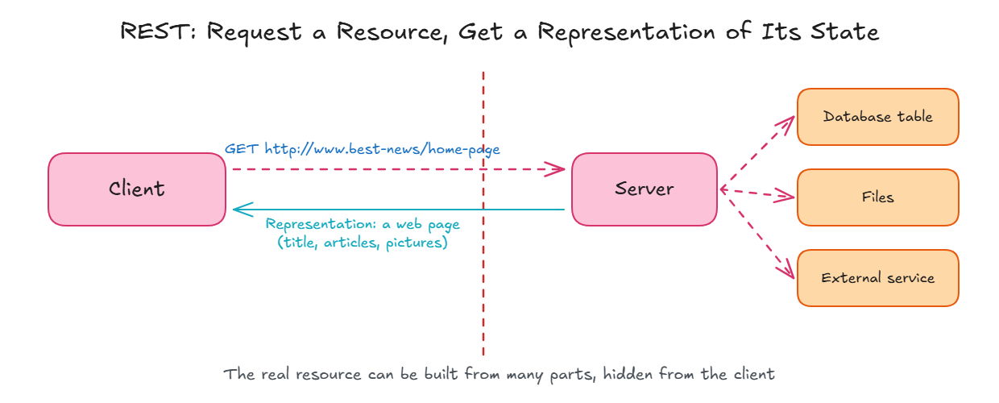
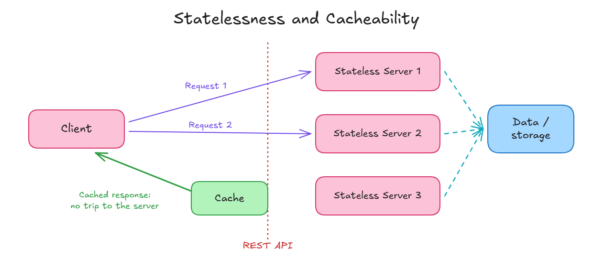
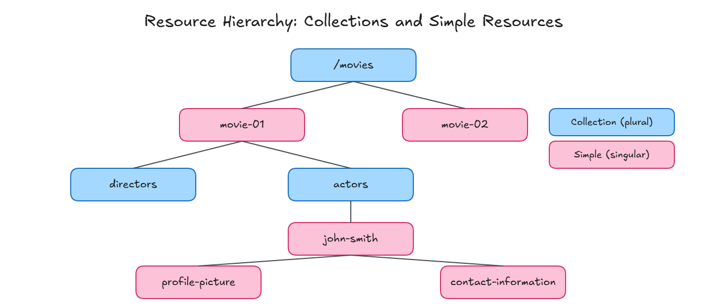

# REST API

**In this lecture:**

1. What a REST API is, and how it differs from RPC
2. How REST helps with performance, scalability and high availability
3. Resources: what they are, how to name them, and what operations we can do on them
4. How to design a REST API step by step (movie streaming example)

---

### What Is REST?

**REST (Representational State Transfer)** comes from a dissertation published by **Roy Fielding in 2000**.

> **REST is a set of architectural constraints and best practices for defining APIs for the web.**

1. It is **not** a standard or a protocol. It is an **architectural style** for designing APIs that are easy for clients to use and understand.
2. It makes it easy to build a system with quality attributes such as **scalability, high availability and performance**.
3. An API that follows the REST constraints is called a **RESTful API**.

---

### REST vs RPC

| | RPC | REST |
| --- | --- | --- |
| **Main idea** | **Methods** exposed to the client, organized in interfaces | **Named resources** that represent entities in our system |
| **Adding features** | Add more methods | Use the **same few methods** on resources |
| **Interface** | **Static:** all actions are defined ahead of time in the IDL | **Dynamic:** responses include links the client can follow (HATEOAS) |

### Resources and Representations

In REST, a client requests a **named resource**, and our system responds with a **representation of the current state** of that resource. The protocol commonly used for this is **HTTP**.

We send back only the **representation**. The resource itself can be built in a completely different way, hidden from the client.

**Lecture example: an online news magazine.** The resource is the **home page**:

1. **The client receives:** a web page with a title, articles and pictures. This is just the representation of the home page's current state.
2. **The system actually builds it from:** many entities spread across multiple database tables, files, or even external services.



**Real-world example:** A weather app shows "25°C, sunny". That is a representation. Behind it are many sensors, satellites and calculations you never see.

### HATEOAS: Hypermedia as the Engine of Application State

With **Hypermedia as the Engine of Application State (HATEOAS)**, each state representation sent to the client comes with **hypermedia links**. The client can follow those links to get more information or take actions, and move its own state forward.

**Lecture example (chat or email system):** the client asks for its current messages and gets back the message information **plus links** to related resources:

```json
GET .../users/john-smith

{
  "accounts_status": {
    "user_id": 123,
    "total_incoming_messages": 1003,
    "unread_messages": 5,
    "total_sent_messages": 567
  },
  "links": {
    "messages": "/users/123/messages",
    "profile": "/users/123/profile",
    "threads": "/users/123/threads"
  }
}
```

---

### How REST Gives Us Performance, Scalability and Availability

### Requirement 1: Statelessness → Scalability and High Availability

The server must be **stateless**. It must not keep any **session information** about a client. Each message is handled **in isolation**, without information about previous requests.

Because servers keep no session information, we can run a **group of servers** and spread the client requests across many machines, **completely transparently** to the client. One request can go to one machine and the next request to a different machine, and the client won't notice.

### Requirement 2: Cacheability → Performance

The server must define each response as **cacheable** or **non-cacheable**, explicitly or implicitly.

1. If a response is already cached somewhere closer to the client, the client **skips the round trip** to the server and back.
2. **Side benefit:** less load on our system.



**Real-world example:** In a bank, any free cashier can serve you, because your details are in the bank's system, not in one cashier's memory. That is statelessness.

---

### Resources

Each resource is **named and addressed by a URI** (Uniform Resource Identifier, its address). Resources are organized in a **hierarchy**, shown with forward slashes (`/`).

1. **Simple resource:** has a state, and can optionally contain one or more sub-resources.
2. **Collection resource:** a special resource that contains a **list of resources of the same type**.

**Lecture example: a movie streaming service.**

```
http://best-movies-service/movies                      ← collection
http://best-movies-service/movies/movie-01             ← simple resource (a movie)
http://best-movies-service/movies/movie-01/directors   ← collection
.../movies/movie-02/actors/john-smith/profile-picture
.../movies/movie-03/actors/john-smith/contact-information
```

1. `movies` is a collection, and each item in it is a **movie** (a simple resource).
2. Each movie has a **directors** collection and an **actors** collection.
3. Each actor (a simple resource) has a **profile-picture** sub-resource and a **contact-information** sub-resource.



### What a Representation Can Be

A resource's state can be represented in many ways:

1. An image
2. A link to a movie stream
3. An object
4. An HTML page
5. A binary blob
6. Even executable code, such as JavaScript that runs in the browser

### Best Practices for Naming Resources

1. **Use nouns only.** This clearly separates resources (nouns) from the actions we take on them (verbs).
2. **Plural for collections, singular for simple resources.** In the example, `movies`, `directors` and `actors` are collections, and the others are simple resources.
3. **Clear and meaningful names.** This makes the API easy to use and prevents mistakes. Avoid overly generic collection names, such as `elements`, `entities`, `items`, `instances`, `values` or `objects`, which can mean anything.
4. **Unique, URL-friendly identifiers**, so they can be used easily and safely on the web.

---

### Operations: REST Methods Mapped to HTTP

Unlike RPC, REST limits each resource to **just a few predefined operations**:

| Operation | HTTP method |
| --- | --- |
| **Create** a new resource | `POST` |
| **Update** an existing resource | `PUT` |
| **Delete** an existing resource | `DELETE` |
| **Get** the state of a resource, or **list** the sub-resources of a collection | `GET` |

For a collection, "getting its state" usually means getting the **list of its sub-resources**. In some uncommon situations, we may define extra **custom methods**.

### Guarantees from HTTP

1. **Safe:** `GET` does not change the resource's state in any way.
2. **Idempotent:** `GET`, `PUT` and `DELETE` give the same state change whether we apply them once or many times.
3. **Cacheable:** `GET` responses are usually cacheable by default. `POST` responses can be made cacheable with the right HTTP headers. This helps us meet REST's cacheability requirement.

### Sending Data

When the client sends extra information, for example in a `POST` or `PUT`, we use the **JSON** format. Other formats, such as XML, are also acceptable.

---

### Designing a REST API Step by Step

**Lecture example: a movie streaming service.**

### Step 1: Identify the Entities

These become the resources of our API. To keep it simple: **users, movies, reviews and actors**.

### Step 2: Map the Entities to URIs

Define the resources and organize them in a hierarchy based on their relationships:

```
/users                                  /users/{user-id}
/movies                                 /movies/{movie-id}
/actors                                 /actors/{actor-id}
/movies/{movie-id}/reviews              /movies/{movie-id}/reviews/{review-id}
```

1. **Users and movies** are independent collections.
2. **Actors** is also independent, because the same actor can appear in different movies.
3. **Reviews** are a sub-resource of movies, because each review belongs to only **one** movie.

### Step 3: Choose the Representation of Each Resource

The most common format is **JSON**. For example, the movies collection is an object with an array of movie names mapped to movie IDs:

```json
GET /movies

{
  "movies": [
    { "name": "Pirates of the Caribbean", "id": "movie-123" },
    { "name": "Lord of the Rings",        "id": "movie-456" }
  ]
}
```

1. This makes it easy to find a movie by name and get its ID.
2. The client adds the ID to the URI to get that movie, for example `/movies/movie-123`.
3. A single movie object contains all the information about that movie, plus **links** to play it on the user's device, get its reviews, and get its actors. These links make the API driven by **HATEOAS**.

### Step 4: Assign HTTP Methods to Actions

| Request | Action |
| --- | --- |
| `POST /users` | Create (register) a new user. The response contains the new user ID. |
| `GET /users/{user-id}` | Get all the user's information, such as favorite movies and the watch list |
| `PUT /users/{user-id}` | Update the user's profile, information or preferences |
| `DELETE /users/{user-id}` | Remove the user entirely from the system |

To finish the API, **repeat this process for every resource** in the system.

---

**Key idea:** REST is a resource-oriented API style: clients use a few HTTP methods (POST, GET, PUT, DELETE) on named resources (URIs), and stateless servers plus caching give scalability, availability and performance.

---

## Short Note

- **REST (Representational State Transfer):** Roy Fielding, 2000. An **architectural style**, not a standard or protocol. Following it makes an API **RESTful**.
- **REST vs RPC:** RPC = many **methods** with a static IDL. REST = named **resources** + a few methods, and **dynamic** (HATEOAS links).
- **Representation:** the client gets a representation of a resource's state over **HTTP**. The real resource can be built from many hidden parts, such as a news home page built from tables, files and services.
- **HATEOAS:** responses include links (messages, profile, threads) the client can follow.
- **Statelessness:** no session information on the server, so requests can go to any server → **scalability and high availability**.
- **Cacheability:** responses are marked cacheable or not, so cached copies skip the round trip → **performance** and less load.
- **Resources:** addressed by **URIs** in a `/` hierarchy. **Simple** (has a state) vs **collection** (a list of the same type). A representation can be JSON, HTML, an image, a stream link, a blob or JS.
- **Naming:** nouns only, plural = collection and singular = simple, meaningful (not `items` or `objects`), unique and URL-friendly IDs.
- **Methods:** `POST` = create, `PUT` = update, `DELETE` = delete, `GET` = get or list. `GET` is **safe**, `GET`/`PUT`/`DELETE` are **idempotent**, and `GET` is cacheable by default. Send data as **JSON**.
- **4 design steps:**
  - Identify the entities (users, movies, reviews, actors).
  - Map them to URIs (reviews go under movies).
  - Choose representations (JSON with IDs and links).
  - Assign HTTP methods (POST/GET/PUT/DELETE on users).

---

## Q & A

**Question 1:** We have this resource in our online store: `/store/products/apparel/shirts/hoodie`. What is the most correct statement?

1. It can be a "simple" resource.
2. It may have a "collection" sub-resource called `hoodie-sizes`.
3. It may have a sub-resource called `description`, and another sub-resource called `image`.
4. All of the above

**Answer:** 4. All of the above.

`hoodie` is singular, so it is a simple resource. A simple resource has a state and can optionally contain sub-resources, which can be collections (`hoodie-sizes`) or simple ones (`description`, `image`), just like an actor in the lecture has `profile-picture` and `contact-information`.

**Question 2:** Our company offers a REST API. To reduce the overhead of authenticating a user against a database record, someone suggests that the user is authenticated against the database only once, on the first request, and after that the server caches the user's session information in memory. What is the most correct statement?

1. Caching is one of the REST API concepts, so this solution will definitely keep our API RESTful.
2. Our application instances will now keep session information about users' requests and will no longer be stateless, so our API can't be considered RESTful anymore.
3. This can cause other performance issues and memory leaks, but if we're very careful, we can avoid them, and then our API can still be considered RESTful.

**Answer:** 2. The servers are no longer stateless, so the API is not RESTful.

REST requires the server to keep **no session information** about a client. The REST "cacheability" concept is about caching **responses**, not about servers remembering user sessions. With sessions in memory, each user is tied to one server, which breaks the scalability and availability that statelessness gives us.

**Question 3:** Which one of these operations is **NOT** a standard REST API operation?

1. Get the list of sub-resources of a collection resource
2. Update a simple resource
3. Delete an existing resource
4. Modify 2 simple resources in one operation
5. Get the state of a resource

**Answer:** 4. Modify 2 simple resources in one operation.

The standard REST operations each act on **one** resource: create (`POST`), update (`PUT`), delete (`DELETE`) and get or list (`GET`). Changing two resources in a single operation is not one of them.
