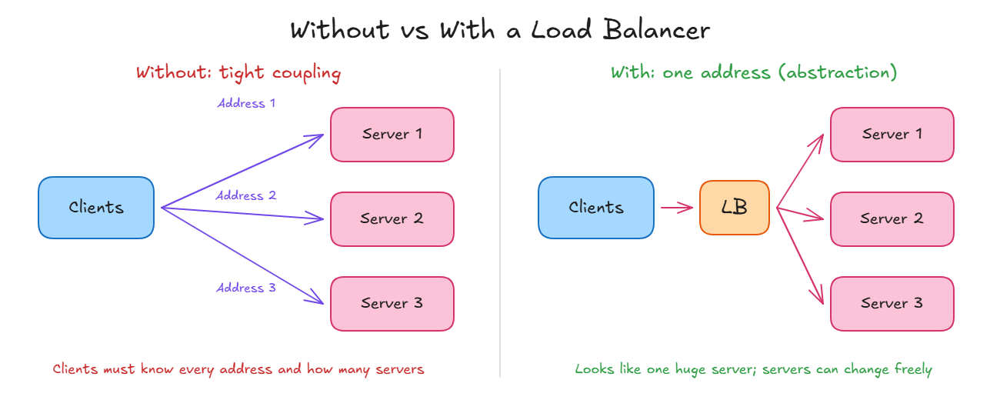
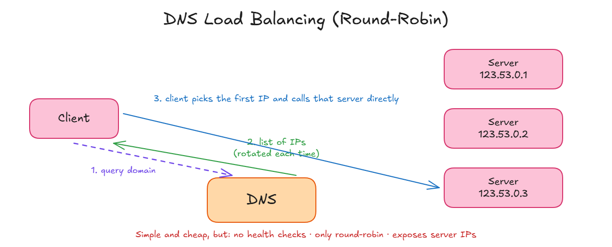
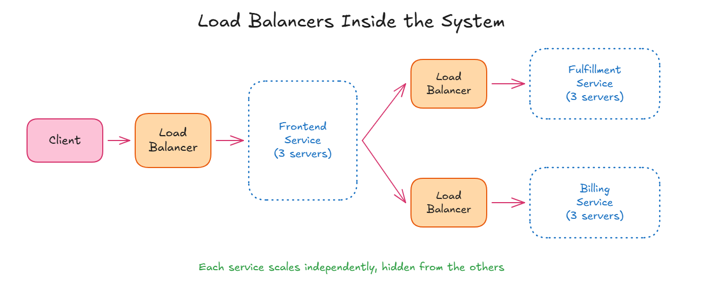
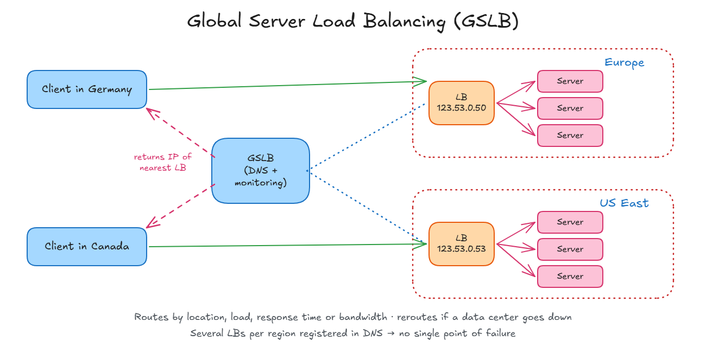

# DNS, Load Balancing & GSLB

**In this lecture:**

1. Why we need a load balancer (the motivation)
2. The quality attributes a load balancer gives our system
3. The 4 types of load balancing solutions, and how to combine them in a real large-scale system

The **load balancer** is the first, and one of the most important, software architecture building blocks. It is used in pretty much **100%** of real-life large-scale systems.

---

### Why We Need a Load Balancer

The basic role of a load balancer is to **balance the traffic load across a group of servers**, so no single server is overloaded.

From earlier lectures: the best way to get **high availability** and **horizontal scalability** is to run many identical instances of our application on many computers.

**The problem without a load balancer:** the client application, which may run on our customers' computers, must know:

1. The **addresses** of all those computers
2. The **number** of application instances

This **tightly couples** the client to our system's internal implementation, and makes it very hard for us to change anything.

**The added benefit of a load balancer: abstraction.** Most load balancing solutions also hide our group of servers behind them, so our whole system **looks like a single server** with immense computing power and a lot of memory. Different solutions give different levels of abstraction.

**Real-world example:** A restaurant host seats each new guest at a free table. Guests don't need to know how many waiters there are or which one is free.

---

### Quality Attributes a Load Balancer Gives Us

### 1. Scalability

By hiding servers behind a load balancer, we can scale **horizontally**, both ways:

1. **Scale up:** add servers when the load increases (high traffic).
2. **Scale down:** remove unneeded servers when the load decreases (low traffic), to **save money**.

In a **cloud** environment, where we can rent hardware on demand, **auto-scaling policies** can add or remove servers automatically, based on criteria such as requests per second or network bandwidth.

### 2. High Availability

Most load balancers can be configured to **stop sending traffic to servers that can't be reached**. With this monitoring feature, they balance the load only across **healthy** servers, and ignore servers that are dead or excessively slow.

### 3. Performance

1. **Response time:** a load balancer may add a **little latency**, so the response time can go up slightly.
2. **Throughput:** this small cost is usually acceptable, because we can have, within reason, as many backend servers as we like. So the number of requests or tasks we handle per unit of time is **much larger** than one server could give.

### 4. Maintainability

We can easily add servers to, or remove them from, the rotation. So we can:

1. Take servers down **one by one** for maintenance or to upgrade the application version, without disrupting clients
2. Add each server back when it's done, and take down the next

This is called a **rolling release**, and it keeps our SLA for availability.

---

### Type 1: DNS Load Balancing

**DNS (Domain Name System)** is part of the internet's infrastructure. It maps human-friendly names, such as `amazon.com`, `netflix.com` or `apple.com`, to **IP addresses** that network routers use to reach individual computers. It is the **phone book of the internet**.

**Normal DNS resolution:**

1. The client sends a **DNS query** to the DNS server.
2. The DNS server responds with the **IP address** of our domain, for example `123.53.0.1`.
3. The client uses that IP address to send requests **directly** to the server.

**How DNS balances the load:**

1. One DNS record can map to a **list of IP addresses**, one for each server.
2. Most DNS servers return that list in a **different order** for each client request.
3. By convention, most clients simply use the **first address** in the list.
4. So DNS spreads the load by rotating the list in a **round-robin** fashion (taking turns in order).

**Advantage:** super simple and cheap. It comes basically for free when we buy a domain name.

**Drawbacks:**

1. **No health monitoring.** If a server stops responding, DNS doesn't know and keeps sending clients to it.
   - The list of IPs only changes as often as the record's **TTL (time to live)** allows.
   - The list can also be **cached** in other places, such as the client's computer, so it takes even longer before requests stop going to a dead server.
2. **Only round-robin.** It can't account for some servers being more powerful than others, or detect that one server is more overloaded than the rest.
3. **Exposes our servers' IP addresses.** This reveals implementation details and makes the system **less secure**. Nothing stops a malicious client from picking one IP and sending all its requests to that one server, overloading it.

---

### Types 2 and 3: Hardware and Software Load Balancers

These are much more powerful and intelligent, and they solve DNS's drawbacks. The only difference between them:

1. **Hardware load balancers** run on **dedicated devices**, designed and optimized only for load balancing.
2. **Software load balancers** are **programs** that run on any general-purpose computer.

**What they give us:**

1. **Security:** **all** communication between clients and servers goes **through the load balancer**. The servers' IP addresses, and how many servers there are, are hidden from users.
2. **Health monitoring:** they send periodic **health checks** to the servers, to actively detect unresponsive ones.
3. **Smarter balancing:** they consider the type of hardware each instance runs on, the current load on each server, the number of open connections, and so on.

### Load Balancers Inside Our System

Besides balancing requests from external users, they can sit **inside** our system to create an abstraction **between services**.

**Lecture example: an online store.**

1. A **frontend service** responds to client requests and serves the front end to browsers.
2. Separate **fulfillment** and **billing** services sit behind their own load balancers.
3. Each service runs as multiple instances on a group of servers and is deployed independently.
4. The services talk to each other **through load balancers**, so each one can scale **independently** and transparently to the others.

### Their Limitations

1. **They must be collocated** (placed close to) with the servers they balance. Everything, to the servers and back to the client, passes through the load balancer, so placing it far away adds a lot of latency. If we run in **multiple data centers** (geographical locations), one load balancer for all of them hurts performance for at least one location.
2. **They don't solve DNS resolution.** We still need DNS to map human-readable domain names to an IP address.

---

### Type 4: Global Server Load Balancer (GSLB)

A **GSLB** is a **hybrid** of a DNS service and a hardware or software load balancer:

1. **Like DNS:** it provides a normal DNS service.
2. **Knows the user's location:** it can work out where the user is from the origin IP of the incoming request.
3. **Like a load balancer:** it has monitoring, so at any moment it knows the location and state of every server registered with it.

In a typical large-scale deployment, the "servers" registered with the GSLB are **load balancers in different data centers**, in different regions.

**How it works:**

1. The user sends a DNS query to the GSLB.
2. The GSLB returns the address of the **nearest** load balancer, for example Europe for a client in Germany, and US East for a client in Canada.
3. From then on, the user talks **directly** to that data center through its collocated load balancer.

**Routing strategies:** most GSLBs can route by more than just physical location, because they constantly talk to our data centers:

1. Current traffic or CPU load on each data center
2. The best estimated response time
3. The bandwidth between the user and each data center

This gives the best possible performance for each user, wherever they are.

**Disaster recovery:** if a data center has a natural disaster or a power outage, users can easily be sent to other locations, which gives **higher availability**.

### No Single Point of Failure

To stop a load balancer from being a **single point of failure** in a region, we place **several load balancers** and register all their addresses with the GSLB's DNS service, or any other DNS service. Clients get the list of load balancers and either use the first one, or pick one at random.

**Real-world example:** A delivery company sends your order to the nearest warehouse. If that warehouse is flooded, your order comes from the next closest one.

---

**Key idea:** A load balancer spreads traffic across servers and hides them behind one address, giving scalability, availability, throughput and maintainability. Large systems combine GSLB (global, DNS-based routing to the nearest healthy data center) with hardware or software load balancers in each data center.

---

## Short Note

- **Load balancer:** spreads traffic across servers so none is overloaded. It is used in almost every large system.
  - **Without it:** clients must know every server address and how many there are → tight coupling.
  - **With it:** an abstraction, where the whole system looks like one huge server.
- **Quality attributes:**
  - **Scalability:** add or remove servers (auto-scaling in the cloud, by requests/sec or bandwidth).
  - **High availability:** traffic goes only to healthy servers.
  - **Performance:** a little more latency, but much higher **throughput**.
  - **Maintainability:** take servers out one by one for a **rolling release**.
- **DNS load balancing:** DNS (the internet's phone book) returns a rotated list of IPs (**round-robin**), and the client uses the first one.
  - ✅ Simple and nearly free. ❌ No health checks (TTL and caching slow down changes), only round-robin, and exposes server IPs (less secure).
- **Hardware / software load balancers:** a dedicated device vs a program on a normal computer.
  - ✅ Hide the IPs, run health checks, smart balancing (hardware, load, connections), and can sit **between internal services** (frontend → fulfillment / billing).
  - ❌ Must be **collocated** with their servers, and don't solve DNS.
- **GSLB (Global Server Load Balancer):** DNS + location awareness + monitoring.
  - Returns the **nearest** data center's load balancer (Germany → Europe, Canada → US East).
  - Can also route by load, response time or bandwidth, and reroutes during **disasters**.
- **No single point of failure:** register several load balancers per region in DNS or the GSLB.
