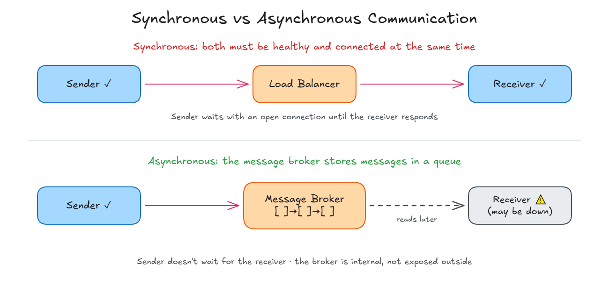
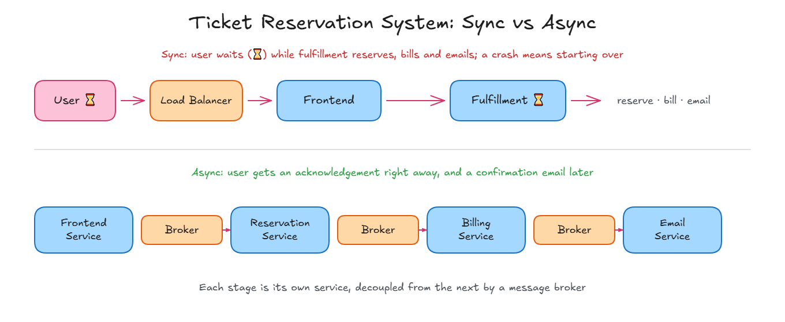
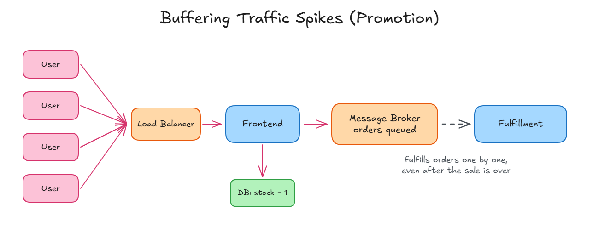
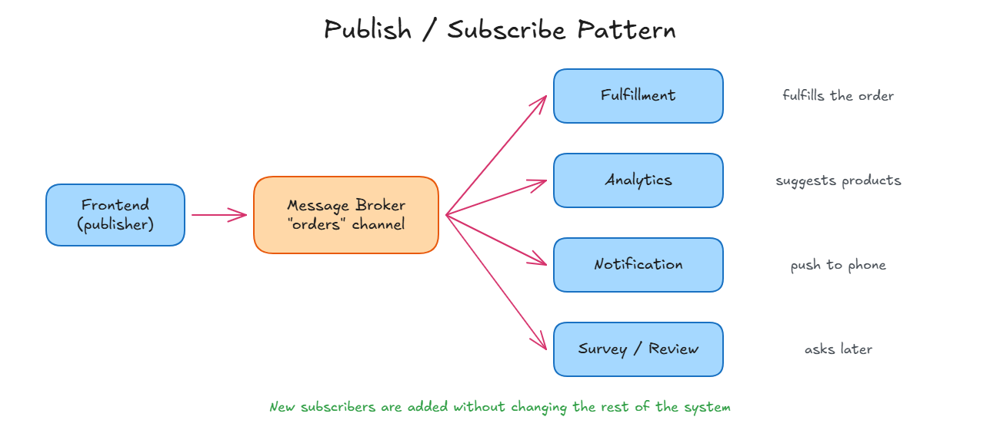

# Message Brokers

**In this lecture:**

1. Why we need a message broker, using cases where an **asynchronous** architecture gives us more benefits
2. What a message broker can do for us
3. The quality attributes a message broker adds to our system

The **message broker** is the most fundamental architectural building block for **asynchronous** architectures.

---

### Synchronous Communication and Its Drawbacks

In the load balancer lecture, whenever two applications talked to each other, directly or through a load balancer, there was a hidden assumption: the **sender** and the **receiver** both kept an **active connection**. So both had to be **healthy and running at the same time**. This is called **synchronous communication**.

It is the most straightforward way for services to talk, but it has drawbacks.

### Drawback 1: Both Sides Must Stay Healthy and Connected

This is easy when two services exchange very short messages that are quick to process. It gets much harder when a service takes a **long time** to finish its work and respond.

**Lecture example: a ticket reservation system** that sells tickets for shows offered by different theaters. It has two services:

1. **Frontend service:** shows the front end to the user and receives ticket purchase requests.
2. **Fulfillment service:** fulfills the order. It:
   - Reserves the ticket through an **external API** (the theater)
   - **Bills** the user by talking to a credit card company
   - Sends a **confirmation email**, or talks to an external service that sends a **physical ticket**

**The problems:**

1. While the fulfillment service works, the frontend service must keep an **open connection** and wait for the response.
2. While waiting, it also keeps the **user in suspense**, because we don't know if the operation succeeded until the ticket is reserved and the user is billed.
3. Even when it succeeds, the operation can take a long time.
4. Worse, if the server doing all this work **crashes**, we have to **start over**.

### Drawback 2: No Padding for Traffic Spikes

Synchronous communication has no **padding** (buffer) to absorb a sudden increase in traffic or load.

**Lecture example: an online store** with a frontend service and an order fulfillment service, running a **limited-time promotion** on a product.

1. The promotion brings many requests to the **frontend service**, which we can handle easily.
2. But it also brings a very large number of **purchase fulfillment requests** to the fulfillment service, which we **can't** handle easily, even if we scale it to many server instances.
3. The reason: fulfilling each order involves many operations that take a long time.

---

### What Is a Message Broker?

> **A message broker is a software architectural building block that uses the queue data structure to store messages between senders and receivers.**

A **queue** works like a line at a shop: the first message in is the first message out.

1. **Used inside our system:** unlike a load balancer, which can take external traffic from client applications, a message broker is used **inside** our system and is generally **not exposed externally**.
2. **Extra functionality:** besides storing or temporarily buffering messages, it can do **message routing, transformation, validation, and even load balancing**.
3. **Full decoupling:** unlike load balancers, message brokers **entirely decouple** senders from receivers, by providing their **own communication protocols and APIs**.

---

### Benefits and Capabilities

### 1. Asynchronous Architecture

Message brokers are the fundamental building block for **any** asynchronous software architecture.

1. The sender **doesn't wait** for any confirmation from the receiver after it sends the message to the broker.
2. The receiver may **not even be available** when the sender sends the message.

**Back to the ticket reservation system:**

1. The user gets an **acknowledgement immediately** after placing the order.
2. Later, the user gets an **email** with the official purchase confirmation, after the reservation is actually complete.
3. We can also **break the fulfillment service into multiple services**, one for each stage of the transaction (reservation, billing, email). Each pair of services is decoupled by its own message broker.

**Real-world example:** At a dry cleaner, you drop off your clothes, get a receipt right away, and get a message when they are ready. You don't stand at the counter waiting.

### 2. Buffering Messages to Absorb Traffic Spikes

**Back to the online store promotion:**

1. When many orders arrive in a short time, the frontend service simply **decrements a counter** in a database for the number of items left in stock.
2. The actual orders are stored in the message broker's **queue**.
3. The orders are then fulfilled **one by one**, even after the sale is over and traffic goes down.

**Real-world example:** On a big sale day, a restaurant takes every order slip at the counter, and the kitchen cooks them in order, at its own pace.

### 3. Publish/Subscribe Pattern (Pub/Sub)

Most message brokers also offer the **publish/subscribe** pattern:

1. Multiple services can **publish** (send) messages to a particular **channel**.
2. Multiple services can **subscribe** to that channel and get **notified** when a new event is published.

**Back to the online store:** without changing anything else in the system, we can add services that subscribe to the **orders** channel:

1. **Analytics service:** analyzes users' purchasing patterns and suggests products to them in the future.
2. **Notification service:** sends a **push notification** to the user's phone for every order, so the user is alerted if a purchase was placed from their account.
3. **Survey/review service:** for every purchase, schedules a survey or a review request some time after the purchase.

All of these were added **without any modifications** to the system.

**Real-world example:** A YouTube channel posts a video once, and every subscriber gets notified. The channel doesn't need to know who the subscribers are.

---

### Quality Attributes a Message Broker Gives Us

### 1. Fault Tolerance → High Availability

1. Services can communicate even while some of them are **temporarily unavailable**.
2. The broker **prevents messages from being lost**, which is another sign of a fault-tolerant system.
3. All this extra fault tolerance lets us give our users **higher availability**.

### 2. Scalability

The broker can **queue up messages** during a traffic spike, so our system can scale to high traffic **without any modifications**.

### 3. The Cost: Performance (Latency)

We pay a little in **latency**. A message broker adds a significant **indirection** (an extra stop in the middle) between two services, compared to straightforward synchronous communication, even through a load balancer. For most systems, this penalty is **not too significant**.

---

**Key idea:** A message broker stores messages in a queue between services, so senders don't wait for receivers. This gives an asynchronous architecture, buffering of traffic spikes and pub/sub, which bring high availability and scalability, at the cost of a little extra latency.

---

## Short Note

- **Synchronous communication:** sender and receiver keep an active connection, so both must be healthy at the same time.
  - ❌ **Long operations:** the frontend and the user wait (ticket system: reserve → bill → email), and a crash means starting over.
  - ❌ **No padding for spikes:** a promotion floods the slow fulfillment service, and even scaling doesn't help much.
- **Message broker:** an internal building block that uses a **queue** to store messages between senders and receivers.
  - Not exposed externally (unlike a load balancer), and fully decouples sender and receiver with its own protocols and APIs.
  - Can also do routing, transformation, validation and load balancing.
- **Benefits:**
  - **Async:** the sender doesn't wait and the receiver can be down. The user gets an instant acknowledgement and an email later, and each stage becomes its own service.
  - **Buffering:** decrement the stock in the DB, queue the orders, and fulfill them one by one after the sale.
  - **Pub/Sub:** publish to a channel, and subscribers (analytics, push notifications, surveys) are added with no changes to the system.
- **Quality attributes:** ✅ **high availability** (fault tolerance, no lost messages) and ✅ **scalability** (buffers spikes). ❌ A little more **latency**, usually acceptable.
