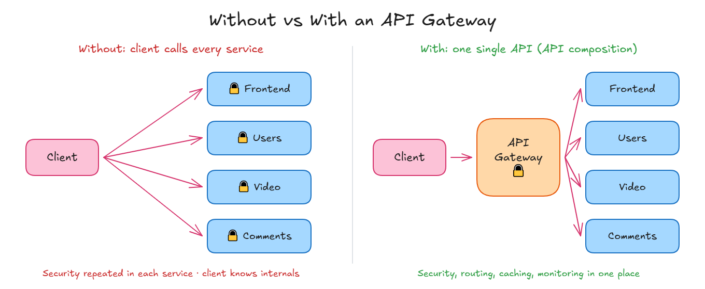
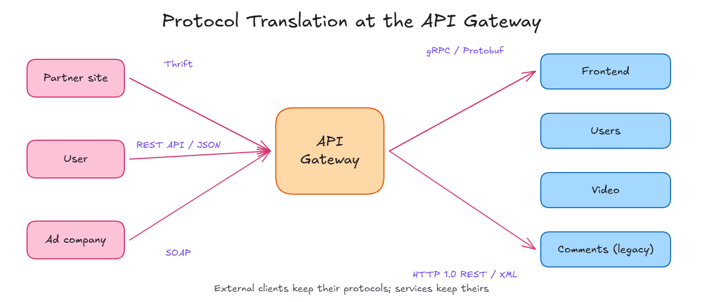
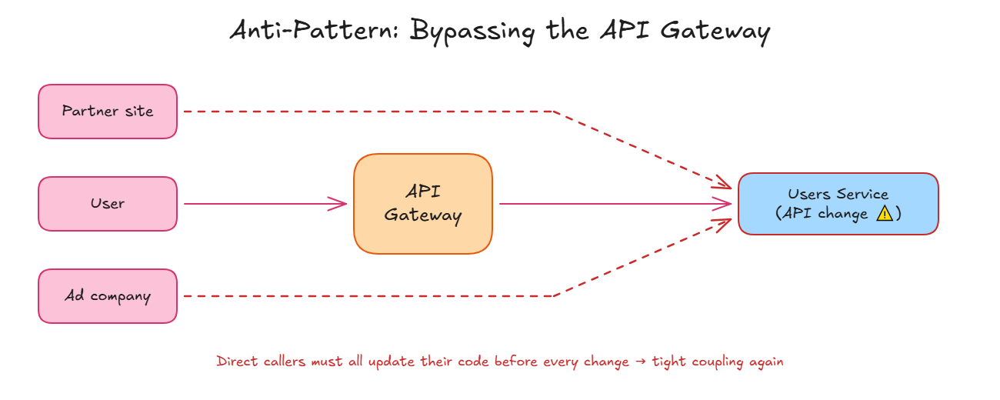

# API Gateway

**In this lecture:**

1. The problem an API Gateway solves
2. What an API Gateway is, and the benefits it gives us
3. Best practices and anti-patterns (mistakes to avoid)

The **API Gateway** is an architectural building block and **design pattern** used by pretty much all large-scale systems in the industry.

---

### The Problem

**Lecture example: a video streaming and sharing system.** Users upload videos, and watch and comment on other people's videos.

**At the start, there is one service** that does everything:

1. Serves the **frontend** (HTML and JavaScript)
2. User **profile** management
3. Channel **subscriptions**
4. **Notifications**
5. Video **storing and streaming**
6. User **comments** on each video
7. **Security:** before a user uploads or deletes a video, or updates their profile, we must check they are properly **authenticated** (who they are) and **authorized** (what they're allowed to do).

**Over time, this one codebase becomes too big and complex** to develop and maintain. So we apply the **organizational scalability** principle and split it into multiple services, each with **one purpose**: Frontend, Users, Video and Comments services.

**The consequences:**

1. The single API is now **split into multiple APIs**, one for each service.
2. The frontend code in the client's browser must know our **internal organization** and call different services for different tasks:
   - **Home page** (latest activity): call the Frontend service and the Users service.
   - **Watch a video:** call the Frontend service (pages), the Video service (the video), and the Comments service (the comments).
3. Since the client calls each service separately, **each service must reimplement security**, authentication and authorization. This adds a lot of **performance overhead and duplication**.

---

### What Is an API Gateway?

To remove these redundancies, decouple the client from our internal organization, and simplify our external API, we add an abstraction: a service called the **API Gateway**.

> **An API Gateway is an API management service that sits between the client and the collection of backend services.**

It follows an architectural pattern called **API composition**: we compose all the APIs of our services that we want to expose externally into **one single API**. Client applications then send requests to just **one single service**.

**Real-world example:** A hotel reception desk. Guests ask the reception for everything (room service, taxi, laundry), and never need to know which department does it.

---

### Benefits of an API Gateway

### 1. Seamless Internal Changes (Refactoring)

We can change our system's internals **completely transparently** to API consumers. For example, if we have desktop and mobile users:

1. Split the **Frontend service** into a **Desktop Frontend** and a **Mobile Frontend** service, serving different data depending on the device the request came from.
2. Split the **Video service** into a **High Resolution Video** service (optimized for desktops) and a **Low Resolution Video** service (optimized for mobile).

Clients still call the same API Gateway, and notice nothing.

### 2. Security

All security, authentication and authorization are **consolidated in one place**, at the front door of our system.

1. A **malicious user** trying to impersonate another user is **stopped at the API Gateway**.
2. A **real user** is authenticated at the gateway, where we can do **SSL termination** (decrypting the encrypted HTTPS traffic) and forward the **decrypted** request to the services.
3. **Permissions and roles:** different users can do different operations, such as viewing private videos, or deleting and uploading videos.
4. **Rate limiting:** limiting how many requests a user can send, to block **denial of service (DoS) attacks** (attempts to flood the system with requests) from malicious users.

### 3. Performance

1. **Less overhead:** we authenticate each request **once**, instead of at every service.
2. **Request routing:** the client makes **one call** instead of many.
   - **Without** the gateway, watching a video takes **3 calls**: Frontend (page), Video (video), and Comments (comments).
   - **With** the gateway, the client makes **a single call**. The gateway routes it to the right services and **aggregates** (combines) all the responses into **one response**.
3. **Caching:** the gateway can cache **static content** and responses to certain requests. If a cached response exists, it is returned **immediately**, without calling the services, which reduces the response time.

### 4. Monitoring and Alerting

All traffic goes through one service, so by adding monitoring logic to the gateway we get:

1. **Real-time visibility** into the traffic pattern and the load on our system
2. **Alerts** when traffic suddenly **drops** or **increases** unexpectedly

This improves our system's **observability** (how well we can see what's happening inside it) and **availability**.

### 5. Protocol Translation

The gateway can translate between protocols and formats **in one place**.

1. **Inside:** some services may use different **RPC technologies** or formats (such as gRPC with Protocol Buffers), and **legacy** services may support only old protocols like **HTTP 1.0** with **XML**.
2. **Outside:** we expose a **REST API** with **JSON**. But we may also integrate with other companies that bring extra revenue, and that already use specific protocols (such as **Thrift** or **SOAP**) and don't want to change their systems. For example:
   - A **digital advertising company** that wants to run ads on our videos
   - Another system that wants to **host its videos** on our platform and request them on demand to **embed** on its web pages
3. We just extend the gateway to support their protocols and formats, and **translate** to call our services using the existing implementation.

### Quality Attributes

The API Gateway gives us **security**, **performance**, and **high availability** (through monitoring).

---

### Best Practices and Anti-Patterns

### 1. No Business Logic in the API Gateway

1. Security, caching and monitoring are nice extra features, but the **main purpose** of the API Gateway is **API composition** and **routing requests** to services.
2. The services make the **business decisions** and do the actual tasks.
3. **Anti-pattern:** adding business logic and making the gateway **too smart**. We end up again with **one service that does all the work**, with an unmanageable amount of code. This is exactly the problem we wanted to solve by splitting our system.

### 2. The API Gateway Can Become a Single Point of Failure

All traffic now goes through the API Gateway.

1. **Scalability, availability and performance:** easily solved by deploying **multiple instances** of the gateway behind a **load balancer**.
2. **Bad releases:** if we push a bad release or a bug that crashes the gateway, our **entire system becomes unavailable**. So we must eliminate any chance of human error, and deploy new gateway releases with **extreme caution**.

### 3. Don't Bypass the API Gateway

1. The extra service adds a **little performance overhead**, but overall we usually **gain more than we lose** in performance.
2. In some situations we may be tempted to **over-optimize** and let clients **bypass** the gateway. This is an **anti-pattern**.
3. **Example:** the Users service team wants to change its API.
   - If the **only** external caller is the gateway, they just update the gateway and safely release their change.
   - If other external clients call the service **directly**, the team must be much more cautious and slower, because they must first update **every client's code** before releasing.
4. This **tightly couples** the service to external clients' code again, which is the problem the API Gateway solved in the first place.

**Real-world example:** If some guests call the hotel kitchen directly instead of the reception, the kitchen can't change its menu without telling each of them first.

---

**Key idea:** An API Gateway is the single front door to our backend services. It composes their APIs into one, and gives us seamless refactoring, central security, request routing, caching, monitoring and protocol translation. Keep business logic out of it, release it carefully, and never let clients bypass it.

---

## Short Note

- **Problem:** one big service (frontend, profiles, subscriptions, notifications, videos, comments, security) gets too complex, so we split it into services (organizational scalability).
  - ❌ The client must know every service and make many calls (watching a video = Frontend + Video + Comments).
  - ❌ Each service repeats security → overhead and duplication.
- **API Gateway:** an API management service between the client and the backend services. **API composition** = many service APIs → **one** external API.
- **Benefits:**
  - **Seamless refactoring:** split into Desktop/Mobile Frontend, or High/Low Resolution Video, and clients notice nothing.
  - **Security:** authentication and authorization in one place, **SSL termination**, roles and permissions, and **rate limiting** against DoS.
  - **Performance:** authenticate once, **request routing** (one call → aggregated response), and **caching** of static content and responses.
  - **Monitoring and alerting:** real-time traffic visibility, alerts on drops or spikes → observability and availability.
  - **Protocol translation:** REST/JSON, Thrift or SOAP outside ↔ gRPC/Protobuf or legacy HTTP 1.0/XML inside.
- **Do's and don'ts:**
  - ❌ **No business logic** in the gateway, or it becomes the big service again.
  - ⚠️ **Single point of failure:** use multiple instances behind a load balancer, and release with extreme caution.
  - ❌ **Don't bypass it:** direct callers tightly couple services to client code again.
