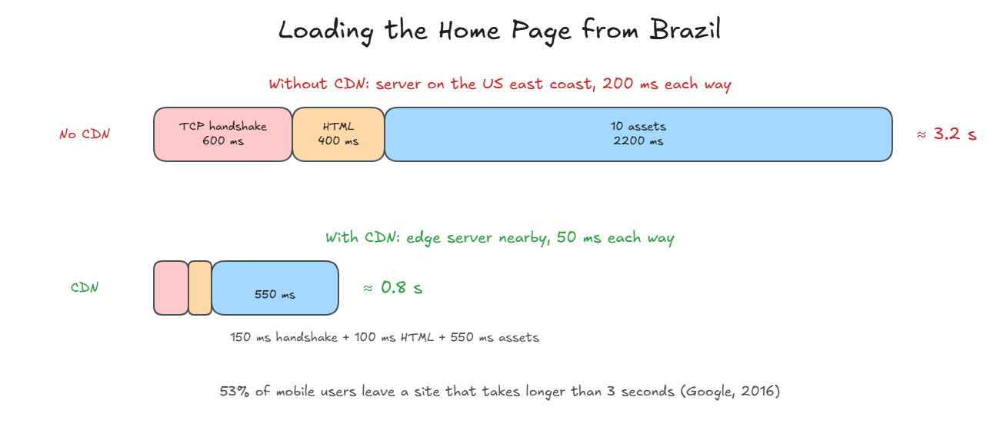
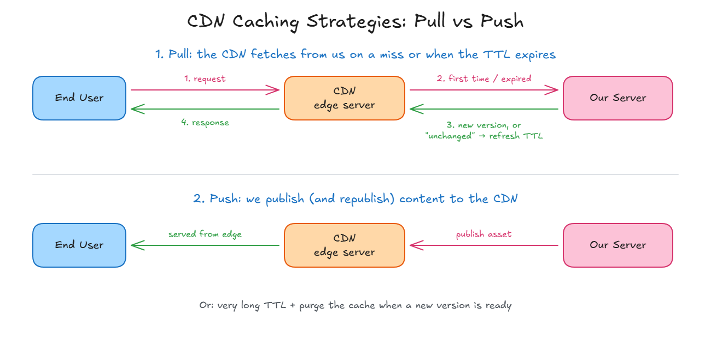

# Content Delivery Network - CDN

**In this lecture:**

1. The problem a CDN solves
2. What a CDN is, and how it improves performance, availability and security
3. The two caching strategies (**pull** and **push**), and their pros and cons

A CDN is not so much an architectural building block as a **service**, but it is one of the most important technologies powering the internet as we know it.

---

### The Problem: Distance Adds Latency

Even with web hosting spread over **multiple data centers** (using technologies like **GSLB**), there is still significant **latency** (delay):

1. **Physical distance** between the end user and the hosting servers
2. **Multiple hops:** each request passes through many network **routers** on the way, which adds even more latency

### Lecture Example: Loading an Online Store from Brazil

A user in **Brazil** loads the home page of our online store, hosted in a data center on the **US east coast**.

1. The HTML page links to **10 assets** (images, JavaScript and CSS files).
2. The network latency between Brazil and the US is about **200 ms** each way.

**Step by step:**

1. **TCP three-way handshake: 600 ms.** HTTP uses **TCP** under the hood. To open a connection, the client and server exchange 3 messages: **SYN → SYN-ACK → ACK**, so 3 × 200 ms.
2. **Page load: 400 ms.** The client sends the HTTP request for the home page, and gets back the HTML (2 × 200 ms).
3. **Assets: 2,200 ms.** The browser makes an asynchronous request for the 10 assets: 200 ms for the request to arrive, plus 10 × 200 = 2,000 ms to load them all.

**Total: a little over 3 seconds** before the user has a complete page they can use.

**Why that's bad:** a **Google Analytics study (March 2016)** found that **53% of mobile users abandon a website** that takes longer than **3 seconds** to load.

### What Needs to Be Closer to Users?

We could replicate our service in more data centers. But it's not our **business logic** that users need closer. It's mostly the **static content**:

1. Images
2. HTML pages
3. JavaScript
4. CSS files
5. Videos

---

### What Is a CDN?

> **A CDN (Content Delivery Network) is a globally distributed network of servers, located in strategic places, whose main purpose is to speed up the delivery of content to end users.**

1. CDNs were first created to fix the **"World Wide Wait"**: a bad user experience caused by a slow network connection or an overloaded web server.
2. A CDN **caches** our website content on its servers, called **edge servers**, located at different **Points of Presence (PoPs)** (CDN locations around the world).
3. Edge servers are **physically closer** to users and **better placed in the network infrastructure**, so they transfer content much faster and improve our **perceived** performance.

**What CDNs deliver:**

1. Web page content and assets: images, text, CSS and JavaScript files
2. **Video streams**, both **live** and **on-demand**

**Who uses them:** pretty much every digital company that talks to users through a website or mobile app, such as:

1. E-commerce services
2. Financial institutions, such as banks
3. Technology and **SaaS** (Software as a Service) companies
4. Media companies (video streaming, news)
5. Social media companies

**Real-world example:** Instead of shipping every order from one central factory, a company keeps popular products in local stores near its customers.

---

### Benefits of a CDN

### 1. Performance

**The same Brazil example, with a CDN nearby** (about **50 ms** each way):

1. **TCP handshake:** 3 × 50 = **150 ms**
2. **Page load (HTML):** 2 × 50 = **100 ms**
3. **Assets:** 50 + 10 × 50 = **550 ms**

**Total: about 800 ms**, comfortably **under 1 second**, which is an excellent user experience.

**Other speed techniques CDNs use, besides being closer:**

1. **Faster, more optimized hard drives** to store cached content
2. **Less bandwidth** by **compressing** content, using techniques like **Gzip**, or **minification** of JavaScript files (removing spaces, comments and long names to make files smaller)

### 2. Availability

Most content comes from the CDN, not directly from our servers. So any issue or slowness in our system is **less noticeable** to users.

### 3. Security

CDNs help protect us against **DDoS attacks** (Distributed Denial of Service: many machines flooding a system with requests). Malicious requests are spread across the CDN provider's huge number of servers instead of hitting our system, so their impact on us is very low.

---

### Caching Strategies

### Strategy 1: Pull

1. We tell the CDN provider **which content** to cache, and **how often** to invalidate (expire) it, by setting the **TTL (Time To Live)** on each asset or type of asset.
2. **First request** for an asset: the CDN doesn't have it yet, so it requests it from **our server** and caches it.
3. **Later requests:** served **directly by the edge servers**, saving all the latency of talking to our servers.
4. **Expired asset:** the CDN asks our server if there's a new version.
   - **Not changed:** the CDN just **refreshes the expiration time** and serves the asset.
   - **New version:** our server sends it, and the CDN serves the new version.

### Strategy 2: Push

1. We **manually or automatically upload (publish)** the content we want delivered through the CDN.
2. Whenever that content changes, **we** are responsible for **republishing** the new version to the edge servers.
3. Some CDN providers support this model directly. Others enable it through a **very long TTL**, so the cache basically never expires. When we have a new version, we **purge** (delete) the content from the cache, which forces the CDN to fetch it from our servers the next time a user asks for it.

### Pull vs Push

| | Pull | Push |
| --- | --- | --- |
| ✅ **Advantages** | **Low maintenance:** once we set what to cache and when it expires, the CDN provider keeps everything up to date | If content **rarely changes**, push it once and traffic goes straight to the edge servers. This **greatly reduces traffic** to our system, and even if our system goes down temporarily, users still get the data from the CDN |
| ❌ **Disadvantages** | 1. The **first users** of an uncached asset get **longer latency** (the CDN must fetch it first). 2. If all assets have the **same TTL**, they expire **at the same time**, causing **traffic spikes** from the CDN refreshing its caches. 3. We still need **high availability**: if an asset expires and our system is down, the user gets an **error** | If content **changes often**, we must actively publish new versions, otherwise users get **stale** (out-of-date) content |

**Real-world example:** **Pull** is like a shop that orders a book from the warehouse only when a customer first asks for it. **Push** is like a publisher sending new books to every shop before release day.

---

**Key idea:** A CDN caches static content (images, HTML, JS, CSS, videos) on edge servers close to users, cutting load time (about 3.2 s → 0.8 s in the example) and improving availability and security. Use **pull** for low maintenance, and **push** for content that rarely changes.

---

## Short Note

- **Problem:** even with many data centers and GSLB, distance and router hops add latency.
  - Brazil → US east coast (200 ms each way): TCP handshake **600** + HTML **400** + 10 assets **2,200** ≈ **3.2 s**.
  - 53% of mobile users leave after 3 seconds (Google, 2016).
  - Users need **static content** closer (images, HTML, JS, CSS, videos), not the business logic.
- **CDN:** a global network of **edge servers** at **Points of Presence** that cache our content. It fixes the "World Wide Wait", and delivers web assets plus live and on-demand video.
- **Benefits:**
  - **Performance:** with a CDN 50 ms away → 150 + 100 + 550 ≈ **0.8 s**, plus faster drives and compression (Gzip, JS minification).
  - **Availability:** our system's slowness is less noticeable.
  - **Security:** DDoS traffic is spread over the CDN's servers.
- **Pull strategy:** set what to cache and its **TTL**. The CDN fetches on the first request or on expiry (refreshes the TTL if unchanged).
  - ✅ Low maintenance. ❌ Slow first request, spikes when TTLs expire together, and our system still needs high availability.
- **Push strategy:** we publish and republish content (or use a very long TTL + purge).
  - ✅ Great for rarely changing content: less traffic, and works even if we're down. ❌ Frequent changes mean lots of publishing, or users get stale content.
