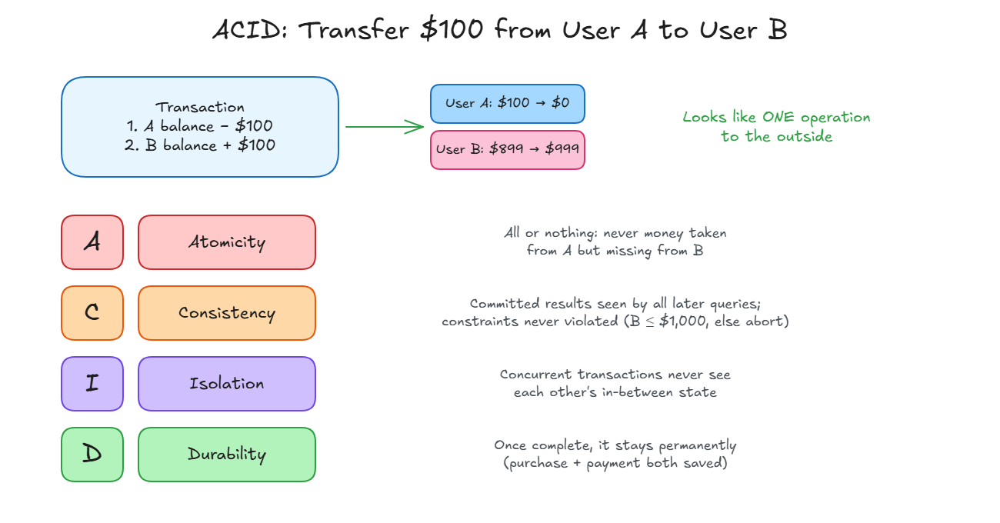

# Relational Databases & ACID Transactions

**In this lecture:**

1. What relational databases are
2. Their advantages (including **ACID transactions**) and disadvantages
3. When to use a relational database, and when to go another route

There are so many databases that it's easy to feel overwhelmed. Instead of picking the most popular or trendy one, the next lectures teach a **methodical way** to choose the right database for our system's use case.

---

### What Is a Relational Database?

1. **Data is stored in tables.** Each **row** is a single **record**.
2. All records are related through a **predefined set of columns** that they all have. This relationship between records is what gives the database the name **relational**.
3. Each **column** has a **name**, a **type**, and optionally a set of **constraints** (rules, such as "can't be empty").
4. Each record is uniquely identified by a **primary key**: one column, or a set of columns.
5. The structure of each table is defined **ahead of time**. This is called the table's **schema**.

### SQL

Because of the predefined schema, we know what every record must have, so we can use a very **robust query language** to analyze and update the data.

1. The industry standard is **SQL (Structured Query Language)**.
2. Each relational database adds its own features to its version of SQL, but most standard operations are **the same** in all of them.
3. Relational databases have been around since the **1970s**, so they are a well-known, proven way to structure data.
4. They are also commonly called **SQL databases**.

---

### Avoiding Data Duplication

One big reason relational databases became popular early on: **storage used to be very expensive**, and storing data in **separate tables** removes the need to duplicate data. Storage is much cheaper today, but we collect far more data, so for large-scale systems **storage cost is still a major factor**.

**Lecture example: an online store** with a limited number of products.

**Products table:**

| ProductId | Name | Model Year | Company | Category | Base Price |
| --- | --- | --- | --- | --- | --- |
| 1 | Baby Bottle | 2001 | Johnson & Johnson | Baby Accessories | $9 |
| 2 | Car Toy | 2016 | Toys"R"Us | Toys | $15 |
| 3 | Sports Shoes | 1999 | Nike | Apparel | $59 |

We also want to store **orders**, and easily analyze things like:

1. Which products sell the most or least in a given time frame
2. Ranking companies by how their products perform
3. Which product categories do better during certain sales or seasons

**The duplicated approach:** one Orders table where each row has the purchase **plus all the product information**:

| Order Id | Discount | Status | User Id | ProductId | Name | Model Year | Company | Category | Base Price |
| --- | --- | --- | --- | --- | --- | --- | --- | --- | --- |
| 15 | 0% | Pending | 102 | 1 | Baby Bottle | 2001 | Johnson & Johnson | Baby Accessories | $9 |
| 16 | 20% | Completed | 1005 | 2 | Car Toy | 2016 | Toys"R"Us | Toys | $15 |
| 17 | 5% | Pending | 15 | 3 | Sports Shoes | 1999 | Nike | Apparel | $59 |
| 18 | 0% | Completed | 99 | 1 | Baby Bottle | 2001 | Johnson & Johnson | Baby Accessories | $9 |

This table takes a lot of space and **keeps growing** with every order, and most of it is **duplicated** from the Products table.

**The relational approach:** relational databases support relationships **between tables**, not just between rows. So the Orders table only keeps the **ProductId**:

| Order Id | Discount | Status | User Id | ProductId |
| --- | --- | --- | --- | --- |
| 15 | 0% | Pending | 102 | 1 |
| 16 | 20% | Completed | 1005 | 2 |

Using this one shared column, the **join** operation combines information from both tables, without storing anything twice.

**Real-world example:** A shop receipt lists only product codes. The full product details live once in the shop's catalog.

---

### Advantages of Relational Databases

1. **Complex, flexible queries** with SQL, which give deep insight into our business and users.
2. **Efficient storage:** joining tables removes duplication, which directly **saves money**.
3. **Easy to reason about:** tables are natural for humans and don't need knowledge of sophisticated data structures or computer science.
4. **ACID transactions** (below).

---

### ACID Transactions

A **transaction** is a sequence of operations that, to an outside observer, should look like **a single operation**.

**Example: transferring money** from User A to User B involves several internal operations (subtract from A, add to B), but must look like one operation. We never want, even for a moment:

1. The money **taken from A but missing from B**, or
2. The money appearing **in both accounts** at once

**ACID** stands for **Atomicity, Consistency, Isolation, Durability**:

### 1. Atomicity

All operations in a transaction **appear all at once, or not at all**. Everything or nothing, never anything in between.

### 2. Consistency

1. A transaction that has been **committed** (completed) is **seen by all future** queries and transactions. After transferring $100 from A to B, no later query can suddenly see the $100 still in A's account, or missing from B's.
2. A transaction **never violates the constraints** we set. For example, if a user can't have more than **$1,000**, and User B has $999, a transfer of $100 would break the limit, so the transaction simply **fails (aborts)**.

### 3. Isolation

Related to atomicity, but for **concurrent** (simultaneous) operations. If another transaction runs at the same time as our transfer, it **won't see the in-between state**, with money present in both accounts or missing from both. Concurrent transactions don't see each other's intermediate state.

### 4. Durability

Once a transaction completes, its final state **persists permanently** in the database. For example, if a user buys a product and pays as part of **one** transaction that succeeds, the final state always contains **both** the purchase record (Orders table) and the money transfer (Account Balance table). The purchase record never disappears.

**Real-world example:** An ATM withdrawal: either you get the cash **and** your balance goes down, or neither happens.

---

### Disadvantages of Relational Databases

1. **Rigid schema:** the schema applies to every row, so it must be defined **before** we use the table. Changing it later, such as adding or removing a column, needs **maintenance time**, when the table is **unavailable**. So we must plan schemas very carefully, to change them rarely, or preferably never.
2. **Harder and costlier to maintain and scale**, because of their complexity. Supporting SQL and ACID guarantees is not simple.
3. **Slower reads:** because of all this complexity and these guarantees, reads tend to be slower than in **non-relational** databases (next lecture). Implementations differ, but as a general rule relational databases are notoriously slower.

---

### When to Use a Relational Database

Check if the advantages matter to us, while the disadvantages can take a back seat.

**✅ Use one when:**

1. Complex, flexible **queries to analyze** our data are an important use case
2. We need **ACID transactions** between different entities

**❌ Consider alternatives when:**

1. There is **no inherent relationship** between records that justifies tables
2. **Read performance** is the most important quality for a good user experience

---

**Key idea:** Relational (SQL) databases store related records in tables with a predefined schema. They give powerful SQL queries, no duplication (joins), easy-to-understand tables and ACID transactions, but have a rigid schema, are harder to scale, and have slower reads.

---

## Short Note

- **Relational database:** data in **tables**. Rows are records, related through predefined columns (name, type, constraints). Each row has a **primary key**, and the table structure is the **schema**, defined ahead of time.
- **SQL:** the standard query language (since the 1970s), so these are also called **SQL databases**.
- **No duplication:** the Orders table keeps only the **ProductId**, and a **join** brings in the product details → saves storage and money.
- **Advantages:** flexible SQL analysis, efficient storage, human-friendly tables, and **ACID**.
- **ACID** (a transaction looks like one operation, such as a $100 transfer):
  - **Atomicity:** all or nothing.
  - **Consistency:** committed results seen by all later queries, and constraints never broken ($1,000 limit → abort).
  - **Isolation:** concurrent transactions don't see each other's in-between state.
  - **Durability:** completed transactions stay forever (purchase + payment).
- **Disadvantages:** **rigid schema** (changes need downtime), harder and costlier to scale, and **slower reads**.
- **Use when:** complex analysis or ACID is needed. **Avoid when:** records aren't related, or read speed matters most.

---

## Q & A

**Question 1:** Which principle of ACID transactions guarantees that a record committed to the database as part of a successful transaction **doesn't get lost**?

1. Atomicity
2. Consistency
3. Isolation
4. Durability

**Answer:** 4. Durability.

Durability means that once a transaction completes, its final state stays in the database permanently, like the purchase record that never disappears.

**Question 2:** Which principle of ACID transactions guarantees that two transactions operating on the same data **concurrently** don't interfere with each other's results?

1. Atomicity
2. Consistency
3. Isolation
4. Durability

**Answer:** 3. Isolation.

Isolation keeps simultaneous transactions apart, so neither one sees the other's in-between state, such as the money being in both accounts or in neither.

**Question 3:** Which SQL operation in a relational database lets us analyze data from **multiple tables**?

1. SELECT
2. JOIN
3. WHERE
4. ORDER BY

**Answer:** 2. JOIN.

JOIN combines rows from several tables using a shared column, like the Orders and Products tables linked by `ProductId`. SELECT, WHERE and ORDER BY only pick, filter and sort data.
