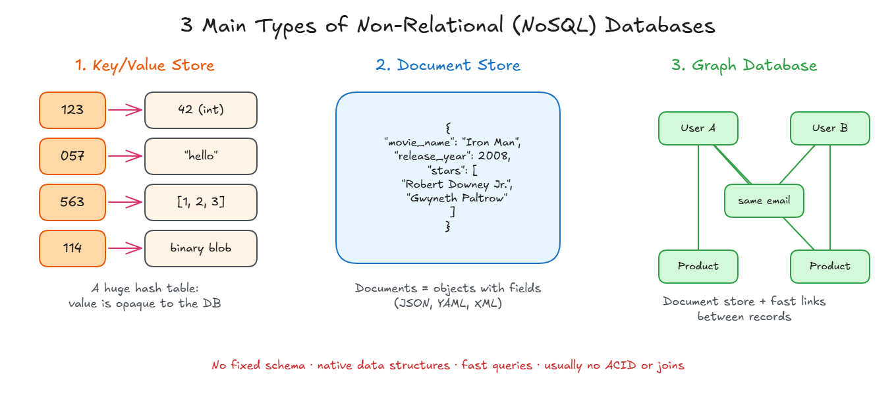
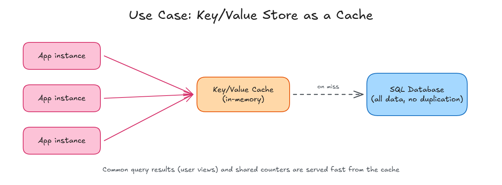

# Non-Relational Databases

**In this lecture:**

1. What non-relational databases are, and why we need them
2. The 3 main categories of non-relational databases
3. When to use a non-relational database

The second type of database is the **non-relational** database, also commonly called a **NoSQL** database.

---

### Why Non-Relational Databases?

Non-relational databases are a relatively **new** concept that became very popular in the **mid-2000s**. They mainly came to solve the **drawbacks of relational databases**.

### 1. Flexible Schema

1. **Relational problem:** all records in a table share the **same schema** (the same columns). To add data that makes sense only for **some** records, we must change the schema of the **whole table**.
   - **Lecture example:** a Users table with UserId, Name, Last Name and Date of Birth. Adding a **Middle Name** column affects every row, even though only John Smith ("Edward") has one, and the rest are empty.
2. **Non-relational solution:** records can be grouped logically **without forcing the same structure**. We can add attributes to one or more records without affecting the rest.

### 2. Data Structures That Fit Programming Languages

1. **Relational problem:** essentially only **one data structure**, the **table**. Tables are natural for humans, but less intuitive for programmers. Most programming languages don't even have a table data structure. They use **lists, arrays, maps**, and so on.
2. **Non-relational solution:** depending on the type, they store data in structures **native to programming languages**. This usually removes the need for an **ORM** (Object-Relational Mapping: a library that translates objects in our code to and from database tables).

### 3. Faster Queries

1. Relational databases were designed for **efficient storage**, back when storage was expensive.
2. Non-relational databases are more oriented toward **faster queries**, and each type is optimized for different kinds of queries depending on the use case.

### The Trade-Offs

Everything in software engineering is a trade-off:

1. **Harder analysis:** with flexible schemas and no enforced relationships, each record can have a completely different structure and data, so analyzing records is harder.
2. **Joins are hard:** analyzing multiple groups of records the way we **join tables** is limited or not supported at all, since each database has its own operations and data structures.
3. **ACID transactions** are **rarely supported**, with a few exceptions.

---

### The 3 Main Types of Non-Relational Databases

The boundaries between categories are somewhat **blurry**, so the same database may appear under a different category in different sources.



### 1. Key/Value Store

The **first and simplest** type.

1. A **key** uniquely identifies a record, and a **value** holds the data for that record.
2. The value is, in theory, **completely opaque** to the database (the database doesn't look inside it). It can be as simple as an **integer or string**, or as complex as an **array, a set, or a binary blob**.
3. Think of it as a **large-scale hash table or dictionary**, with very few constraints on the value types.

**Use cases:**

1. **Counters** that multiple services or application instances read or increment
2. **Caching** pages or pieces of data that can be fetched easily, without slow or complex SQL queries on a relational database

**Real-world example:** A coat check: you hand over a ticket number (key) and get back your coat (value), and the staff don't care what's in the pockets.

### 2. Document Store

1. Stores **collections of documents**, with a bit **more structure** inside each document.
2. Each document is like an **object** with different **attributes**, and those attributes can have different **types**, just like a class has fields of different types.
3. So documents map much more easily to **objects in a programming language**.

**Examples of documents:**

1. A **JSON** object representing a movie:

```json
{
  "movie_name": "Iron Man",
  "release_year": 2008,
  "description": "...billionaire engineer Tony Stark creates a unique weaponized ...",
  "stars": ["Robert Downey Jr.", "Gwyneth Paltrow"]
}
```

2. A **YAML** configuration representing some business logic:

```yaml
name: Main Server
environment: production
enabled: true
servers:
  - 10.0.0.15
  - 10.0.0.16
```

3. An **XML** form submitted by a user:

```xml
<form>
  <name>John</name>
  <lastname>Smith</lastname>
  <country>USA</country>
</form>
```

### 3. Graph Database

An **extension of a document store**, with extra abilities to **link, traverse** (move from one record to related ones) **and analyze** multiple records efficiently. It is optimized for navigating and analyzing **relationships** between records.

**Use cases:**

1. **Fraud detection:** several logical users can easily be identified as **the same person** trying to start multiple transactions with the same email or the same computer.
2. **Recommendation engines**, such as in e-commerce: recommend products based on the purchase history of users with **similar purchasing patterns**, or of a user's **friends**.

**Real-world example:** A social network suggesting "people you may know" by following your friends' friends.

---

### When to Use a Non-Relational Database

Same approach as before: analyze the use case, decide which database properties matter most, and which ones we can compromise on.

1. **Caching:** non-relational databases are generally **faster** at queries. We keep all our data in the relational database (efficient, no duplication, complex queries when needed), and also store very **common query results** that correspond to **user views** in a non-relational database to improve the user experience. **In-memory key/value stores** are especially optimized for this.
2. **Real-time big data:** where relational databases are too slow or not scalable enough, use non-relational databases such as **document stores**.
3. **Unstructured data:** when different records have different attributes, **document stores** are always a better choice. For example:
   - **User profiles**, where different users provide different types of information
   - **Content management**, with different types of user-generated content: images, comments, videos, and so on



**Otherwise:** if we are in none of these use cases, a **relational database** is usually the **safer bet**, because of its simplicity and long-term popularity.

---

**Key idea:** NoSQL databases trade the relational database's fixed schema, joins and ACID for flexible schemas, programmer-friendly data structures and faster queries. The 3 main types are key/value stores, document stores and graph databases. Use them for caching, real-time big data and unstructured data, and otherwise default to a relational database.

---

## Short Note

- **NoSQL (non-relational):** popular since the mid-2000s, it fixes relational drawbacks.
  - **Flexible schema:** add a "Middle Name" to only some records, without changing the whole table.
  - **Native data structures** (lists, maps, objects) → usually no ORM needed.
  - **Faster queries**, optimized per use case (relational = optimized for storage).
  - ❌ Harder analysis, few or no joins, and rarely ACID.
- **Types** (the boundaries are blurry):
  - **Key/value:** a giant hash table with opaque values (int, string, array, blob) → counters and caching.
  - **Document:** objects with typed attributes (JSON movie, YAML config, XML form) → map easily to code.
  - **Graph:** a document store + efficient links between records → fraud detection and recommendations.
- **Use NoSQL for:** caching common query results (in-memory key/value), real-time big data, and unstructured data (user profiles, content management).
- **Otherwise:** a relational database is the safer bet.
