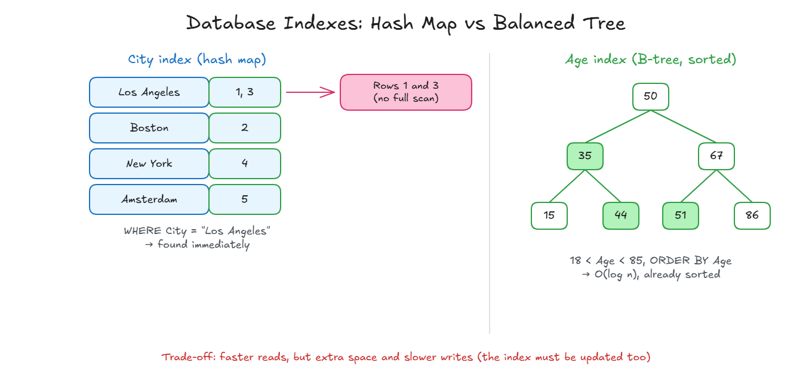
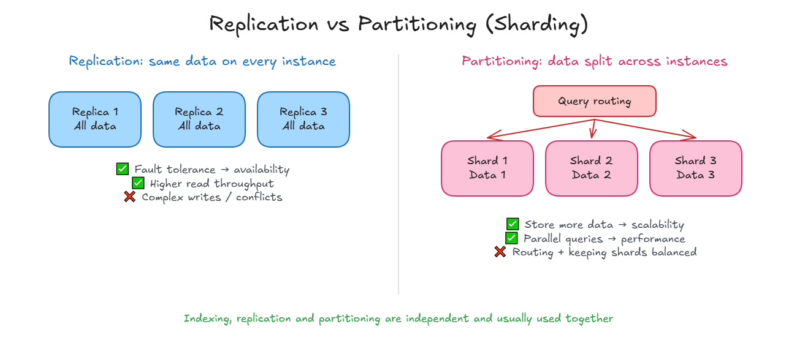
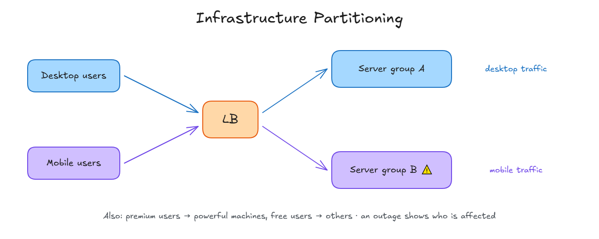

# Techniques to Improve Performance, Availability & Scalability Of Databases

**In this lecture**, 3 techniques for databases in a large-scale system:

1. **Indexing** → performance
2. **Replication** → availability and performance (throughput)
3. **Partitioning (sharding)** → scalability and performance

---

### Technique 1: Indexing

The purpose of indexing is to **speed up retrieval** operations and find records in **sublinear time** (faster than checking every row). Without an index, many operations need a **full table scan**, which takes a very long time on large tables.

**Lecture example: a large Users table.**

| Id | City | FirstName | LastName | Age |
| --- | --- | --- | --- | --- |
| 1 | Los Angeles | Alexander | Ivanov | 35 |
| 2 | Boston | John | Smith | 44 |
| 3 | Los Angeles | Mary | Johnson | 15 |
| 4 | New York | Michael | Bird | 86 |
| 5 | Amsterdam | Joseph | Young | 51 |

### Costly Operations Without an Index

1. **Find users in a city**, for example to send them relevant notifications. The database must **scan every row** linearly:

```sql
SELECT * FROM USERS WHERE City = "Los Angeles"
```

2. **Get users sorted**, for example by last name, age or income. We must **sort**, and still go through the **entire table** at least once:

```sql
SELECT * FROM USERS ORDER BY Age
```

If these run very often, or on very large tables, they become a **performance bottleneck**.

### What Is an Index?

> **A database index is a helper table created from a particular column, or a group of columns.**

1. For a single column, the index maps each **column value → the record(s) containing it**.
2. We put the index table in a **data structure**:
   - **Hash map:** very fast lookups.
   - **Self-balancing tree**, such as a **B-Tree:** keeps values **sorted**, so it's easy to find a record **and** to return a sorted list of matching rows.

**Examples:**

1. **City index in a hash table:** "Los Angeles" → rows 1 and 3. The query for LA users returns the list **immediately**, with no full scan.
2. **Age index in a balanced tree:** a sorted view of users in an age range comes back in **logarithmic time**, O(log n), avoiding both the full scan and sorting on every query:

```sql
SELECT * FROM USERS WHERE Age < 85 AND Age > 18 ORDER BY Age
```



### Composite Index

An index can be built from **several columns**.

**Example:** users in a city **and** with a particular last name:

```sql
SELECT * FROM USERS WHERE City = "Los Angeles" AND LastName = "Smith"
```

1. **City-only index:** we get all LA users (rows 1, 3, 44, 66, 105) immediately, but must still **scan them linearly** to check the last name.
2. **Composite index on (City, LastName):** maps each **pair of values** directly to rows, so ("Los Angeles", "Smith") → rows **44, 105** immediately, with no linear scan.

### Indexing Trade-Offs

1. **Extra space** to store the index tables
2. **Slower writes:** every time we add or update a row, we must also **update the index**

Indexing is also used extensively in **non-relational** databases, such as document stores.

**Real-world example:** The index at the back of a book takes extra pages, but you find a topic without reading the whole book.

---

### Technique 2: Database Replication

A database holding mission-critical data becomes a potential **single point of failure**. Just as with compute instances, we **replicate** the data and run **multiple database instances** on different computers.

### Benefits

1. **Fault tolerance → high availability:** if one replica goes down, temporarily or permanently, queries keep going to the **available replicas** while we restore or replace the faulty one.
2. **Higher throughput (performance):** with thousands or millions of users, we handle a much larger volume of queries by spreading them across more computers.

### Trade-Off

**Much higher complexity**, especially for **write, update and delete** operations. Making sure concurrent changes to the same records don't conflict, and giving predictable **consistency and correctness** guarantees, is not trivial. Distributed databases are notoriously hard to design, configure and manage at high scale, and need skills in **distributed systems**.

### Support

1. Supported by pretty much **all modern databases**.
2. **All non-relational databases** have replication **out of the box**, because they were designed when high availability and large scale were already big concerns.
3. In **relational databases**, support **varies** by implementation.

**Real-world example:** Keeping copies of important documents at home, in the office and in the cloud. If one is lost, you still have the others.

---

### Technique 3: Database Partitioning (Sharding)

1. **Replication:** every instance has the **same copy** of all the data.
2. **Partitioning:** the data is **split** among different database instances (**shards**), usually each on a **separate computer** for better performance.



### Benefits

1. **Scalability:** we can store **far more data** than one machine could hold.
2. **Performance:** queries touching different parts of the data run completely **in parallel**.

### Trade-Off

It turns our database into a **distributed database**, which adds complexity and overhead:

1. We must **route queries** to the right shard.
2. We must make sure no shard becomes **too large** compared to the others.

### Support

1. **First-class feature** in pretty much all **non-relational** databases, because they **decouple records** from each other by design, so storing records on different computers is natural.
2. In **relational** databases, support **depends on the implementation**. Queries involving multiple records are much more common there, and spreading those records across machines while still supporting **ACID transactions** and **table joins** with good performance is much harder.
3. So if we choose a relational database for a **high volume of data**, we must make sure partitioning is **well supported**.

**Real-world example:** A library splits books across floors by subject, so many readers can search different floors at the same time.

### Infrastructure Partitioning

Partitioning isn't only for databases. We can also **logically split our infrastructure**, using configuration files:

1. Requests from **paid (premium) customers** go to some machines, and traffic from **free users** goes to other, maybe less powerful, machines.
2. **Mobile** traffic goes to one group of computers, and **desktop** traffic to another group running the same application. If there's an outage, we easily know **which type of users is affected** and how to act.



---

### Using Them Together

Indexing, replication and partitioning are **orthogonal** (completely independent). We don't need to choose one. In fact, all three are commonly used **together** in most real large-scale systems.

---

**Key idea:** Indexing speeds up reads (at the cost of space and slower writes). Replication copies data to many instances for availability and throughput. Partitioning splits data across instances for scalability and parallel queries. Replication and partitioning both add distributed-system complexity, and all three are usually combined.

---

## Short Note

- **Indexing → performance:** avoids **full table scans** (WHERE City = …, ORDER BY Age).
  - An index = a helper table: column value → rows.
  - **Hash map** = fast lookup (LA → rows 1, 3). **B-Tree** = sorted, so range and sort queries take O(log n).
  - **Composite index** (City + LastName) → ("Los Angeles", "Smith") → rows 44, 105, with no scan.
  - ❌ Extra space and slower writes. Also used in NoSQL.
- **Replication → availability + throughput:** the same data on many instances. If one replica dies, the others serve queries.
  - ❌ Complex writes, conflicts and consistency. Built into all NoSQL databases, and varies in SQL databases.
- **Partitioning / sharding → scalability + performance:** data split across shards, with parallel queries.
  - ❌ Query routing and balancing shard sizes. First-class in NoSQL, and harder in SQL (joins, ACID).
- **Infrastructure partitioning:** premium vs free users, or mobile vs desktop on separate servers → outages show who is affected.
- All 3 are **orthogonal** and usually used **together**.

---

## Q & A

**Question 1:** We are designing an **online video game system**. We estimate we will collect and store about **10 TB** of game-related user information **per week**. Which technique should we use so our storage can keep up with this incoming data rate?

1. Database Indexing
2. Database Partitioning / Database Sharding
3. Database Replication

**Answer:** 2. Database Partitioning / Database Sharding.

Partitioning splits the data across a group of computers, so we can store far more than one machine could hold. Replication only copies the same data, and indexing only speeds up reads.

**Question 2:** What is the **trade-off** we make when deciding whether to add a database **index**?

1. Security vs. Performance
2. Storage Space vs. Performance
3. Availability vs. Scalability
4. Storage Space vs. Scalability

**Answer:** 2. Storage Space vs. Performance.

An index makes lookups much faster, but the extra index table takes storage space, and it must be updated on every write.

**Question 3:** Which technique improves the **fault tolerance** of our database and reduces the risk of **data loss**?

1. Database partitioning
2. Database indexing
3. Database sharding
4. Database replication

**Answer:** 4. Database replication.

Replication keeps copies of the same data on several machines, so if one replica fails, the data still exists on the others and queries keep working.
