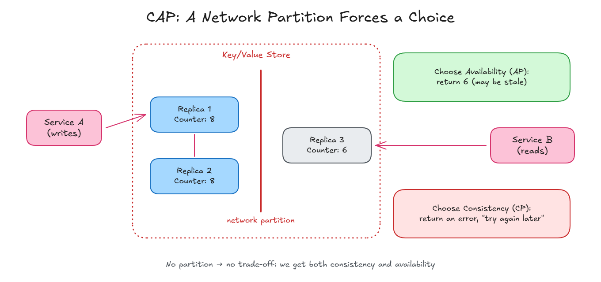
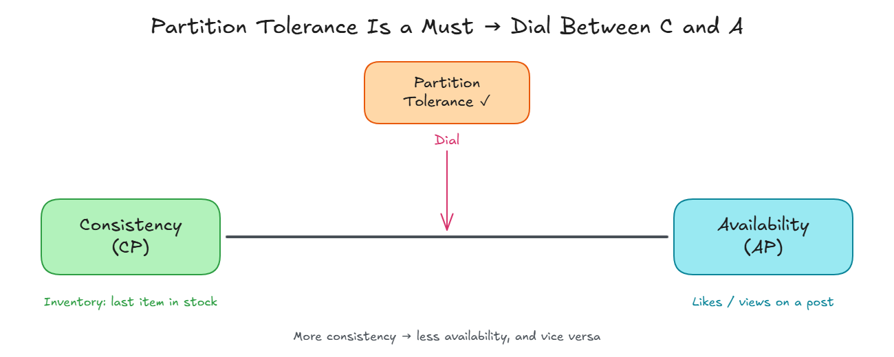

# Brewer's (CAP) Theorem

**In this lecture:**

1. The intuition behind the CAP theorem
2. Formal definitions of **Consistency, Availability and Partition tolerance**
3. How to choose between consistency and availability for our use case

Some techniques from the previous lecture (replication, partitioning) turn our database into a **distributed database**. Running one is outside the scope of this course, but the CAP theorem is something every software architect **must** understand.

---

### What Is the CAP Theorem?

Introduced by **Professor Eric Brewer** in the **late '90s**:

> **In the presence of a network partition, a distributed database cannot guarantee both consistency and availability, and has to choose only one of them.**

---

### The Intuition

**Lecture example:** a simple NoSQL **key/value store**, replicated on 3 computers for high availability. It holds a **counter** that multiple services read and increment.

### Normal Conditions (No Problem)

1. All replicas can talk to each other over the network, so updates **propagate** to all of them.
2. **Example:** Service A increments the counter on Replica 1 (5 → 6). Before the update spreads, Service B reads from Replica 2.
3. Replica 2 simply asks Replicas 1 and 3 if there were changes, updates its own copy, and returns the latest value (6) to Service B.

**How** the updates spread is an implementation detail. It doesn't matter for the theorem, as long as the replicas can communicate.

### Network Partition (The Problem)

1. A **network partition** happens when some replicas **can't reach** the others, for example because of a **network switch problem** or **faulty cables**.
2. **Example:** Replicas 1 and 2 can still talk, but **Replica 3 is isolated**.
3. Service A updates the counter on Replica 1, maybe several times (to 8), and Replica 3 can't get those updates (it still has 6).
4. Service B sends a read request to **Replica 3**. There are two options:
   - **Favor availability:** Replica 3 returns **its own value (6)**, knowing it may be **inconsistent** with the rest of the database.
   - **Favor consistency:** Replica 3 returns an **error** ("try again later"), because it can't guarantee its value is up to date and consistent with what other services see.

### Common Confusion

The database must make this choice **only during a network partition**. Most of the time there is **no partition**, the replicas communicate freely, and we can easily provide **both** consistency and availability.

---

### Formal Definitions

**Consistency** and **availability** in CAP mean something **a bit different** from how we used them earlier in the course (for example, the "C" in ACID).

1. **Consistency (C):** every read receives **either the most recent write or an error**.
   - Without network issues, a consistent database returns the value from the latest write to that record.
   - **All clients see the same value at the same time**, whichever database instance they talk to.
2. **Availability (A):** every request receives a **non-error response**, **without a guarantee** that it contains the most recent write.
   - Different clients may sometimes get **different versions** of a record, and some may be **stale** (out of date).
   - What matters: all requests **succeed** with a valid value.
3. **Partition Tolerance (P):** the system **keeps operating** despite any number of messages being **lost or delayed** by the network between computers.

---

### What CAP Means in Practice

When we choose or configure a database, we must **drop one of the three** properties:

| Choice | We get | We give up |
| --- | --- | --- |
| **CA** | Consistency + Availability | Partition tolerance |
| **CP** | Consistency + Partition tolerance | Availability during a partition |
| **AP** | Availability + Partition tolerance | Consistency |

### Can We Really Have CA?

1. Network partitions can happen **at any time** to **any** distributed database. Even a database with just **2 replicas** on 2 computers will hit one, given enough time and query volume.
2. So the **only** database with both availability and consistency is one running on **a single computer** (centralized). It avoids partitions by having **no network communication** at all.
3. But with a lot of data and queries, such a database **can't scale**, and doesn't give enough **performance** or **fault tolerance**.
4. So for a **distributed** database, we **must choose partition tolerance**, and then choose between **availability and consistency**.

---

### When to Choose What

### Consistency over Availability (CP): Online Store Inventory

The counter is the **inventory** of an item, and only **1 item** is left in stock, while two clients try to buy it.

1. Both clients must see the **same, consistent** inventory.
2. If the first client completes the purchase first, the second must **immediately** see there are **no items left**, and get an **error** if they try to pay.

### Availability over Consistency (AP): Social Media Likes

The counter is the number of **likes or views** on a post or video.

1. It would be unthinkable to show a user an **error** just because we can't get the exact like count right now.
2. Seeing a slightly **out-of-date number** (99 instead of 100) for a while is completely **acceptable**.

**Real-world example:** A bank balance must be exact (CP), but a YouTube view count can lag a bit (AP).

### It's a Dial, Not a Switch

In practice it isn't black and white: we don't have to choose between "full availability, no consistency" and "100% consistency, no availability". When configuring a distributed database, we can usually choose **how much** of each we need.

1. **More consistency → less availability.**
2. **More availability → less consistency.**

The CAP theorem is one of the clearest examples of **trade-offs between quality attributes**. We must make it correctly in the **architectural design phase**, when we formalize the **non-functional requirements**.

---

**Key idea:** During a network partition, a distributed database must choose consistency (return the latest value or an error) or availability (always answer, maybe with stale data). Partitions are unavoidable in distributed systems, so the real choice is CP vs AP, which is usually a dial set by the use case.

---

## Short Note

- **CAP theorem** (Eric Brewer, late '90s): during a **network partition**, a distributed database can't guarantee both **consistency** and **availability**.
- **Intuition (replicated counter):**
  - Normal: replicas sync, so everyone reads the latest value.
  - Partition: Replica 3 is cut off (6 vs 8). Reading from it gives either **6** (availability) or an **error** (consistency).
  - No partition → no trade-off.
- **Definitions (different from ACID):**
  - **C:** latest write or an error. Everyone sees the same value.
  - **A:** always a non-error answer, which may be stale.
  - **P:** keeps working when messages are lost or delayed.
- **In practice:** CA is only possible on **one computer** (doesn't scale). Distributed → **P is a must** → choose **CP or AP**.
  - **CP:** inventory with the last item in stock (the second buyer must get an error).
  - **AP:** likes and views (a stale count is fine, an error is not).
- **A dial, not a switch:** more C → less A. Decide during the design phase, as part of the non-functional requirements.

---

## Q & A

**Question 1:** Our online bank system uses a **CP** (consistent and partition-tolerant) distributed database for account balances, with 3 replicas, each holding **$100** for a user. A thunderstorm breaks a network switch, so **Replica 1** can no longer communicate with the other replicas. What happens if a service asks **Replica 1** for the user's balance?

1. All the replicas contain the same data, so Replica 1 can safely respond to the calling service with the value of $100.
2. Since in the presence of a network partition our distributed database cannot safely guarantee consistency, it will return an error to the calling service.
3. Since in the presence of a network partition our distributed database cannot safely guarantee consistency, it will wait until the network partition is resolved and only then respond to the calling service.

**Answer:** 2. It returns an error.

A CP database picks consistency over availability. Replica 1 is cut off and can't be sure $100 is still the latest value, so it returns an error. It doesn't wait, because the partition could last a long time.

**Question 2:** Now the bank uses an **AP** (available and partition-tolerant) database with the same 3 replicas ($100 each). The switch breaks and **Replica 1** is isolated, while Replicas 2 and 3 can still talk to each other. The user deposits **$50** through Service A to Replica 2, so now:

- Replica 1: $100
- Replica 2: $150
- Replica 3: $150

What happens if **Service B** asks the database for the user's balance?

1. It will definitely return $100.
2. It will definitely return $150.
3. It will most likely return $150, but may also return $100.
4. It will return an error, because it doesn't know the most up-to-date value.

**Answer:** 3. Most likely $150, but it may return $100.

An AP database always answers, but the value may be stale. Two of the three replicas have $150, but if Service B reaches the isolated Replica 1, it gets the old $100.

**Question 3:** Can we have an **available and consistent** distributed database running on 3 replicas, while still guaranteeing **partition tolerance**?

1. Yes
2. No

**Answer:** 2. No.

Network partitions can happen at any time in a distributed database. When one does, the database must choose consistency or availability. It can't guarantee both.
