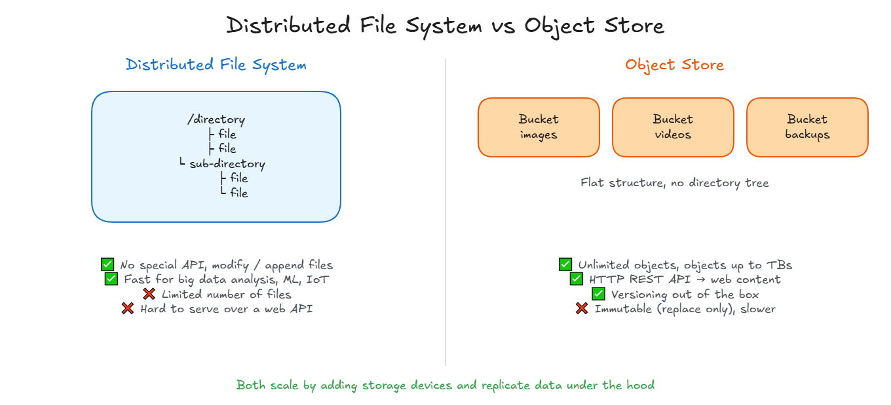
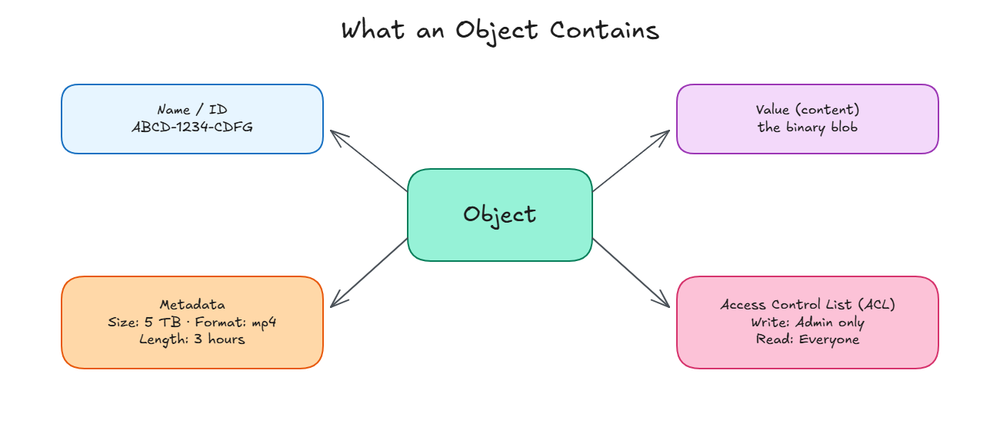

# Scalable Unstructured Data Storage

**In this lecture:**

1. What unstructured data is
2. Common use cases for unstructured data
3. Two scalable solutions with very different properties: a **distributed file system** and an **object store**

---

### What Is Unstructured Data?

> **Unstructured data is data that doesn't follow a particular structure, schema or model.**

1. **Not unstructured:** in a non-relational database, documents or key/value pairs in the same collection don't have to match each other, but **each record still has a well-defined structure** (for example, the Iron Man JSON document).
2. **Unstructured:** binary files such as **audio, video, images and PDF documents**. Without a special tool to decode the file's content, all we have is a **blob** (**B**inary **L**arge **OB**ject).

### Why Not Store Them in a Database?

1. Some databases allow storing blobs, but databases are optimized for **structured** data.
2. Most impose strict **size limits** on blobs, typically in the order of **megabytes**. Otherwise they would suffer from **performance and scalability** problems.

---

### Use Cases for Unstructured Data

### 1. User-Uploaded Data

Users upload raw or uncompressed **images, videos, audio files or documents** for further processing. The data can be **compressed, transcoded** (converted to another format), and moved elsewhere, to be:

1. **Shared:** social media and streaming platforms
2. **Backed up:** file hosting services

### 2. Database Backup and Archiving

We take periodic **snapshots** of our relational or non-relational database. These are stored in **proprietary, database-specific binary formats**, so we treat them as unstructured data, stored elsewhere for two purposes:

1. **Disaster recovery:** if we lose the primary database, or even its replicas, we recover from the backup.
2. **Archiving** backups of transactions, emails or documents for later **auditing**. This is **required by law** in some industries, such as **finance** and **health care**.

### 3. Web Hosting

Web content such as **images, thumbnails, digital downloads** or other media shown on our website is unstructured data. We need to store it somewhere, ideally with the ability to **update it frequently**.

### 4. Machine Learning and Big Data Analytics

Huge data sets, which can contain binary data such as **sensor measurements** from **IoT devices** (Internet of Things: connected devices like smart meters), or images from **satellites** or **surveillance cameras**.

### What These Use Cases Share

1. The **data sets** can be very big, so storage must scale to **terabytes or even petabytes**.
2. **Single objects** (a video, an audio file, a document) can be very big too, **far too big for any database**.

---

### Solution 1: Distributed File System (DFS)

Gives us the same **abstraction** as storing data on our **local hard drive**, but instead of a single storage device, it uses a **network of storage devices** connected to each other.

1. Different DFSs give different guarantees for **replication**, **consistency** (strong or eventual) and **auto-healing** (automatically repairing lost copies).
2. The main feature: files are stored the familiar way, as **files within folders** in a **tree-like structure**.

### Benefits

1. **No special API** is needed to access the files.
2. **Easy to modify files**, for example editing a document, or appending data to the end of a log file or video file.
3. **Very fast for performance-intensive operations**, such as big data analysis or transformations on big data sets, done directly on the DFS. Especially useful for **machine learning** and **IoT**.

### Limitations

1. Most DFSs have a **limit on the number of files**, which is a big scalability issue with many relatively **small files**, such as images.
2. **Hard to give web access:** we can't easily expose the files through a **web API**, for example to serve web content to browsers, without building extra abstractions on top.

**Real-world example:** A shared office drive with folders: easy to open and edit files, but not made for serving millions of website images.

---

### Solution 2: Object Store

> **An object store is a scalable storage solution specifically designed for storing unstructured data at internet scale.**

### Benefits

1. **Scales linearly** like a DFS, by adding storage devices, but with virtually **no limit on the number of objects**.
2. **Very large objects:** single objects can usually be up to **several terabytes**. This makes object stores perfect for **database backups and archiving**.
3. **HTTP REST API:** by far the best feature. It makes object stores perfect for **web content**: images, thumbnails, articles, digital downloads, or anything we can link to on a web page.
4. **Object versioning out of the box:** we can easily revert changes and **undo deletes**. With a file system, we would need an external version control system.

### How Objects Are Organized

1. **No directory hierarchy.** Objects live in a **flat structure**, inside containers usually called **buckets**.
2. Buckets generally have **no limit** on the number of objects. The only limit is our **storage budget**.

### What an Object Contains

1. **Name / ID:** a unique identifier, such as `ABCD-1234-CDFG`
2. **Value:** the object's **content**
3. **Metadata:** key/value pairs with extra information, such as size, type or format (for example, Size: 5 TB, Format: mp4, Length: 3 hours)
4. **Access Control List (ACL):** permissions for who can **read** or **overwrite** the object (for example, Write: Admin only, Read: Everyone)

### Cloud Storage Classes (Tiers)

Almost every cloud vendor offers object storage at reasonable cost, split into **tiers** or **storage classes**, each with different **pricing and SLA** guarantees:

| Tier | Amazon S3 | GCP Storage | Azure Blob | Alibaba OSS |
| --- | --- | --- | --- | --- |
| **Top** | S3 Standard | Standard | Hot tier | Standard |
| **Middle** | Standard - Infrequent Access | Nearline | | IA |
| **Middle** | Glacier Instant Retrieval | Coldline | Cool tier | Archive |
| **Lowest** | Glacier Deep Archive | Archive | Archive Tier | Cold Archive |

1. **Top tier:** the most expensive. Highest availability (about **four nines, 99.99%**), lowest latency, highest throughput, and durability above **ten nines** (99.999999999%). Best for **frequently accessed, user-facing** content like videos and images.
2. **Middle tiers:** lower availability (about **three nines, 99.9%**) and cheaper. Performance is more limited, and sometimes there are limits on **how often** we can access the data. Perfect for **backups** that aren't needed often.
3. **Lowest tier:** the cheapest, for **long-term archiving**. Used by law firms, health care companies and financial institutions that must keep data for many years for legal reasons, but rarely use it.

**Real-world example:** Clothes you wear daily stay in the wardrobe (top tier), winter clothes go in the attic (middle), and old tax papers go in a storage unit (archive).

### On-Premise and Hybrid Cloud

1. Sometimes a cloud object store isn't an option, because of **budget, legal or performance** constraints.
2. There are **open-source** and **third-party managed** solutions for running an object store on our own (**on-premise**) storage devices.
3. Some follow the **same API** as cloud vendors, so we can use them in a **hybrid cloud** deployment, with part of our system in the cloud and part in our private data center, using the **same object store API** in both.

### Data Replication

Like a DFS, object stores **replicate data under the hood**, so losing physical storage never means actually **losing data**.

### Drawbacks

1. **Objects are immutable:** we can't open an object and change its content. We can only **replace** it with a new version. This hurts performance, so storing large documents for **collaboration**, or **log files** that need appending, is out of the question.
2. **Special API needed:** to create or read data, we need a special API or a REST API. It isn't as easy as a regular file system.
3. **Lower throughput:** distributed file systems are usually preferred for **very high-throughput** operations.

---

### Summary: DFS vs Object Store

| | Distributed File System | Object Store |
| --- | --- | --- |
| **Structure** | Files in a folder tree | Objects in flat buckets |
| **Number of files** | Limited | Virtually unlimited |
| **Modify / append** | ✅ Yes | ❌ No, replace only (immutable) |
| **Access** | Like a normal file system | Special API or **HTTP REST API** |
| **Web content** | ❌ Hard | ✅ Perfect |
| **Versioning** | Needs external tools | ✅ Built in |
| **Best for** | High-throughput big data, ML, IoT | Web content, backups, archiving |

---

**Key idea:** Unstructured data (binary blobs like videos, images, backups) is too big for databases. A distributed file system offers a familiar folder tree, editable files and high throughput. An object store offers unlimited objects in flat buckets, a REST API for web content, versioning and cheap storage tiers, but objects are immutable.

---

## Short Note

- **Unstructured data:** no structure, schema or model. Binary **blobs** (audio, video, images, PDFs). Databases cap blobs at about MBs.
- **Use cases:**
  - User uploads (compress, transcode, share or back up).
  - DB **snapshots** for disaster recovery and legal archiving (finance, health care).
  - Web hosting (images, thumbnails, downloads).
  - ML and big data (IoT sensors, satellite and camera images).
  - All need TB–PB scale and very large single objects.
- **Distributed file system:** a local-disk-like **folder tree** over many networked devices, with replication, consistency and auto-healing.
  - ✅ No special API, easy to modify or append, fast big data processing (ML, IoT).
  - ❌ Limited number of files, hard to serve via a web API.
- **Object store:** built for unstructured data at internet scale. Objects live in flat **buckets**, and each object = **ID + value + metadata + ACL**.
  - ✅ Unlimited objects, objects up to TBs, **HTTP REST API** (great for web content), built-in **versioning**, replication.
  - **Storage classes:** top (99.99% availability, eleven nines durability, user-facing content) → middle (99.9%, backups) → archive (cheapest, legal retention).
  - **On-premise and hybrid cloud** options use the same API.
  - ❌ **Immutable** (replace only, no appending logs), needs an API, lower throughput than a DFS.
