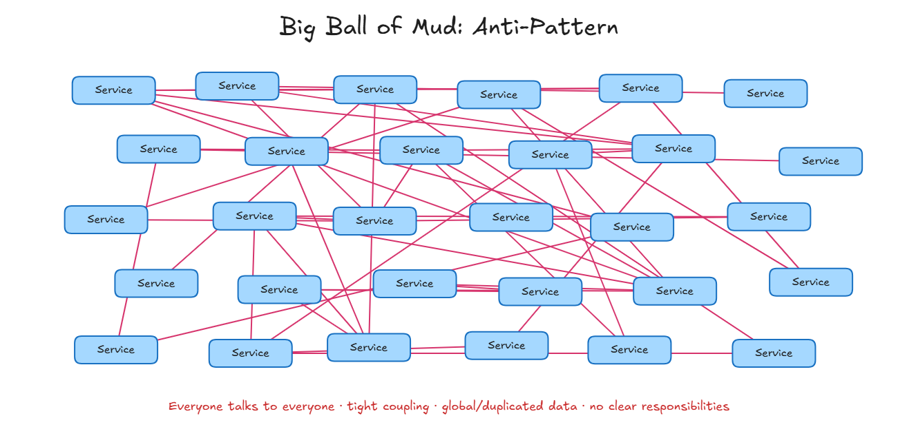

# Introduction to Software Architecture Patterns & Styles

**In this lecture:**

1. What software architectural patterns are
2. Why we should use them
3. What to keep in mind as systems evolve

This section covers the most popular and useful **architectural patterns** for modern software systems.

---

### What Are Software Architectural Patterns?

> **Software architectural patterns are general, repeatable solutions to commonly occurring system design problems.**

| | Design Patterns | Architectural Patterns |
| --- | --- | --- |
| **Examples** | Singleton, Factory, Strategy | (This section: Multi-Tier, Microservices, Event-Driven) |
| **Scope** | Organize **code within a single application** | Solve problems involving **multiple components** running as **separate runtime units** (applications or services) |

### Where They Come From

1. Over the years, software architects observed how **other companies in similar industries** solved design problems similar to their own, and learned **what worked and why**.
2. Even more importantly, they observed **what mistakes were made**, so other companies wouldn't waste resources repeating the same **anti-patterns** (common solutions that turn out badly).
3. The general practices that proved **successful** became what we know as **software architectural patterns**.

**Real-world example:** House builders reuse proven floor plans (like an open-plan kitchen) instead of designing every house from scratch.

---

### Why Use Architectural Patterns?

We're **not required** to follow any pattern, but there are 3 good reasons to:

### 1. Save Time and Resources

If companies with a **similar use case** and a **similar scale** already found an architecture and development practice that works, it's better to use that knowledge than to **reinvent the wheel**.

### 2. Avoid the "Big Ball of Mud"

The **big ball of mud** is an **anti-pattern**: a system that seems to lack any structure, where:

1. **Every service talks to every other service**
2. Everything is **tightly coupled**
3. All information is **global or duplicated**
4. No component has a **clear scope of responsibility**

Surprisingly, many companies end up here, or in some variation of it, because of **rapid growth** or the lack of a well-defined architecture that the **whole organization** follows. Such a system is very **hard to develop, maintain and scale**, which can seriously hurt the business.

**Real-world example:** A city that grew without planning, with random streets everywhere, where every new road makes traffic worse.

### 3. Easy for Others to Continue Our Work

Other engineers and architects can easily continue working on our system and keep to the same architecture, because anyone can **read about the pattern** and understand exactly **what to do and what not to do**.

---

### Keep in Mind

1. **Patterns are just guidelines.** Our job is to define the **best architecture for our use case**, and apply what's relevant to our unique situation.
2. **Systems evolve.** A pattern that fit perfectly before may **not fit anymore**, and that's expected. Then we restructure, and may **migrate** to a different pattern.
3. **Migrations are well-known paths:** many companies have already made such migrations, so we can follow their **best practices** to migrate **quickly and safely**.

---

**Key idea:** Architectural patterns are proven, repeatable solutions for systems made of multiple services. Following them saves time, avoids the "big ball of mud", and lets others easily continue our work, but they are guidelines to adapt, and may need to change as the system evolves.

---

## Short Note

- **Architectural patterns:** proven, repeatable solutions to common system design problems.
  - **vs design patterns** (Singleton, Factory, Strategy): those organize code **inside one app**. Architectural patterns organize **multiple services or apps**.
  - They come from watching what worked, and what failed (anti-patterns), at companies with similar problems.
- **Why use them:**
  - **Save time:** don't reinvent the wheel if similar companies at a similar scale already solved it.
  - **Avoid the big ball of mud:** everyone talks to everyone, tight coupling, global or duplicated data, no clear ownership → hard to develop, maintain and scale (caused by rapid growth or no shared architecture).
  - **Easy handover:** others can read about the pattern and follow it.
- **Remember:** patterns are guidelines, so adapt them to your case. As the system evolves, you may **migrate** to another pattern, following other companies' best practices.
