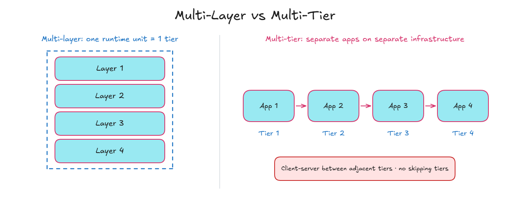
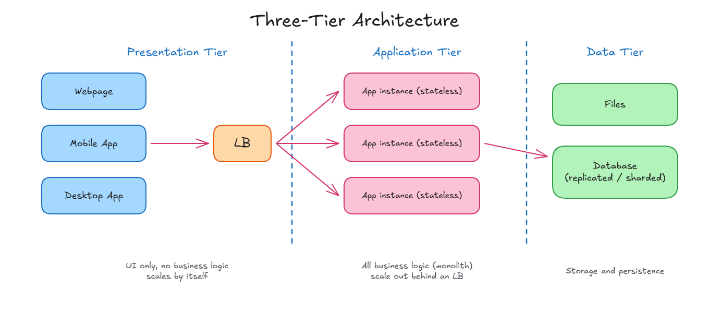
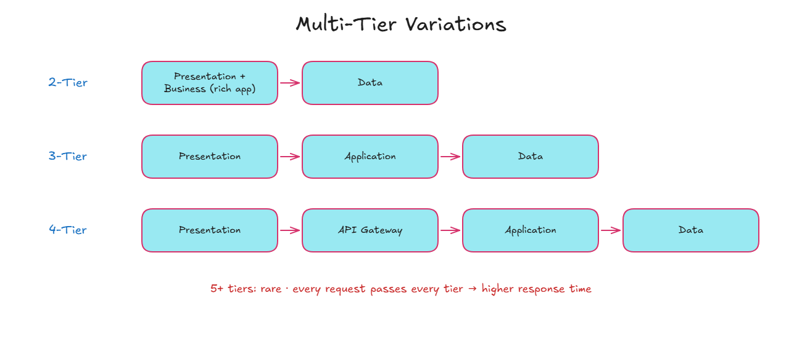
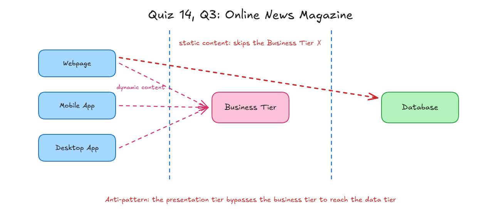

# Multi-Tier Architecture

**In this lecture:**

1. A general introduction to the Multi-Tier architectural pattern
2. Its most common variation, the **Three-Tier Architecture**
3. Other variations (Two-Tier, Four-Tier), and when to use this pattern or look for other solutions

---

### What Is Multi-Tier Architecture?

> **The Multi-Tier Architecture organizes our system into multiple physical and logical tiers.**

1. **Logical separation:** limits the **scope of responsibility** of each tier.
2. **Physical separation:** each tier can be **deployed, upgraded and scaled separately**, by different teams.

### Multi-Layer vs Multi-Tier

People sometimes use these terms interchangeably, but they are **different concepts**:

1. **Multi-layer:** the **internal** separation of a **single application** into logical layers or modules. At runtime it still runs as **one unit**, so it counts as a **single tier**.
2. **Multi-tier:** the applications in each tier **physically run on different infrastructure**.

### Two Restrictions That Simplify the Design

1. **Client-server model:** each pair of applications in **adjacent tiers** communicates using the client-server model, which is a perfect fit for **RESTful APIs**.
2. **No skipping tiers:** communication that **skips** a tier is discouraged. This keeps tiers **loosely coupled**, so we can change each tier without affecting the whole system.

---

### Three-Tier Architecture

To this day, one of the most **common and popular** patterns for client-server, **web-based** services.

### 1. Presentation Tier (Top)

1. Contains the **user interface**: it **displays** information to the user and takes the user's **input** through a graphical user interface.
2. **Examples:** a **webpage** in the browser, a **mobile app**, or a **desktop GUI application**.
3. **No business logic.** One reason, especially for code running in the browser: the code is **directly visible** to the user, and we don't want users to see, and maybe change, our business rules. Putting business logic here is an **anti-pattern**.

### 2. Application Tier (Middle)

1. Also called the **Business Tier** or **Logic Tier**.
2. Provides **all the functionality and features** from our **functional requirements**.
3. **Processes** the data coming from the presentation tier and applies the **business logic** to it.

### 3. Data Tier (Bottom)

Responsible for **storage and persistence** of user and business data. It may include **files** on a file system, and most commonly a **database**.

**Real-world example:** A restaurant: the dining room (presentation), the kitchen that cooks the orders (application), and the pantry and fridge (data).

---

### Why Is Three-Tier So Popular?

1. **Fits many use cases:** almost any web-based service fits, such as an online store, a news website, or a video or audio streaming service.
2. **Easy to scale horizontally**, for large traffic and lots of data:
   - **Presentation tier:** needs no special scaling. It runs on users' devices, so it **scales by itself**.
   - **Application tier:** if we keep it **stateless** (as we should with a REST API), we put the instances behind a **load balancer** and run as many as we need.
   - **Data tier:** a well-established **distributed database** scales with techniques we already learned: **replication** and **partitioning**.
3. **Easy to maintain and develop:** all the logic is **concentrated in one place**, the application tier, where all the backend development happens. No need to integrate multiple codebases, services or projects.

---

### The Major Drawback: A Monolithic Logic Tier

The drawback comes from exactly what makes it popular. There's no business logic in the presentation tier, and none at all in the data tier, so **all the business logic** lives in a **single codebase** that runs as a **single runtime unit**. This has 2 implications:

### 1. Instances Become Too Heavy

1. Each application instance becomes too **CPU-intensive** and uses **too much memory**.
2. Applications get **slower and less responsive**, especially in memory-managed languages like **Java or C#**, which suffer longer and more frequent **garbage collections** (automatic memory clean-up pauses).
3. We may need to upgrade each computer, but **vertical scaling** is **expensive and limited**.

### 2. Low Development Velocity

1. As the codebase grows, it gets much harder to **develop, maintain and reason about**.
2. **Hiring more developers doesn't help much**: more parallel development causes more **merge conflicts** and higher overhead.
3. Splitting the codebase into **modules** helps a little, but modules stay **tightly coupled**, because a new version of a module can only be released when the **whole application** is upgraded.
4. So the **organizational scalability** of Three-Tier is **limited**.

### When to Use Three-Tier

Perfect for companies with a **relatively small, not too complex** codebase, maintained by a **relatively small team**. This includes **early-stage startups**, and well-established companies that fit these criteria.

---

### Other Multi-Tier Variations

1. **One-Tier:** simply a **standalone application**.
2. **Two-Tier:**
   - The **top tier** has both the **presentation and the business logic**, usually a **feature-rich mobile or desktop app**. The **second tier** is the **data tier**.
   - Removes the overhead of a middle logic tier, giving a **faster, more native** user experience.
   - **Examples:** desktop or mobile **document, image or music editors**, with all functionality and UI on the user's device, and storage and backup on the company's remote server.
3. **Four-Tier:**
   - Adds a tier **between presentation and business** for functionality that belongs in neither.
   - **Example:** an **API Gateway** tier, when we support multiple client apps with different APIs or different data and performance needs. It handles **security, API and format translation, and caching**.
4. **More than four tiers:** **extremely rare**. More tiers usually add little value, and add **performance overhead**: because we can't **bypass tiers** (that would cause tight coupling), every request passes through **every** tier, which increases **response time**. We rarely need every request to go through so many services, and the next lectures show better ways to split a codebase into multiple components.

---

**Key idea:** Multi-tier architecture splits a system into logically and physically separate tiers (client-server between neighbors, no skipping). Three-tier (presentation, application, data) is simple, popular and easy to scale, but its monolithic logic tier limits performance and team growth, so it suits small codebases and small teams.

---

## Short Note

- **Multi-tier:** a system split into **logical** (clear responsibility) and **physical** (deploy, upgrade and scale separately) tiers.
  - **≠ multi-layer** (layers inside one app = 1 tier).
  - Rules: **client-server** between adjacent tiers (great for REST), and **no skipping tiers** → loose coupling.
- **Three-tier:**
  - **Presentation:** web, mobile or desktop UI, with **no business logic** (users can see browser code).
  - **Application / business / logic:** all the features from the functional requirements.
  - **Data:** files and databases.
- ✅ **Why popular:** fits most web services. Scales easily (UI scales by itself, stateless app tier behind an LB, DB uses replication and sharding). All logic in one place.
- ❌ **Monolithic logic tier:**
  - Heavy CPU and memory use (GC pauses in Java/C#) → expensive vertical scaling.
  - **Low development velocity** (merge conflicts, coupled modules) → limited organizational scalability.
- **Best for:** small codebases and small teams (startups, or established companies that fit).
- **Variations:**
  - **1-tier:** a standalone app.
  - **2-tier:** a rich client (UI + logic) + data, like document, image or music editors → fast and native.
  - **4-tier:** + an **API Gateway** (security, translation, caching).
  - **5+ tiers:** rare, and slow (every request passes every tier).

---

## Q & A

**Question 1:** Which statement below is **NOT** a prerequisite for using the 3-tier architecture successfully?

1. A small team of engineers
2. The codebase of the application tier is not too big and complex.
3. The presentation tier should not contain any business logic.
4. The data we store can fit on one computer.

**Answer:** 4. The data we store can fit on one computer.

The data tier can use a distributed database that scales with replication and partitioning, so the data doesn't need to fit on one machine. The other three are real requirements: a small team, a small codebase, and no business logic in the UI.

**Question 2:** Which architectural building block should we use to scale the **Presentation Tier**?

1. Load Balancer
2. API Gateway
3. Message Broker
4. Nothing. The Presentation Tier scales on its own on the users' devices.

**Answer:** 4. Nothing. It scales on its own on the users' devices.

The presentation tier (webpage, mobile app, desktop app) runs on each user's own device, so every new user brings their own "server".

**Question 3:** We have the following architecture diagram of an **online news magazine**. The webpage, mobile app and desktop app get **dynamic content** from the Business Tier, but the webpage also gets **static content** directly from the Database. What is the correct statement about this diagram?

1. This is a well-designed 2-Tier Architecture Diagram.
2. This is a well-designed 3-Tier Architecture Diagram.
3. This diagram has an issue because it contains both files and a database in the Data Tier.
4. This diagram includes an anti-pattern of bypassing the Business Tier and sending requests directly from the Presentation Tier to the Data Tier.

**Answer:** 4. It bypasses the Business Tier, which is an anti-pattern.

Multi-tier forbids skipping tiers. The webpage talking directly to the database tightly couples the UI to the data tier, so changing the database would break the clients.

**Question 4:** Why is the 3-Tier Architecture referred to as **Monolithic Architecture**?

1. Because all the business logic is concentrated in one deployable unit
2. Because the entire frontend code runs on a single client device
3. Because we can have only one database in the Data Tier
4. Because we can have only one codebase, and we can't break it into multiple libraries

**Answer:** 1. All the business logic is in one deployable unit.

The whole application tier is a single codebase that runs and is released as one runtime unit. That's what "monolithic" means. We can still split it into modules or libraries, but they are released together.
