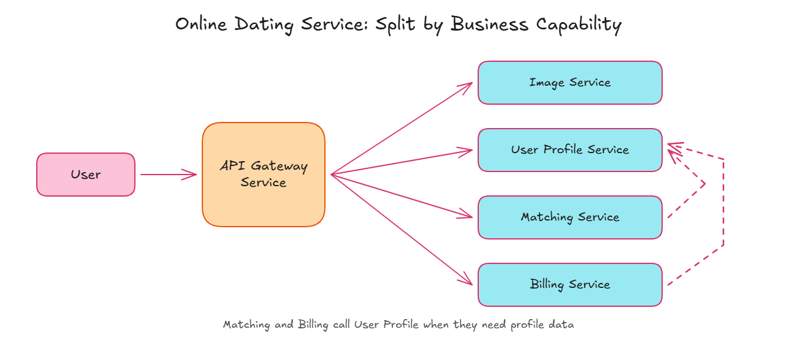
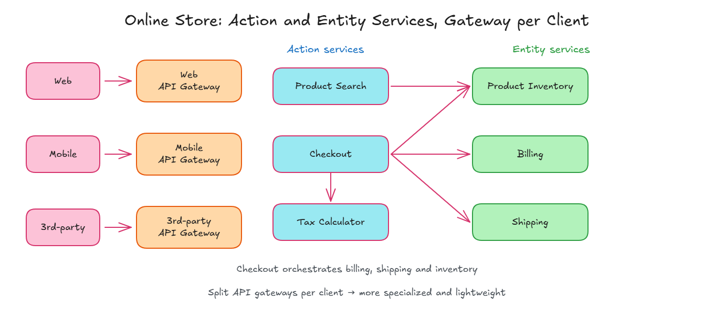
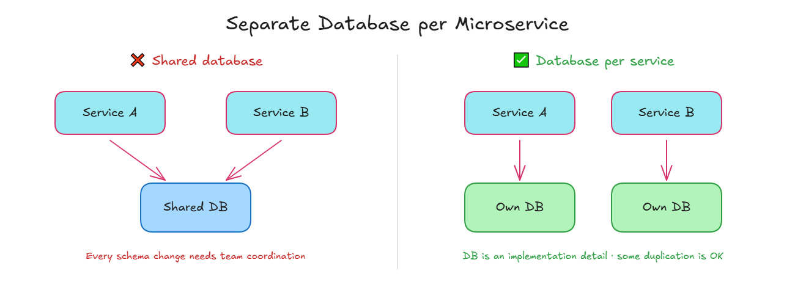
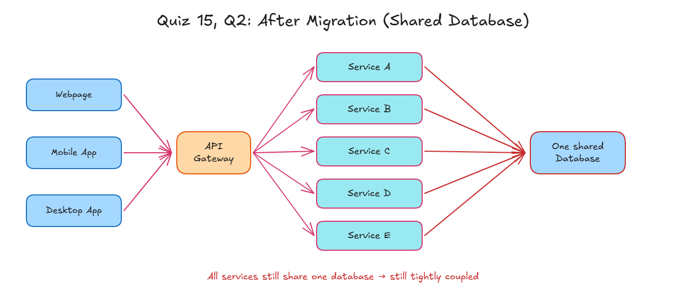
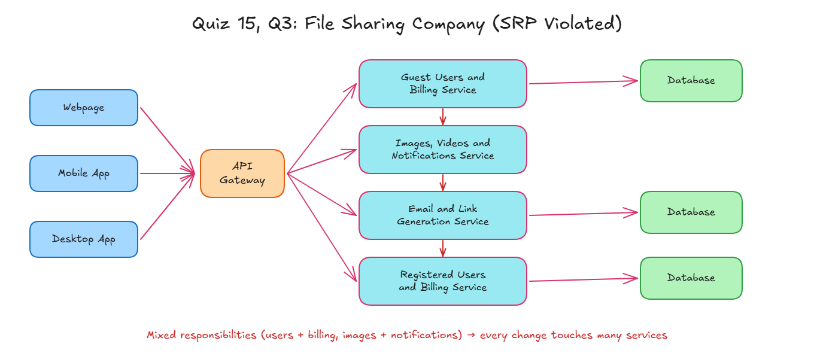

# Microservices Architecture

**In this lecture:**

1. Why we need microservices, compared to the monolithic three-tier architecture
2. The advantages of microservices
3. Best practices and challenges

---

### Why Move Away From the Monolith?

In the [Multi-Tier lecture](2.%20Multi-Tier%20Architecture.md), the three-tier architecture was called **monolithic**, because **all the business logic** sits in **one single service** in the application tier. It's perfect for **small teams** with a fairly small, not too complex codebase.

**As the codebase grows in size and complexity:**

1. It becomes extremely hard to **troubleshoot** and **add new features**.
2. It's hard to **build, test**, and even **load the whole codebase in our IDE**.

**Organizational scalability problems:**

1. The more engineers we add, the more **code merge conflicts** we get.
2. Meetings become **larger, longer and less productive**.

When we see these problems, it's time to consider **migrating to microservices**.

---

### What Is Microservices Architecture?

> **Microservices architecture organizes our business logic as a collection of loosely coupled and independently deployed services. Each service is owned by a small team and has a narrow scope of responsibility.**

**Real-world example:** A big restaurant where separate stations (grill, salad, desserts) each have their own small team, instead of one cook making everything.

---

### Advantages of Microservices

### 1. Smaller Codebase → Faster Development

The narrow scope of each service makes its codebase much **smaller** than the monolith:

1. The code **loads instantly** in the IDE.
2. **Building and testing** is much easier and faster, because there's far less to build and test.
3. **Troubleshooting and adding features** is easier, because the code is easier to reason about.
4. **New developers** become fully productive much faster.

### 2. Performance and Scalability

1. Each service instance is far less **CPU-intensive** and uses far less **memory**, so it runs smoothly on **commodity hardware** (cheap, standard machines).
2. We scale each service **horizontally** by adding more instances on fairly low-end computers.

### 3. Organizational Scalability

1. Each service is independently **developed, maintained and deployed** by a separate small team, so we get very high **throughput** from the whole organization.
2. Each team is **autonomous**. It chooses its own **programming languages, frameworks and technologies**, and its own **release schedule and process**.

### 4. Better Security Through Fault Isolation

If one service has an issue or starts **crashing**, it's much easier to **isolate and fix** the problem than in a single monolithic application.

---

### Two Things to Consider Before Migrating

Many organizations jump to microservices **too quickly**, without considering:

1. **The benefits aren't free.** Splitting the monolith into an **arbitrary** collection of services doesn't give us the benefits. We must follow **best practices**, or we can easily end up in the **Big Ball of Mud**.
2. **Overhead and challenges:** microservices come with real overhead, which we must account for before migrating.

### The Goal: Full Organizational Decoupling

For each team to work independently, services must be **logically separated** so that **every change happens in only one service** and involves only one team. If every change needs meetings and coordination with other teams for development and release, we gain little from microservices.

---

### Best Practice 1: Single Responsibility Principle

Each service is responsible for **only one** business **capability, domain, resource or action**.

### Example: Online Dating Service (Split by Business Capability / Subdomain)

1. **User Profile Service:** the user profile business object, and every way a user can interact with it.
2. **Image Service:** **storage, resizing and presentation** of profile images.
3. **Matching Service:** matches users based on **our rules** and the **preferences** users set in their profiles.
4. **Billing Service:** everything about **charging** users for the services they use.

**How requests flow:**

1. Update or view a profile → **User Profile Service**
2. Upload images → **Image Service**
3. Get partner suggestions → **Matching Service**, which asks the **User Profile Service** which profiles are a good fit
4. Buy extra services → **Billing Service**, which may ask the **User Profile Service** to **unlock features** for that user

### Example: Online Store (Split by Actions and Entities)

**Action-oriented services** (how users interact with the system):

1. **Product Search Service:** takes a search query and returns a **personalized** view of relevant products. To find them, it calls the **Product Inventory Service**.
2. **Checkout Service:** shows what's in the cart, plus the **tax** to pay, by calling the **Tax Calculator Service**.
3. **Tax Calculator Service:** calculates tax based on the product's **price, category** and the user's **location**.

**Entity-oriented services** (the things in our system): **Product Inventory** (encapsulates the products entity), **Billing** and **Shipping**.

When the user **confirms the purchase**, the **Checkout Service orchestrates** (coordinates) the whole transaction by calling the **Billing, Shipping and Product Inventory** services.

**Splitting the API Gateway too:** the API gateway that used to be one monolithic service can also be split, with a separate gateway per type of device or client (**Web, Mobile, Third-Party** API gateways). Each one is more **specialized** and therefore more **lightweight**.

---

### Best Practice 2: A Separate Database per Service

1. **Shared database ❌:** if two services share one database, **every schema or document structure change** needs careful coordination between multiple teams.
2. **Database per service ✅:** the database becomes an **implementation detail** of each service, and can be updated or even **completely replaced**, transparently to the rest of the system.

**How to split the monolith's database:** each service must be **completely independent** and fully able to do its work, while **minimizing calls** to other services. Some **data duplication** is expected. It's the overhead we accept with this architecture.

---

### When to Use Microservices

Microservices give all these benefits, despite their complexity and overhead, **only once we reach a certain complexity and organizational scale**.

> **Always start with the simple monolithic approach first. Consider microservices only when that architecture stops working for us.**

---

**Key idea:** Microservices split business logic into small, loosely coupled, independently deployed services, each owned by a small team. This gives faster development, cheaper horizontal scaling, team autonomy and fault isolation, but only if each service has a single responsibility and its own database. Start with a monolith, and migrate only when it stops working.

---

## Short Note

- **Monolith pain** (as it grows): hard to troubleshoot, build, test or even load in the IDE, plus merge conflicts and big, long meetings → consider microservices.
- **Microservices:** loosely coupled, **independently deployed** services, each with a **small team** and a **narrow responsibility**.
- **Advantages:**
  - **Small codebase:** instant IDE load, fast build and test, easy troubleshooting, quick onboarding.
  - **Performance:** less CPU and memory, runs on commodity hardware, scales horizontally.
  - **Organization:** independent teams, free choice of language, tools and release schedule → high throughput.
  - **Fault isolation:** a crashing service is easy to isolate.
- **Not free:** an arbitrary split → **Big Ball of Mud**. Goal: each change touches **one service and one team**.
- **Best practices:**
  - **Single responsibility:** one capability, domain, resource or action.
    - Dating app: Profile, Image, Matching, Billing.
    - Store: action services (Search, Checkout, Tax) + entity services (Inventory, Billing, Shipping). Checkout **orchestrates**. One API gateway per client type.
  - **Database per service:** the DB becomes an implementation detail, so no cross-team schema coordination. Accept some duplication.
- **Start with a monolith.** Move to microservices only at enough complexity and organizational scale.

---

## Q & A

**Question 1:** Which feature of microservices architecture helps **new developers** become productive faster than in a monolithic architecture?

1. Building and testing are much faster with microservices.
2. The codebase is smaller and much easier to reason about.
3. The code loads faster in the IDE.
4. Microservices consume less memory than monolithic applications.

**Answer:** 2. The codebase is smaller and much easier to reason about.

A new developer only has to learn one small service with a narrow responsibility, not the whole monolith. The other options are real benefits, but they don't explain faster onboarding.

**Question 2:** Our organization migrated its 3-tier web application (webpage, mobile app and desktop app → one monolithic application → one database) into microservices, as shown below. After the migration, development velocity didn't improve. In fact, development **slowed down**. What is the root cause of this bad effect on organizational scalability?

1. The API Gateway that was introduced to the architecture is now a source of contention and friction in the organization.
2. After the migration, all the microservices are still tightly coupled to each other because they share a database.
3. There are too many microservices. Their number needs to be reduced.
4. Each front-end must have its own microservice. But in this architecture, all the frontends share all the microservices.

**Answer:** 2. The microservices are still tightly coupled because they share a database.

Sharing one database across microservices is an anti-pattern. Every schema change still needs coordination between all the teams, so they can't work independently.

**Question 3:** You are a freelance software architect. A company offering premium, high-volume **file sharing** services to businesses migrated to microservices, and says: *"Every change in one microservice requires changes in other microservices. Every operation needs data from multiple microservices, which makes the system very slow and complex. This is the opposite of what we expected."* This is their architecture diagram:

What is the cause of these problems, and how can they solve them?

1. The root cause is the fact that the "Images, Videos and Notifications Service" doesn't have its own database.
2. The architecture violates the SRP (Single Responsibility Principle). Each microservice has too much responsibility, and there is no clear separation between what each microservice is supposed to do. The solution is to rearchitect the system so each microservice is responsible for only one business capability, domain, resource or action.
3. In the current diagram, different microservices communicate with each other directly, which should never happen. They should only communicate with each other through the API Gateway.

**Answer:** 2. The architecture violates the Single Responsibility Principle.

Services like "Guest Users **and** Billing" and "Registered Users **and** Billing" mix several concerns, and billing is split across two services. So every feature touches many services. Each service should own **one** capability, such as Users, Billing, Media or Notifications.

**Question 4:** What is the problem with sharing a database among multiple microservices?

1. A database cannot handle so much traffic from multiple microservices.
2. Every change in the database will require code changes in both microservices, which would require a lot of coordination, potentially among multiple teams.
3. If we use only one database, we limit our storage capacity, which will be a point of contention among multiple microservices.
4. There is no problem. We can freely share the same database among multiple microservices.

**Answer:** 2. Every database change needs code changes and coordination across multiple teams.

With a database per service, the database becomes an implementation detail that one team can change or replace on its own.
