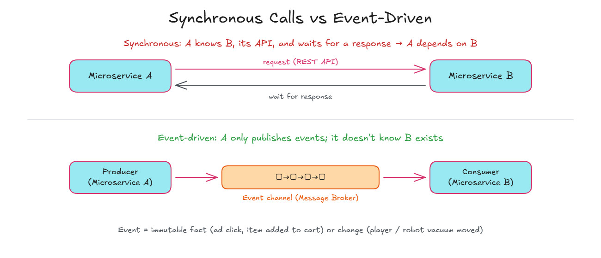
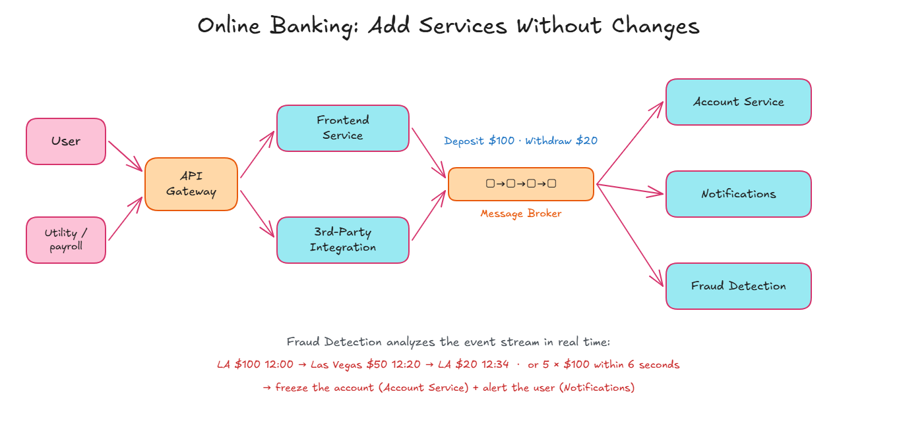
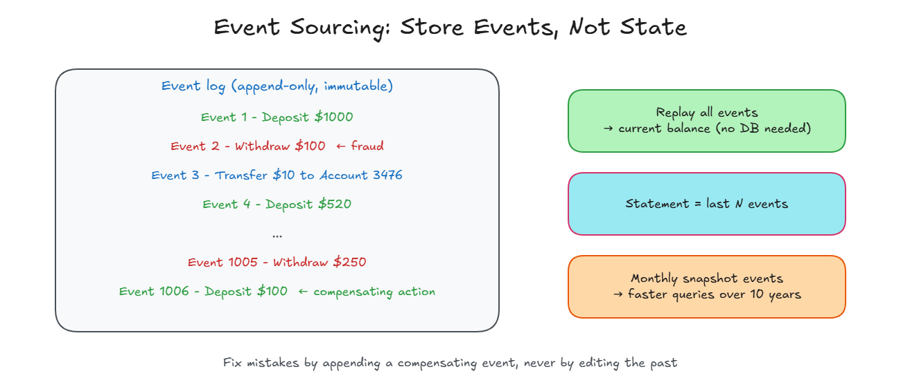
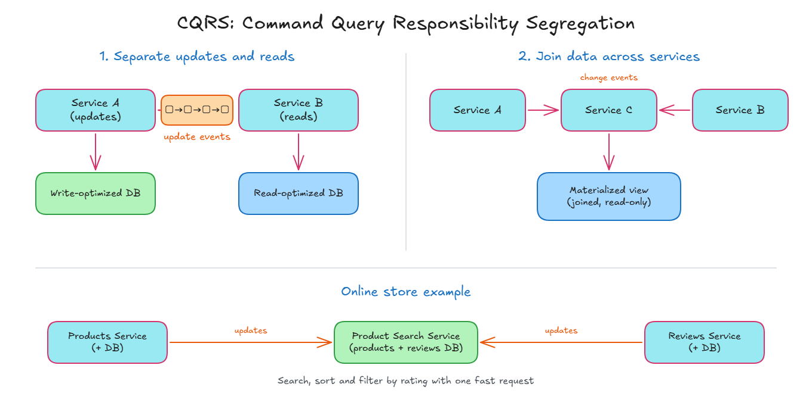
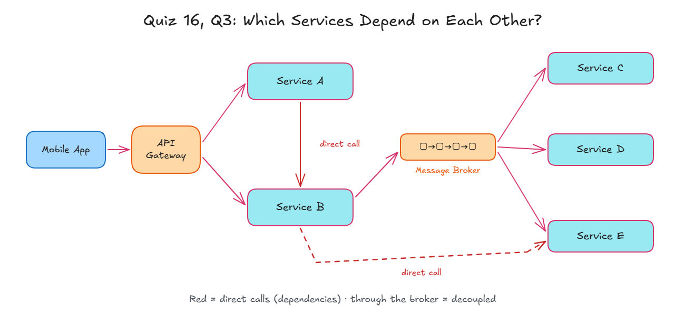

# Event Driven Architecture

**In this lecture:**

1. What Event-Driven Architecture (EDA) is, and its components
2. Its benefits: decoupling, scalability and real-time analysis
3. Two powerful patterns built on it: **Event Sourcing** and **CQRS**

---

### The Problem: Synchronous Calls Create Dependencies

In the [Microservices lecture](3.%20Microservices%20Architecture.md), when **Microservice A** wants to talk to **Microservice B**:

1. A must know that **B exists**.
2. A must know **B's API** and how to call it (for example, B's REST API).
3. At runtime, A calls B **synchronously** and **waits for its response**.

So **Microservice A has a dependency on Microservice B**.

---

### What Is Event-Driven Architecture?

Instead of direct messages that issue **commands** or **requests for data**, we have **only events**.

> **An event is an immutable statement of a fact or a change.**

1. **Fact events:** a user **clicks a digital ad**, or an item is **added to a shopping cart**.
2. **Change events:** a video game **player**, or an **IoT device** like a robot vacuum cleaner, **moves** from one position to another.

### The 3 Components

1. **Event emitters (producers):** on the sending side.
2. **Event consumers:** on the receiving side.
3. **Event channel:** in between. This is the **message broker** we learned about in [Section 5](../005-Large-Scale-Systems-Architectural-Building-Blocks/3.%20Message%20Brokers.md).



**Real-world example:** A radio station broadcasts the news, and anyone tuned in hears it. The station doesn't know or wait for its listeners.

---

### Benefit 1: Decoupling → Scalability

When Microservice A **produces events** instead of calling B:

1. A's **dependency on B is removed**. A doesn't even need to know B exists.
2. After producing an event, A **doesn't wait** for any response from any consumer.

Services don't need to know each other's existence or API, and all messages are **asynchronous**, so microservices are decoupled much more effectively. This gives **higher horizontal and organizational scalability**, and we can **add services without changing the system**.

### Example: Online Banking System

1. **Start with 2 services:**
   - **Frontend Service:** the user interface. It takes the user's input, such as deposits and transfers between accounts.
   - **Account Service:** maintains and updates each user's **balance**.
2. Every user action becomes an **event** produced by the Frontend Service (for example, "Deposit $100", "Withdraw $20"). The Account Service **subscribes** and updates the balance.
3. **Add a Notifications Service:** it subscribes to the **same channel** and sends a **push notification** to the user's phone for every account activity. **No changes** to the Frontend Service.
4. **Add a Fraud Detection Service:** again, **no changes** to existing services.
5. **Add a new producer, a Third-Party Integration Service,** for example to integrate with:
   - **Utility companies** that automatically charge clients for gas, electricity or water
   - **Payroll services** that make **direct deposits** on behalf of the client's employer

   Adding this producer needs **no changes** either.



---

### Benefit 2: Real-Time Stream Analysis

EDA lets us **analyze streams of data, detect patterns and act on them in real time**, without waiting for the data to be post-processed and stored in a database.

**Fraud Detection examples:**

1. **Impossible locations:** in the last hour, transactions happened in **Los Angeles** ($100 at 12:00pm, $20 at 12:34pm), but one happened in **Las Vegas** ($50 at 12:20pm). This is possibly someone who **stole the card or account details**.
2. **Inhuman speed:** **5 transactions** of $100 in Los Angeles within **6 seconds** (12:00:00 to 12:00:06), which can't come from real human activity.

**When fraud is flagged**, the Fraud Detection Service:

1. Tells the **Account Service** to **freeze** the user's account
2. Tells the **Notifications Service** to **alert** the user

---

### Pattern 1: Event Sourcing

Storing all events in the message broker lets us do more than real-time analysis.

1. **Lecture example (banking):** a user's **event log** is basically **all the transactions** in their account.
2. **Replaying** all events from the beginning of time gives the **current balance**, the same value the Account Service stores in its database.
3. **Event sourcing:** instead of storing the **current state** in a database, we store **only the events**, and replay them when we need the current state. This **eliminates the need for the database**.
4. Events are **immutable**, so we **never modify** them. We only **append** new events to the log as they come.

**Event log example:**

| Event | Action |
| --- | --- |
| Event 1 | Deposit $1000 |
| **Event 2** | **Withdraw $100 ← fraud detected** |
| Event 3 | Transfer $10 to Account 3476 |
| Event 4 | Deposit $520 |
| ... | ... |
| Event 1004 | Transfer $520 to Account 12357 |
| Event 1005 | Withdraw $250 |
| **Event 1006** | **Deposit $100 ← compensating action** |

### What Event Sourcing Gives Us

1. **Statements:** a new service can generate a statement, or look up any number of transactions, just by reading the **last N events**.
2. **Fixing fraud without editing data:** if a transaction wasn't approved by the customer, we add a **compensating event**. For example, if a thief charged $100, the Fraud Detection Service credits $100 back. No need to **freeze the account** or **modify database records**, and the fix shows up on the statement **immediately**.
3. **Long history:** we can keep events as long as we want, so users can see transactions from **5 or even 10 years** ago.
4. **Snapshots:** to make queries faster, we add **snapshot events**, for example **every month**, that summarize everything up to that point.



**Real-world example:** A bank passbook: every entry is written in order and never erased. A mistake is fixed with a new correcting entry.

---

### Pattern 2: CQRS (Command Query Responsibility Segregation)

CQRS solves **2 problems**.

### Problem 1: Heavy Reads AND Heavy Updates on One Database

1. When a database has a high load of **both read and update** operations, concurrent operations on the same records or tables **contend** with each other, which makes **everything slow**.
2. A **distributed database** can usually be optimized for only **one** type of operation, at the expense of the other:
   - **Read-intensive:** accept slower writes.
   - **Write-intensive:** accept slower reads.
   - **Both equally frequent:** a problem.

**The CQRS solution:** separate **update** and **read** operations into **separate databases**, behind **two separate services**:

1. **Service A** takes all **updates**, and stores data in its own **write-optimized** database.
2. Every time it performs an update, it also **publishes an event** to the message broker.
3. **Service B** **subscribes** to those update events and applies the changes to its own **read-optimized** database.
4. All **reads** go only to Service B.

Now updates and reads don't interfere, and each database stores data in the best way for its operation.

### Problem 2: Joining Data Across Microservices

1. **Before (monolith):** all tables lived in **one database**. In a relational database, we could easily and quickly combine tables with an SQL **JOIN**.

```sql
SELECT * FROM Table2 t2
LEFT JOIN Table1 t1 ON t2.column = t1.column
ORDER BY ...
```

2. **After (microservices, database per service):** joins are much harder.
   - We must send a request to **each service separately**, which is much **slower**.
   - We must **combine the data programmatically**, because the databases may be different types (for example, a relational database and a document store), and some aren't relational at all.

**The CQRS solution:**

1. Whenever data changes in Service A's or Service B's database, the service **publishes the change as an event**.
2. **Service C subscribes** to both, and stores a **materialized view** (a precomputed, joined, ready-to-query copy of the data) from A and B in its own **read-only** database.
3. When we need the joined view, we ask **only Service C**, which already has the data ready.



### Real-Life Example: Online Store

1. Hundreds of thousands of **products**, and millions of users who **search** for them and leave **reviews** daily.
2. **Products Service** (own DB): name, inventory count, description, price, and so on. Inventory changes constantly as people buy products, and as products are added and updated.
3. **Reviews Service** (own DB): all reviews for all products. Reviews arrive **constantly**, so updates are very frequent.
4. But users also constantly need **both** together: the description and price (from Products) and the reviews and rating (from Reviews).

**Using CQRS:**

1. Add a **Product Search Service** with its own database, storing the **combined** product + review data.
2. It **subscribes** to updates from the Products and Reviews services.
3. A user searching for a **vacuum cleaner** or a **pair of shoes** gets all results quickly, with **one request** to the Product Search Service.
4. **Sorting or filtering** by number of reviews or rating is also easy and fast.

**Real-world example:** A restaurant's menu board is a ready-to-read summary that is updated whenever the kitchen or the pricing team changes something. Customers don't have to ask both teams.

---

**Key idea:** In event-driven architecture, services communicate only through immutable events on a message broker, so producers don't know or wait for consumers. This decouples microservices, lets us add services freely and analyze streams in real time, and enables Event Sourcing (state = replayed events) and CQRS (separate write and read models, and precomputed joins).

---

## Short Note

- **Problem:** synchronous calls → A must know B, its API, and wait → **A depends on B**.
- **EDA:** only **events**, which are immutable facts (ad click, item added to cart) or changes (player or robot vacuum moved).
  - Components: **producer → event channel (message broker) → consumer**.
- **Benefit 1, decoupling:** the producer doesn't know consumers and never waits → horizontal and organizational scalability.
  - Banking: Frontend → events → Account. Then add Notifications, Fraud Detection and a 3rd-party producer (utilities, payroll), all with **zero changes**.
- **Benefit 2, real-time stream analysis:** spot fraud (LA → Las Vegas → LA, or 5 × $100 in 6 s) → freeze the account and alert the user.
- **Event sourcing:** store an **append-only log of events** instead of the current state (no DB needed).
  - Replay → balance. Last N events → statement.
  - Fix fraud with a **compensating event**, not by editing records.
  - Keep 10 years of history, with monthly **snapshots** for speed.
- **CQRS:**
  - **Problem 1, heavy reads + writes:** Service A (write-optimized DB) publishes events → Service B (read-optimized DB) serves all reads.
  - **Problem 2, joins across service DBs:** Service C subscribes to A and B and keeps a **materialized view** (read-only, pre-joined).
  - Online store: **Product Search Service** = products + reviews, with fast search, sort and filter by rating.

---

## Q & A

**Question 1:** What is one of the purposes of the **CQRS** pattern in event-driven architecture?

1. Decoupling microservices using a message broker
2. Improving the performance of read operations at the expense of write operations
3. Merging/joining data from multiple databases belonging to different microservices
4. Improving the performance of write operations at the expense of read operations

**Answer:** 3. Merging/joining data from multiple databases belonging to different microservices.

CQRS lets a service subscribe to change events from other services and keep a pre-joined materialized view. Its other purpose is separating reads and writes so that **both** are fast, not one at the expense of the other.

**Question 2:** Select the **most** correct statement that describes an "event".

1. An event is immutable.
2. An event represents a new fact.
3. An event represents a change in our system's state.
4. All of the above are correct.

**Answer:** 4. All of the above are correct.

An event is an immutable statement of a fact (such as an ad click) or a change (such as a player moving).

**Question 3:** Look at the architecture diagram below. **Definition:** Service 1 **depends** on Service 2 if a change in Service 2's API requires changes in Service 1. Which pairs of services have a **direct dependency** on one another?



1. Service A depends on Service B · Service D depends on Service B · Service E depends on Service C
2. Service A depends on Service D · Service B depends on Service E · Service A depends on Service C
3. Service A depends on Service B · Service B depends on Service E
4. Service B depends on Service A · Service B depends on the API Gateway

**Answer:** 3. Service A depends on Service B, and Service B depends on Service E.

These two pairs communicate **directly**, not through the message broker, so the caller must know the other service's API. B → C, D and E through the broker is decoupled.

**Question 4:** Our online banking system stores all transactions as a log of events (**Event Sourcing**):

| Event | Action |
| --- | --- |
| Event 1 | Deposit $1000 |
| **Event 2** | **Withdraw $100 ← fraud detected** |
| Event 3 | Transfer $10 to Account 3476 |
| Event 4 | Deposit $520 |
| ... | ... |
| Event 1004 | Transfer $520 to Account 12357 |
| Event 1005 | Withdraw $250 |

The Fraud Detection Service detected that **Event 2** was fraudulent, and the account owner didn't approve it. The security specialist suggested **removing that event** from the log to correct the balance. Choose the most correct statement:

1. Before removing events, we need to verify with the store owner that the user indeed did not perform that transaction. After that is verified, we can go ahead and remove that event.
2. This is a correct decision. Incorrect events should be removed as soon as possible.
3. Events are immutable, and they should never be removed. However, we should add a compensating event of "Remove Event 2".
4. Events are immutable, and they should never be removed. However, we should add a compensating event of a Deposit of $100.

**Answer:** 4. Never remove events. Add a compensating Deposit of $100.

The log is append-only and immutable. The fix is a new real transaction that reverses the effect (+$100), not a "remove" command. Replaying the log then gives the correct balance.
