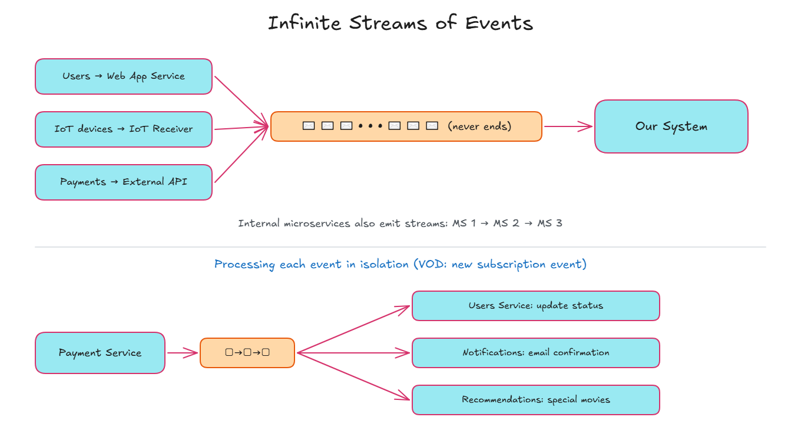
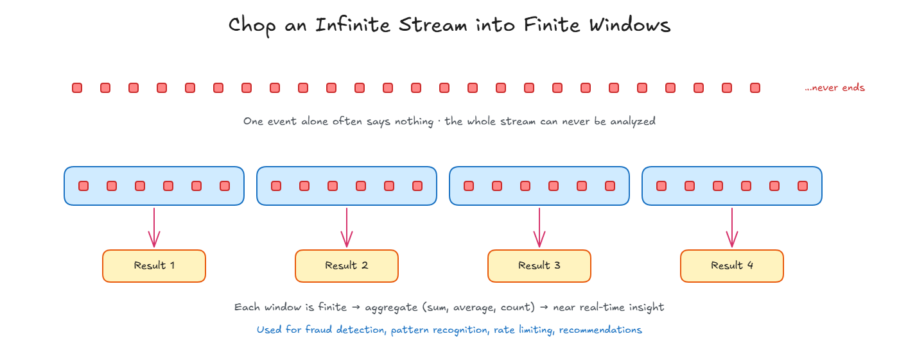
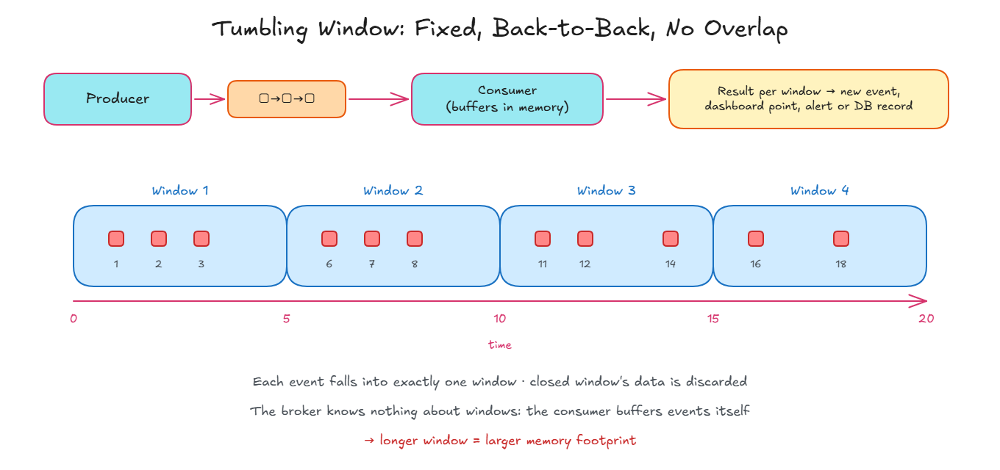
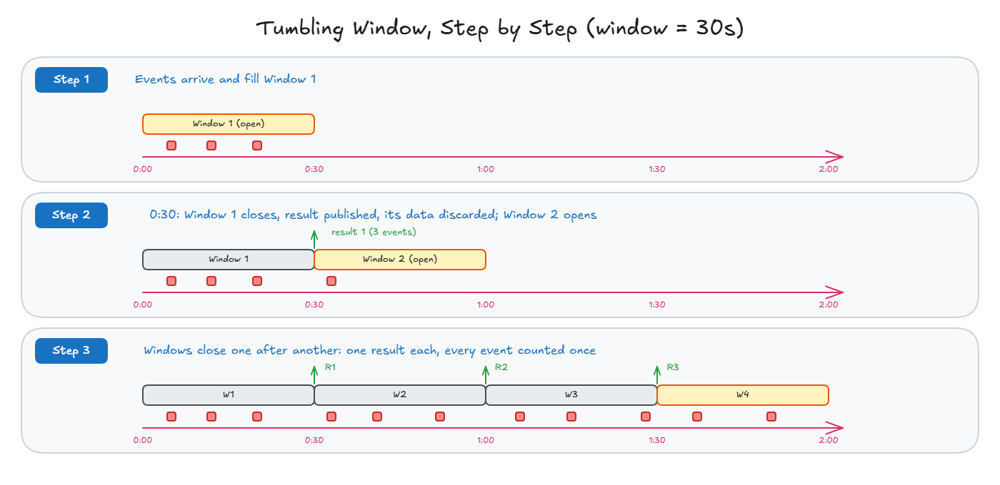
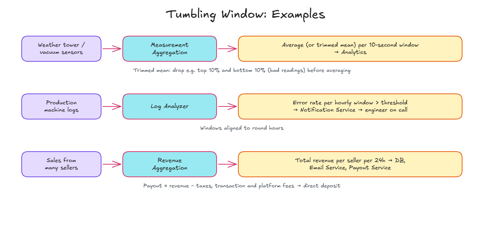
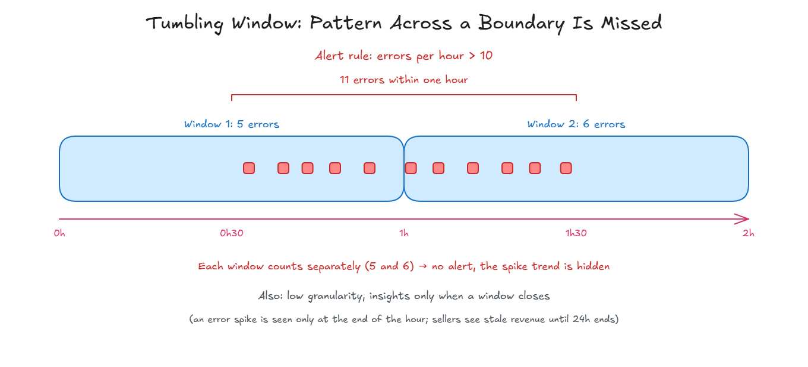

# Introduction to Event-Stream Processing and Tumbling Window Strategy

**In this lecture:**

1. Why we need to process **unbounded** (infinite) streams of events
2. The first and simplest windowing strategy: the **tumbling window**
3. Examples, pros and cons of the tumbling window

---

### Infinite Streams of Events

This section builds on [Event-Driven Architecture](../007-Software-Architecture-Patterns-and-Styles/4.%20Event%20Driven%20Architecture.md). In event-driven architecture, we usually have an **infinite stream of events** to process. The events come from:

1. **External sources:**
   - **User activity** in web applications
   - **Sensor data** from **IoT devices** (Internet of Things: connected devices like smart vacuum cleaners)
   - **Third-party services**, like payment notifications from credit card companies
2. **Internal microservices:** they also emit streams of events that other microservices subscribe to and process.

---

### Processing Events in Isolation

In many situations, reading and processing **each event on its own** is enough.

**Example: Video on Demand (VOD) service**

1. After a user is billed for the next billing cycle, the **Payment Service** emits a **new subscription event**.
2. This event is consumed by:
   - The **Users Service**, to update the user's subscription status
   - The **Notifications Service**, to send an email confirmation
   - The **Recommendations Service**, to create special movie recommendations for the user
3. Each service processes the event in **complete isolation**, with no need for events that came before or after it, from other users or the same user.

---

### Why We Need Windows

In many cases, one event on its own **doesn't carry enough information**. To get meaningful insights, we need to **aggregate and analyze a series of events**.

1. Analyzing an **infinite** stream is **impossible**.
2. So we chop the continuous stream into **finite subsets** of events, called **windows**.
3. Using finite windows, we can analyze streams **almost in real time**.

**Where this is critical:**

1. Anomaly or **fraud detection**
2. **Pattern recognition**
3. **Rate limiting**
4. **Recommendation** services

**Where these strategies are used:**

1. **Microservices** that consume events in event-driven architecture
2. **Big data pipelines**, where the incoming events are unbounded **and** very high in volume (covered later in the course)

---

### Tumbling Window Strategy

> **A tumbling window divides time into fixed-size, back-to-back, non-overlapping time buckets. Each event falls into only one window.**

**How it works:**

1. When a window is open, every event the consumer reads is added **only to the currently active window**.
2. At the **end of the window**, the consumer **aggregates** the events and produces the result as a **single event**. The result can be a sum, an average, a summary or anything else, depending on the use case.
3. The result can become:
   - A new event emitted to another channel
   - A new data point in a user **dashboard**
   - An **alert** for an engineer on call
   - A record stored in a **database**
4. When the window closes, a **new window** of the same fixed duration opens, and all new events go into it.
5. The old window's data is **discarded** and no longer uses any resources.

**Who manages the window:**

1. The **message broker** is generally **unaware** of windows.
2. The **consumer** is fully responsible for **buffering** the events, typically **in memory**, until the window expires and the results are stored or published.
3. So, the **longer the window, the larger the memory footprint**.

**Step by step:**

**Real-world example:** A cashier who counts the till every hour, writes down the total, then starts counting from zero for the next hour.

---

### Tumbling Window Examples

### 1. Sensor Measurements

1. Sensors send measurements, like the **temperature** of a weather tower or the **energy usage** of a vacuum cleaner, to a **Web Application**.
2. A **Measurement Aggregation** service calculates the **average** for each **10-second window** and publishes one event per window.
3. The volume of measurements is high, so one average makes the data easier to use downstream, by another microservice or a user.
4. **Trimmed mean:** a small percentage of samples are clearly wrong (because of **dust particles** or **sensor defects**). We throw away, for example, the **10% highest** and **10% lowest** values, then average the rest. This gives a more accurate average.
5. Later stages, like an **Analytics** service, get much **cleaner** and **lower-volume** data.

### 2. Log Analysis

1. Logs come from **production machines** into a **Log Analyzer**.
2. Tumbling windows are aligned to **every round hour**, and the analyzer calculates the **error rate in the last hour**.
3. If a window's error rate **exceeds a threshold**, it sends an alert to the **Notification Service**, which emails or texts an **engineer on call**.

### 3. E-commerce Revenue

1. Different **sellers** sell products to our user base. A **Revenue Aggregation Service** analyzes revenue **every 24 hours**.
2. At the end of each window, it **groups sales by seller** and produces each seller's total revenue (for example, Seller A: $1,034, Seller B: $802, Seller C: $20,031).
3. The result is **stored in a database** or **published as an event**, consumed by:
   - The **Email Service**, which sends each seller a daily summary
   - The **Payout Service**, which calculates each seller's payout after **taxes, transaction fees and platform fees**, then sends the money by **direct deposit**

---

### Pros of the Tumbling Window

1. It's the **simplest** stream processing strategy.
2. Ideal for **periodic, discrete aggregations or reports** with **minimal memory and computation** overhead.
3. Ideal for **clear time boundaries**, like round minutes, hours or days.
4. Ideal when each event should be **processed only once**, because it logically belongs to only one window.

### Cons of the Tumbling Window

1. **Low granularity of results:** we get insights only as often as the window size, and no faster.
   - **Logs:** a sudden spike in errors is seen only at the **end of the hour-long window**, which may already have caused serious **financial impact**.
   - **E-commerce:** sellers get fresh revenue data only once a day, when the 24-hour window closes. Until then, they keep seeing the **same old data**.
2. **Bad for patterns and trends:** windows have strict boundaries and each event is in only one window, so a pattern can be **split across two windows**.
   - Errors that increase drastically across two one-hour windows are summed or averaged **separately** in each window (for example, 30 errors and 0.5 per minute in both). The trend isn't captured, even though it may show a serious issue.
   - If the alert threshold is **10 errors per hour**, and **11 errors** happen within one hour but **cross the window boundary**, no alert is raised.

The next lectures cover strategies that solve these problems.

---

**Key idea:** Infinite event streams can't be analyzed as a whole, so we cut them into finite windows. The tumbling window uses fixed, back-to-back, non-overlapping windows, buffered in the consumer's memory. It's simple and cheap for periodic reports, but its results come only once per window, and it misses patterns that cross window boundaries.

---

## Short Note

- **Infinite streams:** events from users, IoT devices, third parties and internal microservices.
- **Isolation is sometimes enough:** e.g. a VOD subscription event, handled separately by the Users, Notifications and Recommendations services.
- **Windows:** when one event isn't enough (fraud, patterns, rate limiting, recommendations), we chop the stream into finite windows → near real-time analysis. Used in microservices and big data pipelines.
- **Tumbling window:** fixed, back-to-back, **non-overlapping**; each event is in **one** window.
  - At window end → aggregate → one result (event, dashboard point, alert, DB record); old data is discarded.
  - The broker doesn't know about windows; the **consumer buffers in memory** → longer window = more memory.
- **Examples:** sensor average per 10s (+ **trimmed mean**, drop the top and bottom 10%), hourly log error rate → alert, daily revenue per seller → email + payout.
- **Pros:** simplest, low memory and computation, clear time boundaries, each event processed once.
- **Cons:** low granularity (insights only at window end), misses patterns across boundaries (11 errors in an hour split into 5 + 6 → no alert).
