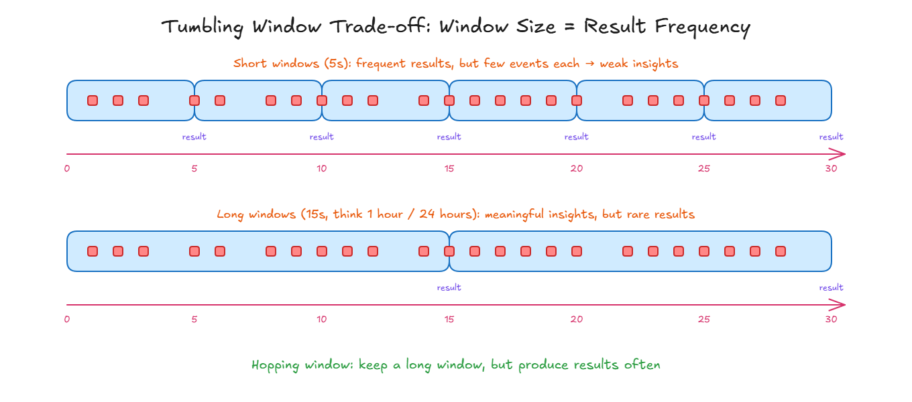
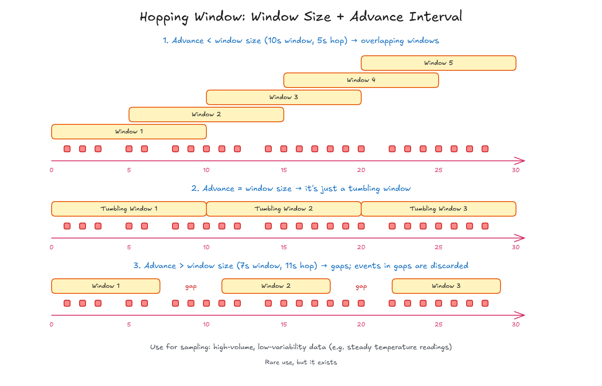
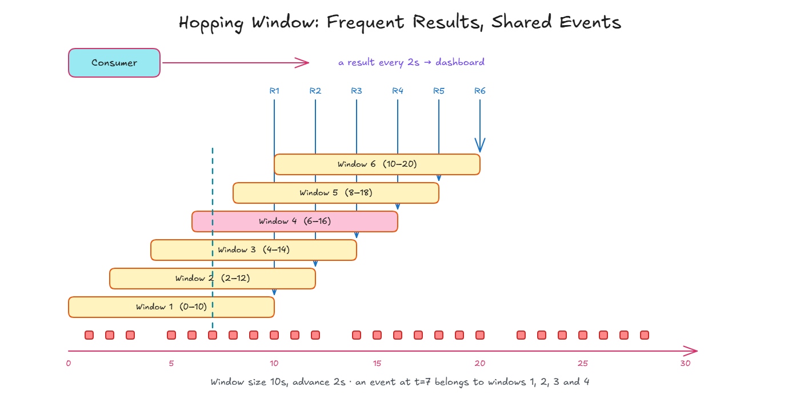
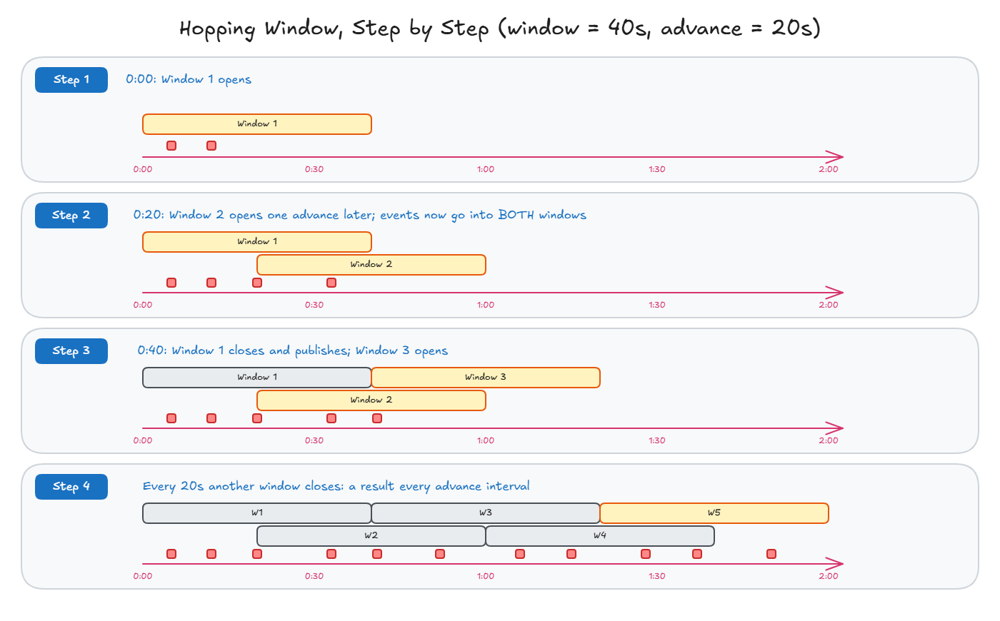
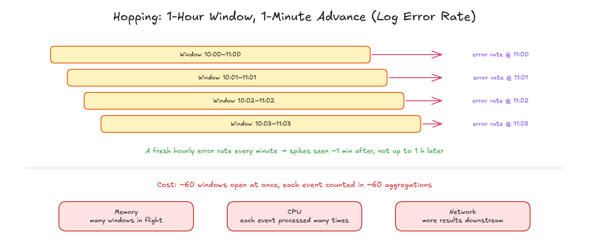

# Hopping Window Event-Stream Processing Strategy

**In this lecture:**

1. Why the tumbling window's window size limits how often we get results
2. The **hopping window** strategy and its **advance interval**
3. Examples, pros and cons of the hopping window

---

### Motivation: The Tumbling Window Trade-off

In the [Tumbling Window lecture](1.%20Introduction%20to%20Event-Stream%20Processing%20and%20Tumbling%20Window%20Strategy.md), time is divided into fixed-size, back-to-back windows. The **frequency of results depends on the window size**:

1. **Short window** (a few seconds or a minute):
   - We produce results **very frequently**.
   - But each window covers a short time with **only a few events**, so it may not have enough data for **meaningful insights**, especially when events are **low-volume or sporadic** (they arrive irregularly). Many windows have nothing or very little to aggregate.
2. **Long window** (like the **error rate for the last hour**, or **website visitors in the last 24 hours**):
   - We get **much more meaningful insights** at the end of each window.
   - But results come only **once an hour** or **once a day**.

**Goal:** produce results **frequently**, but still get insights over **long windows**. This is what the hopping window does.

---

### Hopping Window Strategy

> **A hopping window has a fixed duration, like the tumbling window. But instead of being back to back, windows are separated by a fixed hop called the advance interval, so they can overlap.**

The **advance interval** can be:

1. **Smaller than the window duration:** windows **overlap**. This is where the hopping window is really valuable.
2. **Equal to the window duration:** this is exactly the **tumbling window**. In other words, the tumbling window is a **special case** of the hopping window, where the advance interval and window duration are the same.
3. **Larger than the window duration:** windows have **gaps** between them (covered at the end).

---

### How It Works (Advance Interval < Window Duration)

1. However long the window is, the consumer **opens a new window every advance interval**.
2. After the first window's duration has passed, **one window closes every advance interval**.
3. Each time a window closes, the consumer **aggregates** its events (a sum, an average, or another single metric or summary) and **publishes the result** downstream.
   - Window 1 closes → result for window 1's events.
   - One advance interval later, window 2 closes → result for window 2's events, and so on.
4. If the results go to a **UI or dashboard**, we get **continuous monitoring and trend analysis**, with much more frequent updates than the tumbling window.
5. The **result frequency is independent of the window size.** We can make the window longer to analyze more events, and results still come just as often.
6. Unlike the tumbling window, **the same event can belong to several windows**, so it's processed as part of **multiple aggregations**.

**Step by step:**

**Real-world example:** A "last 7 days" step count in a fitness app that refreshes every day, instead of only once a week.

---

### Hopping Window Examples

Hopping windows are great for **near real-time analytics**, especially **UI dashboards**.

### 1. Stock Trading

1. Show the **average, median, maximum or minimum price** of an asset over a relatively long window, like **a minute or an hour**.
2. With a small advance interval, share **fresh data every second** with users or third parties, so they can:
   - Detect **shifting trends**
   - Make **automated trading decisions**
   - See the data on an **interactive dashboard**

### 2. Log Error Rate

1. We process logs from production machines and want the **hourly error rate**.
2. Keep the **window duration at 1 hour**, but set the **advance interval to 1 minute**.
3. Now we get the error rate for the last hour **every minute**, so we detect issues much earlier, while keeping the aggregation window wide.

---

### Pros of the Hopping Window (Advance < Window)

1. Results are produced **much more frequently**.
2. Great for **interactive UIs and dashboards** watched by humans.
3. Helps us **respond to changes** and important insights **faster** and more effectively.

### Cons of the Hopping Window

1. **More memory:** the consumer keeps events in memory, like the tumbling window. But now it maintains **multiple windows** with many more events in flight.
2. **More CPU:** results are produced more often, and **each event is processed multiple times**, because it's part of several windows.
3. **More network and downstream load:** more frequent results use more network, and the downstream service or application has **more data to store or process**.

---

### Advance Interval > Window Duration (Gaps)

1. It's similar to the tumbling window, but with **gaps** between windows.
2. Events that arrive **in the gaps are discarded**.
3. **Useful when** the event volume is **very large** but has **low variability** (doesn't change much), like a lot of sensor or user data that rarely changes.
4. We don't need to process everything, so we **sample** the events with fixed windows.
5. **Example:** a temperature sensor that always reads about 25°. Windows of 7 seconds with gaps in between are enough.
6. This is a **far less common** use of the hopping window.

---

**Key idea:** The hopping window has a fixed window size plus an advance interval. When the advance is smaller than the window, windows overlap, and results come every advance interval no matter how long the window is. That's great for dashboards and early detection, but it costs more memory, CPU and network, because each event is in several windows. An advance equal to the window is a tumbling window, and a larger advance gives gaps, which is useful for sampling.

---

## Short Note

- **Tumbling trade-off:** short window → frequent but weak results; long window → meaningful but rare results.
- **Hopping window:** fixed **window size** + fixed **advance interval** (the hop).
  - **Advance < size:** windows overlap → a result every advance interval, **independent of window size**.
  - **Advance = size:** a **tumbling window** (a special case).
  - **Advance > size:** **gaps**, events between windows are discarded → **sampling** high-volume, low-variability data (rare).
- **One event belongs to several windows** → processed in multiple aggregations.
- **Examples:**
  - Stock prices: average, median, min and max over a minute or hour, updated every second.
  - Log error rate: 1-hour window, 1-minute advance → hourly error rate every minute.
- **Pros:** frequent results, great for dashboards, faster reaction.
- **Cons:** more **memory** (many windows), more **CPU** (each event processed many times), more **network** and downstream load.
