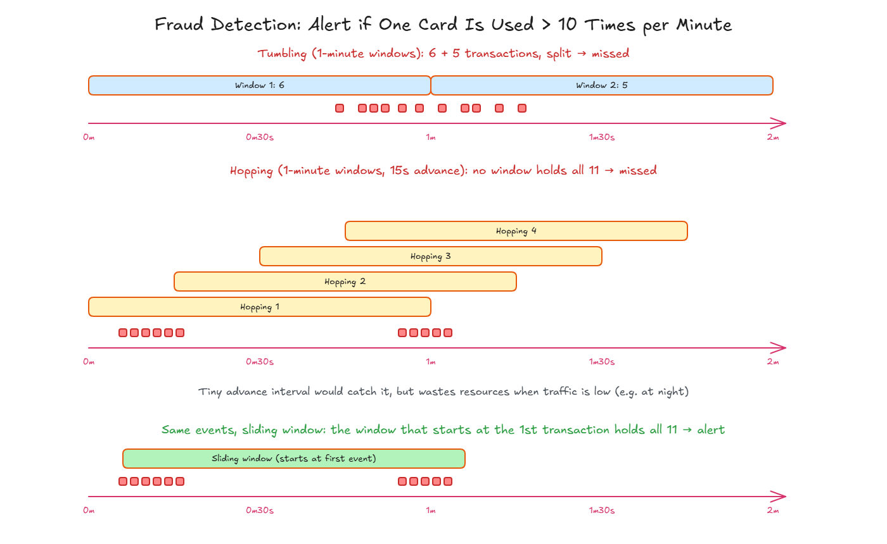
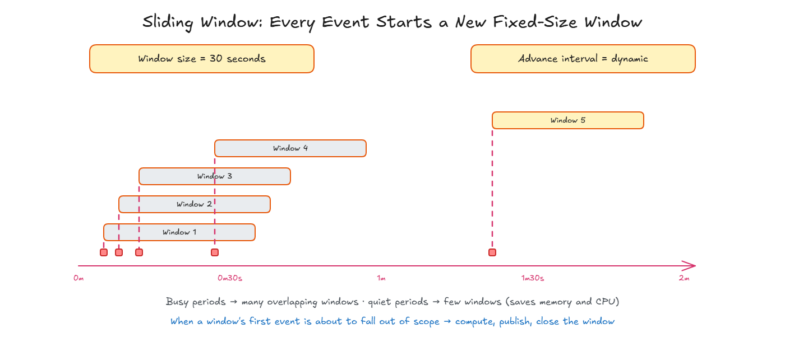
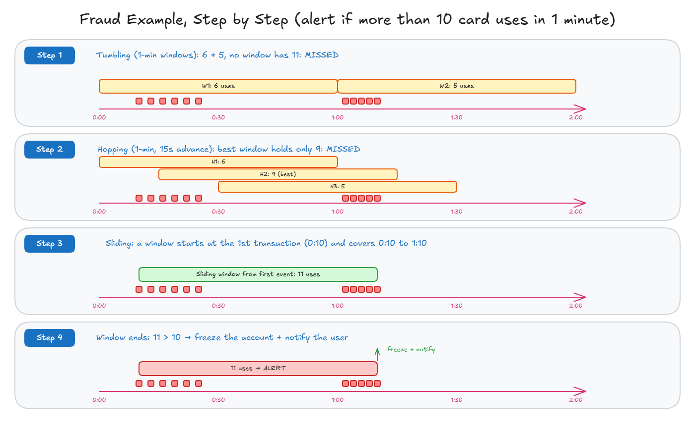
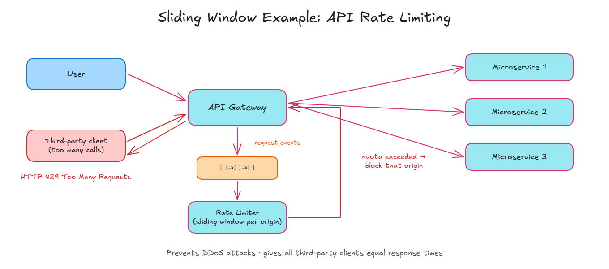
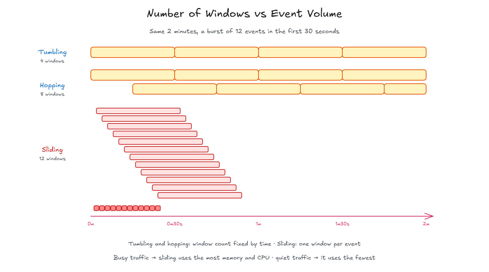

# Sliding Window Event-Stream Processing Strategy

**In this lecture:**

1. Why tumbling and hopping windows can miss patterns (fraud detection)
2. The **sliding window** strategy
3. Examples, pros and cons of the sliding window

---

### Motivation: Fraud Detection

A microservice detects **fraudulent activity** in a financial system, like a bank or a credit card processor.

**Rule:** if one credit card is used **more than 10 times within one minute**, it's suspicious. Then the **Fraud Detection Service**:

1. Triggers an alert to the **Account Service** to **freeze the account**
2. Asks the **Notification Service** to push a notification and send an email to the card owner

**1. Tumbling window (1 minute) fails:**

- **6 transactions** fall into one window and **5** into the next.
- Each window counts separately, so the suspicious activity **isn't detected**, even though **11 transactions** clearly happened within less than one minute.

**2. Hopping window (1 minute, 5-second advance) helps, but only sometimes:**

- In the same example, events fall into multiple overlapping windows, so one window captures all 11 transactions, and we **detect** the anomaly. But we **got lucky**.
- If the 11 transactions are spread differently (6 near the start, 5 about a minute later), they're still **within one minute**, but the advance interval isn't small enough. **No hopping window covers all of them**, so we still **miss** the fraud.

**3. A very small advance interval isn't a good fix:**

- It makes detection **much more likely**.
- But during **quiet periods** (like at night, when almost nobody uses credit cards), the many overlapping windows **waste a lot of resources**, even though they hold barely any events.

---

### Sliding Window Strategy

> **In a sliding window, each window still has a fixed duration, but every new event starts a new window. The advance interval is dynamic and aligned to events, not to fixed points in time.**

**How it works:**

1. In the most basic case, **every new event starts a new fixed-size window**.
2. The **advance interval** between windows is **dynamic**. It depends on when the events arrive.
3. Great when events arrive at **irregular intervals**:
   - **Busy periods** → many overlapping windows
   - **Quiet periods** → fewer windows, which **saves memory and CPU**
4. When an active window's duration passes, and its **first event is about to fall out of scope**, the consumer **calculates and publishes the results**, then **closes** the window.

**Real-world example:** "No more than 5 login attempts in any 10 minutes". The 10 minutes are counted back from every attempt, not from the start of the clock hour.

---

### Sliding Window Examples

### 1. Fraud Detection (Solved)

With the **same event timings** the hopping window missed, look at the window that **started with the first transaction**:

1. It catches all **11 transactions** within the one-minute span.
2. At the end of this window, the fraud detection microservice identifies the **suspicious activity**, **freezes the account** and **alerts the user**.

**Step by step:**

### 2. API Rate Limiting and Throttling

1. Every time a user sends a request, or a **third-party application** makes an API call, we **emit an event** to a message broker.
2. A **Rate Limiter** microservice processes each request with a **sliding window** and **aggregates events by origin** (who sent them).
3. If the same user or client **exceeds its quota** for a period of time, we update the **API gateway** (or web application service) to **block** requests from that origin and respond with **HTTP 429 - Too Many Requests**.
4. **Benefits:**
   - Helps prevent **DDoS attacks** (Distributed Denial of Service: flooding a site with requests to take it down)
   - Gives all third-party client applications **equal response times** from our services

---

### Pros of the Sliding Window

1. Excellent for **real-time monitoring** and **pattern detection**.
2. Essentially a **superior version of the hopping window**: the advance interval is **flexible** instead of fixed to a rigid time interval.
3. The advance interval is effectively **always as small as useful**:
   - Starting windows **faster** than events arrive adds **no value**.
   - Starting windows **slower** than events arrive means some **patterns are missed** (like the fraud edge case).

### Cons of the Sliding Window

1. **Highest processing and memory cost** of all the strategies so far.
2. With a **very high event volume**, the memory footprint and complexity can be significant.
3. With tumbling or hopping windows, the **number of windows is constant**, no matter how many events arrive. With a sliding window, the **number of windows grows with the number of events**.

---

**Key idea:** The sliding window keeps a fixed window size, but starts a new window at every event, so the advance interval adapts to the traffic. It catches patterns like fraud bursts and rate-limit violations that tumbling and hopping windows can miss, and it uses few windows when traffic is low. Its cost is the highest memory and CPU, because the number of windows grows with the number of events.

---

## Short Note

- **Motivation (fraud: > 10 uses of one card per minute):**
  - **Tumbling:** 6 + 5 split across windows → missed.
  - **Hopping:** can also miss if no window covers all 11.
  - **Tiny advance:** catches it, but wastes resources in quiet periods (night).
- **Sliding window:** fixed size; **every event starts a new window**; the advance interval is **dynamic**, aligned to events.
  - Busy → many windows; quiet → few windows.
  - Closes when its first event falls out of scope → compute and publish.
- **Examples:**
  - Fraud detection: the window from the first transaction catches all 11 → freeze the account + alert.
  - **Rate limiting:** request events → Rate Limiter (per origin) → API gateway blocks with **HTTP 429**; stops DDoS, gives clients fair response times.
- **Pros:** best for real-time monitoring and pattern detection; a hopping window with a flexible, optimal advance interval.
- **Cons:** **highest memory and CPU**; the number of windows grows with event volume (tumbling and hopping stay constant).
