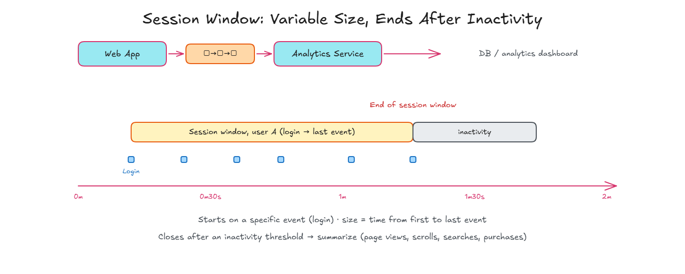
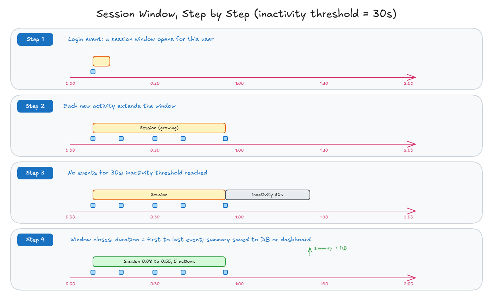
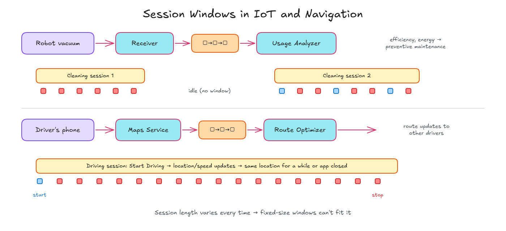
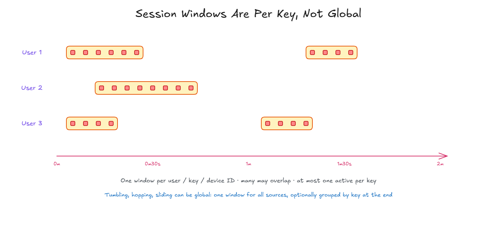
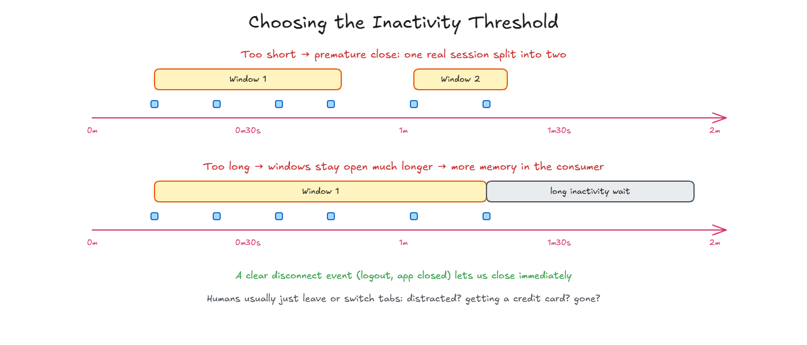
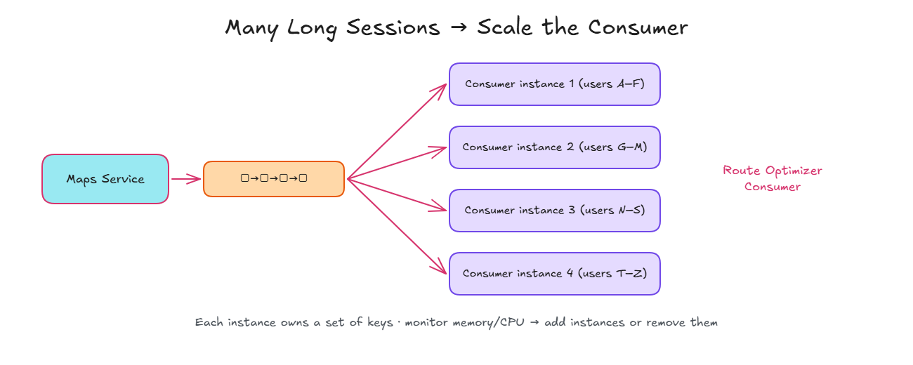

# Session Window Event-Stream Processing Strategy

**In this lecture:**

1. Why fixed-size windows can't capture user sessions
2. The **session window** strategy
3. Examples, pros and cons of the session window

---

### Motivation: Variable-Length Activity

In all the windows so far, the **size (duration) of the window was fixed**:

1. **Tumbling window:** fixed size, back to back
2. **Hopping window:** fixed size, separated by an **advance interval**
3. **Sliding window:** fixed size, a new window starts with **every new event**

But sometimes we want to analyze sequences of events that span a **variable duration**, usually followed by a **period of inactivity** (user activity → inactivity → user activity → inactivity).

**Example: user behavior analytics on an online education website**

To learn about user behavior, both **per user** and **in aggregate** (by demographics, country, and so on), we must track each user's activity through a **whole session**. A **Web App** sends events through a broker to an **Analytics Service**:

1. **User A:** login → search for a course → scroll through results → click a few options → watch a promo video → read the description and reviews → add to cart → checkout.
2. **User B:** login → navigate to a course they already enrolled in → watch Lecture 1 and Lecture 2 → take a quiz → walk away from the computer.

Each user's session has a **different, variable duration**, so **none of the previous strategies works**.

---

### Session Window Strategy

> **A session window starts with a specific type of event, grows dynamically as long as the user (or device) stays active, and closes after an inactivity threshold.**

**How it works:**

1. Each window **starts with a particular type of event**, here the **user login**.
2. The window size is **dynamic**, based on the **continuous activity** of that user.
3. When an **inactivity threshold** is reached, the window **closes** and the results are summarized:
   - Events may be categorized as **page views, scrolls, searches or purchases**.
   - Results are **saved in a database** or **published to an analytics dashboard**.
4. The window's duration is always the **time between the first and the last event** of the session.

**Step by step:**

**Real-world example:** A website timing you out after 30 minutes of no activity, and counting everything you did before that as one visit.

---

### Session Window Examples

### 1. Web User Analytics

As above: track each user's whole session from login until inactivity, then summarize and store or publish it.

### 2. IoT: Autonomous Vacuum Cleaner

1. While a robot vacuum cleans the house, it sends sensor events to a **Receiver**, like **location, temperature** and **amount of dust collected**.
2. A **Usage Analyzer** microservice in the cloud analyzes and categorizes those events.
3. This helps us detect **patterns over time**, like **decreased efficiency** and **increased energy consumption**, and suggest **preventive maintenance** to users.
4. The **frequency and duration** of each cleaning session **vary greatly**, so session windows are the best choice.

### 3. Navigation App

1. Data from drivers using a navigation app is used to **optimize the routes of other drivers** on the same or similar routes.
2. A driver (or autonomous car) **starts a session** by sending a **Start Driving** event (driving from point A to point B) to the **Maps Service**.
3. While getting directions, the app also sends **location and speed updates**, which the **Route Optimizer** processes to keep recalculating the **best routes** and **congestion areas**, and send optimal route updates to other drivers.
4. The session window:
   - **Starts** when the app detects movement
   - **Stops** when location updates show the **same location for some time** (no activity), or when the user **closes the app**

---

### Session Windows Are Not Global

1. A session window is always created **per user, key or device ID**.
2. With **three users**, we can have **three overlapping session windows**, one per user.
3. But **each user has at most one active session window** at any moment.
4. **Contrast:** tumbling (and other) windows can be **global**. One window holds events from **many different sources**, and when it closes, we can **optionally group events by key** before computing.

---

### Pros of the Session Window

1. Excellent for **real-time analytics of user behavior** while using an app or service.
2. The window size is dynamic, so events are grouped by **activity**, not by **predefined time boundaries**.
3. Each event belongs to **only one window**, so no computation is wasted processing the same events many times (a problem of hopping and sliding windows).

### Cons of the Session Window

**1. Defining the inactivity threshold is hard:**

- If we get a clear **disconnection event** (like logout), we close the window immediately.
- But usually there's no clear signal, especially from humans. People just stop using the app or switch browser tabs. We can't know if they're temporarily distracted, went to get their credit card to finish a purchase, or moved on completely.
- **Threshold too short:** the window closes **prematurely**, splitting one real session into two.
- **Threshold too long:** windows stay open much longer, using **more memory** in the consumer.

**2. Many windows to maintain:**

- Each window is for a **single user, origin or event key**, so we may have **many windows** open at once.
- It's even worse with **very long sessions**, like video or audio streaming apps, or location tracking in navigation apps.
- **Solution:**
  - Run **many instances** of the stream-processing microservice.
  - **Dedicate each consumer instance to a set of keys** (users or event origins).
  - **Monitor memory and CPU** of the instances, and **scale up** to keep up with demand or **down** to save resources.

---

**Key idea:** A session window has a dynamic size. It opens on a starting event (like login), grows while the user or device is active, and closes after an inactivity threshold. It's created per key, and each event belongs to one window, which makes it ideal for user behavior, IoT and navigation sessions. The hard parts are picking the inactivity threshold (too short splits sessions, too long wastes memory), and handling many open windows, which we solve by scaling consumer instances by key.

---

## Short Note

- **Previous windows:** all fixed size. **Session window:** **variable size**, for activity followed by inactivity.
- **How it works:** starts on a specific event (login), grows with activity, closes after an **inactivity threshold**; duration = first to last event → summarize (page views, scrolls, searches, purchases) → DB or dashboard.
- **Examples:**
  - Web analytics: each user's full session (e.g. browse and buy, or watch lectures and take a quiz).
  - IoT vacuum: location, temperature, dust → efficiency and energy patterns, preventive maintenance.
  - Navigation app: starts on movement, ends on the same location for a while or app close → optimize other drivers' routes.
- **Not global:** one window **per user, key or device ID**; windows overlap across users, but at most **one active per key**. Tumbling and others can be global (group by key afterwards).
- **Pros:** user behavior analytics, groups by activity instead of time boundaries, **each event in one window** (no repeated processing).
- **Cons:**
  - **Inactivity threshold:** too short → session split; too long → more memory.
  - **Many windows** (worse with long sessions, like streaming or navigation) → many consumer instances, each owning a set of keys, scaled by memory and CPU.
