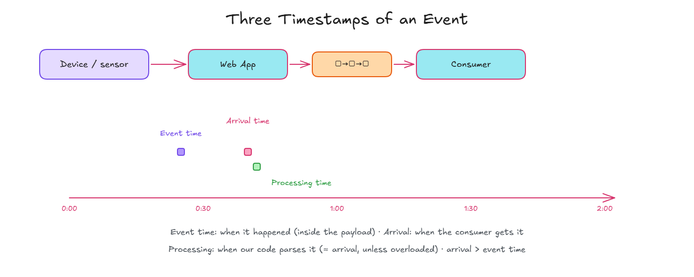
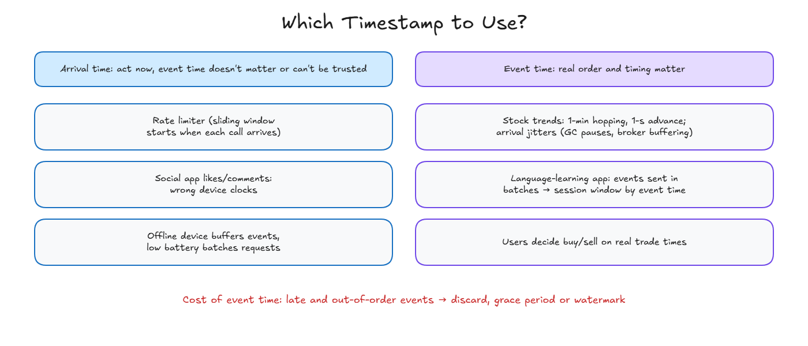
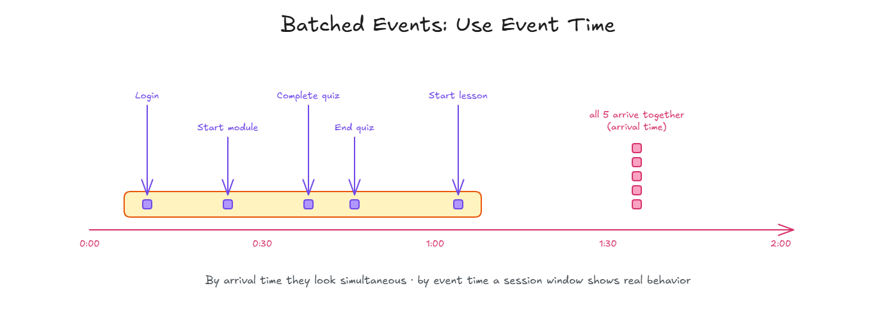
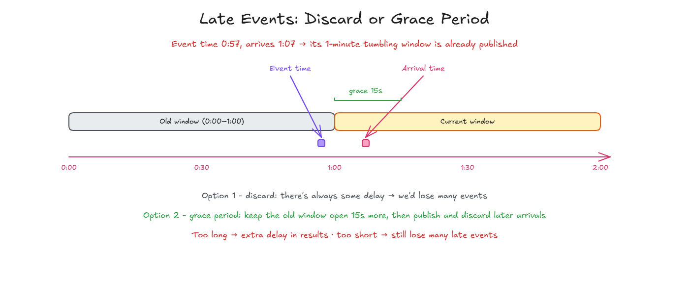
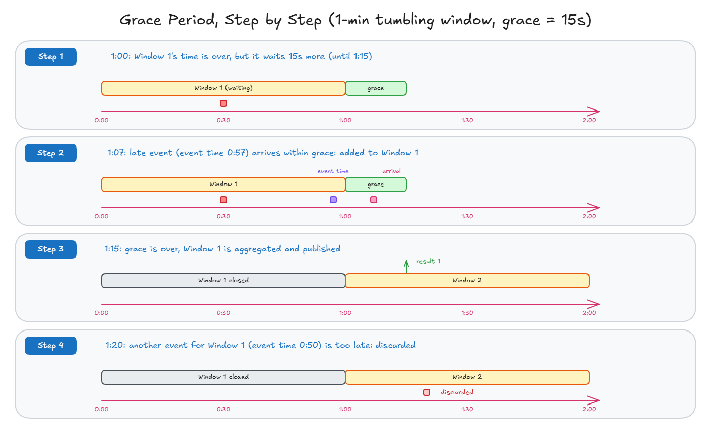
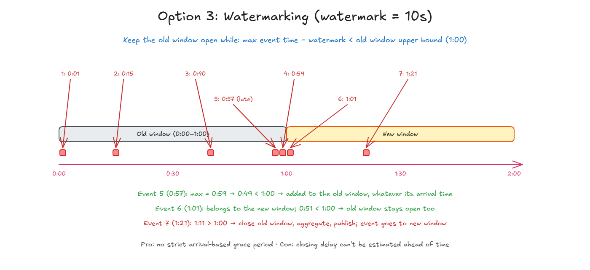
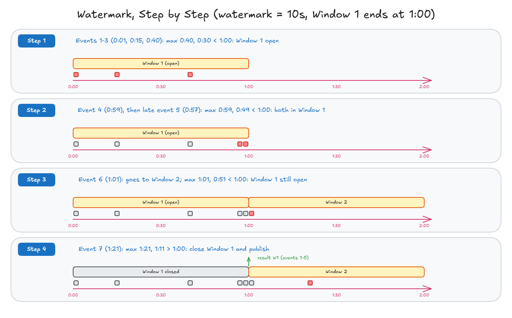
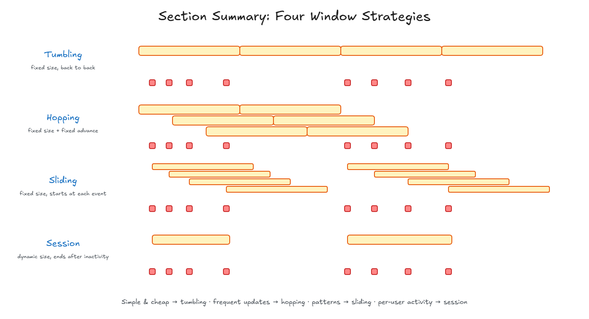

# Time in Stream Processing and Handling Late Arrival of Events

**In this lecture:**

1. The three timestamps of an event: **event time, arrival time, processing time**
2. When to use **arrival time** and when to use **event time**
3. Handling **late** and **out-of-order** events: discard, **grace period**, **watermarking**

---

### Three Types of Timestamps

1. **Event time:** when the event **actually happened**. It's stored **inside the event's payload** (the record).
   - Example: temperature or location measurements from a mobile or IoT device. The event time is when the measurement was **captured on the device** (like `Timestamp: 1749519966`).
2. **Application time / arrival time:** when the event is **consumed** by the application or consumer microservice, after going through the message broker.
   - It's **always later** than the event time.
   - The gap depends on the system's **latency** and **load**, and on whether it's a **real-time** or **batch** processor.
3. **Processing time:** when the event is actually **read, parsed and processed** by our code.
   - Usually very close to arrival time, so they're used **interchangeably**.
   - The gap grows only when the service is **overloaded**.
   - In this lecture, arrival time and processing time are treated as **the same**.

**Real-world example:** A letter's postmark date (event time) vs the day it lands in your mailbox (arrival time) vs the day you open it (processing time).

---

### Which Timestamp to Use?

**Which timestamp decides which window an event goes into? It depends on the use case.**

### Use Arrival Time When…

**1. We don't care when the event happened, but must act in real time** (monitoring, alerting).

- **Example: rate limiter** in a credit card processing system that customers use to bill their users. Each event is an **API call** from a third-party customer.
- The event time doesn't matter, because a **sliding window** starts a new window for **every incoming event when it arrives** at the consumer.

**2. We don't have the real event time, or can't trust it.**

**Example: a social media app** where users scroll, like and comment. The exact time isn't critical, and:

- **Clocks** on user devices may be **wrong** or **out of sync** with our clock.
- In some parts of the world, users **lose internet** for minutes or longer, so events are **buffered on the device** until the connection comes back.
- When the device is **low on battery**, network requests can be **delayed and batched** for efficiency.

### Use Event Time When…

We care **when the event actually happened**, for accurate **correlation or ordering**.

**1. Stock market trends:**

- Trade events are grouped into **1-minute hopping windows** with a **1-second advance**, to show a **moving average** of an asset's price.
- System load changes with trade volume, so arrival time **varies a lot** because of **jitter** (random delays) from **garbage collection** pauses in our app, or **buffering delays** in the broker.
- Users care about the **real time of each trade**, because they make **buy and sell decisions** from those moving averages.

**2. User behavior in a mobile app** (language-learning app):

- The app tracks events like **login, starting a lesson, completing a lesson, taking a quiz**, to optimize the learning experience.
- Because of connection issues or to **save energy**, the device may store events and **send them in batches**, sometimes much later.
- By **arrival time**, a batch looks like everything happened **at the same moment**, which gives no insight.
- By **event time**, we see the real sequence, and can use a **session window** to understand user behavior.

---

### The Problem: Late Arrival of Events

Using event time gives accurate analysis, but creates a challenge.

**Example:** stock trades with a **1-minute tumbling window**, grouped by event time:

1. The window for **0:00–1:00** has already ended.
2. **10 seconds later**, an event with event time **0:57** arrives.
3. It **belongs** to the old window, but that window was **already processed** and its results **published**.

What do we do with it?

### Option 1: Discard Late Events

- Simple, but there's **always some delay** between when an event happens and when it arrives.
- So we'd **consistently throw away many events**.

### Option 2: Grace Period

1. Don't close the window right when its duration ends. **Wait an extra period**, for example **15 seconds**, before aggregating, publishing and discarding it.
2. Any late event whose **event time falls inside the old window** and arrives **within the grace period** is still added to it.
3. When the grace period ends, the old window is **closed** and its results are published. Later events for it are **discarded**.

**Benefit:** late events get a second chance → **more accurate analytics**.

**Challenge: choosing the grace period:**

- **Too long:** results are published only after the grace period, which adds **extra, usually unnecessary delay**.
- **Too short:** we still **lose many events** that belong to the closed window but arrive too late.

**Step by step:**

**Real-world example:** An exam hall that accepts papers for 5 more minutes after the bell. Anything handed in later isn't counted.

### Option 3: Watermarking

> **A watermark is a fixed lag value. The old window stays open as long as: max event time seen so far − watermark < old window's upper bound.**

**How it works:**

1. Choose a **watermark** value (for example, **10 seconds**).
2. Keep track of the **maximum event time** seen so far.
3. For each new event:
   - **Update** the max event time if needed.
   - **Check:** is `max event time − watermark` **less than** the old window's **upper bound** (end time)?
     - **Yes** → the old window **stays open**.
     - **No** → **close** the old window, **aggregate** and **publish** its results.

**Example** (1-minute tumbling window, watermark 10s, old window ends at **1:00**):

| Event | Event time | Max event time | Max − 10s | Result |
|---|---|---|---|---|
| 1–4 | 0:01, 0:15, 0:40, 0:59 | 0:59 | 0:49 < 1:00 | Old window stays open |
| 5 | **0:57** (out of order) | 0:59 | 0:49 < 1:00 | **Added to the old window** |
| 6 | 1:01 | 1:01 | 0:51 < 1:00 | Goes to the **new window**, old window **still open** |
| 7 | 1:21 | 1:21 | **1:11 > 1:00** | **Close the old window** and publish; event 7 goes to the new window |

**Things to notice:**

1. The **arrival time is irrelevant**. Even if event 5 arrived 20 or 30 seconds late, it would still be added, as long as the condition holds.
2. An event for the **new window** goes into the new window, while the **old window stays open**. That's the whole point: late events can still reach the old window even after the new one has opened.

**Step by step:**

**Pros and cons of watermarking:**

- **Pro:** no strict grace period tied to **arrival** times.
- **Con:** closing and aggregating the window can be delayed for a time that **can't be estimated in advance** (unlike the grace period, which is a known delay).

---

### Section Conclusion

1. We learned several strategies to process an **unbounded (infinite) stream of events**. Each has its own **advantages, disadvantages and use cases**.
2. We learned the difference between **event time, arrival time and processing time**.
3. We learned how to handle **late and out-of-order** events: discard, grace period, watermarking.

---

**Key idea:** Every event has an event time (when it happened), an arrival time and a processing time. Use arrival time when you must react now or can't trust device clocks, and event time when the real order matters. Event time brings late and out-of-order events, which we can discard, accept during a fixed grace period, or accept with a watermark until max event time minus the watermark passes the window's end.

---

## Short Note

- **Timestamps:**
  - **Event time:** when it happened, inside the payload.
  - **Arrival (application) time:** when the consumer gets it, always later; the gap depends on latency, load, real-time vs batch.
  - **Processing time:** when our code parses it, ≈ arrival time unless overloaded.
- **Use arrival time:** real-time reaction where event time doesn't matter (rate limiter with a sliding window), or when event time is unknown or untrusted (wrong device clocks, offline buffering, low-battery batching).
- **Use event time:** order and timing matter (stock moving averages despite GC and broker jitter; batched mobile app events → session window by event time).
- **Late events** (event time 0:57 arrives after the 1:00 window is published):
  - **Discard:** loses many events.
  - **Grace period** (e.g. 15s): accept late events, then close; too long → delay, too short → lost events.
  - **Watermark** (e.g. 10s): keep the old window open while **max event time − watermark < window end**; arrival time doesn't matter; new-window events go to the new window meanwhile. Pro: no strict grace period; con: unpredictable closing delay.
