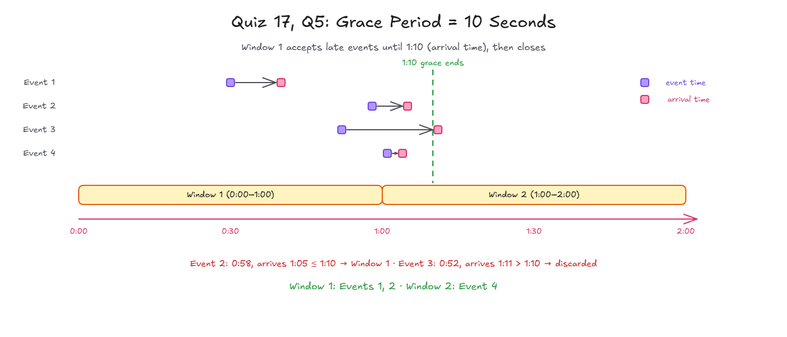
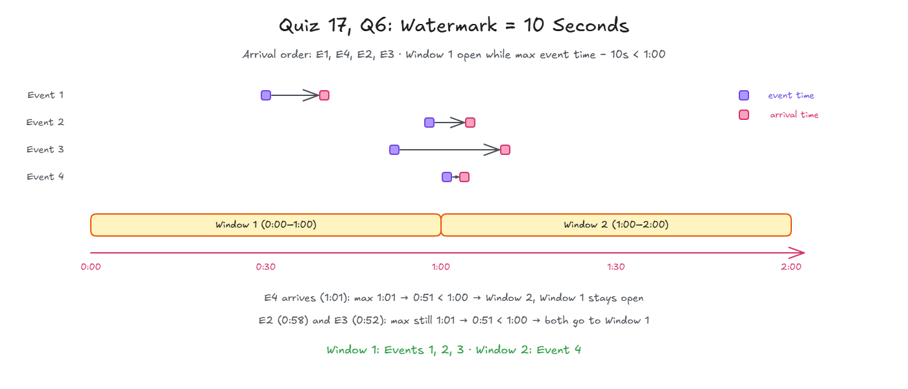

# Quiz - Event Stream Processing

Questions from Quiz 17, covering all the lectures in this section.

## Q & A

**Question 1:** You're building a real-time dashboard to count the number of transactions **per minute**. The requirement is to show a rolling count that updates **every minute**. Which type of window is most appropriate?

1. Tumbling Window
2. Hopping Window
3. Sliding Window
4. Session Window

**Answer:** 1. Tumbling Window

The window size (1 minute) equals the update frequency (1 minute), so simple back-to-back windows are enough. Each transaction is counted once.

**Question 2:** You're building a real-time dashboard to count the number of transactions **per minute**. The requirement is to show a rolling count that updates **every 10 seconds**. Which type of window is most appropriate?

1. Tumbling Window
2. Hopping Window
3. Sliding Window
4. Session Window

**Answer:** 2. Hopping Window

Use a window size of 1 minute with an advance interval of 10 seconds. Results come every 10 seconds, but each one still covers a full minute.

**Question 3:** Your task is to build a microservice that analyzes user behavior on our e-commerce website. Specifically, you want to learn:

- How long each user spends on our website
- When they take actions and which buttons they click
- What sequence of events most likely leads to a purchase

Which window strategy would you use?

1. Tumbling Window
2. Hopping Window
3. Sliding Window
4. Session Window

**Answer:** 4. Session Window

Each user's visit has a variable length and ends with inactivity. A session window per user captures the whole visit from start to end.

**Question 4:** To prevent brute-force attacks on our Authentication Service, we want to detect and block repeated login failures within **any 5-minute window**, and emit an alert if there are **3 or more failures**. What window strategy would you use to process failed login events?

1. Tumbling Window
2. Hopping Window
3. Sliding Window
4. Session Window

**Answer:** 3. Sliding Window

Use a sliding window with a 5-minute duration. "Any 5-minute window" means a window must start at every failed login, so failures that cross fixed boundaries are never missed.

**Question 5:** You're a Software Architect at a global stock trading company that processes millions of buy/sell events per minute. To give day traders a dashboard of the total trading volume of each stock per minute, you use a **tumbling window of 1 minute**. These trade events come in:

| Event | Event time | Arrival time |
|---|---|---|
| 1 | 0:30 | 0:40 |
| 2 | 0:58 | 1:05 |
| 3 | 0:52 | 1:11 |
| 4 | 1:01 | 1:04 |

With a **grace period of 10 seconds** for each window, which events are captured and processed within Window 1 (0:00–1:00), and which within Window 2 (1:00–2:00)?

1. Window 1: Event 1 · Window 2: Events 2, 3, 4
2. Window 1: Events 1, 2 · Window 2: Event 4 (Event 3 will be discarded)
3. Window 1: Events 1, 2 · Window 2: Events 3, 4
4. Window 1: Events 1, 2, 3 (Event 4 will be discarded)

**Answer:** 2. Window 1: Events 1, 2 · Window 2: Event 4 (Event 3 is discarded)

Window 1 accepts late events until 1:10. Event 2 arrives at 1:05, so it's in time. Event 3 arrives at 1:11, after the grace period, so it's dropped.

**Question 6:** Same events and tumbling window as Question 5, but now using a **watermark of 10 seconds**. Which events are captured and processed within Window 1 and Window 2?

1. Window 1: Events 1, 2, 3 · Window 2: Event 4
2. Window 1: Events 1, 2 · Window 2: Event 4 (Event 3 will be discarded)
3. Window 1: Events 1, 2 · Window 2: Events 3, 4
4. Window 1: Events 1, 2, 3 (Event 4 will be discarded)

**Answer:** 1. Window 1: Events 1, 2, 3 · Window 2: Event 4

The highest event time seen is 1:01, and 1:01 − 10s = 0:51, which is still before 1:00. So Window 1 never closes early, and the late events 2 and 3 still join it, whatever their arrival time. Event 4 goes to Window 2.
