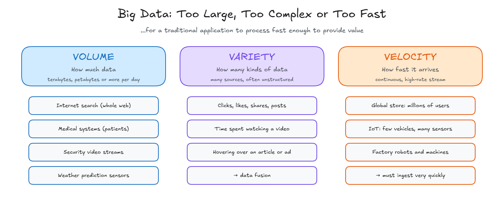
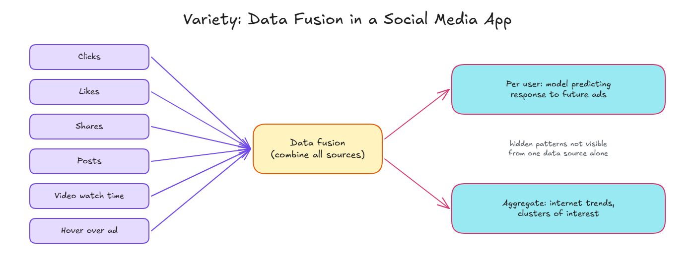
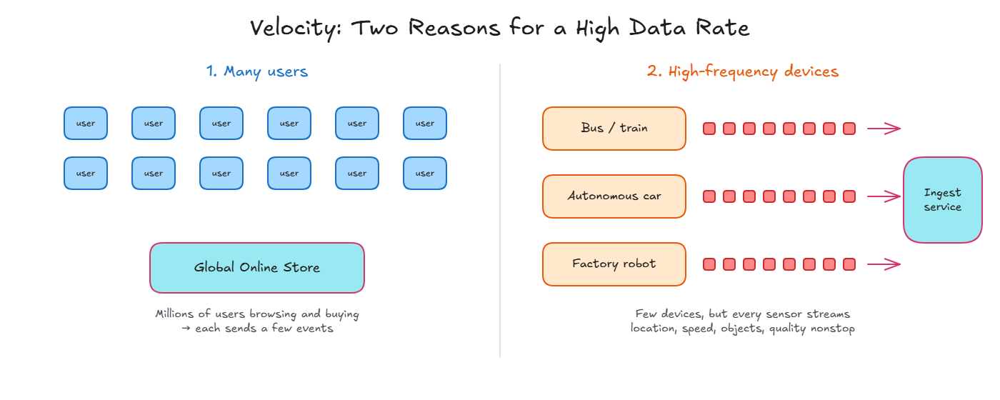
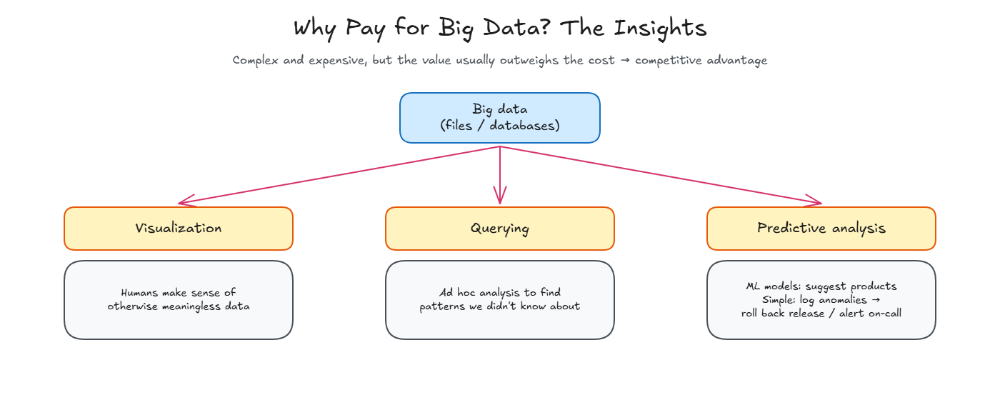

# Introduction to Big Data

**In this lecture:**

1. What big data means
2. The three main characteristics of big data: **volume, variety, velocity**
3. Why big data is worth its cost: the insights we get from it

---

### What Is Big Data?

> **Big data describes datasets that are too large in size, too complex in structure, or arrive at such a high rate that a traditional application can't process them fast enough to provide any value.**

Big data has many characteristics, but the three most important are:

1. **Volume:** how **much** data
2. **Variety:** how many **kinds** of data
3. **Velocity:** how **fast** the data arrives

---

### 1. Volume

**Volume** is the **quantity** of data we need to **process, store and analyze**. With big data, that's usually **terabytes, petabytes or even more per day**.

**Fields with a high volume of data:**

1. **Internet search companies:** analyze the **entire internet** and give users **instant search**.
2. **Medical software systems:** collect, analyze and store a lot of information about **patients** in hospitals or clinics, to help **prevent or detect diseases**.
3. **Real-time security systems:** analyze **multiple video streams** from cameras across neighborhoods, cities or high-security facilities, to help **combat crime**.
4. **Weather prediction systems:** analyze data from **sensors on satellites** and across a large geographical region, to **predict the weather** and warn about **storms or tsunamis**.

---

### 2. Variety

1. **Traditional (non-big data) systems** work with a **limited number** of **structured**, well-defined data types.
2. **Big data** has a **large variety** of data types, often **unstructured**, collected from **many sources**.
3. **Goal:** process all that data and combine it, through a process called **data fusion**.
4. This helps us find **hidden patterns** and **business insights** that aren't obvious from a single data source.

**Example: social media services and apps**

They collect many types of data about user behavior **in real time**:

- **Clicks, likes, shares and posts**
- **Time spent watching** a particular video
- Time spent **hovering** over an article or a digital ad

These seemingly unrelated activities are combined to build models that:

1. **Per user:** predict each user's **behavior and response to future ads** for particular products
2. **In aggregate** (across many users): detect **internet trends** and **clusters of interest**

**Real-world example:** A video app that suggests your next video using your watch history, likes, search terms and how long you paused on each thumbnail.

---

### 3. Velocity

With big data, there's usually a **continuous stream** of data arriving at a **very high rate**. The high rate comes from one of two causes:

**1. The large scale of our system (many users):**

- **Example:** an **online store on a global scale**, with **millions of users** visiting every day, browsing and buying products.
- Each user sends only a few events, but there are so many users that the total rate is huge.

**2. High-frequency events (few sources, a lot of data each):**

- **Internet of Things (IoT):** connecting many devices and getting analytics from their **sensors**.
- **Vehicles:** a fairly **small fleet** of buses, trains or autonomous cars, but each generates **lots of data points** about its **location, speed, surrounding objects** and so on.
- **Factories:** a food or clothing factory full of **robots, assembly lines** and machinery that constantly report **production quality and speed**.
- The number of devices may be **small**, but every sensor produces a **continuous stream** that we must **ingest very quickly**.

---

### Why Big Data Is Worth It

Storing and processing big data is **complex and very expensive**. But the value usually **outweighs the cost**, because its insights can give a **significant competitive advantage** over competitors.

**The insights come in three forms:**

1. **Visualization:** a very powerful tool that helps **humans make sense** of data that would otherwise be meaningless in a file system or database.
2. **Querying capabilities:** after collecting a lot of data, we often **don't know yet** how to benefit from it. Querying lets us run **ad hoc analysis** (one-off questions we come up with as needed), which eventually reveals insights and patterns that weren't obvious before.
3. **Predictive analysis:**
   - **Advanced:** build algorithms or **machine learning models** to predict user behavior and **suggest products** users are likely to buy.
   - **Simple:** detect **anomalies** by analyzing **server logs**, then automatically **roll back a new release** or **alert the on-call engineers**.

The next lectures cover **architectural styles** for processing and analyzing big data.

---

**Key idea:** Big data is data too large (volume), too varied (variety) or too fast (velocity) for a traditional application to handle in time. Processing it is complex and expensive, but the insights from visualization, querying and predictive analysis usually give a competitive advantage that outweighs the cost.

---

## Short Note

- **Big data:** too large, too complex, or too fast for a traditional application to process in time to be useful.
- **Volume:** terabytes to petabytes or more per day; e.g. internet search, medical systems, security video, weather prediction.
- **Variety:** many sources, often unstructured → **data fusion** finds hidden patterns; e.g. social media clicks, likes, shares, watch time, hovering → per-user ad prediction + aggregate trends.
- **Velocity:** continuous high-rate stream, from **many users** (global online store) or **high-frequency devices** (IoT vehicles, factory robots) → must ingest fast.
- **Worth the cost:** expensive and complex, but gives a competitive advantage through:
  - **Visualization:** humans understand the data.
  - **Querying:** ad hoc analysis to discover patterns.
  - **Predictive analysis:** ML product suggestions, or log anomalies → rollback or alert.
