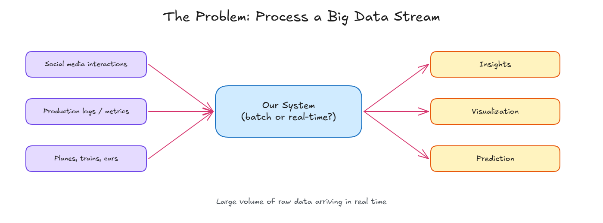
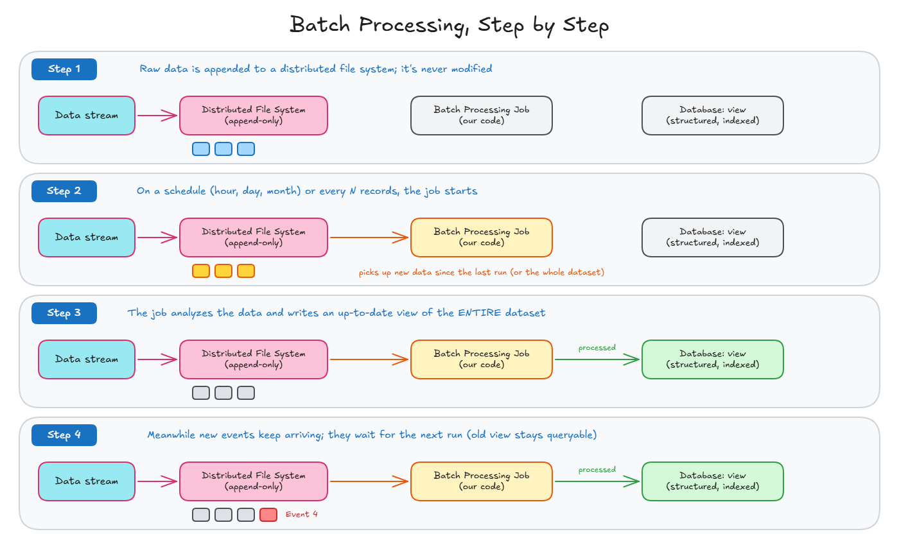
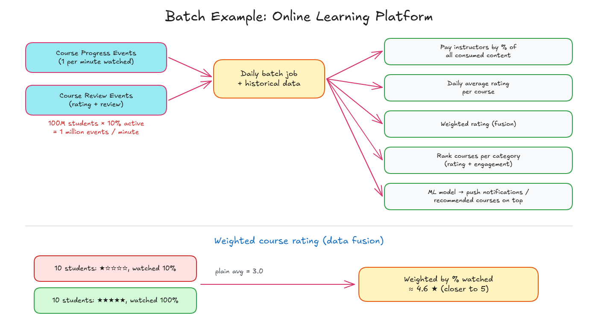
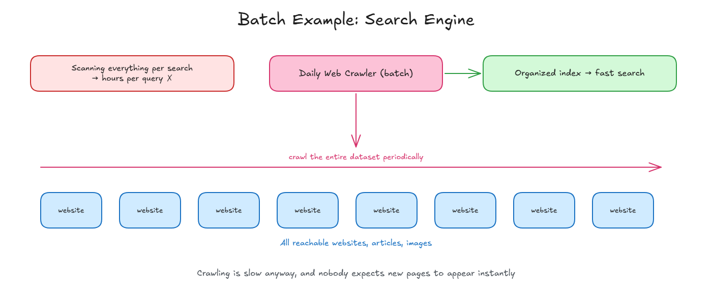
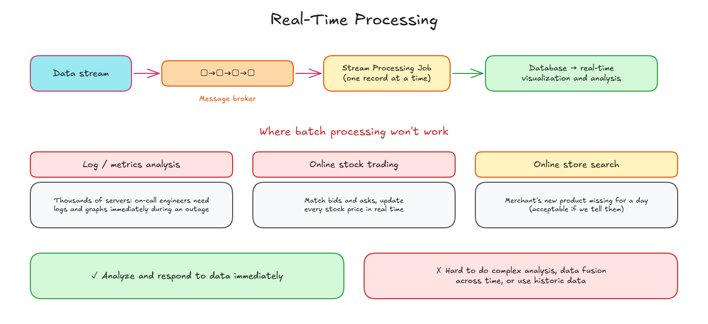
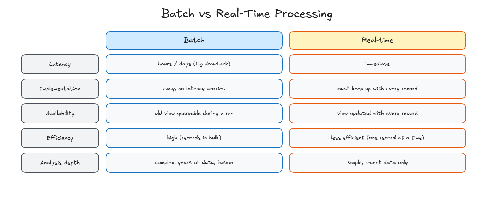

# Big Data Processing Strategies

**In this lecture:**

1. The problem: processing a continuous, high-volume stream of raw data
2. **Batch processing:** how it works, use cases, pros and cons
3. **Real-time processing:** how it works, use cases, pros and cons

---

### The Problem

A continuous stream of data comes into our system from different sources, like:

1. **User interactions** on a social media platform
2. **Logs or metrics** from production application instances
3. Data from **transportation devices**: planes, trains or autonomous cars

This large volume of raw data arrives **in real time**. We want to process it so we can analyze it and provide **insights, visualization or predictions**.

There are two strategies (patterns) for this, both using **event-driven architecture**:

1. **Batch processing**
2. **Real-time processing**

---

### Batch Processing

**How the data is stored:**

1. Incoming data is stored in a **distributed database**, or more commonly, directly in a **distributed file system**.
2. The data is **never modified**. We only **append** new data as it arrives.

**How it's processed:**

1. **Key principle:** we **don't process each record individually**. We process data in **batches** of records.
2. Batches run on a **fixed schedule** (once a month, a day, an hour, and so on), or after a **fixed number of records**.
3. The **logic of the batch job is our own code**, so we can easily **update it** whenever we want.
4. Each run, the job **picks up the new raw data** that arrived since the last run, analyzes it, and produces an **up-to-date view** of all our data.
5. The view is stored in a **well-structured, indexed database** that we can easily **query** for insights.
6. The view should reflect our knowledge of the **entire dataset**. Depending on the use case, the job processes **only the recent data**, or the **whole dataset from scratch** to build a new view.

**Real-world example:** A bank statement, where all the month's transactions are processed together and you get one summary at the end of the month.

---

### Batch Use Case 1: Online Learning Platform

An online learning **subscription** platform offers **thousands of video courses** to **millions of students**. While watching, students can leave a **review and star rating** that reflects their satisfaction at that point in time.

**Two types of events arrive:**

1. **Course progress events:** one event for **every extra minute** a student watches.
   - With **100 million students**, even if only **10%** are active: 100 million × 0.1 = **1 million events per minute**. This is clearly **big data**.
2. **Course review events:** a review and star rating for a course.

None of this needs **real-time** processing. But processing it in **batches** together with **historical data** gives **mission-critical insights**:

1. **Instructor compensation:** pay instructors based on the **percentage of content consumed** from their courses, out of all the content on the platform.
2. **Average rating:** recalculate each course's average rating **daily**.
3. **Weighted rating (data fusion):** give **more weight** to ratings from students who watched **more** of the course, and **less** to those who barely watched a few lectures.
   - **Example:** 10 students rated **1 star** after watching **less than 10%**, and 10 students rated **5 stars** after watching **100%**. The weighted rating is **much closer to 5 stars** (a plain average would be 3), which reflects the course quality more accurately.
4. **Course ranking:** rank courses in each **category** by **rating** and overall **student engagement**.
5. **Machine learning:** combine all the data to predict **which students would benefit from which courses**, then send **push notifications** or show those courses at the **top of the page** ("Recommended Courses").

### Batch Use Case 2: Search Engine

1. We have huge amounts of **websites, articles or images** to make searchable.
2. Scanning all of it **on every search** would take **hours** per result.
3. So search companies **crawl the entire dataset periodically** (a **daily web crawler**), then **organize, index and store** it so searches are **easy and fast**.
4. Crawling takes a long time anyway, and nobody **expects new pages to appear in results immediately**, so this is a **perfect use case** for batch processing.

---

### Pros of Batch Processing

1. **Easy to implement:** we don't have to worry about **latency**.
2. **High availability:** while a job is analyzing the dataset, the **old view is still available** for queries, so users get **no downtime**.
3. **Efficiency:** processing data in batches is usually **much more efficient** than processing each record individually.
4. **High fault tolerance to human error:** if we push **bad code** to the job, little harm is done, because we still have the **original raw data**. We fix the bug, redeploy, and **rerun the job on the whole dataset** to produce a new, correct view.
5. **Deep analysis:** batch jobs can run very **complex analysis** on large datasets spanning **years** of data points, giving **advanced prediction models** and insights.

### Cons of Batch Processing

**One major drawback: a long delay** between data arriving and the result of the processing job.

1. If the job runs every day or every hour, we **don't get a real-time view** of incoming data, so we **can't respond fast enough**, which is extremely important in many use cases.
2. **Users wait a long time** for feedback on their actions, which can cause **confusion** if they don't know we process data in batches.

**Example: online store search engine (acceptable):** a merchant who just added or updated a product may be surprised that it **doesn't show up in search results**. We can tell them changes take effect **after one business day**, and they may be fine with that.

**Where batch processing just won't work:**

1. **Log and metrics analysis:** streams of logs and data points from **thousands of production instances** must be **ingested and visualized in real time**. During a production issue, **on-call engineers** need the logs and metric graphs **immediately** to figure out how to fix it.
2. **Online stock trading:** we must take in **bids and asks** (buy and sell offers), **match them** so people can trade, and **update each stock price in real time**.

---

### Real-Time Processing

**How it works:**

1. Each new event goes into a **queue or message broker**.
2. On the other end, a **stream processing job** processes **each individual record as it arrives**.
3. After processing a record, the job **updates the database**, which provides querying for **real-time visualization and analysis**.

**Real-world example:** A card payment that shows up in your banking app the moment you tap your card.

### Pros of Real-Time Processing

1. We can **analyze and respond** to data **immediately**, without waiting hours for a job.

### Cons of Real-Time Processing

1. It's **very hard to do complex analysis** in real time, so we get **less value and insight** than with batch processing.
2. **Data fusion** across events from **different points in time**, or analyzing **historic data**, is **nearly impossible**. We're limited to the **recent data** we currently have.

---

**Key idea:** Batch processing stores raw data append-only in a distributed file system and processes it in scheduled batches into a queryable view. It's easy, efficient, available, tolerant of bad code and capable of deep analysis, but slow. Real-time processing pushes each event through a message broker to a stream job for immediate results, but it can't do complex, fused or historic analysis.

---

## Short Note

- **Problem:** continuous, high-volume raw data (social media, logs and metrics, vehicles) → insights, visualization, predictions.
- **Batch processing:**
  - Raw data **appended** to a distributed file system (or DB), **never modified**.
  - A job runs on a **schedule** (or every N records), using our own updatable code → an **up-to-date view** of the whole dataset in an indexed DB.
  - **Learning platform:** 100M students × 10% = 1M progress events/min + reviews → instructor pay, daily ratings, **weighted ratings** (fusion: 1★ at 10% watched vs 5★ at 100% → near 5★), category ranking, ML recommendations.
  - **Search engine:** periodic crawl + index; nobody expects instant results.
  - **Pros:** easy, high availability (old view stays), efficient, tolerant of human error (rerun on raw data), deep multi-year analysis.
  - **Con:** **long delay** → no real-time view, user confusion (merchant's product missing for a day).
- **Batch won't work for:** log/metrics analysis during outages, stock trading (match bids and asks, live prices).
- **Real-time processing:** event → message broker → stream job (per record) → DB for live visualization.
  - **Pro:** immediate response.
  - **Cons:** no complex analysis, no data fusion across time or historic data → limited to recent data.
