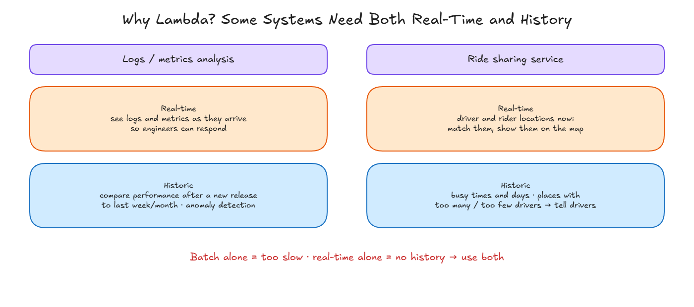
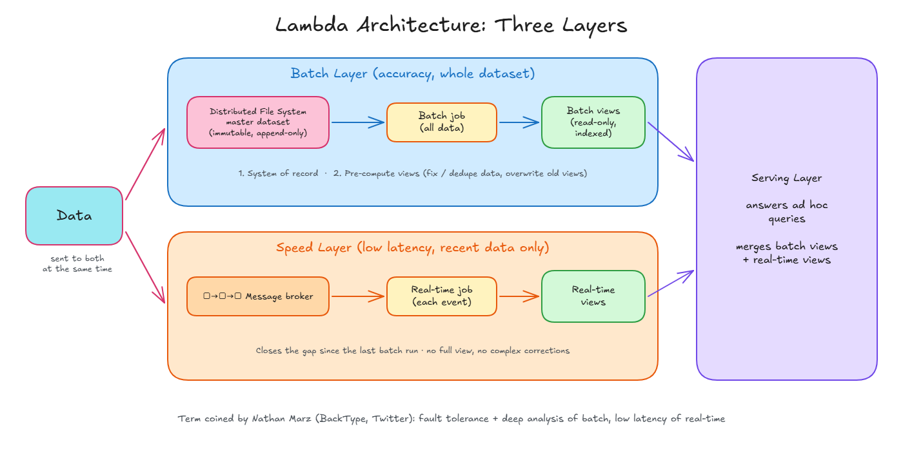
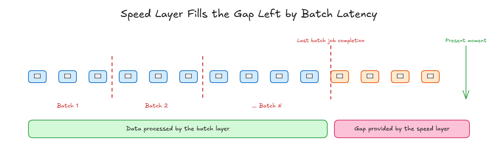
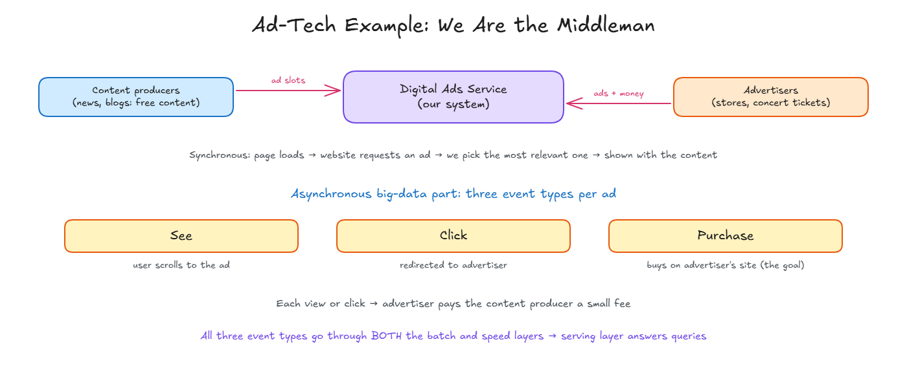
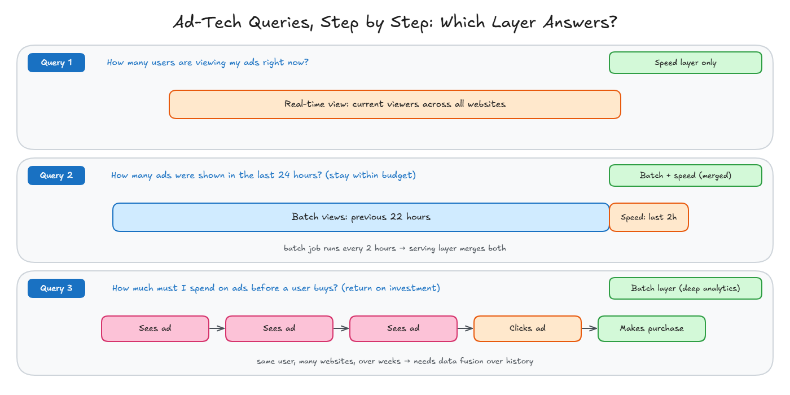

# Lambda Architecture

**In this lecture:**

1. Why some systems need **both** batch and real-time processing
2. The **Lambda architecture** and its three layers: **batch, speed, serving**
3. A practical example from the **ad-tech** industry

---

### Recap: Batch vs Real-Time

From the [previous lecture](2.%20Big%20Data%20Processing%20Strategies.md):

1. **Batch processing:**
   - Works on the **entire dataset** → deep insight into **historic data**, **data fusion** from different sources, and **prediction models**.
   - Trade-off: a **high delay** between data arriving and being queryable.
2. **Real-time processing:**
   - Visibility into **recent data only**.
   - But we can **query and respond** to data in real time as it arrives.

So for each use case, we had to **sacrifice** either a **fast response** or **deep analysis** of historic data. Some use cases fit only batch (delay doesn't matter), and some fit only real-time (no deep historic analysis needed). But **in many cases, we need the properties of both**.

---

### Motivation: Systems That Need Both

### 1. Log and Metrics Analysis

Logs and performance metrics come from **hundreds or thousands of production servers**.

1. **Real-time:** we must see logs and metrics **as they arrive**, so engineers can figure out what happened and **respond**.
2. **Historic:** after deploying a **new feature** that may affect performance, we want to **compare current performance** with the logs and metrics collected over the past **week or month**.
3. **Anomaly detection** needs **both**: it compares **real-time data** with **historic data** to find unusual behavior (Historic data + Real-time data → Compare → Anomaly [not] detected).

### 2. Ride Sharing Service

The events are the **current locations** of **drivers** and **riders** (clients who need a ride).

1. **Real-time:** we must know where every driver and rider is **right now**, to **match** them and show their location **on the map**.
2. **Historic:** detect patterns, like **busy times or days** when many riders need a ride, or **locations** that usually have **too many or too few drivers**.
3. We **share these insights with drivers**, so every location has enough drivers at any moment. Drivers get a **steady income**, and riders get a **good riding experience**.

In both cases, it's **not easy to choose** one strategy over the other.

---

### Lambda Architecture

> **Lambda architecture combines batch and real-time processing to get the best of both worlds: the high fault tolerance and comprehensive analysis of batch processing, and the low latency of real-time processing.**

- The term was coined by **Nathan Marz**, based on his big data work at **BackType** and **Twitter**.
- The infrastructure is divided into **three layers**:
  1. **Batch layer**
  2. **Speed layer**
  3. **Serving layer**
- Incoming data is dispatched to **both the batch layer and the speed layer at the same time**.

### 1. Batch Layer

Very similar to batch processing from the previous lecture. It has **two purposes**:

**1. Manage the dataset and be the system of record** (the single source of truth):

- The data in the **master dataset** is **immutable**. New data is only **appended**, never modified.
- It's usually stored on a **distributed file system**, designed and optimized for storing **big files** with **massive amounts of data**.

**2. Pre-compute the batch views:**

- Every run, the batch job processes **all the data** in the master dataset.
- This is also the perfect point to **make corrections** or **deduplicate** (remove duplicates from) the raw data.
- When the job finishes, it **indexes** the result and stores it in a **read-only database**.
- Usually this **overwrites** the views from the previous run.

**The batch layer aims at perfect accuracy and works on the entire dataset.**

### 2. Speed Layer

In parallel, incoming data goes to the **speed layer**, which uses **real-time processing**:

1. All data goes into a **queue or message broker**.
2. The processing job picks up each event **as it arrives**, analyzes it quickly, and adds the result to the **real-time view**, where anyone can query it.
3. It **compensates for the high latency** of the batch layer.
4. Unlike the batch layer, it works **only on the most recent data**. It doesn't try to give a **complete view** or make **complex data corrections**.

**In other words, the speed layer closes the gap between the present moment and the last time the batch job finished.**

### 3. Serving Layer

1. Responds to **ad hoc queries**.
2. **Merges** data from the **batch views** and the **real-time views**.
3. So any query can use **all the data**: historic data processed by the batch layer, plus the **most up-to-date** data just processed by the speed layer.

**Real-world example:** A bank app showing your balance as last night's official statement (batch) plus today's card payments (speed), added together.

---

### Example: Ad-Tech Industry

**The players:**

1. **Advertisers:** companies selling **concert or event tickets**, or **physical or online stores** advertising existing or upcoming products.
2. **Content producers:** **bloggers** or **news agencies** who offer content **free of charge**. They make money by leaving **empty ad slots** on their websites. Every time a user **sees or clicks** an ad, the advertiser pays the content producer a **small fee**.
3. **Our system (Digital Ads Service):** a **middleman**. It gives advertisers **websites** to advertise on, and gives content producers **advertisers** willing to pay.

**The synchronous part:**

1. A user opens a blog or news website.
2. The website **requests an ad** from our system.
3. We find the **best, most relevant ad** for that user from all our advertisers and send it back.
4. The user sees the content and the ad together when the page loads.

**The asynchronous big data part.** Three types of events per ad:

1. **See:** the user scrolls to where the ad is on the page.
2. **Click:** the user clicks the ad and is **redirected** to the advertiser's website.
3. **Purchase:** the user **buys** on the advertiser's website, which is every advertiser's **ultimate goal**.

We process this massive stream with the **Lambda architecture**. Each event goes through **both** the batch layer and the speed layer, and is then queryable through the **serving layer**.

### Ad-Tech Queries: Which Layer Answers?

Different queries need different parts of the system:

1. **"How many users are viewing my ads right now, across all websites?"**
   - Answered by the **speed layer**.
2. **"How many ads were shown to users in the last 24 hours?"** (so the advertiser stays **within budget**)
   - If the batch layer runs **every 2 hours**, the query **merges both**: the **last 2 hours** from the **speed layer** and the **previous 22 hours** from the **batch layer**.
3. **"How much do I need to spend on ads before a user makes a purchase?"** (**return on investment**)
   - A user may **see the same ad on multiple websites** over **a month** before clicking it, and buy **weeks later**.
   - This needs the **deep analytics and data fusion** of the **batch layer**.

---

**Key idea:** Lambda architecture sends every event to two layers at once. The batch layer keeps an immutable master dataset and builds accurate views over all data, and the speed layer covers the recent gap with low-latency real-time views. The serving layer merges both, so queries can combine deep historic analysis with up-to-the-moment data.

---

## Short Note

- **Problem:** batch = deep history but slow; real-time = fast but recent only. Many systems need **both**:
  - **Logs/metrics:** live view + compare with past weeks + anomaly detection.
  - **Ride sharing:** live locations for matching + historic busy times and driver shortages.
- **Lambda architecture** (Nathan Marz, BackType/Twitter): batch's fault tolerance and deep analysis + real-time's low latency. Data goes to **both** layers at once.
  - **Batch layer:** system of record (immutable, append-only master dataset on a DFS) + pre-computes **batch views** (corrections, dedupe, read-only indexed DB, overwrites old views); perfect accuracy, whole dataset.
  - **Speed layer:** message broker → real-time job → **real-time views**; recent data only, no full view or corrections; fills the gap since the last batch run.
  - **Serving layer:** answers ad hoc queries by **merging** batch + real-time views.
- **Ad-tech example:** we connect advertisers and content producers; events = **see, click, purchase**.
  - "Viewing now?" → speed layer.
  - "Ads in the last 24h?" → 22h batch + 2h speed (batch every 2h).
  - "Spend before a purchase?" → batch layer (fusion over weeks).
