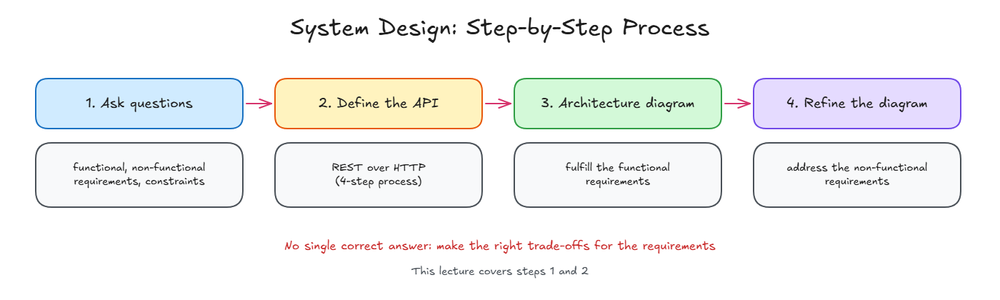
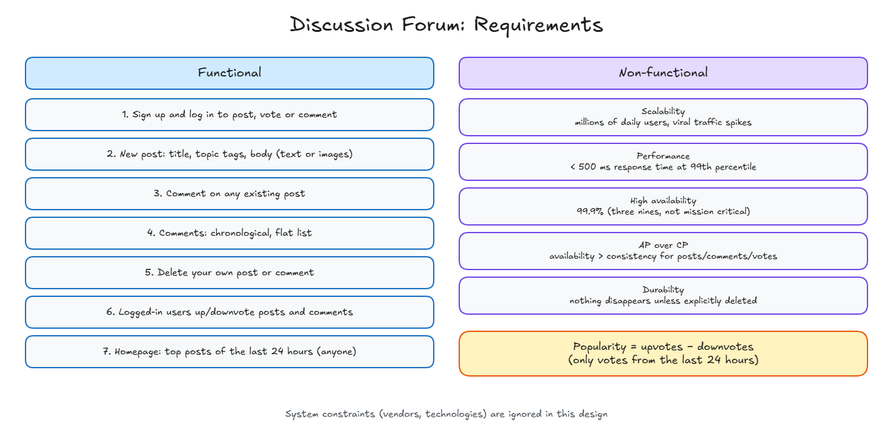
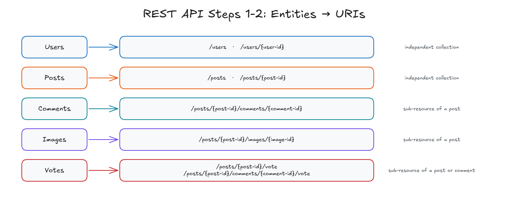
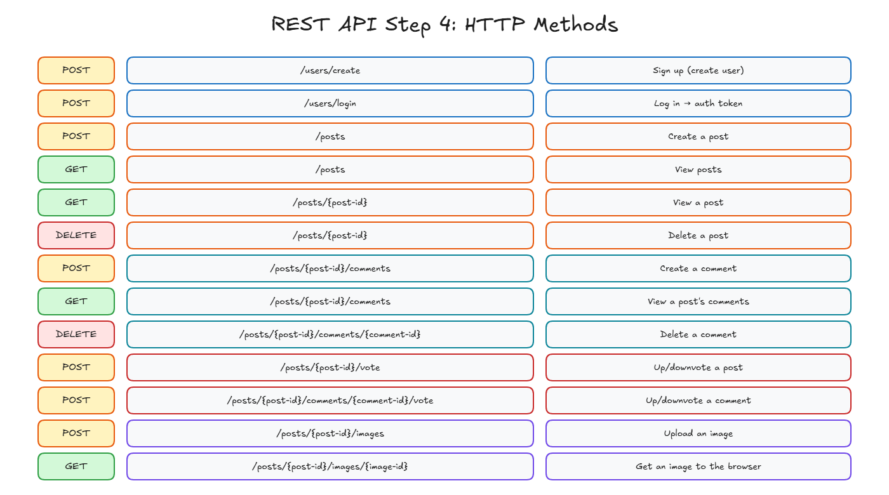
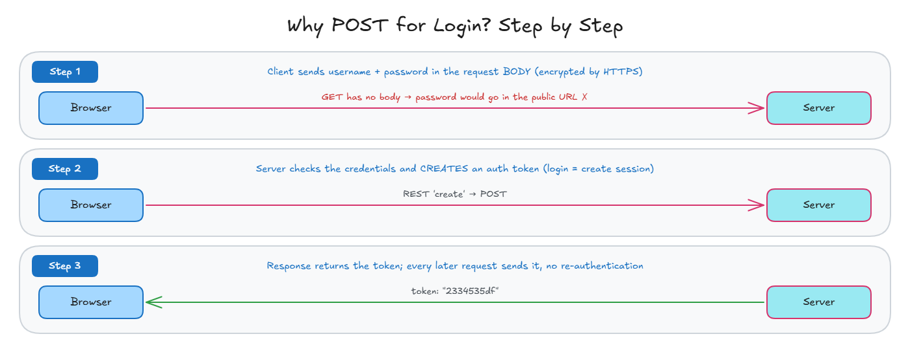
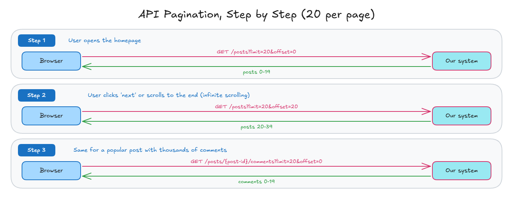

# Design a Highly Scalable Discussion Forum 1 - Requirements & API

**In this lecture:**

1. The step-by-step system design process
2. Gathering **functional** and **non-functional** requirements for a discussion forum
3. Defining the **REST API** with the 4-step process
4. **API pagination**

---

### The System Design Process

We put together everything from the course and design a large-scale system from scratch, taking a **vague, ambiguous problem** all the way to a complete architecture diagram.

**The four steps:**

1. **Ask questions** to capture:
   - Functional requirements
   - Non-functional requirements
   - System constraints
2. **Define the system's API**
3. Create a **software architecture diagram** that fulfills the **functional** requirements
4. **Refine** the diagram to address the **non-functional** requirements

> **There's no single correct way to solve a system design problem. What matters is making the right trade-offs for the requirements we gather.**



---

### The Problem

Design a **highly scalable public discussion forum** where people can:

1. **Post** questions or news to the public
2. **Comment** on existing posts
3. **Upvote or downvote** posts and comments
4. See a **feed of the most popular posts** on their homepage

It must scale to **millions of users worldwide**, so we take it step by step.

**Real-world example:** Forums like Reddit or Hacker News.

---

### Step 1: Ask Questions

**Questions to clarify the functional requirements:**

1. Can **anyone** post or view posts and comments, or only **logged-in** users?
2. What can a post **contain**? Text, images, videos?
3. What does showing the **most popular** posts mean? How do we define **popular**?
4. What's the **structure of comments**? A **flat list** or a **tree** (replies to replies)?

### Functional Requirements

1. A user can **sign up** and **log in** to post, vote or comment.
2. A user can create a **new post** containing:
   - A **title**
   - **Topic tags**
   - A **body** (text or uploaded images)
3. A user can **comment** on any existing post.
4. Comments are ordered **chronologically** as a **flat list**.
5. A user can **delete** their own **post or comment** at any time.
6. A **logged-in** user can **upvote or downvote** an existing post or comment.
7. Any user (logged in or not) sees the **top most popular posts in the last 24 hours** on the homepage.

> **Popularity = upvotes − downvotes**, counting only votes from the **last 24 hours**.

### Non-Functional Requirements

1. **Scalability:** we may start with low traffic but grow to **millions of daily users**. World events or **viral posts** can also cause **sudden traffic spikes**.
2. **Performance:** our clients are end users, so every interaction must respond within a few hundred milliseconds: **less than 500 ms at the 99th percentile** (99% of requests are faster than this).
3. **Fault tolerance / high availability:** it's not a bank or a mission-critical system, so **99.9%** (three nines) is enough.
4. **Availability + partition tolerance (AP over CP):** it doesn't matter much if every user in the world sees the **latest** posts, comments or vote counts. So we prioritize **availability over consistency**, which improves **performance** and **user experience**. (See the [CAP Theorem](../006-Data-Storage-at-Global-Scale/4.%20Brewer's%20(CAP)%20Theorem.md).)
5. **Durability:** new users, posts, comments or votes must **never disappear** unless explicitly deleted.

**System constraints:** in a real system we might be bound to (or excluded from) certain technologies or cloud vendors. We ignore those in this design.



---

### Step 2: Define the REST API

This is a typical **web-based system** called by **client-side code in the browser**, so we use a **REST API over HTTP**. We follow the 4-step process from the [REST API lecture](../004-API-Design/4.%20REST%20API.md):

1. Identify entities
2. Map entities to URIs
3. Define resource representations
4. Assign HTTP methods to operations on resources

### 1. Identify Entities

**Users, posts, images, comments and votes.**

### 2. Map Entities to URIs

1. **Users** and **posts** are **independent collections**.
2. **Comments** and **images** are **sub-resources of a post**.
3. **Votes** are a sub-resource of a **post or a comment**.

| Entity | URIs |
|---|---|
| Users | `/users`, `/users/{user-id}` |
| Posts | `/posts`, `/posts/{post-id}` |
| Comments | `/posts/{post-id}/comments`, `/posts/{post-id}/comments/{comment-id}` |
| Images | `/posts/{post-id}/images`, `/posts/{post-id}/images/{image-id}` |
| Votes | `/posts/{post-id}/vote`, `/posts/{post-id}/comments/{comment-id}/vote` |



### 3. Define Resource Representations

For time, only **posts** and **comments** are shown.

**A single post** (`GET /posts/{post-id}`) is a simple JSON object with its **ID, title, the user who posted it, topic tags, total upvotes and downvotes**, and a **body**. The body can be **JSON-encoded markdown**, because it can contain both **text and links to images**.

```json
{
  "post_id": "14245bac",
  "title": "How do I make money with stocks?",
  "user_id": "1234acd",
  "topics": ["investing", "stocks", "trading"],
  "upvotes": 5,
  "downvotes": 1,
  "body": "......"
}
```

**A comments collection** contains the **post ID** and an **array of comments**. Each comment has its **ID, text, the user who posted it**, and its **votes**.

```json
{
  "post_id": "14245bac",
  "comments": [
    { "comment_id": 1234, "body": "I agree", "user_id": "abd54232", "upvotes": 50, "downvotes": 3 },
    { "comment_id": 4321, "body": "I don't think so, because...", "user_id": "5423adc", "upvotes": 7, "downvotes": 6 }
  ]
}
```

### 4. Assign HTTP Methods to Operations

| Method | URI | Operation |
|---|---|---|
| POST | `/users/create` | Sign up (create a new user) |
| POST | `/users/login` | Log in an existing user |
| POST | `/posts` | Create a new post |
| GET | `/posts` | View posts |
| GET | `/posts/{post-id}` | View a post |
| DELETE | `/posts/{post-id}` | Delete a post |
| POST | `/posts/{post-id}/comments` | Create a new comment |
| GET | `/posts/{post-id}/comments` | View a post's comments |
| DELETE | `/posts/{post-id}/comments/{comment-id}` | Delete a comment |
| POST | `/posts/{post-id}/vote` | Upvote or downvote a post |
| POST | `/posts/{post-id}/comments/{comment-id}/vote` | Upvote or downvote a comment |
| POST | `/posts/{post-id}/images` | Upload an image (image in the message body) |
| GET | `/posts/{post-id}/images/{image-id}` | Get an image to the browser |



### Why POST (Not GET) for Login?

**1. Security:**

- We must send the **username and password** to the server.
- A **GET** request can't use the HTTP **message body**, so the password would go in the **URL**, which is **publicly visible**.
- In a **POST** body, the credentials are **automatically encrypted** when we use **HTTPS**.

**2. Semantics (meaning):**

- Login is really a **"create session"** or **"create authentication token"** operation.
- The response contains a **newly created auth token**, which is sent with **every later request**, so the user doesn't need to **re-authenticate**.
- A REST **create** operation maps to **POST**, so POST is the natural choice.



---

### API Pagination

This follows from the strict **performance** requirement.

**Posts on the homepage:**

1. There can be **thousands or hundreds of thousands** of active posts. We don't want to load them all into the browser.
2. So we use **API pagination** and **limit** each page to, say, **20 posts**.
3. Opening the homepage returns only the **top 20 posts**: `GET /posts?limit=20&offset=0` → posts 0–19.
4. For the **next batch of 20**, the user clicks a button in the UI, which requests the next page.

**Comments:**

- A very popular post may have **thousands of comments**, which could take **minutes to load**. So comments are **paginated** too.

**Infinite scrolling:**

- Front-end engineers can hide pagination behind **infinite scrolling**. When the user scrolls to the end of the page, the front end **requests the next batch**, which appears on the page.



**Real-world example:** A social media feed that loads more posts as you reach the bottom.

---

### Summary So Far

1. We started from a **vague, ambiguous** request to build a highly scalable public discussion forum.
2. We **asked questions** and clarified the **functional requirements**, which should always be the **first step** in any system design.
3. We defined the **quality attributes** (non-functional requirements), with trade-offs like **availability over consistency**.
4. We defined the **REST API**: identified entities, mapped them to URIs, defined resource representations, and mapped operations to HTTP methods.
5. From the **performance** requirement, we added **API pagination** to limit how much data we send at once.

The next lecture continues with the architecture diagram.

---

**Key idea:** Start every design by asking questions to pin down functional and non-functional requirements, then define the API. For the forum, that means seven functional features, AP-leaning, durable, highly available and fast non-functional goals, and a REST API over users, posts, comments, images and votes. POST is used for login, and pagination keeps responses small.

---

## Short Note

- **Process:** ask questions (functional, non-functional, constraints) → API → architecture diagram for the functional requirements → refine it for the non-functional ones. No single right answer, only trade-offs.
- **Forum functional requirements:** sign up and log in; posts (title, tags, text or image body); comments (chronological flat list); delete your own posts and comments; logged-in up/downvotes; homepage shows the top posts of the last 24h. **Popularity = upvotes − downvotes (last 24h).**
- **Non-functional:** scalability (millions of users, viral spikes), performance (< 500 ms at p99), 99.9% availability, **AP over CP**, durability. Constraints ignored.
- **REST API (4 steps):**
  - **Entities:** users, posts, comments, images, votes.
  - **URIs:** users and posts are top-level; comments and images under a post; votes under a post or comment.
  - **Representations:** post JSON (id, title, user, topics, up/downvotes, markdown body); comments = post id + array of comments.
  - **Methods:** POST create/login/vote/upload, GET view, DELETE delete.
- **Login uses POST:** credentials go in the HTTPS-encrypted body, not the URL; login = create an auth token.
- **Pagination:** `limit=20&offset=0` for posts and comments; infinite scrolling on the client.
