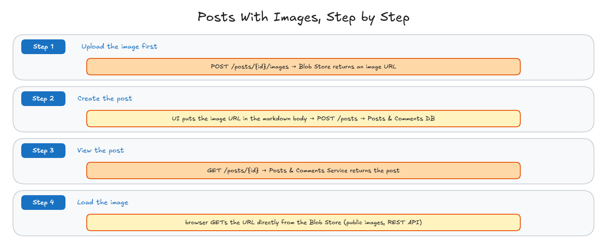
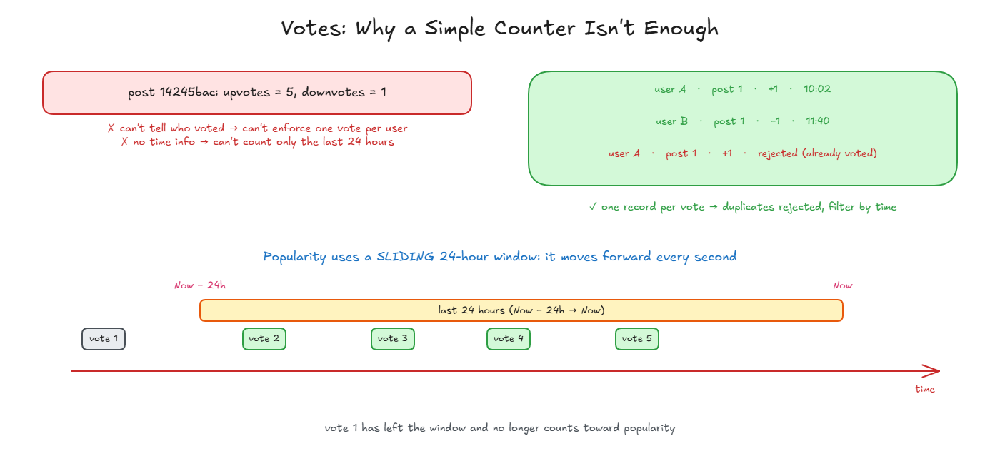
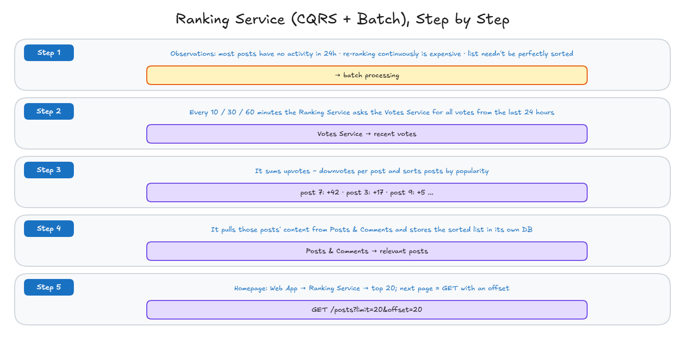
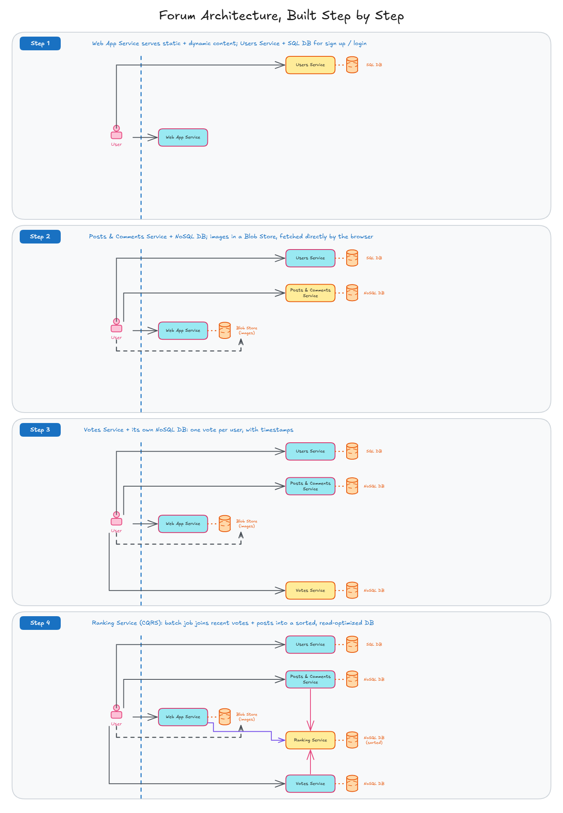
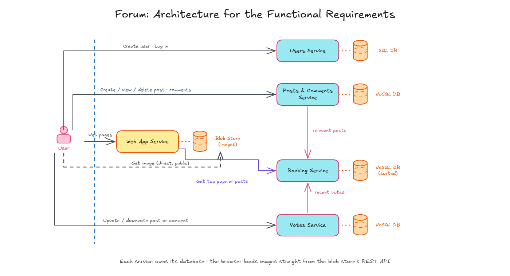
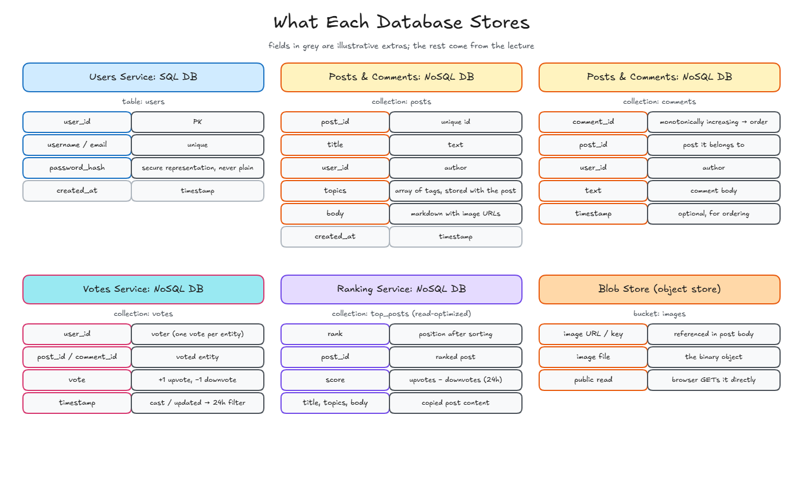

# Design a Highly Scalable Discussion Forum 2 - Functional Architecture Diagram

**In this lecture:**

1. Turning the requirements and API from the [previous lecture](1.%20Design%20a%20Highly%20Scalable%20Discussion%20Forum%201%20-%20Requirements%20%26%20API.md) into an **architecture diagram**
2. One service per feature: **Users, Posts & Comments, Votes, Ranking**
3. What each **database** stores
4. Using **CQRS + batch processing** for the popular-posts feed

In this stage we **ignore the quality attributes** (non-functional requirements) and focus **only on the functional requirements**.

---

### Web App Service

All interactions come from the user's **web browser**, so we need a **Web App Service** to serve all the **static and dynamic content** (web pages) to users' devices.

---

### Requirement 1: Sign Up and Log In → Users Service

1. We design for scale, so we follow a **service / microservices architecture** style (see [Microservices](../007-Software-Architecture-Patterns-and-Styles/3.%20Microservices%20Architecture.md)).
2. A **Users Service** handles sign up and login.
3. Behind it is a **SQL database** storing account information in a **table**, together with a **secure representation of the password** (never the plain password).
4. All **sign-up and login** API calls go to the Users Service.

---

### Requirement 2: Create Posts → Posts Service + Blob Store

1. A **Posts Service** stores posts in a database.
2. **SQL or NoSQL?** Both could work, but we're designing for scale and want the post structure to stay **open-ended**, so we choose **NoSQL**. Now the **topic tags** can be stored as an **array inside the post** itself.
3. Images go into an **object store (blob store)**.

**Creating, viewing and deleting a post with an image:**

1. **Upload:** the user first **uploads the image** to the blob store.
2. **Create:** the UI puts the **image URL** into the post body's **markdown**, which is sent to the Posts Service and stored in the database.
3. **View:** a request to view a post goes to the **Posts Service**.
4. **Load the image:** once the post is in the browser, the browser sends **another request directly to the blob store** for the image. This works because the images are **public** and the object store already **exposes a REST API**.
5. **Delete:** the request goes to the Posts Service, which deletes the post **only if the logged-in user's ID matches** the ID of the post's author.

This fulfills **requirement 2** and **partially** fulfills **requirement 5** (delete your own post).

---

### Requirements 3, 4, 5: Comments → Posts & Comments Service

**Option 1:** a **separate microservice** for comments with its own database, keeping the architecture granular.

**Option 2 (chosen):** comments are **very similar** to posts, only **simpler**. So we **combine them into one microservice**, the **Posts & Comments Service**. Loading a post **with its comments** is easier, because they're in the **same database**.

**A new `comments` collection**, where each record has:

1. A unique **comment ID**
2. The **comment text**
3. The **user ID** of the author
4. The **post ID** the comment belongs to

**Keeping comments in posting order:** make comment IDs **monotonically increasing** (each new ID is bigger than the last), and/or add a **timestamp**.

All API calls to **add, list or delete** comments go to this service. This satisfies **requirements 3, 4 and 5**.

---

### Requirement 6: Votes → Votes Service

**At first glance:** keep a **counter** per post or comment, and let users increment or decrement it concurrently.

**Why that's not enough:**

1. Each user may vote on a post or comment **only once**. A counter can't **enforce** this, because it doesn't remember **who** voted.
2. The last requirement needs votes from a **24-hour window**. That's a **sliding window**: every second, the window moves forward and leaves older votes behind. A counter has **no time information**. (See [Sliding Window](../008-Strategies-for-Processing-Infinite-Streams-of-Events/3.%20Sliding%20Window%20Event-Stream%20Processing%20Strategy.md).)

**The solution: a separate Votes Service** with its **own database**. Its `votes` collection stores one record per vote:

1. The voter's **user ID**
2. The **post ID or comment ID**
3. The **vote**: **+1** for an upvote, **−1** for a downvote
4. A **timestamp** of when the vote was cast or updated, to narrow down votes for the popular-posts feed

All vote requests go to this service. **If the user already voted for that entity, the vote is rejected.**

**Counting** many vote records may be slow, but that's handled later, in the performance lecture.

---

### Requirement 7: Popular Posts Feed → Ranking Service

**Observations:**

1. **Popularity** data lives in the **Votes Service** database, but the **posts** live in the **Posts & Comments Service** database. We need to **join** them efficiently.
   - We use a variation of the **CQRS pattern** (see [Event-Driven Architecture](../007-Software-Architecture-Patterns-and-Styles/4.%20Event%20Driven%20Architecture.md)): a new **Ranking Service** pulls data from **both** services.
   - It has a dedicated **read-optimized database** that stores posts **sorted** and **ready to be served**.
2. **Most posts aren't active** in the last 24 hours, so we only need to sort a **small number** of posts.
3. The 24-hour window **keeps moving**, but **recalculating and re-ranking continuously is expensive**.
4. There's **no strict requirement** to keep the list perfectly sorted at all times.

**All of this "screams" batch processing** (see [Big Data Processing Strategies](../009-Big-Data-Architecture-Patterns/2.%20Big%20Data%20Processing%20Strategies.md)).

**How the Ranking Service works (batch + CQRS):**

1. It runs **periodically**: maybe every **10 minutes, 30 minutes or once an hour**.
2. Each run, it asks the **Votes Service** for all **votes from the last 24 hours**.
3. It **sums upvotes and downvotes per post** and **sorts the posts by popularity**.
4. It pulls the **content** of those posts from the **Posts & Comments Service**.
5. It stores the **sorted list of posts** in its own database.
6. When a user opens the website, the request goes to the **Ranking Service**, which returns the **top 20** most popular posts. The **next 20** is another GET request with an **offset**.

**Real-world example:** A music chart that's recalculated every hour, not after every single song play.

---

### The Architecture, Step by Step

### The Final Functional Architecture

| API call | Goes to |
|---|---|
| Web pages | Web App Service |
| Create user, log in | Users Service (SQL) |
| Create, view, delete a post | Posts & Comments Service (NoSQL) |
| Create, get, delete comments | Posts & Comments Service (NoSQL) |
| Upload or get an image | Blob store (directly) |
| Upvote or downvote a post or comment | Votes Service (NoSQL) |
| Get top popular posts | Web App → Ranking Service (sorted NoSQL) |

---

### What Each Database Stores

The fields below come from the lecture. The grey fields in the diagram (like `created_at`) and the Ranking table's layout are **illustrative extras**, added to make the picture complete.

| Service | Database | Collection / table | Fields |
|---|---|---|---|
| Users | SQL | `users` | user ID, username/email, **password hash** (secure representation) |
| Posts & Comments | NoSQL | `posts` | post ID, title, user ID, **topics (array)**, body (markdown with image URLs) |
| Posts & Comments | NoSQL | `comments` | **comment ID (monotonically increasing)**, post ID, user ID, text, optional timestamp |
| Votes | NoSQL | `votes` | user ID, post ID or comment ID, **vote (+1 / −1)**, **timestamp** |
| Ranking | NoSQL (read-optimized) | sorted posts | post ID, popularity score (upvotes − downvotes in 24h), post content, in sorted order |
| Blob store | Object store | images | image file, accessed by its public URL |

---

### Summary

1. We addressed **all functional requirements**.
2. We **mapped every API call** to the path it takes through the architecture.
3. The next lecture addresses the **non-functional requirements**: **scalability, performance, high availability and durability**.

---

**Key idea:** Each feature gets its own service and database. The Users Service uses SQL, Posts & Comments shares one NoSQL service (with images in a blob store the browser reads directly), and Votes stores one timestamped record per vote so duplicates can be rejected. A Ranking Service uses CQRS and batch processing to join recent votes with post content into a sorted, read-optimized database for the homepage feed.

---

## Short Note

- **Scope:** functional requirements only; quality attributes come next.
- **Web App Service:** serves static and dynamic content to browsers.
- **Users Service + SQL DB:** sign up and log in; stores accounts + password hash.
- **Posts & Comments Service + NoSQL DB:** open-ended post structure, tags as an array; comments combined in (similar but simpler) → easy to load a post with its comments. Comment IDs increase monotonically (or use timestamps) for order. Delete only if the logged-in user is the author.
- **Blob store:** upload the image → URL in the markdown body; the browser fetches images **directly** (public, REST API).
- **Votes Service + NoSQL DB:** a counter can't enforce one vote per user or a 24h sliding window → one record per vote (user, entity, ±1, timestamp); duplicates rejected.
- **Ranking Service (CQRS + batch):** join votes + posts into a sorted, read-optimized DB; runs every 10-60 min: get 24h votes → sum and sort → fetch post content → store. Homepage → top 20, next page by offset.
- **Why batch:** few active posts, continuous re-ranking is expensive, no need for a perfectly sorted list.
