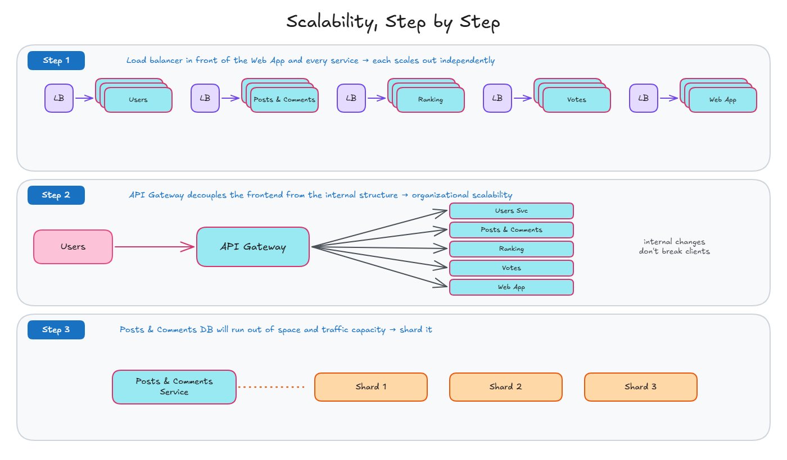
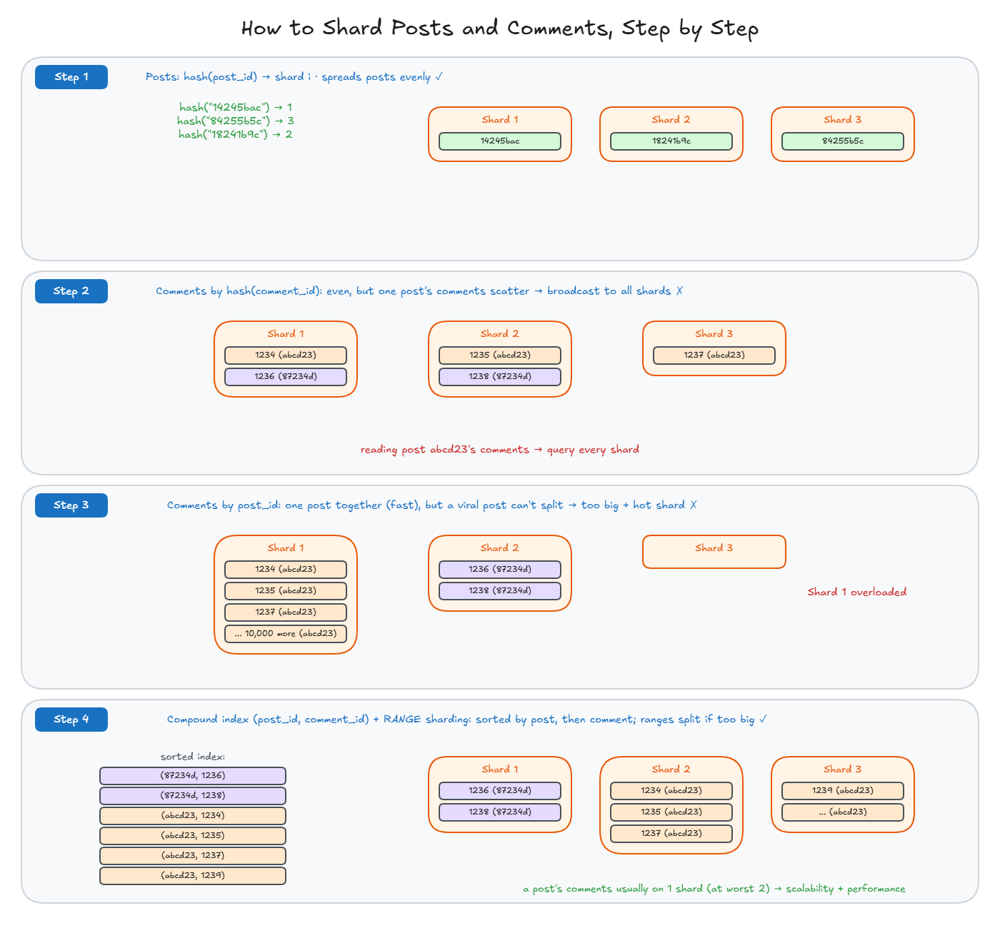
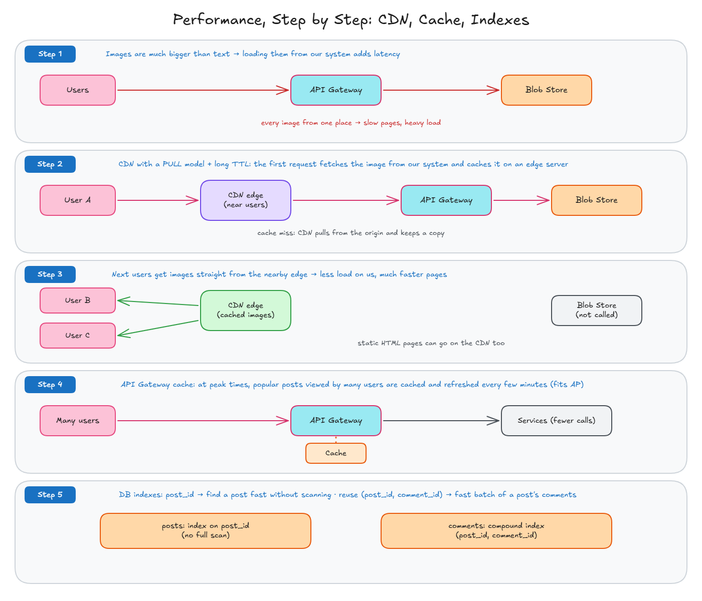
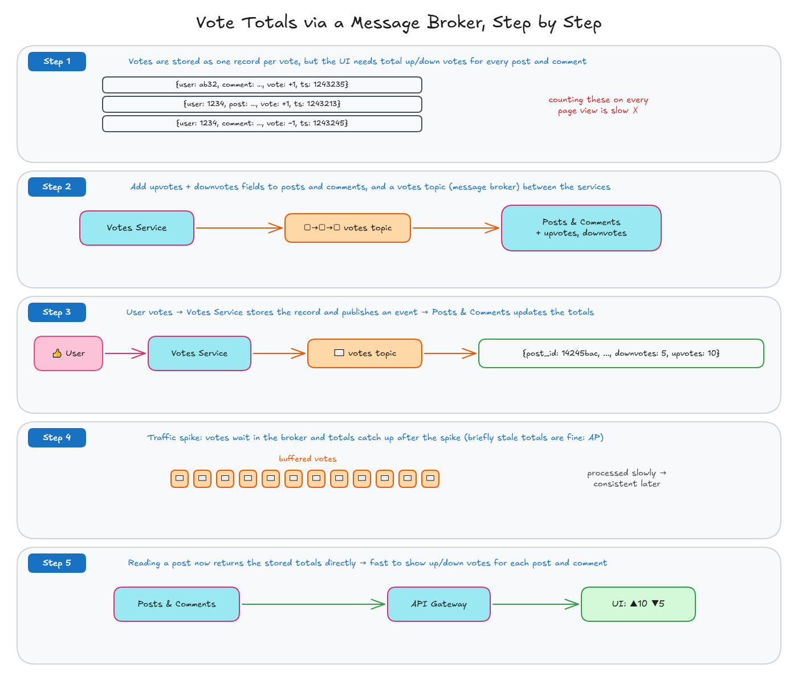
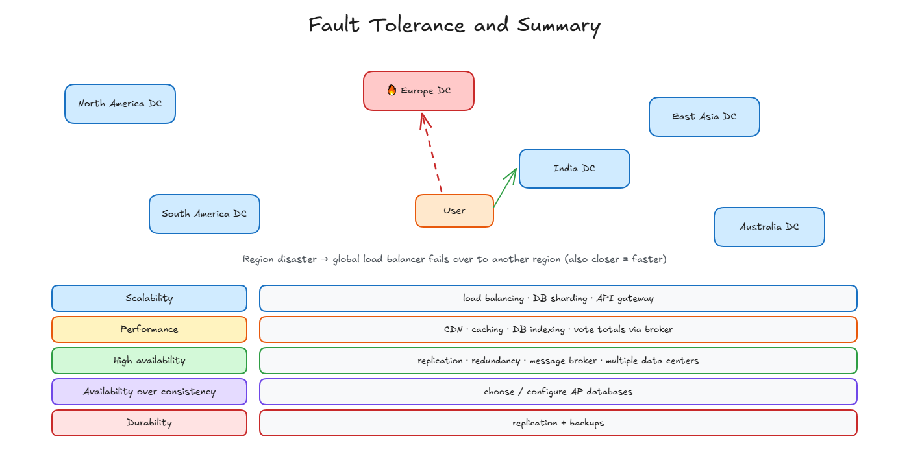
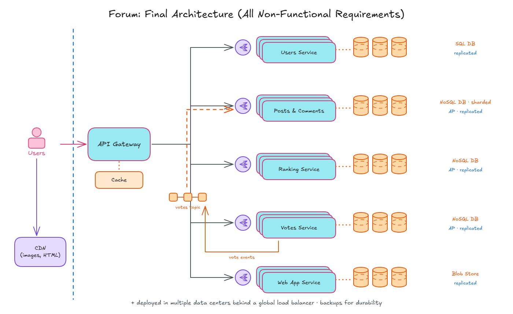

# Design a Highly Scalable Discussion Forum 3 - Final Software Architecture

**In this lecture:**

1. Refining the [functional architecture](2.%20Design%20a%20Highly%20Scalable%20Discussion%20Forum%202%20-%20Functional%20Architecture%20Diagram.md) to meet every **non-functional requirement**
2. **Scalability:** load balancers, API gateway, database sharding
3. **Performance:** CDN, caching, indexing, vote totals through a message broker
4. **Fault tolerance, availability, durability:** replication, multiple data centers, AP databases, backups

---

### Recap

The previous design covered the **functional requirements only**:

1. **Users Service:** creates and maintains user data
2. **Posts & Comments Service:** creates and stores posts and comments
3. **Votes Service:** handles voting
4. **Ranking Service:** ranks posts by popularity in the last 24 hours

But it didn't address **scalability, performance** or any other non-functional requirement. Now we address them **one by one**.

---

### 1. Scalability

### Load Balancers

1. Place a **load balancer** in front of the **Web App Service** and **every other service**.
2. Each service can now **scale out** (add more instances) **independently**, based on its own traffic.

### API Gateway

1. Place an **API gateway** between the users and our services.
2. It **decouples the frontend code** from the system's **internal structure**.
3. We can change things internally without breaking clients, which increases **organizational scalability**. (See [API Gateway](../005-Large-Scale-Systems-Architectural-Building-Blocks/5.%20API%20Gateway.md).)

### Sharding the Posts & Comments Database

As we store more posts and comments, one database instance may:

1. **Run out of space**
2. **Not handle the traffic** from so many users

**Solution:** **shard** the posts and comments collections across database shards. We can then scale to as many posts and comments as we want by **adding instances** and spreading the data across them. (See [Sharding](../006-Data-Storage-at-Global-Scale/3.%20Techniques%20to%20Improve%20Performance%2C%20Availability%20%26%20Scalability%20Of%20Databases.md).)

### How to Shard the Data?

**Posts: easy.**

- Apply a **hash function on the post ID** → shard number: `Hash(post_id) → Shard(i)`.
- This spreads posts **evenly** across shards.

**Comments: harder.** Three options:

**Option 1: hash the comment ID ✗**

- Comments are spread **evenly**.
- But comments of the **same post** land on **different computers**, so loading a post's comments needs an inefficient **broadcast to all shards**.

**Option 2: shard by post ID ✗**

- All comments of a post are on the **same shard**, so loading them is **fast**.
- But if one **popular post** gets so many comments that they **don't fit on one shard**, we **can't split** them.
- That shard also becomes a **performance bottleneck** (a "hot shard"), because too many operations hit it.

**Option 3: compound index (post_id, comment_id) + range sharding ✓**

1. A **compound index** is like a separate data structure that **sorts** the data first by the **first key (post ID)**, then by the **second key (comment ID)**.
2. Instead of a hash function, we use a **range sharding strategy**, which many **NoSQL databases support**. The database splits the sorted data into **ranges** and spreads them across shards.
3. Comments of the same post will **very likely be on the same shard**.
4. If one post gets **too many comments**, the database can still **split its range** across shards.
5. **Result:** a good balance of **scalability and performance**. A request for consecutive comments of a post hits **one shard**, or **two at worst**.

**Real-world example:** A dictionary split into volumes A–D, E–K and so on. Words starting the same way stay together, but a huge letter can get two volumes.

---

### 2. Performance

### CDN for Images and Static Pages

1. **Bottleneck:** every time a user loads a post or the popular-posts feed, we load **images** from our blob store. Even small images are **much bigger than text**, so they add a lot of **latency**.
2. **Solution:** a global network of **CDN edge servers**, using a **pull model** with a **very long TTL** (time to live: how long a cached copy is kept). (See [CDN](../005-Large-Scale-Systems-Architectural-Building-Blocks/7.%20Content%20Delivery%20Network%20-%20CDN.md).)
   - The first request pulls the image from our system and caches it on an edge server.
   - Images of popular posts end up on edge servers **close to users** in different locations.
3. **Result:** less **traffic load** on our system and much faster **page load times**.
4. **Static HTML pages** can also go on the CDN, which reduces load on the Web App Service and makes pages load faster.

### Caching at the API Gateway

1. At **peak times**, a **small group of posts** is viewed by **many users at once**.
2. We **cache** those posts at the API gateway and **refresh the cache every few minutes**.
3. This reduces **response time**, and fits our choice of **availability over consistency** (slightly old data is acceptable).

### Database Indexing

1. **Index on post ID:** finding a post becomes **constant time**, instead of **scanning** the whole posts collection.
2. **Comments:** reuse the **compound index (post_id, comment_id)** from sharding, so fetching a **batch of a post's comments** is much faster.
3. Other databases can be indexed too (skipped in the lecture).

### Vote Totals Through a Message Broker

**Problem:** votes are stored as **individual records** in the Votes Service database. But the UI must show the **total upvotes and downvotes** for every post and comment, and counting records on every view is slow.

**Solution:**

1. Add two fields to the posts and comments collections: **total upvotes** and **total downvotes**.
2. Add a **message broker** (a **votes topic**) between the Votes Service and the Posts & Comments Service.
3. When a user votes:
   - The Votes Service **stores the vote** in its own database.
   - It **publishes the vote as an event** to the votes topic.
   - The Posts & Comments Service **consumes** the event and **updates the totals** stored with that post or comment (e.g. `"downvotes": 5, "upvotes": 10`).
4. **Traffic spikes:** if many people suddenly vote on the same posts, the votes are **buffered in the broker** and the totals are updated slowly, finishing after the spike.
5. During that time, users may not see the **latest totals**. That's fine, because we chose **availability over consistency**.
6. **Result:** totals are stored **with each post and comment**, so they load **easily and efficiently**.

---

### 3. Fault Tolerance and High Availability

1. **Database replication:** so we don't lose data if a database instance or **shard crashes**. (See [Replication](../006-Data-Storage-at-Global-Scale/3.%20Techniques%20to%20Improve%20Performance%2C%20Availability%20%26%20Scalability%20Of%20Databases.md).)
2. **Everything is replicated:** every **message broker, data store and microservice** has multiple instances, adding to overall fault tolerance.
3. **Multiple data centers:**
   - Run the system in **several data centers** in different geographical regions, behind a **global load balancing service**.
   - If a **natural disaster** hits one region, we **fail over** to another region.
   - **Bonus:** better **performance**, because the system is physically **closer to users** on different continents.

### 4. Availability Over Consistency

- We prioritized availability, so our databases are **configured (or chosen) to be AP**: **available and partition tolerant**.
- This is on top of all the **caching** and other optimizations already made.

### 5. Durability

- We get it "for free" from **database replication** plus **periodic backups**, so no data is lost.

---

### The Final Architecture

---

### Summary

| Requirement | Techniques |
|---|---|
| **Scalability** | Load balancing, database sharding, API gateway (also for organizational scalability) |
| **Performance** | CDN, caching, database indexing (+ vote totals via a message broker) |
| **High availability** | Database replication, redundancy, message broker as a buffer for events processed asynchronously, multi-data-center deployment (no single location is a single point of failure) |
| **Availability over consistency** | Choose or configure **AP** databases → users always get data, even if it's not the latest |
| **Durability** | Replication across instances and data centers + rolling backups → no data lost |

---

**Key idea:** The functional design is made production-ready by adding load balancers, an API gateway and range-sharded databases for scale. A CDN, gateway caching, indexes and broker-updated vote totals give speed, while replication, multiple data centers and AP databases give availability. Replication plus backups give durability.

---

## Short Note

- **Scalability:**
  - **LB** before every service → independent scale-out.
  - **API gateway** → frontend decoupled from internals (organizational scalability).
  - **Shard** Posts & Comments: posts by `hash(post_id)`; comments by **compound index (post_id, comment_id) + range sharding**. Hashing the comment ID → broadcast to all shards; sharding by post ID → a viral post can't split and creates a hot shard.
- **Performance:**
  - **CDN** (pull, long TTL) for images + static HTML.
  - **API gateway cache** for hot posts at peak, refreshed every few minutes.
  - **Indexes:** post_id, and (post_id, comment_id).
  - **Vote totals:** Votes Service → **votes topic** → Posts & Comments updates the upvotes/downvotes fields; buffers spikes; briefly stale totals are OK (AP).
- **High availability:** replicate DBs, brokers and services; **multiple data centers** + global LB → regional failover (also closer = faster).
- **AP:** configure or choose AP databases.
- **Durability:** replication + periodic backups.
