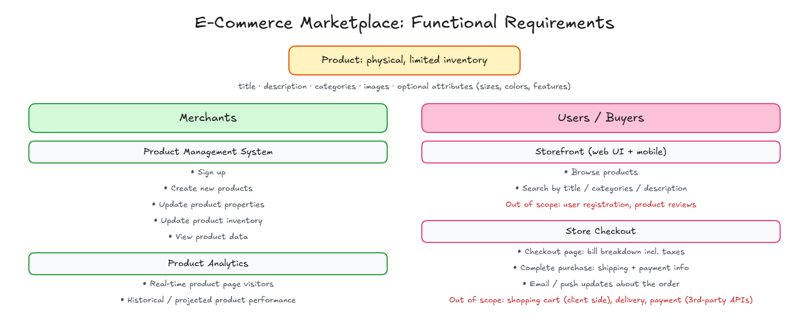
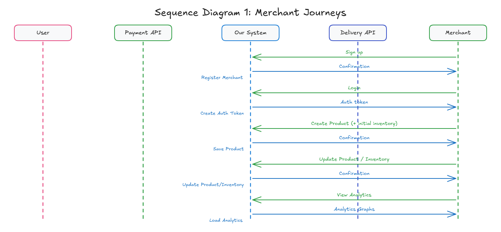
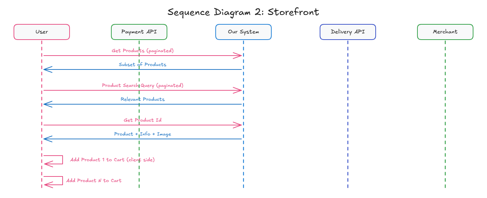
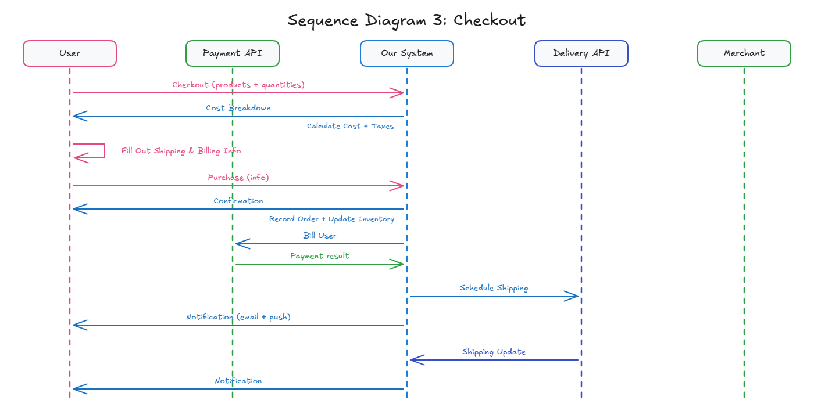
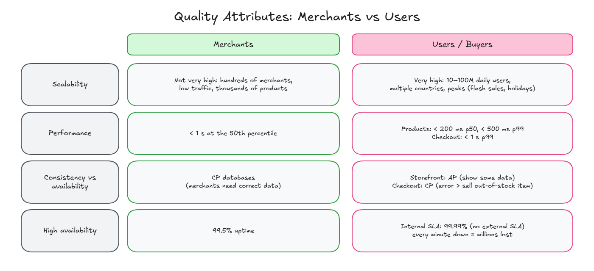

# Design an E-Commerce Marketplace Platform 1 - Requirements & Sequence Diagram

**In this lecture:**

1. The design problem: a highly scalable e-commerce marketplace
2. Asking questions for **two actors**: merchants and users (buyers)
3. Organizing the functional requirements with **sequence diagrams**
4. **Quality attributes** for each actor and use case

---

### The Design Problem

> **Architect a highly scalable e-commerce marketplace platform** (like Amazon.com, AliExpress, eBay, Rakuten) for **millions of users** in different countries.

1. **Merchants** can **upload** and **sell** products.
2. **Users** can **browse**, **search for** and **buy** products.

Real companies building such systems employ **thousands of engineers**, but we follow our usual step-by-step process:

1. Gather functional and non-functional requirements
2. Define the system API
3. Architecture diagram for the **functional** requirements
4. Architecture diagram for the **non-functional** requirements

---

### Step 1: Ask Questions

**Important observation:** there are **two major actors**, so we clarify functionality for each one **separately**:

1. **Merchants**
2. **Users / buyers**

**Questions about merchants:**

1. What **type of products** are we selling? **Digital** (ebooks, music) or **physical** with a fixed inventory?
2. What **product information** does a merchant provide when onboarding a new product?
3. What **data** do we give the merchant about their product sales, if any?
4. What **operations** can a merchant perform on their existing products?

**Questions about users / buyers:**

1. Can **anyone** browse and purchase, or is **registration** required?
2. Are **product reviews and ratings** in scope?
3. What **search capabilities**, if any, do we need?
4. Which parts of **checkout / payment / delivery** do we need to design?
5. What **UI** do we offer: **browser** only, or **mobile** too?

---

### Functional Requirements

### Products

1. **Physical** products with **limited inventory**.
2. Each product contains:
   - **Title**
   - **Description**
   - **Categories**
   - **Images**
   - **Optional attributes**, like available sizes, colors and special features

### Merchant Requirements

**1. Product Management System** (web-based). A merchant can:

- **Sign up**
- **Create** new products
- **Update** the product **properties**
- **Update** product **inventory**
- **View** product **data**

**2. Product Analytics** (merchant dashboard). A merchant can:

- **View real-time** product **page visitors**
- **View historical and projected** product **performance** (trends)

### User / Buyer Requirements

**1. Storefront** (web UI + mobile app). Users can:

- **Browse** products
- **Search** products by **title, categories and description**
- **Out of scope:** user registration, product reviews

**2. Store Checkout.** After adding products to their cart, users can:

1. **Navigate** to the **checkout page**.
2. **View** a full **breakdown of the bill**, including **taxes**.
3. **Complete** the purchase with **one click** after filling in **shipping and payment info**.
4. **Receive updates** by **email** and **mobile push notifications** throughout the order process.

- **Out of scope:**
  - **Shopping cart:** 100% **client side**, stored in the user's app or browser.
  - **Delivery** and **payment:** offloaded to **third-party APIs**.

---

### Sequence Diagrams

We now know what's **in scope** and **out of scope**. But there's still **high complexity** because of:

1. **Multiple actors** (merchants, users)
2. **External services** (payment API, delivery system API)

**Solution:** a **sequence diagram**, a great visual tool to organize requirements. It shows the actors as **vertical lifelines** and the **messages** between them in **time order**, top to bottom.

**Actors on the diagram:** User, Payment System API, Our System, Delivery System API, Merchant.

### Merchant Journeys

1. **Sign up** → our system **registers the merchant** → confirmation.
2. **Login** → our system **creates an auth token**.
3. **Create product** with an **initial inventory** → our system **saves the product** → confirmation.
4. **Update product / inventory** at any time (inventory, description, title, pricing or any other data) → confirmation.
5. **View analytics** in the dashboard → our system **loads analytics** → **analytics graphs**.

### Storefront Journey

1. **Get products** → a **subset of products**, using **API pagination** (loading every product onto the user's device would be unreasonable).
2. **Product search query** → **relevant products**, also **paginated** (results can be very big).
3. **Get product by ID** (user clicks a product) → full product page: **product + info + images**.
4. **Add products to the cart:** happens **on the client** only, no call to our system.

### Checkout Journey

1. **Checkout:** the user sends the **list of products and quantities** → our system **calculates cost + taxes** → returns the **cost breakdown**.
2. The user **fills in shipping and billing info** in the browser or app.
3. **Purchase:** clicking the button sends all the filled-in info → internally we **record the order** and **update the inventory** → **confirmation** to the user.
4. We **bill the user** by calling the **Payment System API**.
5. We **schedule shipping** by calling the **Delivery System API**.
6. At **every transaction stage**, we send an **email and push notification** to the user.
7. When the delivery system makes **shipping progress**, it sends us a **shipping update**, which also triggers an **email notification** to the user.

**Real-world example:** An online order that emails you "order received", "payment confirmed" and "out for delivery" as it moves along.

---

### Quality Attributes

The two actors have **very different** needs.

### Merchants

1. **Scalability (not very high):**
   - Only a **few hundred merchants** at most
   - **Low traffic**: product and inventory updates happen **rarely**
   - About **thousands of products** in total
2. **Performance:** merchants need a decent experience, but can tolerate **more latency** than end users → response time **< 1 second at the 50th percentile**.
3. **Consistency vs availability:** **CP databases** for products and inventory. Merchants must always have the **most correct data** about their products.
4. **High availability:** they can tolerate **more downtime** than end users → about **99.5% uptime**.

### Users / Buyers

1. **Scalability (very high, the top priority):**
   - **10–100 million daily users** in **multiple countries**
   - **Very high traffic at peaks**, like **flash sales** and **holidays**, for both storefront and checkout
2. **Performance:**
   - **Storefront** (list of products, product details): **< 200 ms at the 50th percentile**, **< 500 ms at the 99th percentile**
   - **Checkout:** very high, but not as high as browsing → **< 1 second at the 99th percentile**
3. **Consistency vs availability:** **opposite needs**:
   - **Storefront: AP.** Show users **some data**, even if it's not the most up to date.
   - **Checkout: CP.** During a network partition, it's better to show the user an **error** than to **bill them for an item that's no longer in stock**.
4. **High availability:**
   - At this scale, **every minute** the store is down may lose **millions of dollars**.
   - We have **no contract** with users, so **no external SLA**.
   - **Internal SLA:** at least **99.99%** (four nines) uptime.

---

### Step 2: The API (Skipped)

Thanks to the clarity from the sequence diagrams, defining the API is now **pretty technical**, so the lecture **skips it** in the interest of time.

---

### Summary So Far

1. We started from a **vague, ambiguous** description.
2. We asked **clarifying questions** to find what's **in scope** and, more importantly, what's **out of scope**, either because we don't care about it or because we can **delegate it to third-party services**.
3. We created detailed **sequence diagrams** for each merchant and user journey.
4. We captured a detailed list of **quality attributes** for the final design.

The next lecture turns the functional requirements into an architecture diagram.

---

**Key idea:** With two actors and external APIs, separate the requirements per actor, push what you can out of scope (cart, payment, delivery), and map every journey in a sequence diagram. Quality attributes also differ per actor and use case. Merchants are low-scale, CP and 99.5%, while users are huge-scale, fast, AP for browsing, CP for checkout and 99.99%.

---

## Short Note

- **Problem:** scalable e-commerce marketplace (like Amazon or eBay); merchants upload and sell, users browse, search and buy; millions of users worldwide.
- **Two actors** → ask questions separately: product type, product info, merchant data and operations; registration, reviews, search, checkout scope, web or mobile.
- **Products:** physical, limited inventory; title, description, categories, images, optional attributes.
- **Merchants:** Product Management System (sign up, create, update properties and inventory, view) + Analytics (real-time visitors, historical and projected performance).
- **Users:** Storefront (browse, search by title/categories/description; no registration or reviews) + Checkout (bill with taxes, one-click purchase with shipping + payment info, email/push updates). Cart is client side; payment and delivery are 3rd-party APIs.
- **Sequence diagrams:** merchant (sign up → login/token → create → update → analytics); storefront (paginated products and search → product page → cart on client); checkout (cost + taxes → purchase → record order + update inventory → bill via Payment API → schedule via Delivery API → notifications, plus shipping updates).
- **Quality attributes:**
  - **Merchants:** low scale, < 1 s p50, **CP**, 99.5%.
  - **Users:** 10–100M daily, peaks; products < 200 ms p50 / 500 ms p99; checkout < 1 s p99; storefront **AP**, checkout **CP**; internal SLA 99.99%.
- **API step skipped** (sequence diagrams made it clear).
