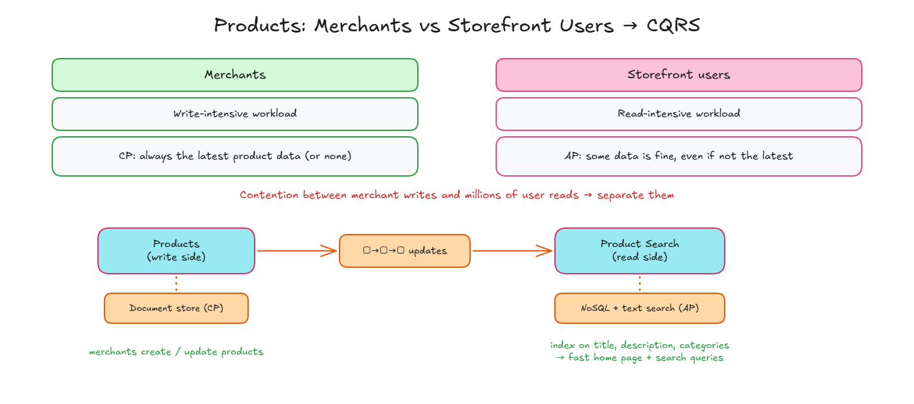
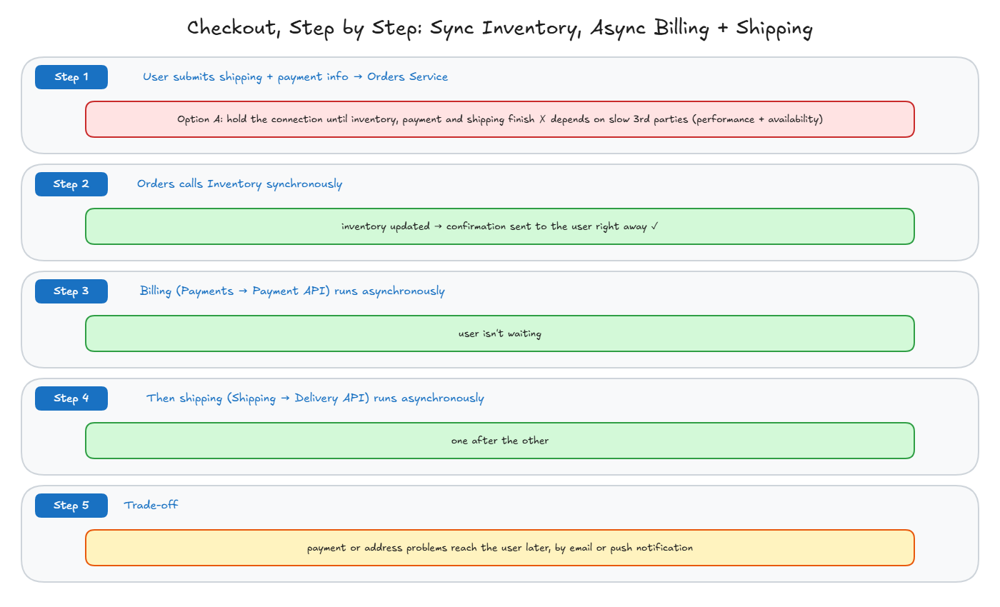
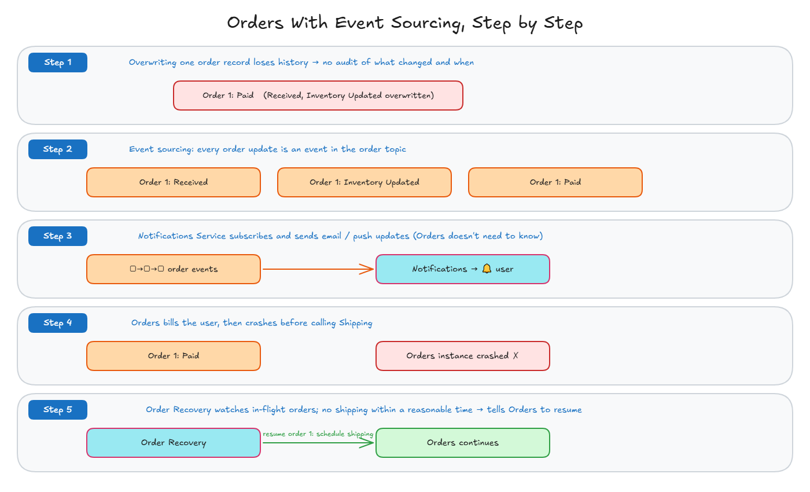
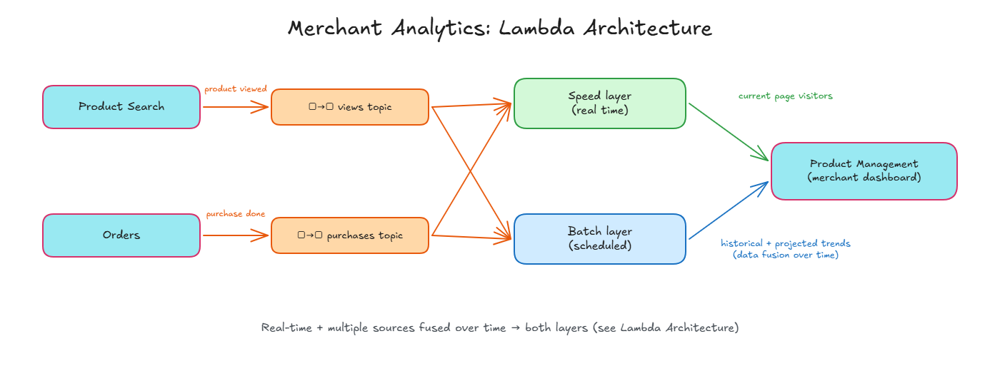
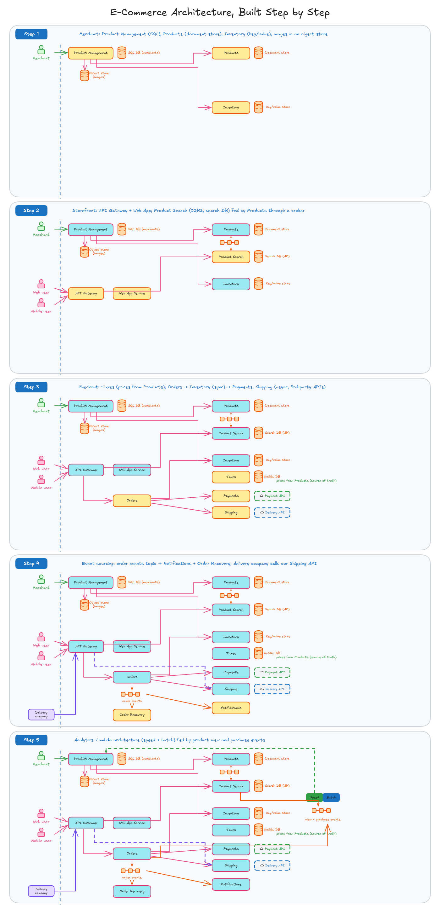
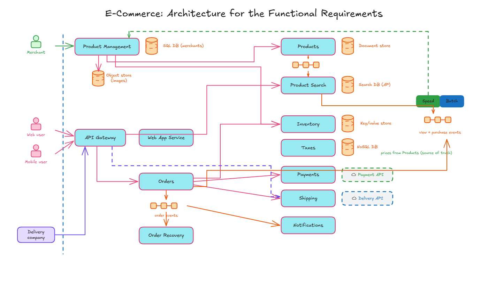

# Design an E-Commerce Marketplace Platform 2 - Functional Diagram

**In this lecture:**

1. Turning the [requirements and sequence diagrams](4.%20Design%20an%20E-Commerce%20Marketplace%20Platform%201%20-%20Requirements%20%26%20Sequence%20Diagram.md) into an **architecture diagram**
2. Merchant side: **Product Management, Products, Inventory**
3. Storefront: **API Gateway**, **CQRS** with a **Product Search** service
4. Checkout: **Taxes, Orders, Payments, Shipping**, sync vs async, **event sourcing**
5. Merchant analytics with the **Lambda architecture**

---

### Reminder: Functional Requirements

| Merchants | Users / Buyers |
|---|---|
| **Product Management System:** sign up, create products, update properties, update inventory, view product data | **Storefront** (web + mobile): browse, search by title/categories/description |
| **Product Analytics:** real-time page visitors, historical/projected performance | **Store Checkout:** bill breakdown with taxes, purchase with shipping + payment info, email/push order updates |

---

### Merchant: Product Management

1. **Product Management Service:** gives merchants a **web-based UI**. New merchants **register**, existing ones **log in**.
   - Merchant info and **credentials** are stored securely in a **SQL database**.
2. **Products Service:** lets a logged-in merchant **add or update** a product.
   - Stores title, description, **price**, additional attributes and **links to images**.
   - Uses a **NoSQL document store**, because different product types have **different optional attributes**.
3. **Object store:** holds the **product images**.
4. **Inventory Service:** stores the **current inventory per product ID** in a **high-performance key/value store**. Merchants can **view and update** inventory at any time.

**Merchant analytics** (requirement 2) is **left until the end**, because it needs data from services not yet created.

---

### Users: Storefront

**Two UIs:**

1. **Browser:** a **Web App Service** (storefront web service) **serves and renders HTML pages**.
2. **Mobile app:** no pages to serve, but we need something that takes **API calls** and sends them to the right service → an **API Gateway**.

All requests go to the **API Gateway**, whatever their origin. Based on the **request type** or **device type**, it routes them to the relevant service.

### The Conflict Over Product Data

We could send product listing and search to the Products Service, but merchants and users have **conflicting needs**:

| Merchants | Storefront users |
|---|---|
| **Write-intensive** (update product info) | **Read-intensive** (only read products) |
| **CP:** always the most up-to-date product data, or none | **AP:** some data is fine, even if not the latest |

We also don't want **contention** (competing for the same resources) between merchants updating products and **millions of users** reading them.

**Solution: the CQRS pattern** (see [Event-Driven Architecture](../007-Software-Architecture-Patterns-and-Styles/4.%20Event%20Driven%20Architecture.md)):

1. A separate **Product Search Service** receives **product updates** from the Products Service through a **message broker**.
2. It stores products in a **read-optimized** database that **favors availability over consistency**.
3. The database is **NoSQL with an efficient text search engine**. An **index** on product **title, description and categories** makes search queries very fast.
4. Every **homepage load** or **product search** goes to the Product Search Service, which already has the data organized and indexed.
5. **Images** are loaded by the front end or mobile app **directly from the object store**.

**Real-world example:** A shop's stockroom ledger (kept exact) vs the printed catalog customers browse (updated a bit later).

---

### Users: Checkout

The **shopping cart is 100% client side**, so we don't care about cart contents until the user **opens the checkout page**.

### Cost Breakdown → Taxes Service

1. A new **Taxes Service** with its own database of **tax-related data**.
2. It calculates tax from the product's **price**, its **type**, and the user's **location** (derived from their **IP address**).
3. Now **consistency matters**, so prices come **directly from the source of truth**: the **Products Service** (not the Product Search copy).
4. Example breakdown: Product A × 3: $21, Product B × 1: $11, Product C × 2: $16, Taxes: $4, **Total: $52**.

### Placing the Order → Orders, Payments, Shipping

New services: **Orders**, **Payments** and **Shipping**. Payments and Shipping wrap the **external 3rd-party** payment and delivery APIs. When the user submits shipping and payment info, the request goes to the **Orders Service**.

**Option A: fully synchronous ✗**

- Hold the user's connection until the **inventory is updated**, the **payment is confirmed** and **shipping is scheduled**.
- **Problem:** we depend on **timely responses from external services** we don't control → a **performance and availability** issue.

**Option B (chosen): sync inventory, async billing and shipping ✓**

1. Send the user a **confirmation** as soon as Orders gets a response from the **Inventory Service** only.
2. Do **billing** and then **shipping asynchronously**, one after the other.
3. **Trade-off:** if there's a **payment problem** or the product **can't be shipped** to that address, the user finds out **only afterwards**, by **email or push notification**.

### Storing Orders → Event Sourcing

**Option:** store the order in a database and **overwrite** the record on every update.

- **Problem:** no complete **audit** of **what** changed and **when**.

**Chosen: the event sourcing pattern.** Every order update is stored as an **event** in a message broker topic (Order 1: Received → Order 1: Inventory Updated → Order 1: Paid → ...).

**Benefits:**

1. **Notifications:** a **Notifications Service** subscribes to the same topic and, for certain updates, sends an **email or push notification** to the user. The Orders Service doesn't even need to know about it (**organizational scalability**).
2. **Order recovery:**
   - **Scenario:** Orders **bills the user**, then the instance **crashes** before updating Shipping.
   - Every update is in the broker **with its timestamp**, so an **Order Recovery Service** subscribes and **watches every in-flight order**.
   - If an active order hasn't reached Shipping within a **reasonable time**, it tells the Orders Service to **continue from where it left off** (e.g. "Resume Order 1 by scheduling shipping").
3. **Delivery updates:** we expose an **API endpoint** for the delivery company. It sends us **shipping updates** (through the API Gateway to Shipping), which the Notifications Service passes on to the user **until final delivery**.

---

### Merchant Analytics → Lambda Architecture

**Requirements:**

1. **Real-time** number of product page visitors
2. **Historical and projected** trends from **multiple sources**

**Data sources:**

- **Page visits** → from the **Product Search Service**
- **Product sales** → from the **Orders Service**

We need **real-time** data **and** data from **multiple sources fused over time**, which is the perfect use case for the [Lambda architecture](../009-Big-Data-Architecture-Patterns/3.%20Lambda%20Architecture.md).

1. When a user **views a product**, Product Search sends an event to a special **topic** in a message broker.
2. When an **order purchase completes**, Orders publishes an event on **another topic**.
3. An **analytics Lambda architecture** receives these events, with two layers:
   - **Speed layer:** real-time data
   - **Batch layer:** runs on a **schedule**
4. **Current visitors** → Product Management queries the **speed layer**.
5. **Views, historical data and projected trends** → it queries the **batch layer**.

---

### The Architecture, Step by Step

### The Final Functional Architecture

| Service | Database | Purpose |
|---|---|---|
| Product Management | SQL | Merchant UI, sign up and login, credentials |
| Products | NoSQL document store (CP) | Source of truth for product info and prices |
| Object store | Blob storage | Product images, loaded directly by clients |
| Inventory | Key/value store | Current stock per product ID |
| Web App + API Gateway | — | HTML pages for the browser; routes all API calls |
| Product Search | NoSQL + text search (AP) | CQRS read side: browsing and search |
| Taxes | NoSQL | Tax from price, product type, user location |
| Orders | Event-sourced (message broker) | Places orders; inventory sync, billing and shipping async |
| Payments, Shipping | — (3rd-party APIs) | Billing and delivery |
| Notifications, Order Recovery | — | Subscribe to order events |
| Analytics | Lambda (speed + batch) | Real-time visitors + historical/projected trends |

---

### Summary

1. **Microservices architecture** for **organizational scalability**: each experience is split across codebases and teams.
2. **CQRS** separates a **write-intensive CP** database (Products) from a **read-intensive AP** database (Product Search).
3. A **NoSQL database with a dedicated text search engine** for efficient product search.
4. A **trade-off between synchronous and asynchronous** processing: billing and shipping are async, for better performance and higher availability.
5. **Event sourcing** for order status: **failure recovery**, **auditing** and **organizational scalability** (Notifications just subscribes).
6. **Lambda architecture** gives merchants **real-time** data plus **batch-processed historic and projected** data from multiple event sources.

These already cover **most non-functional requirements**. The next lecture handles the rest.

---

**Key idea:** Each actor and feature gets its own microservice. CQRS splits the CP Products write side from the AP, text-indexed Product Search read side. Checkout confirms after the synchronous inventory update and bills and ships asynchronously, with orders stored as events so Notifications and Order Recovery can react. Merchant analytics combine real-time and historic data through a Lambda architecture.

---

## Short Note

- **Merchant side:** Product Management (web UI, SQL for merchants) → Products (document store: varying attributes) + object store (images) + Inventory (key/value). Analytics left for last.
- **Storefront:** Web App (HTML for browsers) + **API Gateway** (all API calls, routed by request or device type).
- **CQRS:** merchants = write-heavy + CP, users = read-heavy + AP, contention → Products → broker → **Product Search** (AP NoSQL + text search, index on title/description/categories). Images straight from the object store.
- **Checkout:** cart is client side; **Taxes** (price + type + location from IP; prices from Products = source of truth); **Orders → Inventory (sync) → confirm**, then **Payments, Shipping async** (3rd-party APIs); trade-off: failures reported later by email/push.
- **Event sourcing for orders:** no lost history (audit); **Notifications** subscribes; **Order Recovery** resumes stuck in-flight orders; delivery company sends updates via our API.
- **Analytics = Lambda:** view events (Product Search) + purchase events (Orders) → speed layer (current visitors) + batch layer (historical/projected trends).
