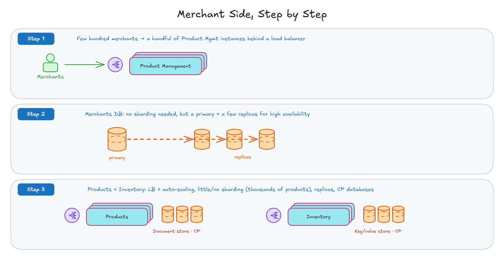
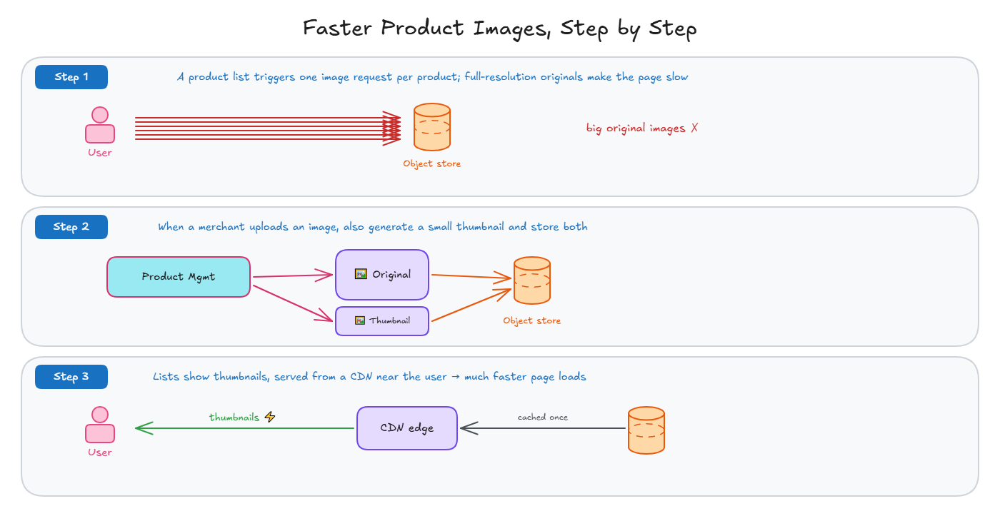
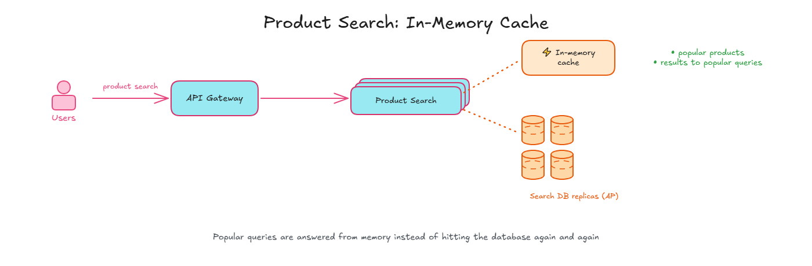
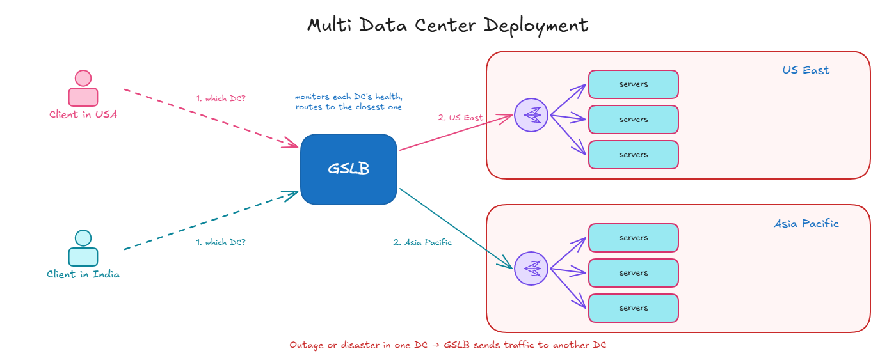
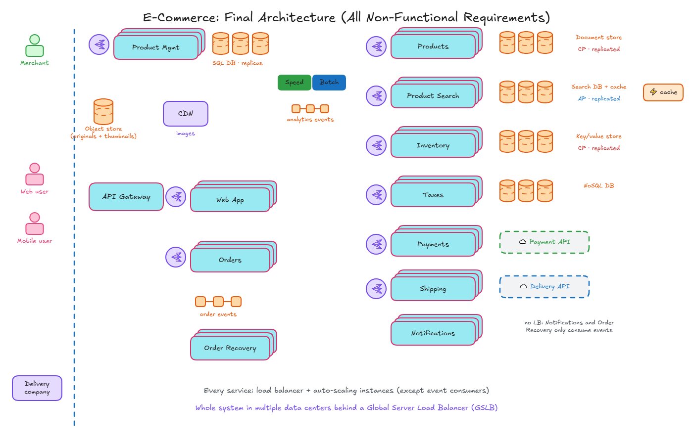

# Design an E-Commerce Marketplace Platform 3 - Final Software Architecture

**In this lecture:**

1. Refining the [functional architecture](5.%20Design%20an%20E-Commerce%20Marketplace%20Platform%202%20-%20Functional%20Diagram.md) for the remaining **non-functional requirements**
2. **Merchants:** load balancers, replicas, CP databases
3. **Storefront users:** auto-scaling, AP replicas, **thumbnails + CDN**, an **in-memory search cache**
4. **Checkout:** async processing and a key/value inventory store
5. **Multi data center deployment** with a global load balancer

---

### Merchants: Non-Functional Requirements

**Reminder:** a **few hundred merchants**, **infrequent** updates, reasonably good **performance**, **consistency** for product and inventory updates, and fairly **high availability** (99.5%).

1. **Product Management Service:**
   - The scale is low, so a **handful of instances** is more than enough, behind a **load balancer**.
2. **Merchants database:**
   - **No sharding** needed for so few merchants.
   - But a **primary and a few replicas** are a **must** for **high availability**.
3. **Products and Inventory services:**
   - Behind **load balancers**, with **automatic auto-scaling** based on their traffic.
   - Only **a few thousand products**, so **little or no sharding** is needed.
   - **Multiple replicas** of each database **prevent data loss** and improve **read performance**.
4. **Consistency:** the Products and Inventory databases are chosen or configured to be **CP**.

---

### Storefront Users and Buyers: Non-Functional Requirements

**Reminder:** **millions of users** in many countries, **very high traffic peaks** (shopping holidays, flash sales), **strict performance** (users have little patience and may **abandon** the store), **availability** for storefront users, **consistency** for buyers, and **very high uptime**, because downtime means a **huge loss of revenue**.

### Scalability and Availability

1. Put **all remaining services behind load balancers**, with **redundancy** and **auto-scaling policies** so the system can **scale out substantially** at peak traffic.
2. **Exception:** **Order Recovery** and **Notifications** need **no load balancer**. They only **subscribe to events** from the message broker and get **no HTTP traffic** directly.
3. **Product Search database:** many search requests → **multiple replicas** on **separate computers**. Availability matters more than consistency here, so the database is chosen or configured as **AP**.
4. **Taxes database:** also **replicated** for higher availability.

### Performance 1: Thumbnails + CDN

1. **Problem:** when a user requests a **list of products**, the browser sends a batch of requests to the **object store** for **each product's image**. Sending the **original full-resolution** images slows the page load **significantly**.
2. **Observation:** in a list, each product image appears **small** on screen. We don't need full resolution.
3. **Solution:**
   - When a merchant **uploads an image**, we also **generate a smaller thumbnail** and store **both** in the object store.
   - Product **lists** show the **thumbnails**, not the originals.
4. On top of this, a **CDN provider** reduces response time even further, delivering images from servers **close to the user**. (See [CDN](../005-Large-Scale-Systems-Architectural-Building-Blocks/7.%20Content%20Delivery%20Network%20-%20CDN.md).)

**Real-world example:** A shopping site's search results show small pictures, and the full-size photo loads only when you open a product.

### Performance 2: In-Memory Cache for Search

1. Some search queries are **very popular**, so running them against the database **again and again** would be unreasonable.
2. Add an **in-memory cache** to the **Product Search Service**, storing:
   - A small list of **popular products**
   - **Results of popular queries**
3. This **significantly speeds up** most search queries.

### Checkout: Already Mostly Done

Most of the work was done in the [previous lecture](5.%20Design%20an%20E-Commerce%20Marketplace%20Platform%202%20-%20Functional%20Diagram.md):

1. Users get a **quick confirmation**. **Billing** and **shipping scheduling** with **third-party APIs** happen **asynchronously**.
2. Orders are stored with an **event-driven architecture**, so a **high spike in purchases** is easy to handle. Orders are **buffered in the message broker** and processed **as fast as** the external payment and shipping services can handle.
3. The **Inventory** database is a **key/value store**, which is already **very fast** because of its **simple structure** and **lack of schema**.

---

### Multi Data Center Deployment

As the final step for **performance and availability**:

1. Run the system in **multiple data centers** worldwide (e.g. **US East**, **Asia Pacific**).
2. A **global load balancing service (GSLB)** sends each user to the **closest data center**, based on location (a client in the USA → US East, a client in India → Asia Pacific).
3. The GSLB **constantly monitors the health** of each data center. If one has a **power outage** or a **natural disaster**, traffic **falls back** to another data center.

---

### The Final Architecture

| Area | Technique |
|---|---|
| Merchant scale | Few Product Management instances behind an LB; merchants DB: primary + replicas, no sharding |
| Products, Inventory | LB + auto-scaling; replicated **CP** databases; little or no sharding |
| Storefront scale | LB + auto-scaling for all services (not event consumers) |
| Product Search | Replicated **AP** search DB + **in-memory cache** |
| Images | **Thumbnails** + **CDN** |
| Checkout | Async billing and shipping; orders buffered in the broker; fast key/value inventory |
| Global availability | **Multiple data centers** + **GSLB** with health monitoring and failover |

---

### Conclusion

We now have a **fully scalable, highly available and fast** e-commerce marketplace, **distributed across multiple geographical locations**, serving **tens of millions of users**.

More importantly, we now have the **process and skills** to design **any** system, starting from **general, non-technical requirements** all the way to a **complete software architecture**.

---

**Key idea:** The low-scale merchant side only needs a few load-balanced instances and replicated CP databases. The huge storefront side needs auto-scaling everywhere, replicated AP search with an in-memory cache, and thumbnails served from a CDN. Checkout already scales through async, event-driven processing, and multiple data centers behind a GSLB give global speed and disaster failover.

---

## Short Note

- **Merchants:** a handful of Product Management instances + LB; merchants DB: primary + replicas (no sharding); Products and Inventory: LB + auto-scaling, little/no sharding, replicas, **CP**.
- **Storefront:** every service behind LB + auto-scaling (except **Notifications** and **Order Recovery**: event consumers, no HTTP); Product Search DB replicated + **AP**; Taxes DB replicated.
- **Images:** generate a **thumbnail** on upload, show thumbnails in lists + **CDN**.
- **Search:** **in-memory cache** for popular products and popular query results.
- **Checkout:** already handled: quick confirmation, async 3rd-party billing and shipping, orders buffered in the broker during spikes, fast schemaless **key/value** inventory.
- **Multi data center + GSLB:** route to the closest DC; health monitoring → failover on outage or disaster.
